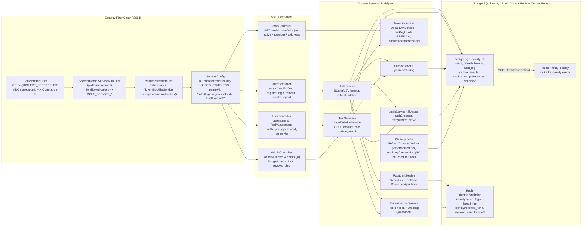
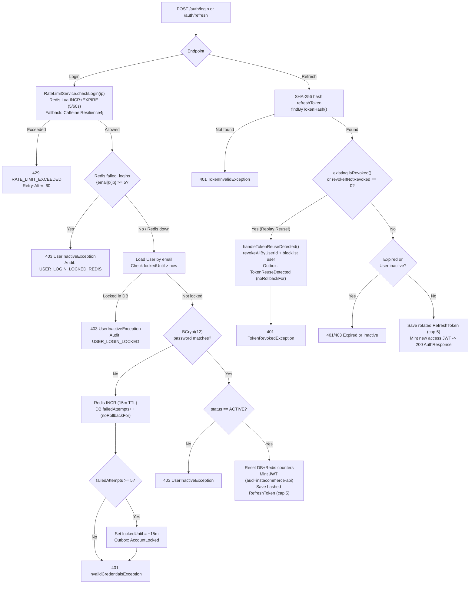
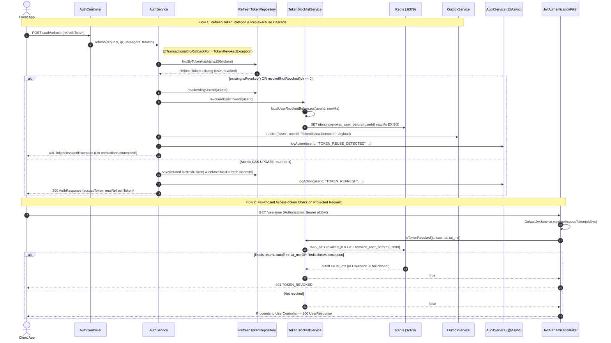

# `identity-service` — Code Walkthrough

> [!NOTE]
> **Part of the InstaCommerce Onboarding Suite:** [Onboarding Hub](../../README.md) · [Code Walkthrough Atlas](../README.md) · [Domain & Event Catalog (`05`)](../../05-domain-model-and-event-catalog.md) · [Incident Drills & Exam (`06`)](../../06-incident-drills-and-readiness-exam.md) · [Dependency Matrix & Cheatsheet (`07`)](../../07-service-dependency-and-command-cheatsheet.md)

> **Module:** `:services:identity-service` · **Port:** `:8081` (`SERVER_PORT`) · **Runtime:** Java 21, Spring Boot `4.0.0` (MVC), Spring Data JPA, Flyway (`V1`–`V13`), BCrypt (`12`), JJWT, MapStruct, Redis, Resilience4j, ShedLock, `libs/platform-common`
>
> **Scope & Verification:** Verified directly against all Java sources, SQL migrations (`V1`–`V13`), and YAML configs under [`services/identity-service/`](../../../../services/identity-service/build.gradle.kts#L1-L44), [`libs/platform-common/`](../../../../libs/platform-common/src/main/java/com/instacommerce/platform/security/SharedInternalServiceAuthFilter.java#L1-L116), [`deploy/helm/values.yaml`](../../../../deploy/helm/values.yaml#L484-L615), and [`monitoring/error-budget-policy.yaml`](../../../../monitoring/error-budget-policy.yaml#L5-L13) (**Tier 0**: `99.9%` availability, `500ms` p99).

---

## 1. Purpose, Boundaries & Package Tree

`identity-service` is the single write authority for customer and operator credentials, RS256 JWT minting, multi-key JWKS publishing, SHA-256 hashed refresh-token rotation with replay-reuse cascade revocation, distributed rate limiting and lockout, fail-closed access-token revocation, notification opt-out storage, and GDPR account erasure.

```text
services/identity-service/
├── build.gradle.kts                                    # MVC, JPA, Flyway, Redis, Resilience4j, ShedLock, MapStruct
└── src/main/
    ├── resources/
    │   ├── application.yml                             # Port 8081, DB/Redis/Resilience4j, 30 allowed-callers
    │   ├── application-local.yml                       # devpass, local-dev-internal-token, OTLP disabled
    │   └── db/migration/V1__... to V13__...            # users, refresh_tokens, audit_log, outbox_events, prefs, shedlock
    └── java/com/instacommerce/identity/
        ├── IdentityServiceApplication.java             # @EnableConfigurationProperties(IdentityProperties.class)
        ├── config/
        │   ├── CorrelationIdFilter.java                # @Order(HIGHEST_PRECEDENCE) MDC + X-Correlation-ID
        │   ├── IdentityProperties.java                 # @Validated @ConfigurationProperties("identity")
        │   ├── JacksonConfig.java                      # ISO-8601 dates
        │   ├── PasswordConfig.java                     # BCryptPasswordEncoder(12)
        │   └── SchedulerConfig.java                    # @EnableScheduling, @EnableAsync, ShedLock, auditExecutor
        ├── security/
        │   ├── SecurityConfig.java                     # @Import(InternalServiceSecurityConfiguration), dual filter chain
        │   ├── JwtAuthenticationFilter.java            # JWT verify + TokenBlocklistService + mergeInternalAuthorities
        │   ├── DefaultJwtService.java                  # RS256 mint (aud=instacommerce-api) + keyLocator verify
        │   ├── JwtKeyLoader.java                       # Active + previousPublicKeys + SHA-256 kid computation
        │   ├── JwksController.java                     # GET /.well-known/jwks.json
        │   ├── RestAuthenticationEntryPoint.java       # 401 ErrorResponse JSON + X-Trace-Id
        │   └── RestAccessDeniedHandler.java            # 403 ErrorResponse JSON + X-Trace-Id
        ├── controller/
        │   ├── AuthController.java                     # /auth & /api/v1/auth: register, login, refresh, revoke, logout
        │   ├── UserController.java                     # /users/me & /api/v1/users/me: profile, prefs, password, delete
        │   └── AdminController.java                    # /admin/users/** & /users/{id}: list, get, unlock, revoke, roles
        ├── service/
        │   ├── AuthService.java                        # Register, login lockout, CAS refresh rotation + reuse cascade
        │   ├── UserService.java                        # Profile, password change, role updates, Redis SCAN unlock
        │   ├── UserDeletionService.java                # GDPR anonymization + UserErased outbox
        │   ├── RateLimitService.java                   # Redis Lua INCR/EXPIRE + Caffeine Resilience4j fallback
        │   ├── TokenBlocklistService.java              # Fail-closed Redis + local 4096-entry cutoff & JTI maps
        │   ├── TokenService.java                       # SecureRandom 64B refresh tokens + SHA-256 hex digest
        │   ├── OutboxService.java                      # Propagation.MANDATORY outbox_events writer
        │   ├── AuditService.java                       # @Async("auditExecutor") + Propagation.REQUIRES_NEW
        │   ├── NotificationPreferenceService.java      # Default-false opt-out CRUD
        │   └── *CleanupJob.java (3 jobs)               # RefreshToken, Outbox (@SchedulerLock), AuditLog (unlocked!)
        ├── domain/model/                               # User, RefreshToken, AuditLog, OutboxEvent, NotificationPreference, Role
        ├── repository/                                 # JPA repositories (atomic CAS queries on RefreshTokenRepository)
        ├── exception/                                  # ApiException hierarchy, GlobalExceptionHandler, TraceIdProvider
        ├── infrastructure/metrics/AuthMetrics.java     # auth.login.total, auth.register/refresh/revoke.total, duration
        └── util/RequestContextUtil.java                # RFC1918/GCP/ULA CIDR right-to-left X-Forwarded-For parser
```

- [IdentityServiceApplication.java](../../../../services/identity-service/src/main/java/com/instacommerce/identity/IdentityServiceApplication.java#L8-L14)
- [SecurityConfig.java](../../../../services/identity-service/src/main/java/com/instacommerce/identity/security/SecurityConfig.java#L22-L78)
- [AuthService.java](../../../../services/identity-service/src/main/java/com/instacommerce/identity/service/AuthService.java#L40-L393)
- [TokenBlocklistService.java](../../../../services/identity-service/src/main/java/com/instacommerce/identity/service/TokenBlocklistService.java#L21-L186)

---

## 2. Internal Architecture & Trust Boundaries

**identity-service LLD architecture** — *[Rendered PNG](../diagrams/services/identity-service-arch-lld.png) · [Mermaid Source](../diagrams/services/identity-service-arch-lld.mmd)*



### Key Runtime Boundaries

- **Only Full Caller of `SharedInternalServiceAuthFilter`:** [`SecurityConfig`](../../../../services/identity-service/src/main/java/com/instacommerce/identity/security/SecurityConfig.java#L25) imports `InternalServiceSecurityConfiguration` and [`application.yml`](../../../../services/identity-service/src/main/resources/application.yml#L105-L135) populates all **30** service tokens under `internal.service.allowed-callers`.
- **Key Rotation & JWKS Discovery:** [`JwtKeyLoader`](../../../../services/identity-service/src/main/java/com/instacommerce/identity/security/JwtKeyLoader.java#L36-L90) parses the active private key (deriving the public key from `RSAPrivateCrtKey` if `publicKey` is blank) plus `previousPublicKeys`, computes deterministic `kid = Base64URL_noPad(SHA-256(unsignedModulus || unsignedExponent))`, and publishes `kty: RSA, alg: RS256` entries on [`JwksController`](../../../../services/identity-service/src/main/java/com/instacommerce/identity/security/JwksController.java#L23-L37).
- **Async Audit Pool vs Mandatory Outbox:** [`AuditService.logAction`](../../../../services/identity-service/src/main/java/com/instacommerce/identity/service/AuditService.java#L20-L40) runs asynchronously on `auditExecutor` (`core=2`, `max=5`, `queue=500`, `REQUIRES_NEW`) so audit logs survive `noRollbackFor` auth exceptions, while [`OutboxService.publish`](../../../../services/identity-service/src/main/java/com/instacommerce/identity/service/OutboxService.java#L22-L37) uses `Propagation.MANDATORY` to guarantee atomic commit with business state.

---

## 3. Startup, Configuration Properties & Security Filter Chain

1. **Startup Validation ([`IdentityProperties.java`](../../../../services/identity-service/src/main/java/com/instacommerce/identity/config/IdentityProperties.java#L9-L113)):** Annotated `@Validated`, enforcing `@NotBlank` on both `identity.jwt.publicKey` and `identity.jwt.privateKey`. Token defaults: `accessTtlSeconds = 900`, `refreshTtlSeconds = 604800`, `maxRefreshTokens = 5`, `issuer = "instacommerce-identity"`.
2. **Filter Order ([`SecurityConfig.java`](../../../../services/identity-service/src/main/java/com/instacommerce/identity/security/SecurityConfig.java#L33-L63)):**
   - [`CorrelationIdFilter`](../../../../services/identity-service/src/main/java/com/instacommerce/identity/config/CorrelationIdFilter.java#L15-L38) runs at `HIGHEST_PRECEDENCE`.
   - Inside `SecurityFilterChain`, both [`SharedInternalServiceAuthFilter`](../../../../libs/platform-common/src/main/java/com/instacommerce/platform/security/SharedInternalServiceAuthFilter.java#L63-L93) (`#L60`) and [`JwtAuthenticationFilter`](../../../../services/identity-service/src/main/java/com/instacommerce/identity/security/JwtAuthenticationFilter.java#L32-L158) (`#L61`) are added before `UsernamePasswordAuthenticationFilter`. Because `SharedInternalServiceAuthFilter` is registered first, it sets `ROLE_INTERNAL_SERVICE` and `ROLE_SERVICE_<CALLER>` when `X-Internal-Service` + `X-Internal-Token` validate.
   - `JwtAuthenticationFilter.shouldNotFilter` skips `/auth/{login,register,refresh}`, `/api/v1/auth/{login,register,refresh}`, `/.well-known/**`, `/actuator/**`, and `/error`. When a Bearer token is present, it validates the signature, calls `tokenBlocklistService.isTokenRevoked(...)` (returning `401 TOKEN_REVOKED` on match or Redis failure), and calls [`mergeInternalAuthorities`](../../../../services/identity-service/src/main/java/com/instacommerce/identity/security/JwtAuthenticationFilter.java#L138-L157) to preserve `ROLE_INTERNAL_SERVICE` and `ROLE_SERVICE_*` alongside user roles.
3. **Authorization Rules & RBAC Matrix:**
   - `permitAll()`: `/auth/{login,register,refresh}`, `/api/v1/auth/{login,register,refresh}`, `/.well-known/**`, `/actuator/**`, `/error`.
   - `GET /users/{id}`, `/users/{id}/notification-preferences`, `/admin/users/{id}` (+ `/api/v1/users/*`): `ADMIN`, `SUPER_ADMIN`, or `INTERNAL_SERVICE` (matching `@PreAuthorize` on [`AdminController`](../../../../services/identity-service/src/main/java/com/instacommerce/identity/controller/AdminController.java#L42-L86)).
   - `/admin/**`, `/api/v1/admin/**`: `ADMIN` or `SUPER_ADMIN`.

---

## 4. Data Model, Flyway `V1`–`V13` & Redis / Locking Invariants

### PostgreSQL Schema (`identity_db`)

| Migration | Table / Change | Key Columns, Constraints & Indexes |
|---|---|---|
| [`V1`](../../../../services/identity-service/src/main/resources/db/migration/V1__create_users.sql#L1-L17) | `users` | `id UUID PK`, `email VARCHAR(255) UNIQUE`, `password_hash VARCHAR(72)`, `roles VARCHAR[]`, `status CHECK ('ACTIVE','SUSPENDED','DELETED')`, `version BIGINT` (`@Version`), partial active index |
| [`V2`](../../../../services/identity-service/src/main/resources/db/migration/V2__create_refresh_tokens.sql#L1-L13) | `refresh_tokens` | `id UUID PK`, `user_id FK ON DELETE CASCADE`, `token_hash VARCHAR(64) UNIQUE`, `device_info`, `expires_at`, `revoked BOOLEAN`, partial index `WHERE revoked = false` |
| [`V3`](../../../../services/identity-service/src/main/resources/db/migration/V3__create_audit_log.sql#L1-L15), [`V5`](../../../../services/identity-service/src/main/resources/db/migration/V5__update_audit_log_schema.sql#L1-L13), [`V9`](../../../../services/identity-service/src/main/resources/db/migration/V9__drop_duplicate_audit_indexes.sql#L1-L3), [`V13`](../../../../services/identity-service/src/main/resources/db/migration/V13__widen_audit_log_trace_id.sql#L1) | `audit_log` | `id BIGSERIAL PK`, `user_id`, `action VARCHAR(100)`, `entity_type`, `entity_id VARCHAR(100)`, `details JSONB`, `ip_address VARCHAR(45)` (`V8`), `user_agent TEXT`, `trace_id VARCHAR(64)` (`V13`) |
| [`V4`](../../../../services/identity-service/src/main/resources/db/migration/V4__add_user_deletion_fields.sql#L1-L7), [`V8`](../../../../services/identity-service/src/main/resources/db/migration/V8__add_lockout_and_fix_inet.sql#L1-L5) | `users` extensions | `first_name`, `last_name`, `phone`, `deleted_at`, `failed_attempts INTEGER DEFAULT 0`, `locked_until TIMESTAMPTZ` |
| [`V6`](../../../../services/identity-service/src/main/resources/db/migration/V6__create_outbox.sql#L1-L11), [`V11`](../../../../services/identity-service/src/main/resources/db/migration/V11__add_outbox_envelope_fields.sql#L1-L13), [`V12`](../../../../services/identity-service/src/main/resources/db/migration/V12__add_outbox_events_retention_index.sql#L1) | `outbox_events` | `id`, `aggregate_type`, `aggregate_id`, `event_type`, `payload JSONB`, `sent`, `event_id UUID NOT NULL`, `schema_version 'v1'`, `source_service 'identity-service'`, `correlation_id`, `event_timestamp`, `idx_outbox_events_sent_created_at` |
| [`V7`](../../../../services/identity-service/src/main/resources/db/migration/V7__create_notification_preferences.sql#L1-L9) | `notification_preferences` | `user_id UUID PK FK -> users(id) ON DELETE CASCADE`, 4 opt-out booleans |
| [`V10`](../../../../services/identity-service/src/main/resources/db/migration/V10__create_shedlock.sql#L1-L6) | `shedlock` | Standard ShedLock table for `RefreshTokenCleanupJob` and `OutboxCleanupJob` |

### Redis Keyspaces & Concurrency Invariants

- **`identity:ratelimit:{baseName}:{ip}` ([`RateLimitService`](../../../../services/identity-service/src/main/java/com/instacommerce/identity/service/RateLimitService.java#L25-L99)):** Atomic Lua script `INCR` + conditional `EXPIRE` on count `== 1`. Enforces `loginLimiter` (`5/60s`) and `registerLimiter` (`3/60s`). Falls back to per-IP Resilience4j limiters cached in Caffeine (`10,000` keys, `5m` idle eviction) if Redis fails.
- **`identity:failed_logins:{email}:{ip}` ([`AuthService`](../../../../services/identity-service/src/main/java/com/instacommerce/identity/service/AuthService.java#L133-L240)):** Incremented on bad password (`15m` TTL), checked prior to DB query, cleared on success, and scanned/deleted in batches of `100` by [`UserService.unlockUser`](../../../../services/identity-service/src/main/java/com/instacommerce/identity/service/UserService.java#L227-L250).
- **`identity:revoked_jti:{jti}` & `identity:revoked_user_before:{userId}` ([`TokenBlocklistService`](../../../../services/identity-service/src/main/java/com/instacommerce/identity/service/TokenBlocklistService.java#L24-L149)):** Writes update both bounded in-memory `ConcurrentHashMap`s (`LOCAL_PRUNE_THRESHOLD = 4096`) and Redis (`TTL = max(60s, accessTtlSeconds)` = `900s`). Redis write failures throw `IllegalStateException`; Redis lookup failures **fail closed** (`return true`).
- **Atomic Refresh CAS ([`RefreshTokenRepository`](../../../../services/identity-service/src/main/java/com/instacommerce/identity/repository/RefreshTokenRepository.java#L20-L26)):** `UPDATE RefreshToken r SET r.revoked = true WHERE r.id = :id AND r.revoked = false` guarantees only one concurrent `POST /auth/refresh` request wins; losers receive `0` rows updated and trigger reuse detection.

---

## 5. Core Execution Paths & Call-Stack Trace

**identity-service login and refresh-reuse flowchart** — *[Rendered PNG](../diagrams/services/identity-service-flowchart.png) · [Mermaid Source](../diagrams/services/identity-service-flowchart.mmd)*



**identity-service refresh reuse and fail-closed revocation sequence** — *[Rendered PNG](../diagrams/services/identity-service-sequence.png) · [Mermaid Source](../diagrams/services/identity-service-sequence.mmd)*



### Method-by-Method Trace: Refresh Reuse Cascade & Access-Token Revocation

1. Client calls [`AuthController.refresh`](../../../../services/identity-service/src/main/java/com/instacommerce/identity/controller/AuthController.java#L51-L58), which resolves client IP via [`RequestContextUtil.resolveIp`](../../../../services/identity-service/src/main/java/com/instacommerce/identity/util/RequestContextUtil.java#L34-L82) (walking `X-Forwarded-For` right-to-left only if `remoteAddr` is in `DEFAULT_TRUSTED_PROXY_STRINGS`).
2. [`AuthService.refresh`](../../../../services/identity-service/src/main/java/com/instacommerce/identity/service/AuthService.java#L264-L306) opens `@Transactional(noRollbackFor = TokenRevokedException.class)`.
3. Computes SHA-256 of the raw token via [`TokenService.hashRefreshToken`](../../../../services/identity-service/src/main/java/com/instacommerce/identity/service/TokenService.java#L34-L46) and queries `refreshTokenRepository.findByTokenHash(refreshHash)`.
4. If `existing.isRevoked()` is already true, or if `refreshTokenRepository.revokeIfNotRevoked(existing.getId())` returns `0` (concurrent race), [`handleTokenReuseDetected`](../../../../services/identity-service/src/main/java/com/instacommerce/identity/service/AuthService.java#L308-L329):
   - Executes `refreshTokenRepository.revokeAllByUserId(userId)` (bulk DB revocation).
   - Calls `tokenBlocklistService.revokeAllUserTokens(userId)` (records `nowMillis` cutoff in `localUserRevokedBefore` + Redis `SET identity:revoked_user_before:{userId}`).
   - Publishes `"TokenReuseDetected"` via `outboxService.publish(...)` and logs `"TOKEN_REUSE_DETECTED"` asynchronously via `auditService.logAction(...)`.
   - Throws `TokenRevokedException` (`401`); because of `noRollbackFor`, all DB revocations and outbox writes **commit**.
5. On normal refresh (`updated == 1`), `AuthService` saves a newly hashed `RefreshToken`, calls `enforceMaxRefreshTokens(userId)` (deleting oldest active tokens above `5`), mints a fresh RS256 access token (`aud: "instacommerce-api"`, `iat_ms`, `jti`, `kid`) via [`DefaultJwtService.generateAccessToken`](../../../../services/identity-service/src/main/java/com/instacommerce/identity/security/DefaultJwtService.java#L31-L48), and returns `AuthResponse`.
6. Subsequent calls using any earlier access token hit `JwtAuthenticationFilter` -> [`TokenBlocklistService.isTokenRevoked`](../../../../services/identity-service/src/main/java/com/instacommerce/identity/service/TokenBlocklistService.java#L107-L149), which rejects if `issuedAtMillis <= revokedBeforeMillis` (or if Redis throws) with `401 TOKEN_REVOKED`.

### Other Key Write Flows

- **Login & Lockout ([`AuthService.login`](../../../../services/identity-service/src/main/java/com/instacommerce/identity/service/AuthService.java#L128-L262)):** Uses `@Transactional(noRollbackFor = {InvalidCredentialsException.class, UserInactiveException.class})` so `users.failed_attempts`, `locked_until` (`5` failures -> `15` min lock), and `AccountLocked` outbox rows persist even when throwing `401`/`403`.
- **GDPR Erasure ([`UserDeletionService.initiateErasure`](../../../../services/identity-service/src/main/java/com/instacommerce/identity/service/UserDeletionService.java#L46-L75)):** Anonymizes `email` (`deleted-{id}@anonymized.local`), `firstName` (`"DELETED"`), `lastName` (`"USER"`), `phone` (`null`), `passwordHash` (`"[REDACTED]"`), sets `UserStatus.DELETED` and `deletedAt`, deletes all `refresh_tokens`, revokes all access tokens, and publishes `"UserErased"`.

---

## 6. Outbox, Cleanup Jobs & Error Handling

- **Outbox Events (`identity.events`):** `OutboxEvent` ([`OutboxEvent.java`](../../../../services/identity-service/src/main/java/com/instacommerce/identity/domain/model/OutboxEvent.java#L57-L74)) initializes `eventId`, `schemaVersion="v1"`, `sourceService="identity-service"`, and `eventTimestamp`. Emitted event types: `UserRegistered`, `AccountLocked`, `TokenReuseDetected`, `UserLoggedOut`, `UserErased`, `AccountUnlocked`, and `UserSessionsRevoked` — relayed externally by `outbox-relay-identity` ([`values.yaml`](../../../../deploy/helm/values.yaml#L993-L1014)).
- **Scheduled Cleanup Jobs:**
  - [`RefreshTokenCleanupJob`](../../../../services/identity-service/src/main/java/com/instacommerce/identity/service/RefreshTokenCleanupJob.java#L23-L29): cron `0 30 3 * * *`, `7d` retention, `@SchedulerLock(name = "refresh-token-cleanup")`.
  - [`OutboxCleanupJob`](../../../../services/identity-service/src/main/java/com/instacommerce/identity/service/OutboxCleanupJob.java#L24-L31): cron `0 0 */6 * * *`, `7d` retention, `@SchedulerLock(name = "outbox-cleanup")`.
  - [`AuditLogCleanupJob`](../../../../services/identity-service/src/main/java/com/instacommerce/identity/service/AuditLogCleanupJob.java#L22-L27): cron `0 0 3 * * *`, `730d` retention, **no `@SchedulerLock`**.
- **Error Contract ([`GlobalExceptionHandler`](../../../../services/identity-service/src/main/java/com/instacommerce/identity/exception/GlobalExceptionHandler.java#L23-L93)):** Returns custom `ErrorResponse(code, message, traceId, timestamp, details)` (not RFC 7807 `ProblemDetail`) with `Retry-After: 60` on `RequestNotPermitted` (`429`).

---

## 7. Config Matrix, Metrics, Tests & Verified Bugs / Drift

### Configuration Matrix

| Property / Env Var | `application.yml` Default | Local / Helm Notes |
|---|---|---|
| `SERVER_PORT` | `8081` | Helm sets `"8081"` |
| `IDENTITY_DB_URL` / `PASSWORD` | `jdbc:postgresql://localhost:5432/identity_db` / `${sm://db-password-identity:${IDENTITY_DB_PASSWORD}}` | `local`: `devpass`; Helm uses Cloud SQL `identity_db` |
| `REDIS_HOST` / `REDIS_PORT` | `localhost` / `6379` (`1000ms` timeout) | **Omitted** in Helm [`values.yaml`](../../../../deploy/helm/values.yaml#L484-L615) |
| `IDENTITY_ACCESS_TTL` / `REFRESH_TTL` / `MAX_REFRESH_TOKENS` | `900` / `604800` / `5` | 15m access, 7d refresh, max 5 active sessions |
| `IDENTITY_JWT_ISSUER` / `PUBLIC_KEY` / `PRIVATE_KEY` | `instacommerce-identity` / `sm://jwt-rsa-*` | Required (`@NotBlank`); `previousPublicKeys` optional |
| `internal.service.allowed-callers` | 30 per-service env vars (`*_SERVICE_TOKEN`) | Mounted from `service-tokens` K8s Secret in Helm |

### Metrics

- [`AuthMetrics`](../../../../services/identity-service/src/main/java/com/instacommerce/identity/infrastructure/metrics/AuthMetrics.java#L17-L32): `auth.login.total{result=success|failure}`, `auth.register.total`, `auth.refresh.total`, `auth.revoke.total`, `auth.login.duration`.
- [`TokenBlocklistService`](../../../../services/identity-service/src/main/java/com/instacommerce/identity/service/TokenBlocklistService.java#L46-L51): `auth.token.blocklist.redis.failures{operation=write|lookup}`.

### Narrow Test & Build Commands

```bash
./gradlew :services:identity-service:test
./gradlew :services:identity-service:test --tests "com.instacommerce.identity.service.AuthServiceRefreshAndLockoutTest"
./gradlew :services:identity-service:spotlessCheck :services:identity-service:bootJar
```

### Verified Code-Level Bugs & Doc-vs-Code Drift

1. **Security Bug — `ROLE_ADMIN` Privilege Escalation to `SUPER_ADMIN`:** [`AdminController.updateUserRoles`](../../../../services/identity-service/src/main/java/com/instacommerce/identity/controller/AdminController.java#L78-L86) allows `@PreAuthorize("hasAnyRole('ADMIN', 'SUPER_ADMIN')")` and [`UserService.updateUserRoles`](../../../../services/identity-service/src/main/java/com/instacommerce/identity/service/UserService.java#L183-L217) accepts any [`Role`](../../../../services/identity-service/src/main/java/com/instacommerce/identity/domain/model/Role.java#L3-L10) enum value including `SUPER_ADMIN`, allowing an `ADMIN` caller to promote any user (or themselves) to `SUPER_ADMIN`.
2. **Security Bug — Unknown `kid` Falls Back to Active Public Key:** [`DefaultJwtService.validateAccessToken`](../../../../services/identity-service/src/main/java/com/instacommerce/identity/security/DefaultJwtService.java#L51-L68) falls back to `keyLoader.getPublicKey()` whenever `keyLoader.getVerificationKey(kid)` returns `null`, unlike `platform-common`'s [`JwtTokenVerifier`](../../../../libs/platform-common/src/main/java/com/instacommerce/platform/security/JwtTokenVerifier.java#L51-L56) which rejects unknown `kid`s.
3. **Audience Coupling (`aud: "instacommerce-api"`):** [`DefaultJwtService.generateAccessToken`](../../../../services/identity-service/src/main/java/com/instacommerce/identity/security/DefaultJwtService.java#L43) hardcodes `aud: "instacommerce-api"` for all roles (including `ADMIN`/`SUPER_ADMIN`), conflicting with [`ADR-011`](../../../../docs/adr/011-admin-gateway-auth-model.md#L29-L36) and Istio `admin-gateway-rbac-policy` requiring `aud == "instacommerce-admin"` ([`values.yaml`](../../../../deploy/helm/values.yaml#L143-L154)).
4. **Missing `@SchedulerLock` on `AuditLogCleanupJob`:** [`AuditLogCleanupJob.purgeExpiredLogs`](../../../../services/identity-service/src/main/java/com/instacommerce/identity/service/AuditLogCleanupJob.java#L22-L27) lacks `@SchedulerLock`, causing all replicas to run competing `DELETE FROM audit_log` statements at `03:00`.
5. **Missing `REDIS_HOST` in Helm `values.yaml`:** [`values.yaml`](../../../../deploy/helm/values.yaml#L484-L615) omits `REDIS_HOST` for `identity-service`, causing pods to target `localhost:6379` unless overridden — which causes `TokenBlocklistService.isTokenRevoked` to **fail closed** (`401 TOKEN_REVOKED`) on any Redis lookup exception whenever `StringRedisTemplate` is auto-configured.
6. **Stale `README.md`:** [`services/identity-service/README.md`](../../../../services/identity-service/README.md#L1-L864) lists `V1`–`V12` (missing `V13` `trace_id VARCHAR(64)`), claims lockout threshold is `10` attempts (actual: `5`), claims only `UserErased` emits outbox events (actual: 7 event types), and lists already-implemented Redis rate limiting, reuse cascade, and `previousPublicKeys` as unimplemented.

---

**Previous:** [mobile-bff-service](./mobile-bff-service.md) | **Atlas Hub:** [Code Walkthrough Atlas](../README.md) | **Next:** [admin-gateway-service](./admin-gateway-service.md)
