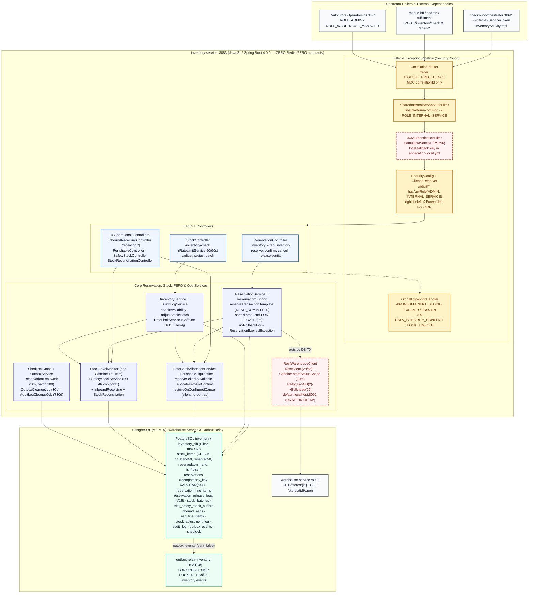
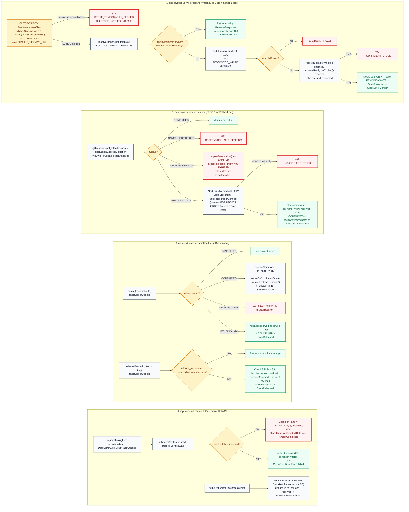
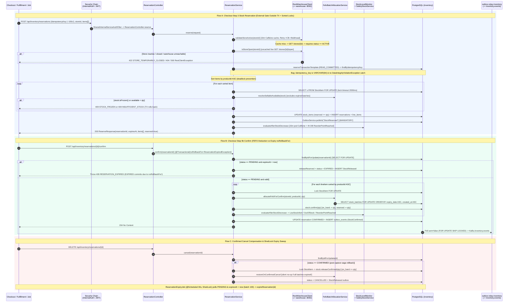

# `inventory-service` — Code Walkthrough (`:8083`)

> [!NOTE]
> **Part of the InstaCommerce Onboarding Suite:** [Onboarding Hub](../../README.md) · [Code Walkthrough Atlas](../README.md) · [Domain & Event Catalog (`05`)](../../05-domain-model-and-event-catalog.md) · [Incident Drills & Exam (`06`)](../../06-incident-drills-and-readiness-exam.md) · [Dependency Matrix & Cheatsheet (`07`)](../../07-service-dependency-and-command-cheatsheet.md)

> **Service Identity Card**
>
> | Attribute | Verified Reality | Source |
> |---|---|---|
> | **Stack** | Java 21 / Spring Boot 4.0.0 (`:services:inventory-service`, `:libs:platform-common`) — **Zero Redis, Zero `:contracts` dependency** | [build.gradle.kts](../../../../services/inventory-service/build.gradle.kts#L1-L41) |
> | **HTTP Port & Probes** | `8083` (`${SERVER_PORT:8083}`); Liveness `/actuator/health/liveness`, Readiness `/actuator/health/readiness` (`readinessState,db`) | [application.yml](../../../../services/inventory-service/src/main/resources/application.yml#L1-L82), [Dockerfile](../../../../services/inventory-service/Dockerfile#L8-L11) |
> | **Primary Storage & Caches** | PostgreSQL (`inventory` local / `inventory_db` Helm), Flyway `V1`–`V15`, HikariCP (`max=60`, `min=15`, `leakDetection=30s`) + **pod-local Caffeine caches only** (`RestWarehouseClient` `10m`, `StockLevelMonitor` `1h`, `RateLimitService` `5m`) | [application.yml](../../../../services/inventory-service/src/main/resources/application.yml#L18-L35), [RestWarehouseClient.java](../../../../services/inventory-service/src/main/java/com/instacommerce/inventory/client/RestWarehouseClient.java#L57-L60) |
> | **Kafka Topics** | **Publishes via Outbox Relay:** `inventory.events` (`outbox-relay-inventory` `:8103`) · **Consumes:** none | [TopicNames.java](../../../../contracts/src/main/java/com/instacommerce/contracts/topics/TopicNames.java#L22), [values.yaml](../../../../deploy/helm/values.yaml#L971-L991) |
> | **Synchronous Dependencies** | **Outbound:** `warehouse-service` (`:8092`) via `RestWarehouseClient` (`GET /stores/{id}`, `GET /stores/{id}/open`) · **Inbound:** `checkout-orchestrator-service`, `fulfillment-service`, `order-service`, `mobile-bff-service`, `admin-gateway-service`, `search-service`, `warehouse-service`, `ai-orchestrator-service` | [RestWarehouseClient.java](../../../../services/inventory-service/src/main/java/com/instacommerce/inventory/client/RestWarehouseClient.java#L113-L164), [values.yaml](../../../../deploy/helm/values.yaml#L227-L236) |
> | **Helm Keys & Scaling** | `inventory-service` (`replicas: 2`, prod `3`, HPA `2–6` at `70%` CPU) + `outbox-relay-inventory` (`replicas: 1`) | [values.yaml](../../../../deploy/helm/values.yaml#L633-L647), [values-prod.yaml](../../../../deploy/helm/values-prod.yaml#L14-L16) |
> | **SLO Tier** | **Tier 1** — `99.5%` availability / `1000ms` P99 (`216m`/30d budget); Wave-40 alert labeled `tier-2` | [error-budget-policy.yaml](../../../../monitoring/error-budget-policy.yaml#L15-L27), [wave-40-complete-slo-alerts.yml](../../../../prometheus/rules/wave-40-complete-slo-alerts.yml#L290-L303) |
> | **Bounded Context Role** | Sole ACID authority for per-SKU per-dark-store two-bucket stock (`on_hand`, `reserved`, `is_frozen`), deadlock-free reservations, FEFO perishable batch deduction/liquidation, Z-score safety buffers, pallet ASN receiving, and cycle-count drift reconciliation. | [ReservationService.java](../../../../services/inventory-service/src/main/java/com/instacommerce/inventory/service/ReservationService.java#L46-L326), [StockItem.java](../../../../services/inventory-service/src/main/java/com/instacommerce/inventory/domain/model/StockItem.java#L17-L163) |

---

## 1. Service Boundaries & Package Tree

`inventory-service` is the authoritative ledger for dark-store SKU quantities and holds. Unlike `cart-service` or `pricing-service`, it has **zero Redis dependency** (not in `build.gradle.kts`, not in `values.yaml`), **zero `:contracts` dependency**, and **no Kafka client**—all domain events write transactionally to `outbox_events` and are relayed by Go `outbox-relay-inventory`. It delegates store metadata/hours checks synchronously to `warehouse-service` before opening reservation transactions.

### Package & Resource Tree (`services/inventory-service`)

| Layer | Files | Responsibility |
|---|---|---|
| **Bootstrap** | [InventoryServiceApplication.java](../../../../services/inventory-service/src/main/java/com/instacommerce/inventory/InventoryServiceApplication.java#L9-L15) | `@SpringBootApplication`, `@EnableConfigurationProperties({InventoryProperties.class, ReservationProperties.class})` |
| **Controllers (6)** | [ReservationController.java](../../../../services/inventory-service/src/main/java/com/instacommerce/inventory/controller/ReservationController.java#L21-L69), [StockController.java](../../../../services/inventory-service/src/main/java/com/instacommerce/inventory/controller/StockController.java#L22-L66), [InboundReceivingController.java](../../../../services/inventory-service/src/main/java/com/instacommerce/inventory/controller/InboundReceivingController.java#L21-L64), [PerishableController.java](../../../../services/inventory-service/src/main/java/com/instacommerce/inventory/controller/PerishableController.java#L21-L65), [SafetyStockController.java](../../../../services/inventory-service/src/main/java/com/instacommerce/inventory/controller/SafetyStockController.java#L19-L65), [StockReconciliationController.java](../../../../services/inventory-service/src/main/java/com/instacommerce/inventory/controller/StockReconciliationController.java#L20-L62) | Reservation saga endpoints (`/inventory` & `/api/inventory`), rate-limited `/check` + `/adjust*`, ASN receiving, perishable batches/markdowns/write-offs, safety buffers, cycle-count freeze/unfreeze |
| **Services & Jobs** | [ReservationService.java](../../../../services/inventory-service/src/main/java/com/instacommerce/inventory/service/ReservationService.java#L46-L326), [ReservationSupport.java](../../../../services/inventory-service/src/main/java/com/instacommerce/inventory/service/ReservationSupport.java#L26-L236), [InventoryService.java](../../../../services/inventory-service/src/main/java/com/instacommerce/inventory/service/InventoryService.java#L39-L305), [FefoBatchAllocationService.java](../../../../services/inventory-service/src/main/java/com/instacommerce/inventory/service/FefoBatchAllocationService.java#L15-L94), [StockLevelMonitor.java](../../../../services/inventory-service/src/main/java/com/instacommerce/inventory/service/StockLevelMonitor.java#L20-L136), [SafetyStockService.java](../../../../services/inventory-service/src/main/java/com/instacommerce/inventory/service/SafetyStockService.java#L24-L183), [InboundReceivingService.java](../../../../services/inventory-service/src/main/java/com/instacommerce/inventory/service/InboundReceivingService.java#L27-L239), [PerishableLiquidationService.java](../../../../services/inventory-service/src/main/java/com/instacommerce/inventory/service/PerishableLiquidationService.java#L22-L196), [StockReconciliationService.java](../../../../services/inventory-service/src/main/java/com/instacommerce/inventory/service/StockReconciliationService.java#L23-L222), [RateLimitService.java](../../../../services/inventory-service/src/main/java/com/instacommerce/inventory/service/RateLimitService.java#L11-L38), [AuditLogService.java](../../../../services/inventory-service/src/main/java/com/instacommerce/inventory/service/AuditLogService.java#L18-L85), [OutboxService.java](../../../../services/inventory-service/src/main/java/com/instacommerce/inventory/service/OutboxService.java#L13-L59), [ReservationExpiryJob.java](../../../../services/inventory-service/src/main/java/com/instacommerce/inventory/service/ReservationExpiryJob.java#L13-L40), [OutboxCleanupJob.java](../../../../services/inventory-service/src/main/java/com/instacommerce/inventory/service/OutboxCleanupJob.java#L13-L32), [AuditLogCleanupJob.java](../../../../services/inventory-service/src/main/java/com/instacommerce/inventory/service/AuditLogCleanupJob.java#L12-L34) | Deadlock-free locking, FEFO allocation, Z-score reorder buffers, pallet receipt, drift clamping, IP rate limiting, audit/outbox persistence, ShedLock sweeps |
| **Client** | [WarehouseClient.java](../../../../services/inventory-service/src/main/java/com/instacommerce/inventory/client/WarehouseClient.java#L5-L22), [RestWarehouseClient.java](../../../../services/inventory-service/src/main/java/com/instacommerce/inventory/client/RestWarehouseClient.java#L26-L187) | `RestClient` (`2s`/`5s`) with Caffeine `storeStatusCache` (`10m`) + Resilience4j `@CircuitBreaker` + `@Retry` + `@Bulkhead` calling `warehouse-service` |
| **Domain Models (13)** | [StockItem.java](../../../../services/inventory-service/src/main/java/com/instacommerce/inventory/domain/model/StockItem.java#L17-L163), [Reservation.java](../../../../services/inventory-service/src/main/java/com/instacommerce/inventory/domain/model/Reservation.java#L24-L144), [ReservationLineItem.java](../../../../services/inventory-service/src/main/java/com/instacommerce/inventory/domain/model/ReservationLineItem.java#L14-L62), [ReservationReleaseLog.java](../../../../services/inventory-service/src/main/java/com/instacommerce/inventory/domain/model/ReservationReleaseLog.java#L13-L67), [ReservationStatus.java](../../../../services/inventory-service/src/main/java/com/instacommerce/inventory/domain/model/ReservationStatus.java#L3-L8), [StockBatch.java](../../../../services/inventory-service/src/main/java/com/instacommerce/inventory/domain/model/StockBatch.java#L14-L154), [SkuSafetyStockBuffer.java](../../../../services/inventory-service/src/main/java/com/instacommerce/inventory/domain/model/SkuSafetyStockBuffer.java#L15-L159), [InboundAsn.java](../../../../services/inventory-service/src/main/java/com/instacommerce/inventory/domain/model/InboundAsn.java#L20-L169), [AsnLineItem.java](../../../../services/inventory-service/src/main/java/com/instacommerce/inventory/domain/model/AsnLineItem.java#L15-L98), [AsnStatus.java](../../../../services/inventory-service/src/main/java/com/instacommerce/inventory/domain/model/AsnStatus.java#L3-L8), [StockAdjustmentLog.java](../../../../services/inventory-service/src/main/java/com/instacommerce/inventory/domain/model/StockAdjustmentLog.java#L13-L111), [AuditLog.java](../../../../services/inventory-service/src/main/java/com/instacommerce/inventory/domain/model/AuditLog.java#L16-L127), [OutboxEvent.java](../../../../services/inventory-service/src/main/java/com/instacommerce/inventory/domain/model/OutboxEvent.java#L15-L173) | Aggregate invariants (`reserve`, `confirm`, `releaseReserved`, `releaseConfirmed`), PostgreSQL `reservation_status` enum, `SkuSafetyStockBuffer.recalculate()` |
| **Repositories (11)** | [ReservationRepository.java](../../../../services/inventory-service/src/main/java/com/instacommerce/inventory/repository/ReservationRepository.java#L18-L27), [StockItemRepository.java](../../../../services/inventory-service/src/main/java/com/instacommerce/inventory/repository/StockItemRepository.java#L15-L29), [StockBatchRepository.java](../../../../services/inventory-service/src/main/java/com/instacommerce/inventory/repository/StockBatchRepository.java#L17-L85), [ReservationReleaseLogRepository.java](../../../../services/inventory-service/src/main/java/com/instacommerce/inventory/repository/ReservationReleaseLogRepository.java#L7-L9), [SkuSafetyStockBufferRepository.java](../../../../services/inventory-service/src/main/java/com/instacommerce/inventory/repository/SkuSafetyStockBufferRepository.java#L10-L15), [InboundAsnRepository.java](../../../../services/inventory-service/src/main/java/com/instacommerce/inventory/repository/InboundAsnRepository.java#L11-L20), [OutboxEventRepository.java](../../../../services/inventory-service/src/main/java/com/instacommerce/inventory/repository/OutboxEventRepository.java#L10-L15), [AuditLogRepository.java](../../../../services/inventory-service/src/main/java/com/instacommerce/inventory/repository/AuditLogRepository.java#L11-L16) (+ `ReservationLineItemRepository`, `StockAdjustmentLogRepository`, `AsnLineItemRepository`) | `PESSIMISTIC_WRITE` queries (`2000ms` lock timeout), FEFO/restore/write-off queries, batch retention deletes |
| **Config, Security, Exceptions** | [SecurityConfig.java](../../../../services/inventory-service/src/main/java/com/instacommerce/inventory/config/SecurityConfig.java#L25-L69), [InventoryProperties.java](../../../../services/inventory-service/src/main/java/com/instacommerce/inventory/config/InventoryProperties.java#L5-L60), [ReservationProperties.java](../../../../services/inventory-service/src/main/java/com/instacommerce/inventory/config/ReservationProperties.java#L5-L25), [SchedulerConfig.java](../../../../services/inventory-service/src/main/java/com/instacommerce/inventory/config/SchedulerConfig.java#L6-L9), [ShedLockConfig.java](../../../../services/inventory-service/src/main/java/com/instacommerce/inventory/config/ShedLockConfig.java#L11-L24), [CorrelationIdFilter.java](../../../../services/inventory-service/src/main/java/com/instacommerce/inventory/config/CorrelationIdFilter.java#L15-L38), [ClientIpResolver.java](../../../../services/inventory-service/src/main/java/com/instacommerce/inventory/security/ClientIpResolver.java#L17-L186), [GlobalExceptionHandler.java](../../../../services/inventory-service/src/main/java/com/instacommerce/inventory/exception/GlobalExceptionHandler.java#L27-L136), [InventoryMapper.java](../../../../services/inventory-service/src/main/java/com/instacommerce/inventory/dto/mapper/InventoryMapper.java#L13-L40) | Filter chain, trusted proxy CIDR IP extraction, exception status mapping, DTO mapping |
| **Migrations & Config YAML** | `V1`–`V15` in [db/migration](../../../../services/inventory-service/src/main/resources/db/migration/V1__create_stock_items.sql), [application.yml](../../../../services/inventory-service/src/main/resources/application.yml#L1-L125), [application-local.yml](../../../../services/inventory-service/src/main/resources/application-local.yml#L1-L35) | Flyway DDL (`V1`–`V15`), Resilience4j `warehouseService` aspect ordering, baked local RSA key |

---

## 2. Startup, Configuration Properties & Security Filter Chain

### Boot & Configuration Highlights

- [InventoryServiceApplication.java](../../../../services/inventory-service/src/main/java/com/instacommerce/inventory/InventoryServiceApplication.java#L9-L15) binds [InventoryProperties](../../../../services/inventory-service/src/main/java/com/instacommerce/inventory/config/InventoryProperties.java#L5-L60) (`lowStockThreshold=10`, `lockTimeoutMs=2000`, `alertCooldownMinutes=15`) and [ReservationProperties](../../../../services/inventory-service/src/main/java/com/instacommerce/inventory/config/ReservationProperties.java#L5-L25) (`ttlMinutes=5`, `expiryCheckIntervalMs=30000`). Scheduling is enabled via [SchedulerConfig.java](../../../../services/inventory-service/src/main/java/com/instacommerce/inventory/config/SchedulerConfig.java#L6-L9) and [ShedLockConfig.java](../../../../services/inventory-service/src/main/java/com/instacommerce/inventory/config/ShedLockConfig.java#L11-L24) (`defaultLockAtMostFor = "10m"`).
- `ReservationService` builds a dedicated `TransactionTemplate` (`ISOLATION_READ_COMMITTED`) in its constructor ([ReservationService.java#L84-L90](../../../../services/inventory-service/src/main/java/com/instacommerce/inventory/service/ReservationService.java#L84-L90)) so `validateStoreOperational(storeId)` completes over HTTP **before** a Hikari connection (`maximum-pool-size: 60`) is checked out.
- [JwtKeyLoader.java](../../../../services/inventory-service/src/main/java/com/instacommerce/inventory/security/JwtKeyLoader.java#L16-L51) parses `inventory.jwt.public-key` at boot. Unlike `cart-service`, [application-local.yml#L18](../../../../services/inventory-service/src/main/resources/application-local.yml#L18) embeds a non-empty fallback RSA key string (`MIIBIjAN...`), so local startup does not fail when env vars are unset—but verifies tokens against that baked key rather than `./scripts/dev-local.sh` ephemeral keys unless overridden.

### Security Chain & Controller `@PreAuthorize` Enforcement

[SecurityConfig.java](../../../../services/inventory-service/src/main/java/com/instacommerce/inventory/config/SecurityConfig.java#L25-L68) imports `InternalServiceSecurityConfiguration` and sets `@EnableMethodSecurity`:

1. [CorrelationIdFilter](../../../../services/inventory-service/src/main/java/com/instacommerce/inventory/config/CorrelationIdFilter.java#L15-L38) (`@Order(HIGHEST_PRECEDENCE)`): sets only `MDC("correlationId")` (unlike `cart-service`, it does not populate `correlation_id`, `storeId`, `userId`, or `tenantId` in MDC).
2. `SharedInternalServiceAuthFilter` (`libs/platform-common`): validates `X-Internal-Service` + `X-Internal-Token` (`ROLE_INTERNAL_SERVICE` + `ROLE_SERVICE_<CALLER>`).
3. [JwtAuthenticationFilter](../../../../services/inventory-service/src/main/java/com/instacommerce/inventory/security/JwtAuthenticationFilter.java#L25-L77): skips `/actuator/**` and `/error`; verifies RS256 Bearer JWTs (`issuer = instacommerce-identity`) and returns `401 TOKEN_INVALID` on invalid tokens.
4. **HTTP + Method Authorization:**
   - `/actuator/**`, `/error` -> `permitAll()`
   - `POST /inventory/adjust`, `POST /inventory/adjust-batch` -> `hasAnyRole("ADMIN", "INTERNAL_SERVICE")` at both HTTP filter ([SecurityConfig.java#L59-L60](../../../../services/inventory-service/src/main/java/com/instacommerce/inventory/config/SecurityConfig.java#L59-L60)) and controller `@PreAuthorize` ([StockController.java#L56-L63](../../../../services/inventory-service/src/main/java/com/instacommerce/inventory/controller/StockController.java#L56-L63))
   - All other endpoints require `.authenticated()`; writes across `InboundReceivingController`, `PerishableController`, `SafetyStockController`, and `StockReconciliationController` enforce `@PreAuthorize("hasAnyRole('ADMIN', 'WAREHOUSE_MANAGER', 'INTERNAL_SERVICE')")`, whereas `ReservationController` and `POST /inventory/check` allow any authenticated JWT or internal service caller.
5. **Trusted-Proxy Rate Limiting on `/inventory/check`:** [StockController.check](../../../../services/inventory-service/src/main/java/com/instacommerce/inventory/controller/StockController.java#L42-L49) extracts the client IP via [ClientIpResolver.resolve](../../../../services/inventory-service/src/main/java/com/instacommerce/inventory/security/ClientIpResolver.java#L56-L85) (walking `X-Forwarded-For` right-to-left until the first untrusted IP outside configured RFC1918/loopback CIDRs) and gates with [RateLimitService.tryAcquire](../../../../services/inventory-service/src/main/java/com/instacommerce/inventory/service/RateLimitService.java#L29-L37) (`50` permits per `60s`, pod-local Caffeine `10_000` entries / `5m` access TTL), throwing `429 TOO_MANY_REQUESTS`.

### Complete Endpoint Matrix (6 Controllers)

| Controller & Base Path | Routes | Auth / Rate Limit | Source |
|---|---|---|---|
| `ReservationController` (`/inventory`, `/api/inventory`) | `POST /reserve` or `/reservations`; `POST /confirm` or `/reservations/{reservationId}/confirm`; `POST /cancel` or `DELETE /reservations/{reservationId}`; `POST /release-partial` or `/reservations/{reservationId}/release` | `authenticated()` | [ReservationController.java](../../../../services/inventory-service/src/main/java/com/instacommerce/inventory/controller/ReservationController.java#L21-L69) |
| `StockController` (`/inventory`) | `POST /check`; `POST /adjust`; `POST /adjust-batch` | `/check`: `authenticated()` + IP `RateLimitService`; `/adjust*`: `ADMIN` or `INTERNAL_SERVICE` | [StockController.java](../../../../services/inventory-service/src/main/java/com/instacommerce/inventory/controller/StockController.java#L22-L66) |
| `InboundReceivingController` | `POST /receiving/asn`; `POST /receiving/pallets/{barcode}/receive`; `GET /receiving/asn/{asnNumber}`; `GET /receiving/pallets/{barcode}`; `GET /stores/{storeId}/receiving/asns` | Writes: `ADMIN`, `WAREHOUSE_MANAGER`, `INTERNAL_SERVICE`; GETs: `authenticated()` | [InboundReceivingController.java](../../../../services/inventory-service/src/main/java/com/instacommerce/inventory/controller/InboundReceivingController.java#L21-L64) |
| `PerishableController` | `POST /stores/{storeId}/batches`; `GET /stores/{storeId}/batches`; `POST /stores/{storeId}/perishables/trigger-markdowns`; `POST /perishables/trigger-markdowns`; `POST /stores/{storeId}/perishables/write-off-expired` | Writes: `ADMIN`, `WAREHOUSE_MANAGER`, `INTERNAL_SERVICE`; GET: `authenticated()` | [PerishableController.java](../../../../services/inventory-service/src/main/java/com/instacommerce/inventory/controller/PerishableController.java#L21-L65) |
| `SafetyStockController` | `POST /stores/{storeId}/safety-stock/ingest`; `POST /stores/{storeId}/safety-stock/ingest-batch`; `GET /stores/{storeId}/safety-stock/{productId}`; `GET /stores/{storeId}/safety-stock`; `POST /stores/{storeId}/safety-stock/check-reorders` | Writes/Check: `ADMIN`, `WAREHOUSE_MANAGER`, `INTERNAL_SERVICE`; GETs: `authenticated()` | [SafetyStockController.java](../../../../services/inventory-service/src/main/java/com/instacommerce/inventory/controller/SafetyStockController.java#L19-L65) |
| `StockReconciliationController` (`/inventory`) | `POST /reconciliation/run`; `POST /alerts/missing-item`; `POST /audit/unfreeze` | `ADMIN`, `WAREHOUSE_MANAGER`, `INTERNAL_SERVICE` | [StockReconciliationController.java](../../../../services/inventory-service/src/main/java/com/instacommerce/inventory/controller/StockReconciliationController.java#L20-L62) |

---

## 3. Architecture LLD, Flyway Schema (`V1`–`V15`) & Storage Invariants

**inventory-service internal architecture and LLD** — *[Rendered PNG](../diagrams/services/inventory-service-arch-lld.png) · [Mermaid Source](../diagrams/services/inventory-service-arch-lld.mmd)*



### Flyway Evolution (`V1`–`V15`)

| Migration | Tables / Columns / Constraints | Reference |
|---|---|---|
| `V1` | `stock_items`: `id UUID PK`, `product_id UUID`, `store_id VARCHAR(50)`, `on_hand INT`, `reserved INT`, `version BIGINT`, `uq_stock_product_store UNIQUE (product_id, store_id)`, `CHECK (on_hand >= 0)`, `CHECK (reserved >= 0)`, `CHECK (reserved <= on_hand)` | [V1__create_stock_items.sql](../../../../services/inventory-service/src/main/resources/db/migration/V1__create_stock_items.sql#L1-L18) |
| `V2` | `reservation_status` ENUM (`PENDING`, `CONFIRMED`, `CANCELLED`, `EXPIRED`); `reservations`: **`idempotency_key VARCHAR(64) NOT NULL`**, `uq_reservation_idempotency UNIQUE (idempotency_key)`, partial indexes `idx_reservations_status` & `idx_reservations_expiry` (`WHERE status = 'PENDING'`) | [V2__create_reservations.sql](../../../../services/inventory-service/src/main/resources/db/migration/V2__create_reservations.sql#L1-L15) |
| `V3` | `reservation_line_items`: `reservation_id FK -> reservations ON DELETE CASCADE`, `product_id UUID`, `quantity INT CHECK (quantity > 0)` | [V3__create_reservation_line_items.sql](../../../../services/inventory-service/src/main/resources/db/migration/V3__create_reservation_line_items.sql#L1-L9) |
| `V4`, `V8` | `stock_adjustment_log` (`BIGSERIAL PK`, `delta INT`, `reason VARCHAR(100)`, `reference_id`, `actor_id`) + `V8` composite/partial indexes | [V4](../../../../services/inventory-service/src/main/resources/db/migration/V4__create_stock_adjustment_log.sql#L1-L10), [V8](../../../../services/inventory-service/src/main/resources/db/migration/V8__add_stock_adjustment_log_indexes.sql#L1-L3) |
| `V5`, `V7` | `audit_log` (actor, entity, JSONB `details`, `ip_address VARCHAR(45)`, `trace_id VARCHAR(32)`) and `shedlock` | [V5](../../../../services/inventory-service/src/main/resources/db/migration/V5__create_audit_log.sql#L1-L16), [V7](../../../../services/inventory-service/src/main/resources/db/migration/V7__create_shedlock.sql#L1-L6) |
| `V6`, `V10`, `V14` | `outbox_events` (`aggregate_type/id/event_type VARCHAR(100)`, JSONB `payload`, `sent`) + `V10` envelope (`event_id`, `schema_version`, `source_service`, `correlation_id`, `event_timestamp`) + `V14` `(sent, created_at)` index | [V6](../../../../services/inventory-service/src/main/resources/db/migration/V6__create_outbox_events.sql#L1-L11), [V10](../../../../services/inventory-service/src/main/resources/db/migration/V10__add_outbox_envelope_fields.sql#L1-L13), [V14](../../../../services/inventory-service/src/main/resources/db/migration/V14__add_outbox_events_retention_index.sql#L1) |
| `V9` | `ALTER TABLE reservations ADD COLUMN version BIGINT NOT NULL DEFAULT 0` | [V9__add_reservation_version_column.sql](../../../../services/inventory-service/src/main/resources/db/migration/V9__add_reservation_version_column.sql#L1) |
| `V11` | Casts `store_id` from `VARCHAR(50)` to `UUID` across `stock_items`, `reservations`, `stock_adjustment_log` | [V11__alter_store_id_to_uuid.sql](../../../../services/inventory-service/src/main/resources/db/migration/V11__alter_store_id_to_uuid.sql#L1-L12) |
| `V12` | `ALTER TABLE stock_items ADD COLUMN is_frozen BOOLEAN NOT NULL DEFAULT false` + `idx_stock_items_frozen (store_id, is_frozen)` | [V12__add_is_frozen_to_stock_items.sql](../../../../services/inventory-service/src/main/resources/db/migration/V12__add_is_frozen_to_stock_items.sql#L1-L5) |
| `V13` | `stock_batches` (`UNIQUE (store_id, product_id, batch_number)` + expiry index), `sku_safety_stock_buffers` (`UNIQUE (store_id, product_id)`), `inbound_asns` (`asn_number UNIQUE`, `pallet_barcode UNIQUE`), `asn_line_items` | [V13__add_stock_batches_safety_buffers_and_asns.sql](../../../../services/inventory-service/src/main/resources/db/migration/V13__add_stock_batches_safety_buffers_and_asns.sql#L1-L68) |
| `V15` | `reservation_release_logs`: `UNIQUE (reservation_id, release_key)` (`release_key VARCHAR(128)`) | [V15__add_reservation_partial_release_logs.sql](../../../../services/inventory-service/src/main/resources/db/migration/V15__add_reservation_partial_release_logs.sql#L1-L9) |

### Key Locking & Aggregate Invariants

- **Dual-Layer Guard (`StockItem` + PostgreSQL):** Domain methods `StockItem.reserve()`, `confirm()`, `releaseReserved()`, and `releaseConfirmed()` ([StockItem.java#L121-L162](../../../../services/inventory-service/src/main/java/com/instacommerce/inventory/domain/model/StockItem.java#L121-L162)) mirror the PostgreSQL `CHECK` constraints (`on_hand >= 0`, `reserved >= 0`, `reserved <= on_hand`), while `StockItem.reserve()` also rejects `isFrozen == true` with `409 STOCK_FROZEN`.
- **Deadlock-Free Sorted `PESSIMISTIC_WRITE`:** Both `ReservationService` (`reserve`, `confirm`, `releasePartial`, `releaseReserved`, `releaseConfirmed`) and `InventoryService.adjustStockBatch` ([InventoryService.java#L191-L201](../../../../services/inventory-service/src/main/java/com/instacommerce/inventory/service/InventoryService.java#L191-L201)) sort multi-SKU inputs by `productId` ascending before issuing `SELECT ... FOR UPDATE` with `jakarta.persistence.lock.timeout = 2000ms` ([ReservationSupport.java#L32-L48](../../../../services/inventory-service/src/main/java/com/instacommerce/inventory/service/ReservationSupport.java#L32-L48)). Note `InboundReceivingService.receiveByPalletBarcode` sorts by `item.getProductId().toString()` ([InboundReceivingService.java#L112-L114](../../../../services/inventory-service/src/main/java/com/instacommerce/inventory/service/InboundReceivingService.java#L112-L114)), whereas UUID `Comparable` compares signed MSB/LSB longs.
- **`Reservation` Row Locking & Enum Casts:** [Reservation.java#L37-L40](../../../../services/inventory-service/src/main/java/com/instacommerce/inventory/domain/model/Reservation.java#L37-L40) maps the PostgreSQL `reservation_status` enum via `@JdbcTypeCode(SqlTypes.NAMED_ENUM)`, and [ReservationRepository.findByIdForUpdate](../../../../services/inventory-service/src/main/java/com/instacommerce/inventory/repository/ReservationRepository.java#L23-L26) locks the reservation row (`PESSIMISTIC_WRITE`, `2000ms` timeout) on `confirm`, `cancel`, `releasePartial`, and `expireReservation`.

---

## 4. Algorithmic & Concurrency Deep Dive

**inventory-service algorithmic and concurrency flowchart** — *[Rendered PNG](../diagrams/services/inventory-service-flowchart.png) · [Mermaid Source](../diagrams/services/inventory-service-flowchart.mmd)*



### 4.1 `ReservationService.reserve` & `RestWarehouseClient` Gate ([ReservationService.java#L93-L147](../../../../services/inventory-service/src/main/java/com/instacommerce/inventory/service/ReservationService.java#L93-L147))

1. **External Dark-Store Gate (Outside DB TX):** `validateStoreOperational(request.storeId())` invokes `warehouseClient.validateStoreActive(storeId)` (backed by `storeStatusCache`, Caffeine `10m` / `1000` entries, checking `status == "ACTIVE"`) and `warehouseClient.isStoreOpen(storeId)` (uncached `GET /stores/{id}/open`). Missing stores throw `404 STORE_NOT_FOUND`; non-ACTIVE or closed stores throw `422 STORE_TEMPORARILY_CLOSED`.
2. **Transaction & Idempotency Pre-Check:** `reserveTransactionTemplate` executes `reserveInTransaction` under `ISOLATION_READ_COMMITTED`. Note that [ReserveRequest](../../../../services/inventory-service/src/main/java/com/instacommerce/inventory/dto/request/ReserveRequest.java#L17-L29) silently substitutes `UUID.randomUUID().toString()` if `idempotencyKey` is blank and `DEFAULT_STORE_ID` (`00000000-0000-0000-0000-000000000001`) if `storeId` is null! It checks `findByIdempotencyKey` first, returning existing reservations immediately.
3. **Sorted Locking & Batch-Aware Availability:** Items are sorted by `productId` ascending. Each `StockItem` is locked via `ReservationSupport.lockStockItem`; if `stock.isFrozen()` -> `409 STOCK_FROZEN`. Available quantity is resolved via `FefoBatchAllocationService.resolveSellableAvailable(stock)` ([FefoBatchAllocationService.java#L32-L48](../../../../services/inventory-service/src/main/java/com/instacommerce/inventory/service/FefoBatchAllocationService.java#L32-L48)): if `stock_batches` rows exist for `(storeId, productId)`, `sellableOnHand = min(stock.getOnHand(), sum(nonExpiredBatches))` and `available = max(0, sellableOnHand - stock.getReserved())`; otherwise `max(0, onHand - reserved)`.
4. **Mutation, Outbox & Low-Stock Evaluation:** `ReservationSupport.createPendingReservation` mutates `stock.reserve(qty)` (`reserved += qty`), creates `Reservation(PENDING, now + ttlMinutes)` and `ReservationLineItem`s, publishes `"StockReserved"` (`Propagation.MANDATORY`), and runs `StockLevelMonitor.evaluateAfterStockDecrease` for every sorted SKU.

### 4.2 `confirm`, `noRollbackFor` & FEFO Batch Allocation ([ReservationService.java#L149-L182](../../../../services/inventory-service/src/main/java/com/instacommerce/inventory/service/ReservationService.java#L149-L182))

- Annotated `@Transactional(noRollbackFor = ReservationExpiredException.class)` (as are `releasePartial` and `cancel`!).
- Locks the `Reservation` row (`findByIdForUpdate`):
  - `CONFIRMED` -> returns `204` idempotently.
  - Non-`PENDING` -> throws `409 RESERVATION_NOT_PENDING`.
  - `PENDING` with `expiresAt < now` -> calls `expireReservation(reservation)` (releases `reserved`, sets `EXPIRED`, writes `"StockReleased"` outbox) and throws `ReservationExpiredException`. Because of `noRollbackFor`, Spring **commits** the `EXPIRED` state transition and `StockReleased` event while still returning HTTP `409 RESERVATION_EXPIRED`!
- For active `PENDING` reservations: iterates sorted line items, locks each `StockItem` `FOR UPDATE`, and calls [FefoBatchAllocationService.allocateFefoForConfirm](../../../../services/inventory-service/src/main/java/com/instacommerce/inventory/service/FefoBatchAllocationService.java#L50-L80): if batches exist for `(storeId, productId)`, locks non-expired positive-quantity batches `ORDER BY expiry_date ASC, created_at ASC` (`findSellableBatchesForFefoUpdate`), throws `409 INSUFFICIENT_STOCK` if total non-expired batch units `< qty`, deducts batches greedily in FEFO order, calls `stock.confirm(qty)` (`on_hand -= qty; reserved -= qty`), transitions reservation to `CONFIRMED`, and emits `"StockConfirmed"` including `batches[]` metadata.

### 4.3 `cancel`, `releasePartial` & `StockReconciliationService`

- **`cancel(reservationId)`** ([ReservationService.java#L246-L274](../../../../services/inventory-service/src/main/java/com/instacommerce/inventory/service/ReservationService.java#L246-L274)):
  - `CANCELLED` -> idempotent `204`.
  - `CONFIRMED` -> supports post-capture saga rollback via `releaseConfirmed`: locks `StockItem`s in sorted order, calls `stock.releaseConfirmed(qty)` (`on_hand += qty`), calls `fefoBatchAllocationService.restoreOnConfirmedCancel`, transitions to `CANCELLED`, and publishes `"StockReleased"`.
  - `PENDING` expired -> marks `EXPIRED` + throws `409 RESERVATION_EXPIRED` (`noRollbackFor`).
  - `PENDING` active -> `releaseReserved` (`reserved -= qty`) -> `CANCELLED` + `"StockReleased"`.
- **`releasePartial`** ([ReservationService.java#L184-L244](../../../../services/inventory-service/src/main/java/com/instacommerce/inventory/service/ReservationService.java#L184-L244)): Deduplicates via `reservation_release_logs (reservation_id, release_key)` (`V15`). Validates positive, unique SKUs within line quantities, decrements `reserved` and line `quantity`, prunes zero-quantity lines, flips `status` to `CANCELLED` if all lines are pruned (emitting `reason = "CANCELLED", partial = false`, else `"PARTIAL_RELEASE", partial = true`).
- **`StockReconciliationService`** ([StockReconciliationService.java#L74-L221](../../../../services/inventory-service/src/main/java/com/instacommerce/inventory/service/StockReconciliationService.java#L74-L221)):
  - `reconcileStock`: compares WMS `physicalCount` against `stock.getOnHand()` (which includes `reserved`) and emits `"StockDriftDetected"` when `drift != 0` without mutating DB counts.
  - `reportMissingItem`: locks `StockItem`, sets `isFrozen = true`, and emits `"DarkStoreCycleCountTaskCreated"`.
  - `unfreezeStock`: locks `StockItem`, clamps `adjustedOnHand = Math.max(verifiedPhysicalQty, reserved)` so PostgreSQL's `chk_reserved_le_on_hand` cannot fail. If physical stock fell below active holds (`verifiedPhysicalQty < reserved`), emits `"StockReservedShortfallDetected"` in addition to `"CycleCountAuditCompleted"`.
- **`PerishableLiquidationService.writeOffExpiredBatches`** ([PerishableLiquidationService.java#L129-L181](../../../../services/inventory-service/src/main/java/com/instacommerce/inventory/service/PerishableLiquidationService.java#L129-L181)): Sorts affected SKUs, locks `StockItem` **before** locking expired `StockBatch` rows (matching `ReservationService` lock hierarchy to prevent deadlocks!), writes off at most `onHand - reserved` units so reserved holds are protected, decrements `on_hand`, and emits `"ExpiredStockWrittenOff"`.
- **`SafetyStockService` & `SkuSafetyStockBuffer.recalculate()`** ([SkuSafetyStockBuffer.java#L64-L78](../../../../services/inventory-service/src/main/java/com/instacommerce/inventory/domain/model/SkuSafetyStockBuffer.java#L64-L78), [SafetyStockService.java#L123-L161](../../../../services/inventory-service/src/main/java/com/instacommerce/inventory/service/SafetyStockService.java#L123-L161)): Computes `calculatedSafetyStock = max(1, ceil(z * sigma * sqrt(leadTimeDays)))` and `reorderThreshold = calculatedSafetyStock + ceil(sigma * leadTimeDays)` (falling back to `2` / `5` if inputs are zero/missing). Emits `"ReorderPointReached"` with `recommended_order_quantity = max(safetyStock * 2, (reorderThreshold - available) + safetyStock)` gated by a persisted `4h` `last_reorder_event_at` cooldown.

---

## 5. Call-Stack Sequence, Outbox, Resilience4j & ShedLock Jobs

**inventory-service call-stack sequence diagram** — *[Rendered PNG](../diagrams/services/inventory-service-sequence.png) · [Mermaid Source](../diagrams/services/inventory-service-sequence.mmd)*



### End-to-End Trace Highlights (Steps `(1)`–`(34)`)

- **Flow A — Checkout Step 3 Reserve (`(1)`–`(15)`):** `checkout-orchestrator-service` calls `POST /api/inventory/reservations` `(1)` via `InventoryActivityImpl.reserveStock`. `ReservationService.reserve` calls `RestWarehouseClient.validateStoreActive` `(4)` (Caffeine `10m` cached `GET /stores/{id}`) and `isStoreOpen` `(5)` (live `GET /stores/{id}/open`) before starting `reserveTransactionTemplate` `(7)`. Inside the transaction, SKUs are locked sorted by `productId` `(8)`, checked for `isFrozen` and FEFO sellable availability `(9)`, mutated, and persisted alongside `outbox_events` (`"StockReserved"`) `(12)–(13)` and `StockLevelMonitor` checks `(14)`.
- **Flow B — Checkout Step 9b Confirm (`(16)`–`(28)`):** `ReservationService.confirm` acquires `findByIdForUpdate(id)` `(18)`. Expired `PENDING` reservations transition to `EXPIRED` and commit via `noRollbackFor` `(19)–(20)`. Active reservations lock each `StockItem` and deduct `stock_batches` in FEFO order `(21)–(24)`, update `on_hand`/`reserved`, evaluate `StockLevelMonitor`, and emit `"StockConfirmed"` `(26)`, which Go `outbox-relay-inventory` polls (`FOR UPDATE SKIP LOCKED`) and publishes to Kafka `inventory.events` `(28)`.
- **Flow C — Confirmed Compensation & ShedLock Sweep (`(29)`–`(34)`):** `DELETE /api/inventory/reservations/{id}` on a `CONFIRMED` reservation restores `on_hand` via `StockItem.releaseConfirmed` and attempts `FefoBatchAllocationService.restoreOnConfirmedCancel` `(33)`. Separately, `ReservationExpiryJob` runs every `30s` under ShedLock (`reservationExpiry`, `lockAtLeastFor = "30s"`, `lockAtMostFor = "5m"`), polling `status = 'PENDING' AND expires_at < now()` in pages of `100` ([ReservationExpiryJob.java#L25-L39](../../../../services/inventory-service/src/main/java/com/instacommerce/inventory/service/ReservationExpiryJob.java#L25-L39)).

### Resilience4j Aspect Ordering on `RestWarehouseClient`

Notice the deliberate aspect ordering difference vs `cart-service` in [application.yml#L89-L125](../../../../services/inventory-service/src/main/resources/application.yml#L89-L125):
- `resilience4j.retry.retryAspectOrder: 1` (outer) and `resilience4j.circuitbreaker.circuitBreakerAspectOrder: 2` (inner), plus `@Bulkhead(name = "warehouseService", maxConcurrentCalls = 20, maxWaitDuration = 0ms)`.
- Retry retries up to `3` times (`500ms` backoff) only on `IOException` and `SocketTimeoutException` (`404` `StoreNotFoundException` and `StoreInactiveException` are rethrown cleanly by `validateStoreActiveFallback`/`isStoreOpenFallback`). Note `RestWarehouseClient` declares `@Bulkhead` without `type = Bulkhead.Type.THREADPOOL`, so it uses the semaphore bulkhead (`maxConcurrentCalls: 20`, `maxWaitDuration: 0ms`), leaving the `thread-pool-bulkhead.instances.warehouseService` YAML section unused.
- On bulkhead saturation or open circuit breaker, `validateStoreActiveFallback` / `isStoreOpenFallback` ([RestWarehouseClient.java#L89-L144](../../../../services/inventory-service/src/main/java/com/instacommerce/inventory/client/RestWarehouseClient.java#L89-L144)) throw `RestClientException`, which `GlobalExceptionHandler` catches in its generic `Exception` fallback as HTTP `500 INTERNAL_ERROR`.

### Outbox Events & Retention Jobs

- **14 Outbox Event Types (`OutboxService`, `Propagation.MANDATORY`):** `StockReserved`, `StockConfirmed`, `StockReleased`, `StockAdjusted`, `LowStockAlert`, `OutOfStock`, `ReorderPointReached`, `PerishableExpiringSoon`, `ExpiredStockWrittenOff`, `InboundAsnReconciled`, `StockDriftDetected`, `DarkStoreCycleCountTaskCreated`, `CycleCountAuditCompleted`, `StockReservedShortfallDetected`. All `12` schemas in [contracts/src/main/resources/schemas/inventory](../../../../contracts/src/main/resources/schemas/inventory/StockReserved.v1.json) cover these except `OutOfStock` and `ExpiredStockWrittenOff`.
- **Scheduled Retention:** [OutboxCleanupJob](../../../../services/inventory-service/src/main/java/com/instacommerce/inventory/service/OutboxCleanupJob.java#L24-L31) runs at `04:00` (`30d` retention, ShedLock `outboxCleanup`); [AuditLogCleanupJob](../../../../services/inventory-service/src/main/java/com/instacommerce/inventory/service/AuditLogCleanupJob.java#L24-L33) runs at `03:00` (`730d` retention, native `LIMIT 10000` batched delete, ShedLock `auditLogCleanup`).

---

## 6. Configuration Matrix, Metrics & Test Suite

### Configuration & Helm Matrix

| Setting | Default (`application.yml` / Code) | Helm / Env Reality | Reference |
|---|---|---|---|
| `server.port` | `${SERVER_PORT:8083}` | Helm `8083` | [application.yml](../../../../services/inventory-service/src/main/resources/application.yml#L2) |
| `spring.datasource.hikari.*` | `max=60`, `min=15`, `connTimeout=3000ms`, `leakDetection=30000ms` | Staging sets `MAXIMUM_POOL_SIZE: "10"` | [application.yml](../../../../services/inventory-service/src/main/resources/application.yml#L22-L28), [values-staging.yaml](../../../../deploy/helm/values-staging.yaml#L36) |
| `inventory.low-stock-threshold` / `lock-timeout-ms` / `alert-cooldown-minutes` | `10` / `2000` / `15` | `alert-cooldown-minutes` not exposed in `application.yml` | [application.yml](../../../../services/inventory-service/src/main/resources/application.yml#L41-L42), [InventoryProperties.java](../../../../services/inventory-service/src/main/java/com/instacommerce/inventory/config/InventoryProperties.java#L8-L10) |
| `reservation.ttl-minutes` / `expiry-check-interval-ms` | `5` / `30000` | `INVENTORY_RESERVATION_*` | [application.yml](../../../../services/inventory-service/src/main/resources/application.yml#L44-L46) |
| `warehouse.service.url` | `http://localhost:8092` | **Omitted from Helm `values.yaml`** (see §7) | [RestWarehouseClient.java](../../../../services/inventory-service/src/main/java/com/instacommerce/inventory/client/RestWarehouseClient.java#L37), [values.yaml](../../../../deploy/helm/values.yaml#L633-L647) |
| `rate-limit.requests-per-period` / `period-seconds` | `50` / `60` | Pod-local Caffeine `10k` / `5m` | [RateLimitService.java](../../../../services/inventory-service/src/main/java/com/instacommerce/inventory/service/RateLimitService.java#L19-L26) |
| `audit-log.retention` / `outbox.cleanup-cron` | `730d` (`0 0 3 * * *`) / `30d` (`0 0 4 * * *`) | Annotation defaults | [AuditLogCleanupJob.java](../../../../services/inventory-service/src/main/java/com/instacommerce/inventory/service/AuditLogCleanupJob.java#L18-L24), [OutboxCleanupJob.java](../../../../services/inventory-service/src/main/java/com/instacommerce/inventory/service/OutboxCleanupJob.java#L16-L24) |

### Observability & Metrics

- **No Custom `MeterRegistry` Beans:** Exposes Actuator Prometheus (`/actuator/prometheus`) + OTLP push with tags `service=inventory-service, environment=${ENVIRONMENT:dev}` ([application.yml#L57-L63](../../../../services/inventory-service/src/main/resources/application.yml#L57-L63)).
- **SLO Alerting:** [wave-40-complete-slo-alerts.yml](../../../../prometheus/rules/wave-40-complete-slo-alerts.yml#L290-L303) defines `InventoryServiceFastBurn` on `http_server_requests_seconds_count{service="inventory-service"}`, and [service-health-overview.json](../../../../monitoring/grafana/dashboards/service-health-overview.json#L166) dashboards 2xx availability.

### Test Inventory (`51` `@Test` Cases Across `16` Files)

| Test Class | `@Test` | Scope | Link |
|---|---|---|---|
| `RestWarehouseClientTest` | `2` | `storeStatusCache` hit/evict, `404` & `INACTIVE` store exceptions | [RestWarehouseClientTest.java](../../../../services/inventory-service/src/test/java/com/instacommerce/inventory/client/RestWarehouseClientTest.java) |
| `ReservationControllerTest` | `4` | `@WebMvcTest` `/reserve`, `/confirm`, `/cancel`, `/release-partial` | [ReservationControllerTest.java](../../../../services/inventory-service/src/test/java/com/instacommerce/inventory/controller/ReservationControllerTest.java) |
| `StockControllerTest` | `2` | `/check` IP rate limiting (`429`) & `/adjust` role checks | [StockControllerTest.java](../../../../services/inventory-service/src/test/java/com/instacommerce/inventory/controller/StockControllerTest.java) |
| `StockItemTest` | `12` | Domain `reserve`, `confirm`, `releaseReserved`, `releaseConfirmed`, frozen guards | [StockItemTest.java](../../../../services/inventory-service/src/test/java/com/instacommerce/inventory/domain/model/StockItemTest.java) |
| `ReservationIntegrationTest` | `8` | `@Testcontainers` Postgres + Flyway `V1`–`V15`: reserve, confirm, cancel, confirmed cancel, store gate | [ReservationIntegrationTest.java](../../../../services/inventory-service/src/test/java/com/instacommerce/inventory/integration/ReservationIntegrationTest.java) |
| `StockReconciliationIntegrationTest` | `3` | `@Testcontainers`: drift detection, missing-item freeze, unfreeze + clamping | [StockReconciliationIntegrationTest.java](../../../../services/inventory-service/src/test/java/com/instacommerce/inventory/integration/StockReconciliationIntegrationTest.java) |
| `ClientIpResolverTest` | `3` | Right-to-left `X-Forwarded-For` trusted proxy CIDR parsing | [ClientIpResolverTest.java](../../../../services/inventory-service/src/test/java/com/instacommerce/inventory/security/ClientIpResolverTest.java) |
| `LogisticsSecurityAndExceptionTest` | `4` | `SharedInternalServiceAuthFilter`, `@PreAuthorize` `403`, exception mapping | [LogisticsSecurityAndExceptionTest.java](../../../../services/inventory-service/src/test/java/com/instacommerce/inventory/security/LogisticsSecurityAndExceptionTest.java) |
| `AuditLogServiceTest` | `2` | Audit log actor, IP, user-agent, trace ID capture | [AuditLogServiceTest.java](../../../../services/inventory-service/src/test/java/com/instacommerce/inventory/service/AuditLogServiceTest.java) |
| `FefoAndPartialReleaseTest` | `5` | Expired batch exclusion, FEFO confirm order, `releaseKey` idempotency, write-off lock order | [FefoAndPartialReleaseTest.java](../../../../services/inventory-service/src/test/java/com/instacommerce/inventory/service/FefoAndPartialReleaseTest.java) |
| `InboundReceivingServiceTest` | `3` | ASN ingestion, pallet barcode receipt, batch upsert & `InboundAsnReconciled` | [InboundReceivingServiceTest.java](../../../../services/inventory-service/src/test/java/com/instacommerce/inventory/service/InboundReceivingServiceTest.java) |
| `InventoryRemediationTest` | `3` | `noRollbackFor` `EXPIRED` commit, `unfreezeStock` clamp, ASN partial qty & 4h cooldown | [InventoryRemediationTest.java](../../../../services/inventory-service/src/test/java/com/instacommerce/inventory/service/InventoryRemediationTest.java) |
| `PerishableLiquidationServiceTest` | `2` | 50% automated markdown trigger (`PerishableExpiringSoon`) | [PerishableLiquidationServiceTest.java](../../../../services/inventory-service/src/test/java/com/instacommerce/inventory/service/PerishableLiquidationServiceTest.java) |
| `ReservationServiceTest` | `5` | Unit tests for `reserve`, `confirm`, `cancel`, `expire` | [ReservationServiceTest.java](../../../../services/inventory-service/src/test/java/com/instacommerce/inventory/service/ReservationServiceTest.java) |
| `SafetyStockServiceTest` | `1` | Z-score formula and `ReorderPointReached` payload | [SafetyStockServiceTest.java](../../../../services/inventory-service/src/test/java/com/instacommerce/inventory/service/SafetyStockServiceTest.java) |
| `StockLevelMonitorTest` | `3` | `OutOfStock`/`LowStockAlert` cooldowns and `SafetyStockService` delegation | [StockLevelMonitorTest.java](../../../../services/inventory-service/src/test/java/com/instacommerce/inventory/service/StockLevelMonitorTest.java) |

```bash
# Narrow test execution (recommended)
./gradlew :services:inventory-service:test

# Single test class
./gradlew :services:inventory-service:test --tests "com.instacommerce.inventory.service.FefoAndPartialReleaseTest"
```

---

## 7. Verified Seams, Bugs & Doc-vs-Code Drift

1. **`reservations.idempotency_key VARCHAR(64)` Overflow on Temporal Checkout Keys:**
   - [CheckoutController.java#L107](../../../../services/checkout-orchestrator-service/src/main/java/com/instacommerce/checkout/controller/CheckoutController.java#L107) constructs `workflowId = "checkout-" + principal + "-" + idempotencyKey` (`82+` chars for two UUIDs), and [CheckoutWorkflowImpl.java#L142-L143](../../../../services/checkout-orchestrator-service/src/main/java/com/instacommerce/checkout/workflow/CheckoutWorkflowImpl.java#L142-L143) passes `workflowId + ":inventory:reserve"` (`~100` chars) to [InventoryActivityImpl.reserveStock](../../../../services/checkout-orchestrator-service/src/main/java/com/instacommerce/checkout/workflow/activity/InventoryActivityImpl.java#L25-L30). Yet [V2__create_reservations.sql#L5](../../../../services/inventory-service/src/main/resources/db/migration/V2__create_reservations.sql#L5) declares `idempotency_key VARCHAR(64)`, and `ReservationService.reserveInTransaction` persists it verbatim without SHA-256 truncation (unlike [OrderCreationService.normalizeIdempotencyKey](../../../../services/order-service/src/main/java/com/instacommerce/order/service/OrderCreationService.java#L219-L237)), causing PostgreSQL `value too long for type character varying(64)` failures on standard Temporal checkout keys.
2. **Missing `DataIntegrityViolationException` Catch on `uq_reservation_idempotency`:**
   - [ReservationService.reserveInTransaction](../../../../services/inventory-service/src/main/java/com/instacommerce/inventory/service/ReservationService.java#L108-L136) performs a `findByIdempotencyKey` pre-read but does **not** catch `DataIntegrityViolationException` when two concurrent threads miss that read and race on `uq_reservation_idempotency`. [GlobalExceptionHandler#L51-L58](../../../../services/inventory-service/src/main/java/com/instacommerce/inventory/exception/GlobalExceptionHandler.java#L51-L58) converts the unique-constraint failure into `409 DATA_INTEGRITY_CONFLICT` instead of re-querying and returning the winning reservation.
3. **`WAREHOUSE_SERVICE_URL` Omitted From Helm `inventory-service` Env:**
   - [RestWarehouseClient.java#L37](../../../../services/inventory-service/src/main/java/com/instacommerce/inventory/client/RestWarehouseClient.java#L37) reads `@Value("${warehouse.service.url:http://localhost:8092}")` (mapping via Spring relaxed binding to `WAREHOUSE_SERVICE_URL`). However, [deploy/helm/values.yaml#L633-L647](../../../../deploy/helm/values.yaml#L633-L647) does **not** define `WAREHOUSE_SERVICE_URL` for `inventory-service` (unlike `fulfillment-service` at line `710`). In Kubernetes/GKE, `RestWarehouseClient` dials `localhost:8092`, trips the `warehouseService` circuit breaker, and fails closed on `reserve()` with a `RestClientException` mapped to HTTP `500 INTERNAL_ERROR`.
4. **`restoreOnConfirmedCancel` Silent No-Op vs. Unbounded `StockItem.releaseConfirmed`:**
   - When canceling a `CONFIRMED` reservation (`ReservationService.cancel`), [ReservationService.releaseConfirmed](../../../../services/inventory-service/src/main/java/com/instacommerce/inventory/service/ReservationService.java#L306-L316) calls `stock.releaseConfirmed(qty)` (`on_hand += qty` without checking `isFrozen`), then invokes [FefoBatchAllocationService.restoreOnConfirmedCancel](../../../../services/inventory-service/src/main/java/com/instacommerce/inventory/service/FefoBatchAllocationService.java#L82-L93). If all batches for `(storeId, productId)` have expired (`expiryDate <= now`), `findActiveBatchesForRestoreUpdate` returns empty and `restoreOnConfirmedCancel` silently returns—leaving `on_hand > sum(nonExpiredBatches)`.
5. **Local Key Hardcoding & Pod-Local `StockLevelMonitor` / `RateLimitService` State:**
   - [application-local.yml#L18](../../../../services/inventory-service/src/main/resources/application-local.yml#L18) embeds a baked-in RSA public key fallback (`MIIBIjAN...`), which diverges from ephemeral RSA keys generated by `./scripts/dev-local.sh` unless `INVENTORY_JWT_PUBLIC_KEY` or `JWT_PUBLIC_KEY` is exported.
   - [StockLevelMonitor](../../../../services/inventory-service/src/main/java/com/instacommerce/inventory/service/StockLevelMonitor.java#L28-L31) and [RateLimitService](../../../../services/inventory-service/src/main/java/com/instacommerce/inventory/service/RateLimitService.java#L23-L26) store cooldowns and rate-limiter buckets in pod-local Caffeine caches, so multi-replica deployments can duplicate `LowStockAlert`/`OutOfStock` events and scale per-IP `/inventory/check` quotas linearly with pod count.
6. **Contract Schema & `README.md` / `GLOSSARY.md` Drift:**
   - [StockConfirmed.v1.json](../../../../contracts/src/main/resources/schemas/inventory/StockConfirmed.v1.json#L1-L11) and [StockReleased.v1.json](../../../../contracts/src/main/resources/schemas/inventory/StockReleased.v1.json#L1-L11) declare only `{reservationId, orderId, confirmedAt/releasedAt}`, whereas `ReservationSupport` writes `storeId`, `items[]`, `batches[]`, `reason`, and `partial`, and sets `orderId = reservation.getIdempotencyKey()` (not necessarily a UUID).
   - [services/inventory-service/README.md](../../../../services/inventory-service/README.md) documents `V1`–`V14` (missing `V15`), claims Debezium CDC relays `outbox_events` (actually Go `outbox-relay-inventory`), omits `InboundReceivingController`, `PerishableController`, `SafetyStockController`, `StockReconciliationController`, and `/api/inventory/**` aliases, shows `store_id VARCHAR` (converted to `UUID` in `V11`), states canceling `CONFIRMED` throws `409` (code executes `releaseConfirmed`), and claims `src/test/` has no tests (`51` `@Test` cases exist).
   - [GLOSSARY.md#L61](../../../../GLOSSARY.md#L61) lists `PostgreSQL + Redis` as storage despite zero Redis dependencies or beans.

---

**Previous:** [cart-service](./cart-service.md) | **Atlas Hub:** [Code Walkthrough Atlas](../README.md) | **Next:** [order-service](./order-service.md)
