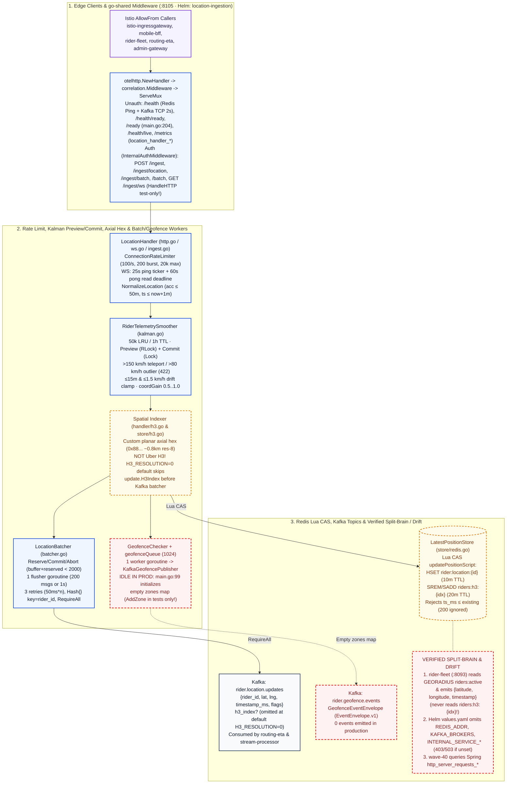
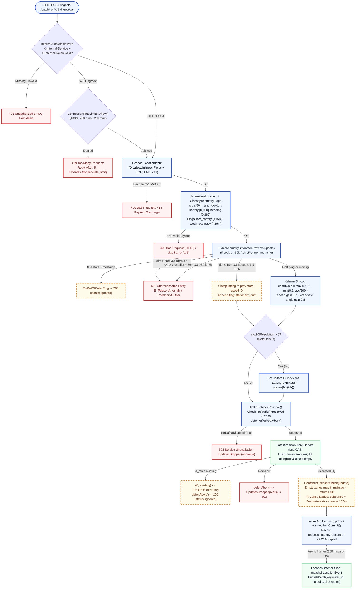
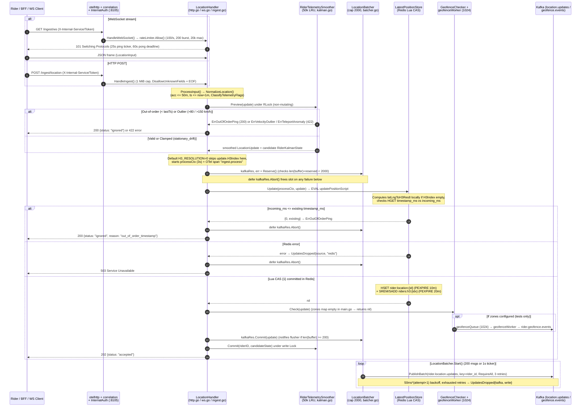

# Location Ingestion Service (`location-ingestion-service`)

> [!NOTE]
> **Part of the InstaCommerce Onboarding Suite:** [Onboarding Hub](../../README.md) · [Code Walkthrough Atlas](../README.md) · [Domain & Event Catalog (`05`)](../../05-domain-model-and-event-catalog.md) · [Incident Drills & Exam (`06`)](../../06-incident-drills-and-readiness-exam.md) · [Dependency Matrix & Cheatsheet (`07`)](../../07-service-dependency-and-command-cheatsheet.md)

> **Onboarding Scope & Repo-Truth Posture:** Every line anchor, Lua script, threshold, metric, and architectural seam below is verified directly from source in [`services/location-ingestion-service/`](../../../../services/location-ingestion-service), [`services/go-shared/pkg/`](../../../../services/go-shared/pkg), [`deploy/helm/values.yaml`](../../../../deploy/helm/values.yaml#L1186-L1201), [`services/rider-fleet-service/`](../../../../services/rider-fleet-service/src/main/java/com/instacommerce/riderfleet/service/RiderAvailabilityService.java#L102-L141), and [`prometheus/rules/wave-40-complete-slo-alerts.yml`](../../../../prometheus/rules/wave-40-complete-slo-alerts.yml#L599-L612). Critical production realities: **`GeofenceChecker` initializes with an empty `zones` map in `main.go:99` (`0` geofence events emitted in production)**, the spatial index uses **custom planar axial hex math rather than Uber H3**, and **`rider-fleet-service` queries `GEORADIUS riders:active` while this service writes `riders:h3:{idx}`**.

---

## 1. Service Identity Card

| Dimension | Verified Value | Source |
|---|---|---|
| **Module / Stack** | `github.com/instacommerce/location-ingestion-service` · Go `1.25.0` (`toolchain go1.25.1`), `gorilla/websocket` `v1.5.3`, `redis/go-redis/v9` `v9.18.0`, `segmentio/kafka-go` `v0.4.50`, `otelhttp` `v0.66.0` | [`go.mod`](../../../../services/location-ingestion-service/go.mod#L1-L18) |
| **HTTP / WS Port** | `:8105` (`PORT` → `SERVER_PORT` → `"8105"`); static `CGO_ENABLED=0` `linux/amd64` Alpine `3.23` binary running as non-root `app` (`UID 1001`) | [`config.go`](../../../../services/location-ingestion-service/config.go#L18-L57), [`Dockerfile`](../../../../services/location-ingestion-service/Dockerfile#L7-L17) |
| **Storage / Cache** | Redis hashes `rider:location:{riderID}` (`10m` TTL) + custom axial hex sets `riders:h3:{h3_index}` (`20m` TTL) via atomic Lua CAS | [`store/redis.go`](../../../../services/location-ingestion-service/store/redis.go#L27-L163) |
| **Kafka Topics** | Produces batched pings to `rider.location.updates` (`Hash{}` key=`rider_id`, `RequireAll`); wired (but idle in prod) producer for `rider.geofence.events` | [`main.go`](../../../../services/location-ingestion-service/main.go#L66-L89), [`handler/batcher.go`](../../../../services/location-ingestion-service/handler/batcher.go#L78-L95) |
| **Helm Release Key** | Shortened key **`location-ingestion`** (`replicas: 2`, HPA `2..6` at `70%` CPU; `500m..1000m`/`512Mi..1024Mi` base, `250m..1000m`/`256Mi..512Mi` prod) | [`values.yaml`](../../../../deploy/helm/values.yaml#L1186-L1201), [`ci.yml`](../../../../.github/workflows/ci.yml#L845) |
| **SLO Tier Status** | **Unlisted** in [`monitoring/error-budget-policy.yaml`](../../../../monitoring/error-budget-policy.yaml#L4-L45); targeted by drifted Spring rule | [`wave-40-complete-slo-alerts.yml`](../../../../prometheus/rules/wave-40-complete-slo-alerts.yml#L599-L612) |
| **First-Principles Role** | Absorbs high-frequency rider GPS pings via authenticated HTTP POST and WebSockets, rejects poor fixes (`accuracy > 50m`) and teleport/velocity outliers (`>150` / `>80 km/h`), smooths jitter via accuracy-weighted Kalman Preview/Commit, enforces monotonic timestamps in Redis via Lua CAS, and batches Kafka writes (`200` / `1s`). | [`handler/ingest.go`](../../../../services/location-ingestion-service/handler/ingest.go#L191-L290), [`handler/kalman.go`](../../../../services/location-ingestion-service/handler/kalman.go#L94-L280) |

---

## 2. Package & File Layout

```text
services/location-ingestion-service/
├── main.go                       # Dependencies, empty GeofenceChecker, background LocationBatcher, mux/auth/OTel, shutdown (213 lines)
├── config.go                     # Env loader via go-shared/pkg/config, slog JSON logger, OTel init, Kafka TCP probe (132 lines)
├── Dockerfile                    # Multi-stage golang:1.25-alpine -> alpine:3.23 non-root UID 1001, EXPOSE 8105 (17 lines)
├── go.mod                        # Go 1.25.0 + local replace ../go-shared (60 lines)
├── README.md                     # Stale pre-refactor docs (641 lines; see Section 9 for drift)
├── model/
│   └── location.go               # LocationUpdate domain model, Validate(), ClassifyTelemetryFlags() (<15% batt, >25m acc) (95 lines)
├── store/
│   ├── redis.go                  # LatestPositionStore, Lua CAS updatePositionScript, GetNearby / GetNearbyH3 (310 lines)
│   └── h3.go                     # Duplicate custom axial hex encoder (0x88...), KRingRes8, haversineKm (85 lines)
└── handler/
    ├── types.go                  # LocationInput wire DTO, NormalizeLocation, KafkaGeofencePublisher, options (285 lines)
    ├── ingest.go                 # LocationHandler struct, geofenceWorker (1024), ingestNormalized orchestrator (330 lines)
    ├── http.go                   # HandleIngest, HandleBatchIngest, and unmounted legacy HandleHTTP (209 lines)
    ├── ws.go                     # HandleWebSocket, 25s ping / 60s pong heartbeat, ConnectionRateLimiter, CloseWebSockets (189 lines)
    ├── kalman.go                 # RiderTelemetrySmoother (50k LRU / 1h TTL), Preview/Commit, 150/80/15/1.5 thresholds (297 lines)
    ├── batcher.go                # LocationBatcher, BatchReservation (Reserve/Commit/Abort), 3x retry flusher (439 lines)
    ├── geofence.go               # GeofenceChecker, GeofenceEventEnvelope, consecutive-ping debounce & 3m hysteresis (379 lines)
    ├── h3.go                     # Custom axial hex encoder (LatLngToH3Res8, EncodeSpatialGridIndex, KRingRes8) (121 lines)
    ├── ratelimit.go              # ConnectionRateLimiter token bucket (100/s, 200 burst, 20,000 max conns) (86 lines)
    └── metrics.go                # 7 location_handler_* Prometheus counters/histograms (103 lines)
```

Test suites across packages (`root`, `handler`, `store`; `model` has no `_test.go` files):
- [`main_test.go`](../../../../services/location-ingestion-service/main_test.go#L24-L362) (11 tests: multi-broker TCP probe, shutdown readiness drain, `H3_RESOLUTION`/`REDIS_TTL`, `InternalAuthMiddleware` enforcement, geofence publishing, WS drain)
- [`location_ingestion_test.go`](../../../../services/location-ingestion-service/location_ingestion_test.go#L18-L371) (14 tests: coordinate/heading/speed/accuracy validation & JSON serialization)
- [`handler/location_test.go`](../../../../services/location-ingestion-service/handler/location_test.go#L93-L359) (4 tests: geofence near-delivery/exit, debounce/hysteresis, out-of-order lock safety)
- [`handler/location_telemetry_test.go`](../../../../services/location-ingestion-service/handler/location_telemetry_test.go#L20-L275) (7 tests: `NaN`/`Inf`/battery validation, teleport/drift, flag classification, `422` status, `Add` error propagation)
- [`handler/hardening_test.go`](../../../../services/location-ingestion-service/handler/hardening_test.go#L47-L199) (3 tests: buffer-full zero side effects, Redis failure reservation abort, concurrent WS ping/close race safety)
- [`handler/kalman_test.go`](../../../../services/location-ingestion-service/handler/kalman_test.go#L16-L302) (7 tests: out-of-order, velocity outlier, smoothing, zero-delta, LRU capacity, non-mutating Preview, writer topic guard)
- [`handler/geofence_test.go`](../../../../services/location-ingestion-service/handler/geofence_test.go#L15-L191) (6 tests: contract envelope, worker drain, memory dedup sweep, custom `SpatialIndexer`)
- [`handler/h3_test.go`](../../../../services/location-ingestion-service/handler/h3_test.go#L10-L46) (2 tests) & [`handler/ratelimit_test.go`](../../../../services/location-ingestion-service/handler/ratelimit_test.go#L9-L41) (2 tests)
- [`store/redis_test.go`](../../../../services/location-ingestion-service/store/redis_test.go#L14-L229) (9 tests against `fake_redis_test.go`: atomic `EVAL` Lua CAS, out-of-order/equal rejection, H3 set `SREM`/`SADD` transitions, prefix handling)

---

## 3. Architecture LLD & Startup / Middleware Stack

**Location Ingestion Architecture LLD** — *[Rendered PNG](../diagrams/services/location-ingestion-service-arch-lld.png) · [Mermaid Source](../diagrams/services/location-ingestion-service-arch-lld.mmd)*



### Startup, Wiring & `go-shared` Edge Stack ([`main.go`](../../../../services/location-ingestion-service/main.go#L40-L213))

1. **Config, Logger & Metrics (`L41-L43`):** Loads env vars via `loadConfig()` ([`config.go`](../../../../services/location-ingestion-service/config.go#L56-L85)), initializes JSON `slog` tagged `"service": "location-ingestion-service"`, and registers 7 `location_handler_*` metrics onto `prometheus.DefaultRegisterer`.
2. **Tracing (`config.go:L107-L120`):** `initTracing` calls [`observability.InitOTel`](../../../../services/go-shared/pkg/observability/otel.go#L58-L108) (`OTelProtocolGRPC`, `ResolveEnv: true`, `NoopIfNoEndpoint: true`, `FallbackNoop: true`).
3. **Redis Store & Kafka Writers (`main.go:L55-L93`):**
   - Connects `go-redis/v9` client and constructs `store.NewLatestPositionStoreWithPrefix(redisClient, cfg.RedisKeyPrefix, cfg.RedisTTL)` (`"rider:location:"`, `10m`). Exits `1` if nil client.
   - Only if `len(cfg.KafkaBrokers) > 0` (`L68`), creates `kafkaWriter` (`rider.location.updates`) and `geofenceWriter` (`rider.geofence.events`) with `Balancer: &kafka.Hash{}`, `RequiredAcks: kafka.RequireAll`, `AllowAutoTopicCreation: true`, `WriteTimeout: 5s` (`L189-L198`).
   - Always constructs `LocationBatcher` (`maxSize: 200`, `maxWait: 1s`, `maxBuffer: 2000`, drop hook incrementing `UpdatesDropped{kafka, reason}`) and launches `batcher.Start(backgroundCtx)` (`L120-L124`). When `kafkaWriter == nil`, `Reserve()` returns `ErrKafkaDisabled` (`503`).
4. **Empty `GeofenceChecker` & `LocationHandler` (`L95-L116`):**
   - Computes `h3Res := cfg.H3Resolution`; if `<= 0`, sets local `h3Res = 8` for `NewGeofenceChecker(h3Res)`, **while still passing raw `cfg.H3Resolution` (`0`) into `IngestConfig` (`L106`)**.
   - `NewIngestHandler` initializes `geofenceQueue` (`cap 1024`), `RiderTelemetrySmoother` (`50,000` / `1h`), `ConnectionRateLimiter` (`100.0/s`, `200.0` burst, `20,000` max conns), and spawns `1` `geofenceWorker` goroutine (`ingest.go:L116-L124`).
5. **Health Probes, Mux & `go-shared` Middleware (`L126-L151`, `L200-L213`):**
   - [`health.Handler`](../../../../services/go-shared/pkg/health/handler.go#L46-L112) verifies `"redis"` (`Ping`) and `"kafka"` (`health.CheckTCPBrokers` `2s` per-broker dialer, returning `"kafka disabled"` if `kafkaWriter == nil`).
   - `newHTTPMux` mounts `/metrics`, `/health`, `/health/ready`, `/health/live`, and `/ready` directly on `mux` (unauthenticated).
   - Wraps **all 5 ingestion routes** in [`auth.NewInternalAuthMiddleware`](../../../../services/go-shared/pkg/auth/middleware.go#L45-L150): `POST /ingest`, `POST /ingest/location`, `POST /ingest/batch`, `POST /batch`, and `GET /ingest/ws`. Missing headers return `401`; bad token or unset `INTERNAL_SERVICE_TOKEN` (when caller not in `INTERNAL_SERVICE_ALLOWED_CALLERS`) returns `403`.
   - Outer HTTP server handler (`L146`): `otelhttp.NewHandler(correlation.Middleware(mux), "http.server")` with `5s`/`10s`/`10s`/`60s` timeouts.
6. **Shutdown Ordering (`L174-L186`):** `health.ShutdownServer` flips `ready = false` and drains active HTTP connections (`15s` timeout) → `ingestHandler.Close()` sends WebSocket `CloseGoingAway` (`1001`) and awaits `wsWG` + drains `geofenceQueue` (`5s` timeout) → cancels `backgroundCtx` so `batcher.Start` flushes all remaining buffered pings → closes `kafkaWriter`, `geofenceWriter`, `redisClient`, and `tp`.

---

## 4. API, Redis Lua CAS & Kafka Output Contracts

### HTTP & WebSocket Endpoints (`:8105`)

| Route | Auth | Handler | Wire Format & Responses | Source |
|---|---|---|---|---|
| `POST /ingest`, `POST /ingest/location` | `InternalAuth` | `HandleIngest` | Strict single-object `LocationInput` (`DisallowUnknownFields` + EOF, `1 MiB` max). Returns `202 {"status":"accepted"}`, `200 {"status":"ignored","reason":"out_of_order_timestamp"}`, `400` (bad JSON/bounds/`acc > 50m`), `413` (`>1 MiB`), `422` (`ErrVelocityOutlier`/`ErrTeleportAnomaly`), `503` (Redis/Kafka disabled/full) | [`handler/http.go`](../../../../services/location-ingestion-service/handler/http.go#L64-L118) |
| `POST /ingest/batch`, `POST /batch` | `InternalAuth` | `HandleBatchIngest` | JSON array `[...]` or `{"updates":[...]}` (`1 MiB` max; no `DisallowUnknownFields`). Loops sequentially via `ProcessInput`, returning `202 {"status":"accepted","accepted":N,"ignored":N,"failed":N}` (`400` if empty) | [`handler/http.go`](../../../../services/location-ingestion-service/handler/http.go#L121-L191) |
| `GET /ingest/ws` | `InternalAuth` | `HandleWebSocket` | Rate-limited (`429 Retry-After: 5` on deny); upgrades with `CheckOrigin: true`; reads Text/Binary `LocationInput` frames (`1 MiB` limit, `DisallowUnknownFields` + EOF, `60s` pong-extended deadline, `25s` server `PingMessage` ticker). No per-frame ACK sent back | [`handler/ws.go`](../../../../services/location-ingestion-service/handler/ws.go#L64-L189) |
| `GET /health` | None | `health.Handler` | Runs concurrent `redis` `Ping` + `kafka` TCP broker check (`5s` outer cap, `2s` per-broker); `200 {"status":"ok",...}` or `503 {"status":"degraded",...}` | [`main.go`](../../../../services/location-ingestion-service/main.go#L126-L141) |
| `GET /health/ready`, `/ready`, `/health/live` | None | `health.Handler` | `ReadyHandler` (`200 ready` / `503 not_ready` atomic flag) & `LiveHandler` (`200 alive`) | [`main.go`](../../../../services/location-ingestion-service/main.go#L203-L204) |
| `GET /metrics` | None | `promhttp` | Exposes the 7 `location_handler_*` metrics + Go runtime metrics | [`main.go`](../../../../services/location-ingestion-service/main.go#L202) |

### Redis Keys & Atomic Lua CAS ([`store/redis.go`](../../../../services/location-ingestion-service/store/redis.go#L27-L163))

`LatestPositionStore.Update` executes `updatePositionScript` via `EVALSHA`/`EVAL` with `KEYS = [rider:location:{riderID}]` (falls back to `rider:{riderID}:location` only if prefix is empty) and `ARGV = [incomingMs, ttlMs, newH3, riderID, "lat", ..., "lng", ..., "timestamp_ms", ..., optional fields...]`:

1. **Monotonic Timestamp Guard (`L28-L31`):** `HGET KEYS[1] timestamp_ms`; if `existing > 0 and incomingMs <= existing`, immediately returns `{0, tostring(existing)}` (mapped to `store.ErrOutOfOrderPing` -> `handler.ErrOutOfOrderPing` via `positionStoreAdapter`, returning HTTP `200 ignored`).
2. **Position Hash Write (`L32-L39`):** Reads `old_h3`, executes `HSET` over key/value pairs (`lat`, `lng`, `timestamp_ms`, optional `speed`, `heading`, `accuracy`, `battery_pct`, `h3_index`), and applies `PEXPIRE KEYS[1] ttl_ms` (`600,000 ms` = `10m`).
3. **Axial Hex Set Transition (`L40-L51`):** If `new_h3 != ''`: removes `rider_id` from `riders:h3:{old_h3}` (`SREM`) when the cell changed, `SADD riders:h3:{new_h3} rider_id`, and sets `PEXPIRE riders:h3:{new_h3} ttl_ms * 2` (`20m`).
4. **Unused Read Path (`L240-L310`):** `GetNearby` (`radiusKm <= 3.0` -> `GetNearbyH3` 7-cell k-ring `SMEMBERS` + `Get` + Haversine; else `SCAN` over `rider:location:*`) is implemented in `store/redis.go` for library completeness/tests, with no HTTP route or external reader.

### Kafka Output Schemas

- **`rider.location.updates` ([`handler/batcher.go`](../../../../services/location-ingestion-service/handler/batcher.go#L78-L95), [`L408-L439`](../../../../services/location-ingestion-service/handler/batcher.go#L408-L439)):** Keyed by `rider_id`, serialized from `LocationEvent`: `rider_id`, `lat`, `lng`, `timestamp_ms`, optional pointers `speed`, `heading`, `accuracy`, `battery_pct`, optional `h3_index` *(omitted by default at `H3_RESOLUTION=0`)*, `geofence_hit`, `low_battery`, `weak_accuracy`, `telemetry_flags`, `source`, `ingested_at` (RFC3339Nano).
- **`rider.geofence.events` ([`handler/geofence.go`](../../../../services/location-ingestion-service/handler/geofence.go#L42-L82), [`RiderGeofenceTransition.v1.json`](../../../../contracts/src/main/resources/schemas/rider/RiderGeofenceTransition.v1.json#L1-L16)):** Canonical [`EventEnvelope.v1.json`](../../../../contracts/src/main/resources/schemas/common/EventEnvelope.v1.json#L1-L52) (`eventType: "RiderGeofenceTransition"`, `aggregateType: "RiderGeofence"`, `schemaVersion: "v1"`, `source_service: "location-ingestion-service"`, headers `event_id`/`event_type`/`aggregate_type`/`aggregate_id`/`schema_version`/`source_service`/`correlation_id`). **Never emitted in production** because `zones` is empty.

---

## 5. Validation, Kalman Smoothing, Hex Grid & Geofencing Flow

**Location Ingestion Flowchart** — *[Rendered PNG](../diagrams/services/location-ingestion-service-flowchart.png) · [Mermaid Source](../diagrams/services/location-ingestion-service-flowchart.mmd)*



### Function-by-Function Algorithmic Trace

1. **Payload Normalization & Telemetry Flagging ([`handler/types.go`](../../../../services/location-ingestion-service/handler/types.go#L58-L121), [`model/location.go`](../../../../services/location-ingestion-service/model/location.go#L52-L95)):**
   - `NormalizeLocation` enforces: non-empty `rider_id`, finite `lat` in `[-90, 90]`, finite `lng` in `[-180, 180]`, `speed >= 0`, `heading` in `[0, 360)`, `accuracy` in `[0, 50.0]` (`>50m` fails with `"poor GPS fix"`), `battery_pct` in `[0, 100]`, and `timestamp <= now + 1m` (absent or `<= 0` defaults to `time.Now().UTC()`).
   - `ClassifyTelemetryFlags` flags `low_battery` (`battery_pct < 15.0`) and `weak_accuracy` (`accuracy > 25.0`), incrementing `location_handler_updates_flagged_total{flag}`.
2. **Non-Mutating Kalman Preview & Outlier Rejection ([`handler/kalman.go`](../../../../services/location-ingestion-service/handler/kalman.go#L94-L297)):**
   - `RiderTelemetrySmoother` maintains a `50,000`-rider / `1h` TTL LRU (`states` map + `container/list`). `ingestNormalized` calls `Preview(update)` under `RLock` first so downstream failures never corrupt filter state.
   - If the rider has an active state (`now.Sub(LastSeenAt) <= 1h`):
     - **Out-of-order (`L207`):** `update.Timestamp.Before(state.Timestamp)` → `ErrOutOfOrderPing` (HTTP `200 ignored`).
     - **Teleport / Velocity Outliers (`L214-L231`):** Computes Haversine `distKm` and `dtSec`. If `distKm > 0.05` (`50m`) and (`dtSec <= 0` or `computedSpeedKmh > 150.0` `MaxTeleportSpeedKmh`), returns `ErrVelocityOutlier` + `ErrTeleportAnomaly` (`422`). If `distKm > 0.05` and `computedSpeedKmh > 80.0` (`MaxPlausibleSpeedKmh`), returns `ErrVelocityOutlier` (`422`).
     - **Stationary Multipath Clamp (`L233-L250`):** If `distKm <= 0.015` (`15m`) and `(dtSec < 0.5 || computedSpeedKmh <= 1.5)` and `(!update.HasSpeed || update.Speed <= 1.5)`, clamps `Lat`/`Lng` to `state.Lat`/`state.Lng`, zeroes `Speed`, preserves `state.Heading`, sets `StationaryDrift = true`, and appends `"stationary_drift"`.
     - **Accuracy-Weighted Kalman Step (`L252-L279`):** Defaults missing `accuracy` to `5.0`, sets `coordGain = max(0.5, 1.0 - min(0.5, accuracy/100.0))` (so `0m` -> `1.0`, `25m` -> `0.75`, `50m` -> `0.5`), updates `Speed` with gain `0.7`, and updates `Heading` via wrap-around safe `smoothAngle(..., 0.8)` (`L282-L297`).
3. **Custom Planar Axial Hex Math ([`handler/h3.go`](../../../../services/location-ingestion-service/handler/h3.go#L19-L121), [`store/h3.go`](../../../../services/location-ingestion-service/store/h3.go#L10-L64)):**
   - Projects `(lat, lng)` onto a flat tangent plane scaled by `111.32 / (0.8 * sqrt(3) / 2)`, cube-rounds `(q, r, s)` via `axialRound`, offsets by `+1,000,000`, and bit-packs `(0x88 << 56) | ((qPart & 0xFFFFFF) << 28) | (rPart & 0xFFFFFF)` as a 16-char hex string.
   - `ingestNormalized` (`ingest.go:L218-L225`) enriches `update.H3Index` **only when `h.cfg.H3Resolution > 0`**; at default `H3_RESOLUTION=0`, `update.H3Index` stays empty entering `LocationBatcher`, while `store.LatestPositionStore.Update` (`store/redis.go:L114-L116`) computes `latLngToH3Res8` independently before calling Lua!
4. **Geofencing Engine ([`handler/geofence.go`](../../../../services/location-ingestion-service/handler/geofence.go#L171-L361)):**
   - Evaluates Haversine distance against circular `Zone` entries (`ZoneStore` → `ENTERED_STORE`, `ZoneDelivery` → `NEAR_DELIVERY`, `ZoneRestricted` → `ENTERED_RESTRICTED`, exit → `EXITED_ZONE`), enforcing `MinConsecutivePings` debounce, `HysteresisWindow` (`3m`), and `GeofenceDeduplicator`.
   - When active, `emitGeofenceEvents` pushes non-blockingly into `geofenceQueue` (`cap 1024`; drops increment `location_handler_geofence_events_dropped_total`) drained by `geofenceWorker`. Because `main.go:99` never populates `zones`, `Check()` returns `nil` on every production ping.

---

## 6. Concurrency, Reservation Batching & WebSocket Sequence

**Location Ingestion Sequence** — *[Rendered PNG](../diagrams/services/location-ingestion-service-sequence.png) · [Mermaid Source](../diagrams/services/location-ingestion-service-sequence.mmd)*



### Reservation Ordering & Backpressure Trace ([`handler/ingest.go`](../../../../services/location-ingestion-service/handler/ingest.go#L240-L290), [`handler/batcher.go`](../../../../services/location-ingestion-service/handler/batcher.go#L204-L406), [`handler/ws.go`](../../../../services/location-ingestion-service/handler/ws.go#L64-L189))

1. **WebSocket Admission & Heartbeat (`ws.go:L75-L188`):** `ConnectionRateLimiter.Allow()` checks `activeConns < 20000` and consumes 1 token from a `100/s` (`200` burst) bucket under `sync.Mutex`, returning `429` (`Retry-After: 5`) if exhausted. Each upgraded socket runs a `25s` `PingMessage` ticker goroutine (`10s` write deadline) paired with a `60s` pong-extended `ReadDeadline`.
2. **Pre-Redis Reservation (`ingest.go:L240-L256`, `batcher.go:L204-L260`):**
   - `kafkaBatcher.Reserve()` verifies producer non-nil and `len(buffer) + reserved < maxBuffer (2000)` **before** touching Redis, ensuring a full Kafka buffer (`ErrKafkaBufferFull` -> `503`) never updates Redis or Kalman state.
   - `defer kafkaRes.Abort()` decrements `reserved` if `redisStore.Update` returns an error or `ErrOutOfOrderPing`.
3. **Post-Redis Commit (`ingest.go:L279-L287`):**
   - Only after `updatePositionScript` succeeds does `kafkaRes.Commit(update)` decrement `reserved`, append `update` to `batcher.buffer`, and send non-blockingly on `b.notify` when `len(buffer) >= 200`.
   - `telemetrySmoother.Commit(update.RiderID, candidateState)` then acquires the write lock, evicts expired LRU tail entries (`> 1h`) or oldest entries (`>= 50,000`), and applies `candidateState` only if `candidate.Timestamp >= existing.Timestamp` (`kalman.go:L163`).
4. **Batch Flusher & Retry (`batcher.go:L307-L406`):** `LocationBatcher.Start` selects on `ctx.Done()` (looping `flush(context.Background())` until empty), `maxWait` ticker (`1s`), or `b.notify` (`200` items). `flush()` pops up to `200` items, serializes `LocationEvent` JSON (`UpdatesDropped{kafka, marshal}` on marshal error), and calls `PublishBatch` up to `3` attempts (`50ms * (attempt + 1)` backoff, `5s` write timeout via `context.WithoutCancel(ctx)`). Exhausted retries increment `location_handler_updates_dropped_total{source="kafka",reason="write"}`.

---

## 7. Configuration, Helm Deployments, Observability & Testing

### Environment Variables & Helm Matrix

| Env Var | Code Default ([`config.go`](../../../../services/location-ingestion-service/config.go#L17-L85)) | Helm ([`values.yaml`](../../../../deploy/helm/values.yaml#L1186-L1201)) | Notes |
|---|---|---|---|
| `PORT` / `SERVER_PORT` | `"8105"` | `PORT: "8105"`, `SERVER_PORT: "8105"` | Dockerfile sets `ENV PORT=8105` |
| `KAFKA_BROKERS` | `nil` (Kafka disabled) | *(unset!)* | Empty disables `kafkaWriter`; `/health` reports `"kafka disabled"` (`503`) and `Reserve()` returns `ErrKafkaDisabled` (`503`) |
| `KAFKA_TOPIC` / `KAFKA_BUFFER` | `"rider.location.updates"` / `2000` | *(unset)* | Max `buffer + reserved` capacity before `503` |
| `KAFKA_BATCH_SIZE` / `TIMEOUT` / `WRITE_TIMEOUT` | `200` / `1s` / `5s` | *(unset)* | Clamped to `>= 1` batch size |
| `REDIS_ADDR` / `PASSWORD` / `DB` | `"localhost:6379"` / `""` / `0` | *(unset!)* | Missing in `values.yaml`, `values-staging.yaml`, and `values-prod.yaml` |
| `REDIS_KEY_PREFIX` / `REDIS_TTL` | `"rider:location:"` / `10m` | *(unset)* | `riders:h3:*` TTL is `2 * REDIS_TTL` (`20m`); non-positive `REDIS_TTL` falls back to `10m` |
| `MAX_BODY_BYTES` / `WS_READ_LIMIT` | `1048576` (`1 MiB`) / `1048576` | *(unset)* | Request body & WebSocket frame cap |
| `PROCESS_TIMEOUT` / `SHUTDOWN_TIMEOUT` | `3s` / `15s` | *(unset)* | Per-ping timeout & graceful server drain |
| `H3_RESOLUTION` | `0` | *(unset)* | `main.go` maps `<=0` to `8` for `GeofenceChecker` only, leaving `IngestConfig.H3Resolution=0` |
| `LOG_LEVEL` | `info` | `LOG_LEVEL: info` (staging only) | Parsed by `parseLogLevel` |
| `INTERNAL_SERVICE_TOKEN` / `ALLOWED_CALLERS` / `STRICT_PER_SERVICE` | `""` / `{}` / `false` | *(unset in `location-ingestion.env`!)* | Read by [`go-shared/pkg/auth`](../../../../services/go-shared/pkg/auth/middleware.go#L45-L68); empty token fails closed (`403`) |

### Registered Prometheus Metrics (`/metrics`, [`handler/metrics.go`](../../../../services/location-ingestion-service/handler/metrics.go#L21-L69))

- `location_handler_updates_received_total{source}`
- `location_handler_updates_invalid_total{source,reason}`
- `location_handler_updates_dropped_total{source,reason}`
- `location_handler_updates_flagged_total{flag}`
- `location_handler_process_latency_seconds{source}` (`0.001..0.25` s buckets)
- `location_handler_geofence_events_emitted_total{event_type,zone_id}`
- `location_handler_geofence_events_dropped_total`

### Narrow Test & Verification Commands

```bash
# Verified passing with race detector (uncached run: root 2.025s, handler 2.595s, store 3.380s; model has no tests)
cd services/location-ingestion-service && go test -count=1 -race ./...

# Single package or targeted test
cd services/location-ingestion-service && go test -race ./store -run '^TestLatestPositionStore_UpdateAtomicLuaAndPrefix$'
```

---

## 8. Verified Seams, Bugs & Doc-vs-Code Drift

1. **Empty `zones` Map (`rider.geofence.events` Always Idle in Prod):** [`main.go`](../../../../services/location-ingestion-service/main.go#L99) instantiates `handler.NewGeofenceChecker(h3Res)` without loading any zones (`AddZone` is called only in unit tests), so `rider.geofence.events` receives **zero** production events despite `routing-eta-service` expecting `ENTERED_STORE` transitions ([`routing-eta-service/README.md`](../../../../services/routing-eta-service/README.md#L783)). Meanwhile [`README.md`](../../../../services/location-ingestion-service/README.md#L52-L53) claims geofence events are log-only while [`README.md`](../../../../services/location-ingestion-service/README.md#L594) claims they publish to Kafka.
2. **GPS Split-Brain with `rider-fleet-service` (`:8093`):** [`store/redis.go`](../../../../services/location-ingestion-service/store/redis.go#L35-L50) writes `rider:location:{id}` and `riders:h3:{idx}` sets, **not** Redis `GEOADD riders:active`. By contrast, [`RiderAssignmentService.java`](../../../../services/rider-fleet-service/src/main/java/com/instacommerce/riderfleet/service/RiderAssignmentService.java#L55-L95) (when `optimizer-enabled=false`) queries `GEORADIUS riders:active`, which is populated solely by Java [`RiderAvailabilityService.updateLocation`](../../../../services/rider-fleet-service/src/main/java/com/instacommerce/riderfleet/service/RiderAvailabilityService.java#L102-L138) (`POST /riders/{id}/location`), which also publishes `{rider_id, latitude, longitude, timestamp}` (`Instant` string) to `rider.location.updates` instead of Go's `{rider_id, lat, lng, timestamp_ms, ...}`. (Only [`RiderAssignmentSupport.java`](../../../../services/rider-fleet-service/src/main/java/com/instacommerce/riderfleet/service/RiderAssignmentSupport.java#L96-L97) reads `rider:location:{id}` `lat`/`lng`.)
3. **Custom Planar Axial Hex vs Uber H3 + `H3_RESOLUTION=0` Quirk:** Both [`handler/h3.go`](../../../../services/location-ingestion-service/handler/h3.go#L19-L51) and [`store/h3.go`](../../../../services/location-ingestion-service/store/h3.go#L10-L38) implement custom flat-plane axial hex math prefixed `0x88...` rather than the Uber H3 library (and duplicate `haversineKm` between `store/h3.go` and `handler/geofence.go`). Worse, because `H3_RESOLUTION` defaults to `0` (`config.go:L82`), `main.go:L95-L107` overrides `h3Res = 8` only for `GeofenceChecker` while leaving `IngestConfig.H3Resolution = 0`, causing [`ingestNormalized`](../../../../services/location-ingestion-service/handler/ingest.go#L218-L225) to omit `h3_index` on Kafka `rider.location.updates` even though `store.Update` computes it locally for Redis.
4. **Missing Helm Env Vars & `NetworkPolicy` / Alert Mismatch:** [`values.yaml`](../../../../deploy/helm/values.yaml#L1195-L1197) omits `REDIS_ADDR`, `KAFKA_BROKERS`, `INTERNAL_SERVICE_TOKEN`, and `INTERNAL_SERVICE_ALLOWED_CALLERS`, so pods fail auth (`403`) or fail readiness (`503`) unless injected outside Helm. Additionally, [`network-policy.yaml`](../../../../deploy/helm/templates/network-policy.yaml#L53) scrapes `port: metrics` instead of `http`, and [`wave-40-complete-slo-alerts.yml`](../../../../prometheus/rules/wave-40-complete-slo-alerts.yml#L599-L612) queries Spring's `http_server_requests_seconds_count{service="location-ingestion-service"}` instead of `location_handler_*`.
5. **Unmounted Legacy `HandleHTTP` & `HandleBatchIngest` Validation Gap:** [`HandleHTTP`](../../../../services/location-ingestion-service/handler/http.go#L13-L61) accepts `model.LocationUpdate` directly (skipping future-timestamp checks and returning `422` for all non-out-of-order errors) and exists solely for unit tests (`newHTTPMux` never mounts it). `HandleBatchIngest` (`L148-L164`) unmarshals without `DisallowUnknownFields`, unlike `HandleIngest` and `HandleWebSocket`. Finally, `README.md` describes a pre-refactor `IngestService` inside `main.go`, `SCAN`-only `GetNearby`, `REDIS_TTL=0`, and "no checked-in tests".

---

**Previous:** [stream-processor-service](./stream-processor-service.md) | **Atlas Hub:** [Code Walkthrough Atlas](../README.md) | **Next:** [payment-webhook-service](./payment-webhook-service.md)
