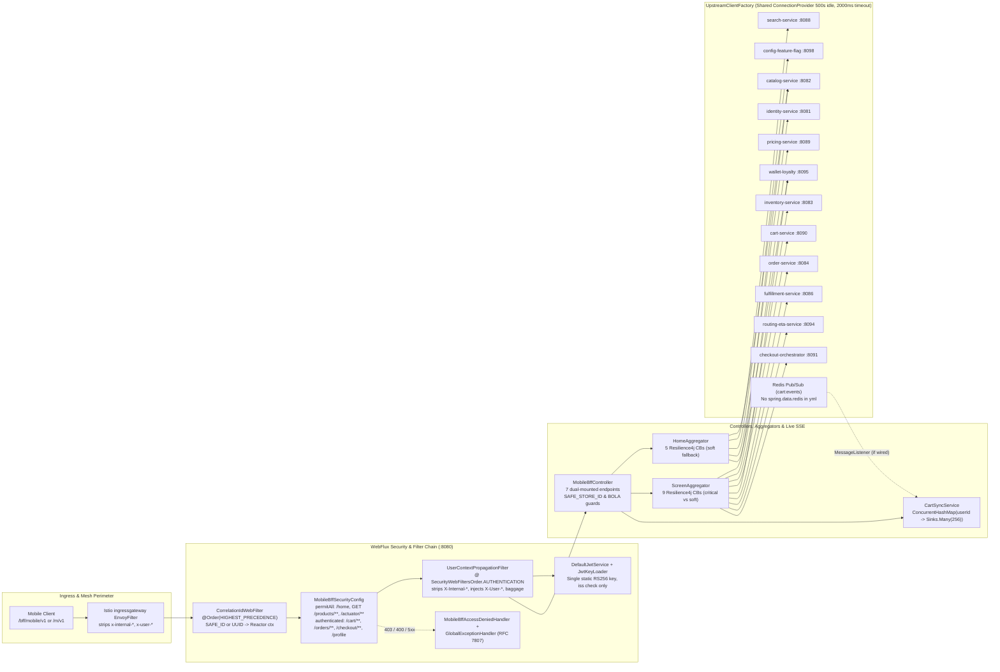
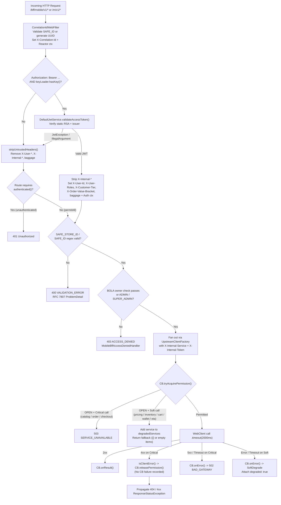
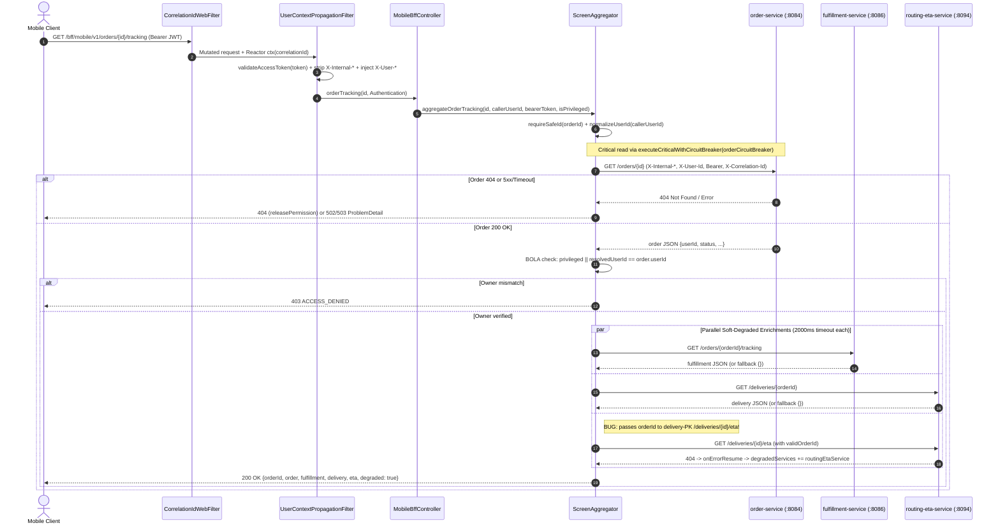

# `mobile-bff-service` — Code Walkthrough

> [!NOTE]
> **Part of the InstaCommerce Onboarding Suite:** [Onboarding Hub](../../README.md) · [Code Walkthrough Atlas](../README.md) · [Domain & Event Catalog (`05`)](../../05-domain-model-and-event-catalog.md) · [Incident Drills & Exam (`06`)](../../06-incident-drills-and-readiness-exam.md) · [Dependency Matrix & Cheatsheet (`07`)](../../07-service-dependency-and-command-cheatsheet.md)

> **Module:** `:services:mobile-bff-service` · **Port:** `:8080` (`SERVER_PORT`) · **Runtime:** Java 21, Spring Boot `4.0.0` (WebFlux / Reactor Netty), JJWT, Resilience4j, Spring Data Redis, `libs/platform-common`
>
> **Scope & Verification:** Every route, filter order, circuit-breaker behavior, header rule, and defect below was verified directly against the checked-in source under [`services/mobile-bff-service/`](../../../../services/mobile-bff-service/build.gradle.kts#L1-L39), [`deploy/helm/values.yaml`](../../../../deploy/helm/values.yaml#L1405-L1425), [`deploy/istio/envoy-filter-strip-internal-headers.yaml`](../../../../deploy/istio/envoy-filter-strip-internal-headers.yaml#L1-L41), and [`services/routing-eta-service/src/main/java/com/instacommerce/routing/controller/DeliveryController.java`](../../../../services/routing-eta-service/src/main/java/com/instacommerce/routing/controller/DeliveryController.java#L42-L66).

---

## 1. Purpose, Boundaries & Package Tree

`mobile-bff-service` is the customer mobile edge Backend-for-Frontend. It consolidates multi-service round-trips over high-latency cellular connections into bounded, parallel Reactor Netty HTTP fan-outs across **12** downstream microservices, sanitizes untrusted client headers, verifies customer RS256 JWTs, enforces Broken Object Level Authorization (BOLA) checks, and relays live cart SSE updates. It is stateless with respect to SQL persistence (no database, no Flyway migrations, no direct Kafka client).

```text
services/mobile-bff-service/
├── build.gradle.kts                                    # WebFlux, Redis, Resilience4j, Caffeine, JJWT, OTel
├── src/main/resources/
│   ├── application.yml                                 # Port 8080, 12 upstream URLs, 2000ms budget, CB configs
│   └── application-local.yml                           # Localhost URL overrides, local-dev-internal-token
└── src/main/java/com/instacommerce/mobilebff/
    ├── MobileBffServiceApplication.java                # @SpringBootApplication entrypoint
    ├── config/
    │   ├── JacksonConfig.java                          # ProblemDetailJacksonMixin, ISO-8601 dates
    │   ├── MobileBffProperties.java                    # @ConfigurationProperties(prefix = "mobile-bff")
    │   ├── MobileBffSecurityConfig.java                # @EnableWebFluxSecurity + SecurityWebFilterChain
    │   └── WebClientConfig.java                        # @ConditionalOnMissingBean WebClient.Builder
    ├── security/
    │   ├── CorrelationIdWebFilter.java                 # @Order(HIGHEST_PRECEDENCE), Reactor ctx correlationId
    │   ├── UserContextPropagationFilter.java           # WebFilter @ AUTHENTICATION: strip + JWT + baggage
    │   ├── JwtService.java                             # Token validation / authority extraction SPI
    │   ├── DefaultJwtService.java                      # JJWT verifyWith(single public key) + requireIssuer
    │   ├── JwtKeyLoader.java                           # Parses PEM/Base64/Base64URL RSA key (nullable!)
    │   └── MobileBffAccessDeniedHandler.java           # RFC 7807 ProblemDetail 403 handler
    ├── client/
    │   └── UpstreamClientFactory.java                  # Shared ConnectionProvider + 12 WebClient instances
    ├── controller/
    │   └── MobileBffController.java                    # Dual-mounted /bff/mobile/v1 & /m/v1 endpoints + BOLA
    ├── aggregator/
    │   ├── HomeAggregator.java                         # Soft-degraded /home & /profile fan-outs (5 CBs)
    │   └── ScreenAggregator.java                       # Critical vs soft CBs for /products, /cart, /orders, /checkout
    ├── service/
    │   └── CartSyncService.java                        # Redis Pub/Sub ("cart:events") -> Sinks.Many(256) SSE
    ├── dto/
    │   └── HomeResponse.java                           # Immutable home response record + fallback()
    └── exception/
        └── GlobalExceptionHandler.java                 # @RestControllerAdvice emitting RFC 7807 ProblemDetail
```

- [MobileBffServiceApplication.java](../../../../services/mobile-bff-service/src/main/java/com/instacommerce/mobilebff/MobileBffServiceApplication.java#L1-L11)
- [MobileBffController.java](../../../../services/mobile-bff-service/src/main/java/com/instacommerce/mobilebff/controller/MobileBffController.java#L27-L185)
- [HomeAggregator.java](../../../../services/mobile-bff-service/src/main/java/com/instacommerce/mobilebff/aggregator/HomeAggregator.java#L31-L319)
- [ScreenAggregator.java](../../../../services/mobile-bff-service/src/main/java/com/instacommerce/mobilebff/aggregator/ScreenAggregator.java#L32-L555)
- [UpstreamClientFactory.java](../../../../services/mobile-bff-service/src/main/java/com/instacommerce/mobilebff/client/UpstreamClientFactory.java#L18-L149)
- [CartSyncService.java](../../../../services/mobile-bff-service/src/main/java/com/instacommerce/mobilebff/service/CartSyncService.java#L22-L113)

---

## 2. Internal Architecture & Trust Boundaries

**mobile-bff-service LLD architecture** — *[Rendered PNG](../diagrams/services/mobile-bff-service-arch-lld.png) · [Mermaid Source](../diagrams/services/mobile-bff-service-arch-lld.mmd)*



### Trust Perimeter & Downstream Fan-Out Topology

1. **Istio Ingress Stripping:** [`envoy-filter-strip-internal-headers.yaml`](../../../../deploy/istio/envoy-filter-strip-internal-headers.yaml#L37-L41) strips `x-internal-token`, `x-internal-service`, `x-user-id`, and `x-user-roles` at the `istio: ingressgateway` before traffic enters the mesh.
2. **In-Pod Reactive Chain:** Because `mobile-bff-service` runs on Spring WebFlux / Reactor Netty (not Servlet MVC), it does **not** use `SharedInternalServiceAuthFilter` or `JwtTokenVerifier` from `libs/platform-common`; instead, it implements [`CorrelationIdWebFilter`](../../../../services/mobile-bff-service/src/main/java/com/instacommerce/mobilebff/security/CorrelationIdWebFilter.java#L14-L40) and [`UserContextPropagationFilter`](../../../../services/mobile-bff-service/src/main/java/com/instacommerce/mobilebff/security/UserContextPropagationFilter.java#L21-L119).
3. **12 Downstream WebClients:** [`UpstreamClientFactory`](../../../../services/mobile-bff-service/src/main/java/com/instacommerce/mobilebff/client/UpstreamClientFactory.java#L54-L91) creates one shared Reactor Netty `ConnectionProvider` (`"mobile-bff-upstream"`, `maxIdleTime(500s)`, `evictInBackground(60s)`) and one `HttpClient` with `CONNECT_TIMEOUT_MILLIS`, `responseTimeout`, `ReadTimeoutHandler`, and `WriteTimeoutHandler` all bound to `mobile-bff.upstream.timeout-ms` (`2000ms`), then clones `WebClient.Builder` into 12 base-URL clients attaching default `X-Internal-Service` and `X-Internal-Token` headers.

---

## 3. Startup, Configuration & Reactive Security Filter Chain

### Startup & Bean Wiring

- [`MobileBffServiceApplication`](../../../../services/mobile-bff-service/src/main/java/com/instacommerce/mobilebff/MobileBffServiceApplication.java#L6-L11) boots with `spring.config.import: optional:sm://` ([`application.yml`](../../../../services/mobile-bff-service/src/main/resources/application.yml#L11-L12)).
- [`MobileBffProperties`](../../../../services/mobile-bff-service/src/main/java/com/instacommerce/mobilebff/config/MobileBffProperties.java#L6-L169) binds `mobile-bff.jwt.*` (`issuer`, `publicKey`) and `mobile-bff.upstream.*` (12 URLs + `timeoutMs = 2000`).
- [`JwtKeyLoader`](../../../../services/mobile-bff-service/src/main/java/com/instacommerce/mobilebff/security/JwtKeyLoader.java#L16-L34) parses a single RSA X.509 key (PEM, standard Base64, or URL-safe Base64). Unlike `identity-service`, `catalog-service`, and `admin-gateway-service`, if `publicKey` is blank, `JwtKeyLoader` sets `publicKey = null` and `hasKey()` returns `false` rather than failing startup.
- [`JacksonConfig`](../../../../services/mobile-bff-service/src/main/java/com/instacommerce/mobilebff/config/JacksonConfig.java#L13-L27) registers `ProblemDetailJacksonMixin` and disables `WRITE_DATES_AS_TIMESTAMPS`.

### WebFlux Security Filter Chain

1. **`CorrelationIdWebFilter`** ([`CorrelationIdWebFilter.java`](../../../../services/mobile-bff-service/src/main/java/com/instacommerce/mobilebff/security/CorrelationIdWebFilter.java#L15-L39)):
   - Runs at `@Order(Ordered.HIGHEST_PRECEDENCE)`.
   - Reads `X-Correlation-Id` (falling back to `X-Request-Id`), validates against `^[a-zA-Z0-9._-]{1,64}$`, or mints a random UUID.
   - Echoes `X-Correlation-Id` on the HTTP response, mutates the request header, and binds `"correlationId"` into the Reactor `Context` (`contextWrite`) so [`HomeAggregator`](../../../../services/mobile-bff-service/src/main/java/com/instacommerce/mobilebff/aggregator/HomeAggregator.java#L88) and [`ScreenAggregator`](../../../../services/mobile-bff-service/src/main/java/com/instacommerce/mobilebff/aggregator/ScreenAggregator.java#L95) can propagate it via `Mono.deferContextual`.
2. **`MobileBffSecurityConfig`** ([`MobileBffSecurityConfig.java`](../../../../services/mobile-bff-service/src/main/java/com/instacommerce/mobilebff/config/MobileBffSecurityConfig.java#L25-L47)):
   - Disables CSRF, HTTP Basic, and Form Login.
   - Route authorization rules:
     - `permitAll()`: `/actuator/**`, `/health/**`, `/bff/mobile/v1/home`, `/m/v1/home`, `GET /bff/mobile/v1/products/**`, `GET /m/v1/products/**`, `/bff/mobile/v1/public/**`, `/m/v1/public/**`.
     - `authenticated()`: `/bff/mobile/v1/cart/stream/**`, `/m/v1/cart/stream/**`, and `.anyExchange().authenticated()`.
   - Registers `UserContextPropagationFilter` at `SecurityWebFiltersOrder.AUTHENTICATION` and `MobileBffAccessDeniedHandler` for `403` responses.
3. **`UserContextPropagationFilter`** ([`UserContextPropagationFilter.java`](../../../../services/mobile-bff-service/src/main/java/com/instacommerce/mobilebff/security/UserContextPropagationFilter.java#L44-L118)):
   - Checks for `Authorization: Bearer ` and `keyLoader.hasKey()`.
   - If absent or if [`DefaultJwtService.validateAccessToken`](../../../../services/mobile-bff-service/src/main/java/com/instacommerce/mobilebff/security/DefaultJwtService.java#L27-L33) throws `JwtException | IllegalArgumentException`, invokes `stripUntrustedHeaders` (removing `X-User-Id`, `X-User-Roles`, `X-Internal-Service`, `X-Internal-Token`, `X-Customer-Tier`, `X-Order-Value-Bracket`, and `baggage`) and lets Spring Security's authorization filter reject protected routes or pass `permitAll` routes anonymously.
   - On valid JWT: strips inbound `X-Internal-Service` and `X-Internal-Token`, extracts `sub`, `roles`, `tier` / `customer_tier` (falling back to `"VIP"` if any authority contains `"VIP"`, else `"STANDARD"`), and `order_value_bracket` (default `"STANDARD"`), formats W3C `baggage` (`customer_tier=...,order_value_bracket=...`), injects `X-User-*` headers, and populates `ReactiveSecurityContextHolder` with `UsernamePasswordAuthenticationToken(userId, token, authorities)`.

---

## 4. State, Caching & Live SSE Mechanics

`mobile-bff-service` has **no SQL database or Flyway migrations**. Its only stateful component is [`CartSyncService`](../../../../services/mobile-bff-service/src/main/java/com/instacommerce/mobilebff/service/CartSyncService.java#L22-L113):

- **Per-User SSE Sink Map:** Maintains `ConcurrentHashMap<String, Sinks.Many<ServerSentEvent<Map<String, Object>>>> userSinks`.
- **Backpressure:** `subscribeToCartUpdates(userId)` creates a multicast sink via `Sinks.many().multicast().onBackpressureBuffer(256, false)` (dropping when full rather than blocking producers), and attaches `.doFinally(...)` to remove the sink when `sink.currentSubscriberCount() <= 0`.
- **Redis Pub/Sub Subscriber:** When Spring supplies a `RedisConnectionFactory`, the constructor spins up a `RedisMessageListenerContainer` subscribed to `ChannelTopic("cart:events")`, parses JSON messages, reads `data.get("userId")`, and calls `dispatchToUser(userId, data)` emitting `event: cart-updated`.
- **Stale Sink Eviction:** If `sink.tryEmitNext(sse)` returns `FAIL_TERMINATED` or `FAIL_CANCELLED`, `dispatchToUser` atomically removes `(userId, sink)` from `userSinks`. `destroy()` stops and destroys the `RedisMessageListenerContainer` on graceful shutdown.

---

## 5. Core Execution Paths & Call-Stack Walkthrough

**mobile-bff-service decision and CB flowchart** — *[Rendered PNG](../diagrams/services/mobile-bff-service-flowchart.png) · [Mermaid Source](../diagrams/services/mobile-bff-service-flowchart.mmd)*



**mobile-bff-service order tracking sequence** — *[Rendered PNG](../diagrams/services/mobile-bff-service-sequence.png) · [Mermaid Source](../diagrams/services/mobile-bff-service-sequence.mmd)*



### Endpoint & Fan-Out Matrix ([`MobileBffController`](../../../../services/mobile-bff-service/src/main/java/com/instacommerce/mobilebff/controller/MobileBffController.java#L57-L158))

| Endpoint (`/bff/mobile/v1/...` & `/m/v1/...`) | Controller Method | Aggregator / Service | Downstream Calls & Semantics |
|---|---|---|---|
| `GET /home?storeId=` | [`home`](../../../../services/mobile-bff-service/src/main/java/com/instacommerce/mobilebff/controller/MobileBffController.java#L57-L64) | [`HomeAggregator.aggregate`](../../../../services/mobile-bff-service/src/main/java/com/instacommerce/mobilebff/aggregator/HomeAggregator.java#L84-L148) | Soft parallel `Mono.zip`: `catalog` `GET /categories`, `search` `GET /search/trending`, `featureFlag` `GET /flags[?userId=]` -> [`HomeResponse`](../../../../services/mobile-bff-service/src/main/java/com/instacommerce/mobilebff/dto/HomeResponse.java#L8-L35) |
| `GET /products/{id}?storeId=` | [`productDetails`](../../../../services/mobile-bff-service/src/main/java/com/instacommerce/mobilebff/controller/MobileBffController.java#L66-L76) | [`ScreenAggregator.aggregateProduct`](../../../../services/mobile-bff-service/src/main/java/com/instacommerce/mobilebff/aggregator/ScreenAggregator.java#L89-L150) | **Critical** `catalog` `GET /products/{id}` (`404` mapped to `NOT_FOUND`) + soft `pricing` `GET /pricing/products/{id}` + conditional soft `inventory` `POST /inventory/check` (`quantity: 1`) when `storeId != null` |
| `GET /cart/summary?storeId=&couponCode=` | [`cartSummary`](../../../../services/mobile-bff-service/src/main/java/com/instacommerce/mobilebff/controller/MobileBffController.java#L78-L94) | [`ScreenAggregator.aggregateCartSummary`](../../../../services/mobile-bff-service/src/main/java/com/instacommerce/mobilebff/aggregator/ScreenAggregator.java#L152-L250) | Soft parallel `cart` `GET /cart`, `wallet` `GET /wallet/balance`, `loyalty` `GET /loyalty/points`; if `extractPricingItems(cart)` non-empty, chained soft `pricing` `POST /pricing/calculate` |
| `GET /orders/{id}/tracking` | [`orderTracking`](../../../../services/mobile-bff-service/src/main/java/com/instacommerce/mobilebff/controller/MobileBffController.java#L96-L111) | [`ScreenAggregator.aggregateOrderTracking`](../../../../services/mobile-bff-service/src/main/java/com/instacommerce/mobilebff/aggregator/ScreenAggregator.java#L252-L334) | **Critical** `order` `GET /orders/{id}` -> BOLA check (`order.userId == callerUserId` or `isPrivileged`) -> soft parallel `fulfillment` `GET /orders/{orderId}/tracking`, `routing-eta` `GET /deliveries/{orderId}`, `routing-eta` `GET /deliveries/{id}/eta` |
| `POST /checkout/submit` | [`submitCheckout`](../../../../services/mobile-bff-service/src/main/java/com/instacommerce/mobilebff/controller/MobileBffController.java#L113-L130) | [`ScreenAggregator.submitCheckout`](../../../../services/mobile-bff-service/src/main/java/com/instacommerce/mobilebff/aggregator/ScreenAggregator.java#L336-L380) | BOLA guard on `body.userId` -> forwards `Idempotency-Key` (when non-blank) + Bearer + `X-User-Id` via **critical** CB to `checkout-orchestrator` `POST /checkout` (`4xx` body preserved) |
| `GET /profile` | [`profile`](../../../../services/mobile-bff-service/src/main/java/com/instacommerce/mobilebff/controller/MobileBffController.java#L143-L147) | [`HomeAggregator.aggregateProfile`](../../../../services/mobile-bff-service/src/main/java/com/instacommerce/mobilebff/aggregator/HomeAggregator.java#L154-L234) | Soft parallel `identity` `GET /users/{id}` (no Bearer header, relies on `X-Internal-*`), `wallet` `GET /wallet/balance` (+ Bearer), `loyalty` `GET /loyalty/points` (+ Bearer) |
| `GET /cart/stream/{userId}` | [`streamCartUpdates`](../../../../services/mobile-bff-service/src/main/java/com/instacommerce/mobilebff/controller/MobileBffController.java#L149-L158) | [`CartSyncService.subscribeToCartUpdates`](../../../../services/mobile-bff-service/src/main/java/com/instacommerce/mobilebff/service/CartSyncService.java#L69-L78) | `enforceCartStreamAccess`: requires self or `ROLE_ADMIN`/`ROLE_SUPER_ADMIN`, streams `text/event-stream` |

### Call-Stack Trace: Order Tracking & Error Handling

1. Request hits `CorrelationIdWebFilter.filter` -> sets `X-Correlation-Id` and Reactor context key `"correlationId"`.
2. `UserContextPropagationFilter.filter` validates JWT via `DefaultJwtService`, injects `X-User-*` + `baggage`, and sets `ReactiveSecurityContextHolder`.
3. [`MobileBffController.orderTracking`](../../../../services/mobile-bff-service/src/main/java/com/instacommerce/mobilebff/controller/MobileBffController.java#L96-L111) checks `isAuthenticatedUser(authentication)` and passes `id`, `authentication.getName()`, `extractBearerToken(authentication)`, and `isPrivileged(authentication)` (`ROLE_ADMIN`, `ROLE_INTERNAL_SERVICE`, or `ROLE_SUPER_ADMIN`).
4. [`ScreenAggregator.aggregateOrderTracking`](../../../../services/mobile-bff-service/src/main/java/com/instacommerce/mobilebff/aggregator/ScreenAggregator.java#L252-L334) validates `orderId` against `SAFE_ID` (`^[a-zA-Z0-9._:-]{1,128}$`), acquires a permit on `orderCircuitBreaker`, and fetches `GET /orders/{id}`.
   - If `404`, `.onStatus(...)` emits `ResponseStatusException(404)` and `executeCriticalWithCircuitBreaker` calls `circuitBreaker.releasePermission()` via `isClientError(ex)` so `4xx` responses never trip the circuit breaker.
   - If `5xx`/timeout, `onError(...)` records a CB failure and `.onErrorMap` maps it to `502 BAD_GATEWAY` (or `503 SERVICE_UNAVAILABLE` if CB is open).
5. On `200 OK`, `aggregateOrderTracking` verifies `privileged || resolvedUserId.equals(String.valueOf(order.get("userId")))`, throwing `AccessDeniedException` -> `403 ACCESS_DENIED` via [`GlobalExceptionHandler.handleAccessDenied`](../../../../services/mobile-bff-service/src/main/java/com/instacommerce/mobilebff/exception/GlobalExceptionHandler.java#L47-L50).
6. Next, `Mono.zip(fulfillmentMono, deliveryMono, etaMono)` fires all three soft-degraded calls in parallel (`executeWithCircuitBreaker`), collecting failed service names in `degradedServices` and falling back to `Map.of()`.

---

## 6. Resilience4j, Caching & Error Contract

- **12 Circuit Breaker Instances ([`application.yml`](../../../../services/mobile-bff-service/src/main/resources/application.yml#L78-L113)):** All inherit `configs.default`: `COUNT_BASED`, `slidingWindowSize: 10`, `minimumNumberOfCalls: 5`, `failureRateThreshold: 50`, `waitDurationInOpenState: 15s`, `permittedNumberOfCallsInHalfOpenState: 3`, `automaticTransitionFromOpenToHalfOpenEnabled: true`.
- **Manual Reactive CB Accounting:** Both [`HomeAggregator.executeWithCircuitBreaker`](../../../../services/mobile-bff-service/src/main/java/com/instacommerce/mobilebff/aggregator/HomeAggregator.java#L278-L318) and [`ScreenAggregator.executeCriticalWithCircuitBreaker`](../../../../services/mobile-bff-service/src/main/java/com/instacommerce/mobilebff/aggregator/ScreenAggregator.java#L424-L479) wrap `Mono.defer` with `tryAcquirePermission()`, `.timeout(2000ms)`, `AtomicBoolean completed` guards for `onResult` / `onError`, and `doOnCancel(circuitBreaker::releasePermission)`.
- **ProblemDetail Contract ([`GlobalExceptionHandler`](../../../../services/mobile-bff-service/src/main/java/com/instacommerce/mobilebff/exception/GlobalExceptionHandler.java#L101-L161)):** Returns `application/problem+json` with `type: "urn:instacommerce:problem:<code>"`, `code`, `instance`, `timestamp`, `traceId` (checked in order: `X-Correlation-Id`, `X-B3-TraceId`, `X-Trace-Id`, `traceparent`, `X-Request-Id`), and optional `errors`.

---

## 7. Config Matrix, Metrics, Tests & Verified Bugs / Drift

### Configuration Matrix

| Property / Env Var | `application.yml` Default | `application-local.yml` | Helm `values.yaml` |
|---|---|---|---|
| `SERVER_PORT` | `8080` | *(inherits `8080`)* | `"8080"` |
| `INTERNAL_SERVICE_TOKEN` | `""` (empty) | `local-dev-internal-token` | **Omitted** ([`values.yaml`](../../../../deploy/helm/values.yaml#L1412-L1421)) |
| `MOBILE_BFF_JWT_ISSUER` | `instacommerce-identity` | *(inherits)* | *(unset)* |
| `MOBILE_BFF_JWT_PUBLIC_KEY` | `${sm://jwt-rsa-public-key:${MOBILE_BFF_JWT_PUBLIC_KEY:}}` | `${MOBILE_BFF_JWT_PUBLIC_KEY:${JWT_PUBLIC_KEY:}}` | *(unset)* |
| `UPSTREAM_TIMEOUT_MS` | `2000` | *(inherits)* | *(unset)* |
| `*_SERVICE_URL` (12 clients) | `http://<svc>:<port>` | `http://localhost:<port>` | Only 7 URLs set (`pricing`, `inventory`, `fulfillment`, `routing-eta`, `checkout` rely on code defaults) |

### Metrics & Health Probes

- **Actuator Exposure:** `/actuator/health` (readiness includes `readinessState`; liveness includes `livenessState`), `/actuator/info`, `/actuator/prometheus`, `/actuator/metrics`.
- **Auto-Instrumented Metrics:** Micrometer HTTP server timers (`http.server.requests`), Resilience4j circuit breaker state/calls (`resilience4j.circuitbreaker.*`), and OTLP trace/metric export (`TRACING_PROBABILITY: 1.0`).

### Narrow Test & Build Commands

```bash
./gradlew :services:mobile-bff-service:test
./gradlew :services:mobile-bff-service:test --tests "com.instacommerce.mobilebff.aggregator.MobileBffScreenAggregatorTest"
./gradlew :services:mobile-bff-service:spotlessCheck :services:mobile-bff-service:bootJar
```

### Verified Code-Level Bugs & Doc-vs-Code Drift

1. **Bug — `aggregateOrderTracking` Passes `orderId` to Delivery-ID Endpoint:** [`ScreenAggregator.aggregateOrderTracking`](../../../../services/mobile-bff-service/src/main/java/com/instacommerce/mobilebff/aggregator/ScreenAggregator.java#L309-L319) calls `GET /deliveries/{id}/eta` passing `validOrderId` in parallel with `GET /deliveries/{orderId}`. In `routing-eta-service`, [`DeliveryController.getETA`](../../../../services/routing-eta-service/src/main/java/com/instacommerce/routing/controller/DeliveryController.java#L42-L46) looks up by delivery primary key (`deliveryService.getById(id)`), causing `/eta` calls to `404` and always degrade `eta` to `{}` (`degradedServices: ["routingEtaService"]`) unless the delivery UUID matches the order UUID.
2. **Bug / Config Gap — `CartSyncService` Lacks `spring.data.redis` Config:** [`CartSyncService`](../../../../services/mobile-bff-service/src/main/java/com/instacommerce/mobilebff/service/CartSyncService.java#L32-L63) subscribes to `cart:events` when `RedisConnectionFactory` exists, but neither [`application.yml`](../../../../services/mobile-bff-service/src/main/resources/application.yml), [`application-local.yml`](../../../../services/mobile-bff-service/src/main/resources/application-local.yml), nor Helm [`values.yaml`](../../../../deploy/helm/values.yaml#L1405-L1425) configures `spring.data.redis.host`, causing GKE pods to point at `localhost:6379` and silently disable cross-pod SSE cart sync.
3. **Regex Inconsistency (`SAFE_STORE_ID` vs `SAFE_ID`):** [`MobileBffController.SAFE_STORE_ID`](../../../../services/mobile-bff-service/src/main/java/com/instacommerce/mobilebff/controller/MobileBffController.java#L31) allows `^[a-zA-Z0-9_-]{1,64}$`, whereas [`ScreenAggregator.SAFE_ID`](../../../../services/mobile-bff-service/src/main/java/com/instacommerce/mobilebff/aggregator/ScreenAggregator.java#L36) allows `^[a-zA-Z0-9._:-]{1,128}$` — rejecting `storeId` containing `.` or `:` at the controller before `ScreenAggregator` runs.
4. **Security Gap — Blank `INTERNAL_SERVICE_TOKEN` & Single Static RSA Key:** [`UpstreamClientFactory`](../../../../services/mobile-bff-service/src/main/java/com/instacommerce/mobilebff/client/UpstreamClientFactory.java#L97-L99) omits `X-Internal-Token` when `internal.service.token` is blank (its default in `application.yml` and omitted in `values.yaml`). Meanwhile, [`DefaultJwtService`](../../../../services/mobile-bff-service/src/main/java/com/instacommerce/mobilebff/security/DefaultJwtService.java#L27-L33) uses one static RSA key with no JWKS `kid` lookup, no `aud` check, and no Redis revocation check.
5. **Istio `AuthorizationPolicy` & `README.md` Drift:** Helm's `mobile-bff-access-policy` ([`values.yaml`](../../../../deploy/helm/values.yaml#L154-L167)) omits `/bff/mobile/v1/home`, `/m/v1/home`, `/bff/mobile/v1/products/**`, `/m/v1/products/**`, and `/public/**` that [`MobileBffSecurityConfig`](../../../../services/mobile-bff-service/src/main/java/com/instacommerce/mobilebff/config/MobileBffSecurityConfig.java#L35-L38) marks `permitAll()`. Meanwhile [`services/mobile-bff-service/README.md`](../../../../services/mobile-bff-service/README.md#L1-L664) falsely claims `/products/{id}`, `/cart/summary`, `/orders/{id}/tracking`, and `/checkout` are unimplemented and claims JWKS validation in app code.

---

**Previous:** [CI, Observability & Scripts](../components/ci-observability-scripts.md) | **Atlas Hub:** [Code Walkthrough Atlas](../README.md) | **Next:** [identity-service](./identity-service.md)
