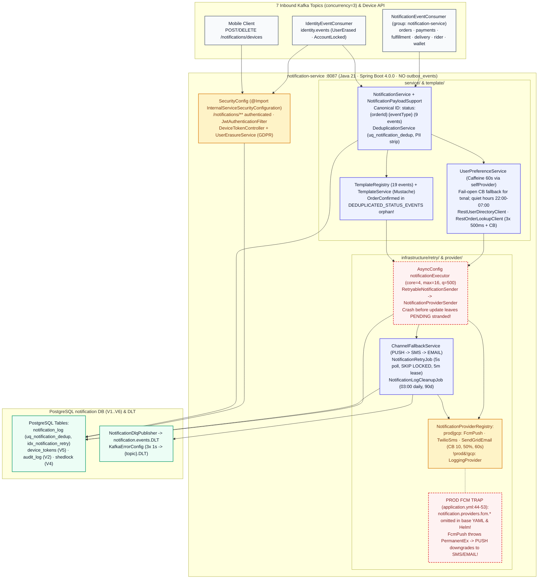
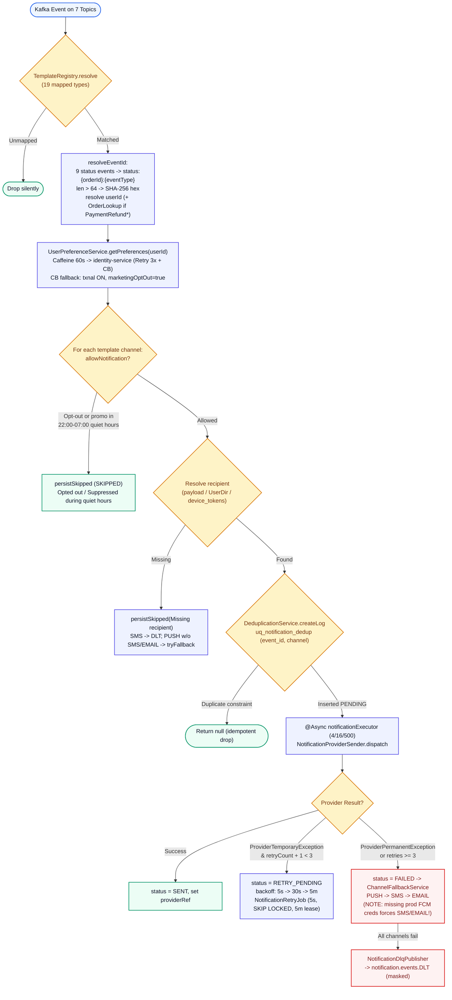
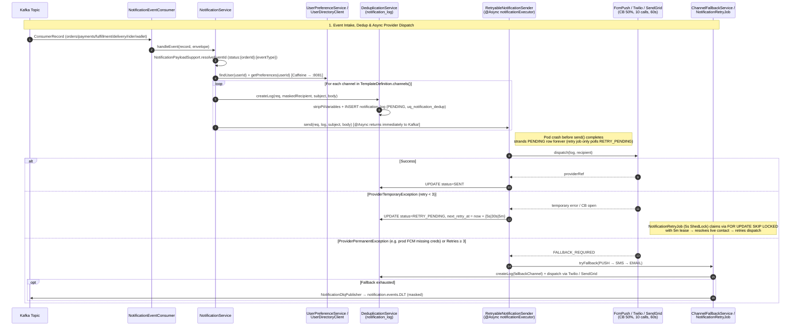

# `notification-service` — Code Walkthrough

> [!NOTE]
> **Part of the InstaCommerce Onboarding Suite:** [Onboarding Hub](../../README.md) · [Code Walkthrough Atlas](../README.md) · [Domain & Event Catalog (`05`)](../../05-domain-model-and-event-catalog.md) · [Incident Drills & Exam (`06`)](../../06-incident-drills-and-readiness-exam.md) · [Dependency Matrix & Cheatsheet (`07`)](../../07-service-dependency-and-command-cheatsheet.md)

> **Multi-Topic Kafka Fan-In, Canonical Status Dedup, Mustache Templates, Quiet Hours & Provider Fallback**
>
> | Dimension | Verified Repo Truth |
> |---|---|
> | **Module & Runtime** | Java 21 / Spring Boot 4.0.0 ([build.gradle.kts](../../../../services/notification-service/build.gradle.kts#L1-L45)) · Mustache templates, Resilience4j, Caffeine (`userDirectory`, `userPreferences`), ShedLock · Dependencies: `:libs:platform-common`, `:contracts` |
> | **HTTP Port** | `8087` (`${SERVER_PORT:8087}` in [application.yml](../../../../services/notification-service/src/main/resources/application.yml#L1-L4)) |
> | **Primary Storage** | PostgreSQL `notification`, Flyway `V1`–`V6` (`ddl-auto: validate`, `open-in-view: false`, Hikari `max=20`) — **zero `outbox_events`, zero Redis** |
> | **Kafka Topics** | **Produces:** DLT only (`notification.events.DLT` in `application.yml:60` via `NotificationDlqPublisher`; `{topic}.DLT` via `KafkaErrorConfig`)<br>**Consumes:** `orders.events`, `payments.events`, `fulfillment.events`, `delivery.events`, `rider.events`, `wallet.events` (group `notification-service`, concurrency `3`) · `identity.events` (`notification-identity`) |
> | **Helm Keys** | `notification-service` ([values.yaml](../../../../deploy/helm/values.yaml#L716-L732)) — **CRITICAL:** omits `FCM_*` credentials while `prod`/`gcp` activates `FcmPushNotificationProvider`! |
> | **SLO Tier** | **Tier 2** (`99.0%` availability, `2000 ms` p99, `432 min/30d` budget) per [error-budget-policy.yaml](../../../../monitoring/error-budget-policy.yaml#L29-L44) |

---

## 1. Service Boundaries & Package Tree

`notification-service` is an **asynchronous terminal sink** (no `outbox_events` table, no Go outbox relay). It consumes domain events from `7` Kafka topics (`6` business topics + `identity.events`), enriches missing user/contact/order details via `identity-service` (`:8081`), `order-service` (`:8084`), and local `device_tokens`, deduplicates per `(event_id, channel)`, renders Mustache templates across `PUSH`, `SMS`, and `EMAIL`, and dispatches via FCM HTTP v1, Twilio, or SendGrid on `@Profile({"prod", "gcp"})` (or `LoggingNotificationProvider` on non-prod profiles).

### Package Layout (`com.instacommerce.notification`)

```text
services/notification-service/src/main/java/com/instacommerce/notification/
├── NotificationServiceApplication.java      # @SpringBootApplication, @EnableAsync, @EnableScheduling, Clock.systemUTC()
├── config/
│   ├── AsyncConfig.java                     # notificationExecutor (core=4, max=16, queue=500, CallerRunsPolicy)
│   ├── CacheConfig.java                     # Caffeine: userDirectory & userPreferences (10K, 60s TTL)
│   ├── KafkaErrorConfig.java                # CommonErrorHandler(FixedBackOff 1s, 3x) -> {topic}.DLT
│   ├── NotificationProperties.java          # dltTopic default "notifications.DLT" (overridden in application.yml:60!)
│   ├── SecurityConfig.java                  # @Import(InternalServiceSecurityConfiguration) + /notifications/** auth
│   └── ShedLockConfig.java                  # @EnableScheduling, defaultLockAtMostFor = PT10M
├── consumer/
│   ├── NotificationEventConsumer.java       # @KafkaListener across 6 topics (concurrency=3)
│   └── IdentityEventConsumer.java           # identity.events (UserErased -> delete tokens/mask; AccountLocked -> alert)
├── controller/
│   └── DeviceTokenController.java           # POST/DELETE /notifications/devices (and /api/v1/notifications/devices)
├── domain/model/                            # NotificationLog (status/retry/lease/maskedRecipient), DeviceToken, AuditLog
├── exception/
│   └── GlobalExceptionHandler.java          # Custom ErrorResponse + DeviceTokenNotFoundException (404)
├── infrastructure/retry/
│   ├── RetryableNotificationSender.java     # @Async("notificationExecutor"): initial dispatch + 3x retry state updates
│   ├── NotificationProviderSender.java      # Resolves provider from NotificationProviderRegistry -> calls send()
│   ├── NotificationRetryJob.java            # Every 5s (ShedLock): FOR UPDATE SKIP LOCKED + 5m lease -> live contact re-resolve
│   ├── NotificationDlqPublisher.java        # KafkaTemplate send to notification.events.DLT with masked PII
│   └── NotificationLogCleanupJob.java       # Daily 03:00 ShedLock purge (90d retention)
├── provider/
│   ├── NotificationProviderRegistry.java    # Matches channel via NotificationProvider.supports(channel)
│   ├── FcmPushNotificationProvider.java     # @Profile({"prod","gcp"}) — THROWS if credentials unconfigured!
│   ├── TwilioSmsProvider.java               # @Profile({"prod","gcp"}) + CB smsProvider (2s/5s)
│   ├── SendGridEmailProvider.java           # @Profile({"prod","gcp"}) + CB emailProvider + List-Unsubscribe header
│   └── LoggingNotificationProvider.java     # @Profile("!prod & !gcp") local noop logger
├── repository/
│   └── NotificationLogRepository.java       # Native SKIP LOCKED claim query (status='RETRY_PENDING' ONLY!)
├── template/
│   ├── TemplateRegistry.java                # 19 mapped eventTypes -> channels, template keys, transactional vs promo
│   └── TemplateService.java                 # Mustache compiler/renderer
└── service/
    ├── NotificationService.java             # Event routing, template lookup, skip/allow decision, async dispatch trigger
    ├── NotificationPayloadSupport.java      # Canonical dedup IDs (9 status events) + OrderLookup enrichment
    ├── DeduplicationService.java            # stripPiiVariables + INSERT notification_log (uq_notification_dedup)
    ├── UserPreferenceService.java           # Caffeine cache + RestUserDirectoryClient + fail-open CB fallback + 22:00-07:00 quiet hours
    ├── ChannelFallbackService.java          # PUSH -> SMS -> EMAIL cascade + DLQ fallback when all exhausted
    ├── DeviceTokenService.java              # Upserts/deactivates mobile FCM tokens per (user_id, token)
    └── UserErasureService.java              # GDPR erasure: wipes device_tokens & scrubs PII in notification_log
```

---

## 2. Startup, Async Executor & Security Filter Chain

1. **Async Pool ([AsyncConfig](../../../../services/notification-service/src/main/java/com/instacommerce/notification/config/AsyncConfig.java#L1-L20)):** Configures `notificationExecutor` (`corePoolSize = 4`, `maxPoolSize = 16`, `queueCapacity = 500`, `CallerRunsPolicy`) so Kafka listener threads commit offsets quickly instead of blocking on external HTTP provider latency (`2s` connect / `5s` read per provider).
2. **Security Rules ([SecurityConfig](../../../../services/notification-service/src/main/java/com/instacommerce/notification/config/SecurityConfig.java#L1-L68)):** Imports `InternalServiceSecurityConfiguration` (`SharedInternalServiceAuthFilter`) and adds `JwtAuthenticationFilter`. Only `/actuator/**` is open; `/notifications/**` and `/api/v1/notifications/**` ([DeviceTokenController](../../../../services/notification-service/src/main/java/com/instacommerce/notification/controller/DeviceTokenController.java#L1-L38)) require an authenticated caller, resolving user identity directly from the JWT principal.
3. **Provider Selection Profile ([NotificationProviderRegistry](../../../../services/notification-service/src/main/java/com/instacommerce/notification/provider/NotificationProviderRegistry.java#L8-L21)):**
   - `@Profile({"prod", "gcp"})` registers [FcmPushNotificationProvider](../../../../services/notification-service/src/main/java/com/instacommerce/notification/provider/FcmPushNotificationProvider.java#L1-L132), [TwilioSmsProvider](../../../../services/notification-service/src/main/java/com/instacommerce/notification/provider/TwilioSmsProvider.java#L27-L100), and [SendGridEmailProvider](../../../../services/notification-service/src/main/java/com/instacommerce/notification/provider/SendGridEmailProvider.java#L25-L100).
   - `@Profile("!prod & !gcp")` activates `LoggingNotificationProvider`.

---

## 3. PostgreSQL Schema (`V1`–`V6`) & Retry Queue Locking

| Migration | Schema & Index Mechanics |
|---|---|
| `V1`, `V3`, `V6` | `notification_log` (`event_id`, `user_id`, `channel`, `status`, `recipient` stored masked, `template_id`, `provider_ref`, `error_message`; unique `uq_notification_dedup(event_id, channel)`). `V3` adds `retry_count`, `max_retries`, `next_retry_at`, `processing_started_at`, `lease_until` plus partial index `idx_notification_retry`. `V6` adds `event_type` and `template_context` JSONB so `NotificationRetryJob` can re-render without hitting upstream services again. |
| `V2`, `V4` | `audit_log` (`V2`) and `shedlock` (`V4`). |
| `V5` | `device_tokens` (`user_id`, `token`, `platform`, `active`, unique `(user_id, token)`). |

---

## 4. Architecture & Low-Level Component Topology

**notification-service Architecture LLD** — *[Rendered PNG](../diagrams/services/notification-service-arch-lld.png) · [Mermaid Source](../diagrams/services/notification-service-arch-lld.mmd)*



**Key Architectural Facts:**
- **Zero Outbox:** Unlike transactional services, `notification-service` persists delivery attempts in `notification_log` directly and publishes *only* permanently failed fallback dead letters (`notification.events.DLT`).
- **PII Scrubbing Before Storage:** [DeduplicationService](../../../../services/notification-service/src/main/java/com/instacommerce/notification/service/DeduplicationService.java#L1-L68) masks recipients before writing `notification_log` (`MaskingUtil`) and strips PII keys from persisted template context.

---

## 5. Dedup, Quiet Hours, Preference Fallback & `PUSH -> SMS -> EMAIL` Cascade

**notification-service Flowchart** — *[Rendered PNG](../diagrams/services/notification-service-flowchart.png) · [Mermaid Source](../diagrams/services/notification-service-flowchart.mmd)*



### Core Decision Pipeline ([NotificationService](../../../../services/notification-service/src/main/java/com/instacommerce/notification/service/NotificationService.java#L1-L193) & [NotificationPayloadSupport](../../../../services/notification-service/src/main/java/com/instacommerce/notification/service/NotificationPayloadSupport.java#L1-L288))
1. **Template Resolution (`19` mapped events):** [TemplateRegistry](../../../../services/notification-service/src/main/java/com/instacommerce/notification/template/TemplateRegistry.java#L1-L66) matches the Kafka envelope `eventType` against `19` supported templates across orders, payments, fulfillment, delivery, rider, wallet, and identity. Unmapped event types drop silently (`OrderConfirmed` sits in `DEDUPLICATED_STATUS_EVENTS` at [NotificationPayloadSupport:28](../../../../services/notification-service/src/main/java/com/instacommerce/notification/service/NotificationPayloadSupport.java#L28) with no template in `TemplateRegistry`).
2. **Canonical Event ID Stabilization:** `resolveEventId` maps `9` order-status event types to canonical IDs (`status:{orderId}:{eventType}`)—hashing with SHA-256 if length `> 64`—so duplicate status notifications emitted by both `outbox` and HTTP choreography collapse onto one `(event_id, channel)` dedup row! If `PaymentRefunded`/`PaymentRefundFailed` lacks `userId`, [RestOrderLookupClient](../../../../services/notification-service/src/main/java/com/instacommerce/notification/service/RestOrderLookupClient.java#L19-L71) fetches it from `order-service:8084/admin/orders/{id}`.
3. **Preference Check & Quiet Hours ([UserPreferenceService](../../../../services/notification-service/src/main/java/com/instacommerce/notification/service/UserPreferenceService.java#L1-L185)):**
   - Queries `identity-service` (`:8081`) via Caffeine (`60s`) + Resilience4j CB/Retry.
   - `22:00`–`07:00` quiet hours (`Asia/Kolkata` / configured zone) suppress non-transactional promotional messages, logging `SKIPPED`.
   - Channel opt-outs (`pushOptOut`, `smsOptOut`, `emailOptOut`, `marketingOptOut`) persist `SKIPPED` rows so retries don't replay opted-out sends.
4. **Provider Execution & Channel Fallback ([ChannelFallbackService](../../../../services/notification-service/src/main/java/com/instacommerce/notification/service/ChannelFallbackService.java#L1-L176)):**
   - `ProviderTemporaryException` (HTTP `5xx`, network error, or open circuit breaker) transitions row to `RETRY_PENDING` with `next_retry_at` backoff (`5s` -> `30s` -> `5m`, up to `3` retries).
   - `ProviderPermanentException` (HTTP `4xx`, missing/placeholder creds in prod, or retries exhausted `>= 3`) sets `FAILED` and calls `tryFallback`: **`PUSH -> SMS -> EMAIL`**, creating a new `notification_log` row for the fallback channel or publishing to `notification.events.DLT` ([NotificationDlqPublisher](../../../../services/notification-service/src/main/java/com/instacommerce/notification/infrastructure/retry/NotificationDlqPublisher.java#L1-L45)) once all channels fail.

---

## 6. Call-Stack Sequence: Async Dispatch, `SKIP LOCKED` Retries & Fallback

**notification-service Sequence Diagram** — *[Rendered PNG](../diagrams/services/notification-service-sequence.png) · [Mermaid Source](../diagrams/services/notification-service-sequence.mmd)*



Trace how the Kafka thread hands off work without blocking partition offsets:
1. [NotificationEventConsumer](../../../../services/notification-service/src/main/java/com/instacommerce/notification/consumer/NotificationEventConsumer.java#L1-L73) invokes `NotificationService.handleEvent`, which synchronously resolves user preferences, creates `notification_log(status=PENDING)` under `uq_notification_dedup(event_id, channel)`, and submits [RetryableNotificationSender.send](../../../../services/notification-service/src/main/java/com/instacommerce/notification/infrastructure/retry/RetryableNotificationSender.java#L1-L136) onto `@Async("notificationExecutor")`.
2. Notice the hazard documented in the sequence diagram: once `createLog` commits `PENDING` and `@Async` enqueues the work in JVM memory (`queue=500`), the Kafka listener returns immediately and commits the Kafka offset. If the pod is evicted/restarted before the executor completes provider dispatch, the row stays **`PENDING`** permanently because [NotificationRetryJob](../../../../services/notification-service/src/main/java/com/instacommerce/notification/infrastructure/retry/NotificationRetryJob.java#L1-L90) only claims **`RETRY_PENDING`** rows ([NotificationLogRepository](../../../../services/notification-service/src/main/java/com/instacommerce/notification/repository/NotificationLogRepository.java#L22-L27)) while `uq_notification_dedup` rejects manual Kafka replays!
3. When a temporary failure writes `RETRY_PENDING`, `NotificationRetryJob` wakes every `5s` under ShedLock, claims batches via PostgreSQL `FOR UPDATE SKIP LOCKED` with a `5m` lease (`lease_until`), **re-resolves live user contact info** (never relying on the masked `recipient` stored in `notification_log`), and dispatches synchronously.

---

## 7. Consumers & Scheduled Jobs

- **[IdentityEventConsumer](../../../../services/notification-service/src/main/java/com/instacommerce/notification/consumer/IdentityEventConsumer.java#L1-L64):** Listens on `identity.events` (`notification-identity`); calls [UserErasureService](../../../../services/notification-service/src/main/java/com/instacommerce/notification/service/UserErasureService.java#L1-L37) on `UserErased` (deletes `device_tokens` + scrubs PII) and triggers security alerts on `AccountLocked`.
- **[NotificationLogCleanupJob](../../../../services/notification-service/src/main/java/com/instacommerce/notification/infrastructure/retry/NotificationLogCleanupJob.java#L1-L37):** Runs daily at `03:00` under ShedLock, deleting `notification_log` entries older than `90` days.

---

## 8. Configuration, Helm Overrides & Narrow Test Verification

- **Key Properties & Helm Drift:** [application.yml](../../../../services/notification-service/src/main/resources/application.yml#L44-L60) configures `sendgrid`, `twilio`, and `notification.events.DLT` (overriding `NotificationProperties`'s default `"notifications.DLT"` at [line 14](../../../../services/notification-service/src/main/java/com/instacommerce/notification/config/NotificationProperties.java#L14)), while [application-local.yml](../../../../services/notification-service/src/main/resources/application-local.yml#L29-L31) is the only place defining `notification.providers.fcm.*`. [deploy/helm/values.yaml](../../../../deploy/helm/values.yaml#L716-L732) omits `FCM_*` credentials entirely.
- **Tests:** `16` test classes live under `services/notification-service/src/test` (`NotificationFallbackQuietHoursAndDedupTest`, `UserPreferenceResilienceAndRetryJobTest`, `NotificationServiceIntegrationTest`, `NotificationProviderProfileTest`, etc.). Run narrow verification via:

```bash
./gradlew :services:notification-service:test --tests "com.instacommerce.notification.service.NotificationFallbackQuietHoursAndDedupTest"
```

---

## 9. Must-Fix Code Risks & Documentation Drift

| Severity | Finding | Exact Evidence & Impact |
|---|---|---|
| **MUST-FIX (PROD BUG)** | **Omitted `FCM_*` credentials in Helm & base YAML disables Push in Prod** | Base [application.yml](../../../../services/notification-service/src/main/resources/application.yml#L44-L53) configures `sendgrid` and `twilio` but omits `notification.providers.fcm.*` (present only in [application-local.yml](../../../../services/notification-service/src/main/resources/application-local.yml#L29-L31)), and [deploy/helm/values.yaml](../../../../deploy/helm/values.yaml#L716-L732) passes no `FCM_*` env vars. Under `@Profile({"prod","gcp"})`, [FcmPushNotificationProvider](../../../../services/notification-service/src/main/java/com/instacommerce/notification/provider/FcmPushNotificationProvider.java#L78-L80) throws `ProviderPermanentException("FCM push credentials are not configured")`, forcing every `PUSH` notification (`OrderDispatched`, `DeliveryFailed`, `ETABreachRisk`, `ItemSubstituted`, `TierUpgraded`) down `ChannelFallbackService` to SMS/Email! |
| **MUST-FIX** | **`PENDING` stranding on pod crash between dedup insert and `@Async` send** | [NotificationService.dispatchToChannel](../../../../services/notification-service/src/main/java/com/instacommerce/notification/service/NotificationService.java#L143-L148) commits `status = PENDING` synchronously then dispatches onto an in-memory `notificationExecutor` (`queue=500`), committing the Kafka offset immediately. A crash/OOMKill strands rows in `PENDING`, ignored by [NotificationRetryJob](../../../../services/notification-service/src/main/java/com/instacommerce/notification/repository/NotificationLogRepository.java#L22-L27) (`WHERE status = 'RETRY_PENDING'`). |
| **MEDIUM** | **Unreachable `PreferenceLookupException` Kafka retry + orphan `OrderConfirmed` + DLT name mismatch** | [UserPreferenceService.fetchPreferences](../../../../services/notification-service/src/main/java/com/instacommerce/notification/service/UserPreferenceService.java#L145-L167) defines `fallbackMethod = "fetchPreferencesFallback"` returning `(false, false, false, true)` on all `Exception`s, bypassing the `catch (PreferenceLookupException)` Kafka DLT retry block in [NotificationEventConsumer](../../../../services/notification-service/src/main/java/com/instacommerce/notification/consumer/NotificationEventConsumer.java#L59-L62). Also `OrderConfirmed` in [NotificationPayloadSupport:28](../../../../services/notification-service/src/main/java/com/instacommerce/notification/service/NotificationPayloadSupport.java#L28) has no `TemplateRegistry` mapping, and `NotificationProperties:14` defaults `dltTopic` to `"notifications.DLT"` while `application.yml:60` overrides it to `notification.events.DLT`. |
| **DRIFT** | **`notification-service/README.md` is severely outdated** | [notification-service/README.md](../../../../services/notification-service/README.md) lists 4 legacy consumers, 4 topics, 5 templates, and 4 migrations (missing `V5`/`V6`, `delivery.events`, `rider.events`, `wallet.events`, `FcmPushNotificationProvider`, quiet hours, and `ChannelFallbackService`). |

---

**Previous:** [routing-eta-service](./routing-eta-service.md) | **Atlas Hub:** [Code Walkthrough Atlas](../README.md) | **Next:** [outbox-relay-service](./outbox-relay-service.md)
