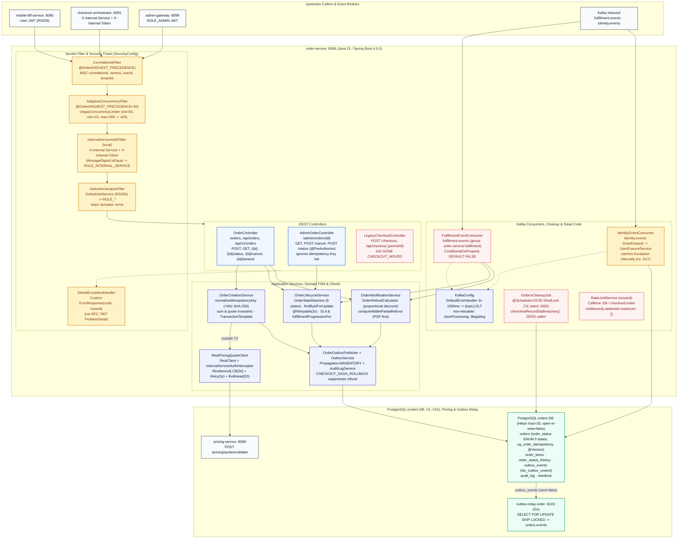
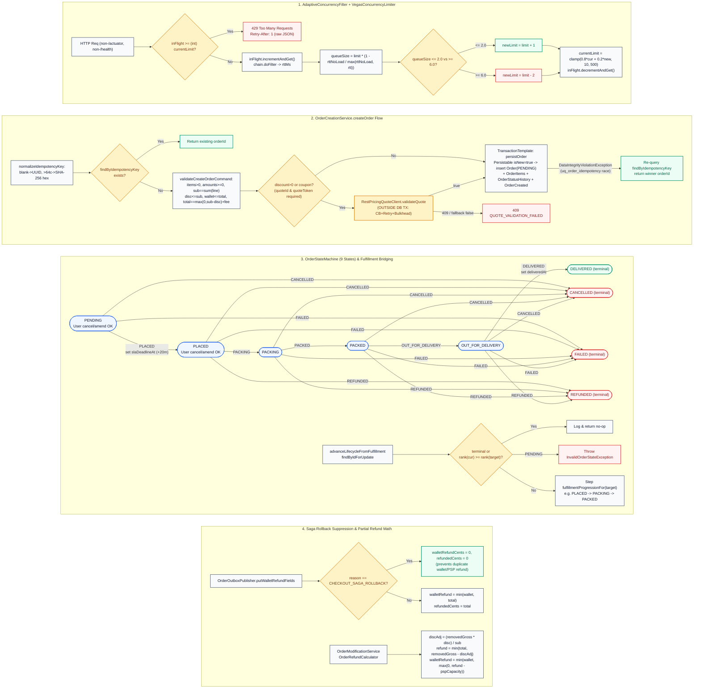
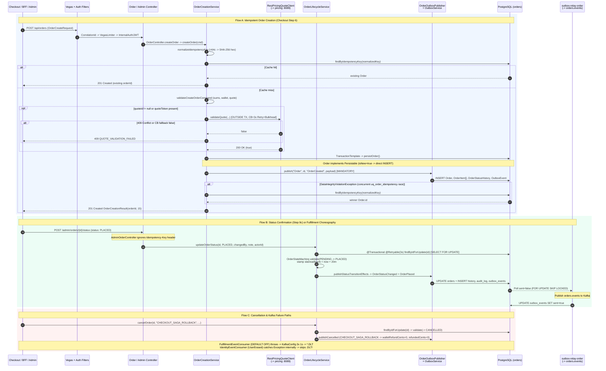

# `order-service` — Code Walkthrough

> [!NOTE]
> **Part of the InstaCommerce Onboarding Suite:** [Onboarding Hub](../../README.md) · [Code Walkthrough Atlas](../README.md) · [Domain & Event Catalog (`05`)](../../05-domain-model-and-event-catalog.md) · [Incident Drills & Exam (`06`)](../../06-incident-drills-and-readiness-exam.md) · [Dependency Matrix & Cheatsheet (`07`)](../../07-service-dependency-and-command-cheatsheet.md)

> **Authoritative Order State of Record & Outbox Producer**
>
> | Dimension | Verified Repo Truth |
> |---|---|
> | **Module & Runtime** | Java 21 / Spring Boot 4.0.0 ([build.gradle.kts](../../../../services/order-service/build.gradle.kts#L1-L44)) · Dependencies: `:libs:platform-common`, `:contracts` |
> | **HTTP Port** | `8084` (`${SERVER_PORT:8084}` in [application.yml](../../../../services/order-service/src/main/resources/application.yml#L1-L3)) |
> | **Primary Storage** | PostgreSQL `orders` (`order_db` in Helm), Flyway `V1`–`V15` (`ddl-auto: validate`, `open-in-view: false`, Hikari `max=20`) — **zero Redis, zero Temporal SDK** |
> | **Kafka Topics** | **Produces** (via external Go `outbox-relay-order`): `orders.events` (`OrderCreated`, `OrderStatusChanged`, `OrderPlaced`, `OrderCancelled`, `OrderFailed`, `OrderRefunded`, `OrderDelivered`, `OrderModified`, `OrderPartiallyRefunded`, `OrderSlaBreached`)<br>**Consumes:** `identity.events` (`order-service-erasure`, unconditional) · `fulfillment.events` (`order-service-fulfillment`, `@ConditionalOnProperty` default `false`) · **DLT:** `{topic}.DLT` |
> | **Helm Keys** | `order-service` ([values.yaml](../../../../deploy/helm/values.yaml#L649-L669)) · Relay: `outbox-relay-order` (`:8103`, [values.yaml](../../../../deploy/helm/values.yaml#L883-L903)) |
> | **SLO Tier** | **Tier 1** (`99.5%` 30d availability, `216 min` budget, `1000 ms` p99) per [error-budget-policy.yaml](../../../../monitoring/error-budget-policy.yaml#L15-L27) |

---

## 1. Service Boundaries & Package Tree

`order-service` owns the authoritative `orders`, `order_items`, `order_status_history`, `outbox_events`, `audit_log`, and `shedlock` tables. Per [ADR-001](../../../../docs/adr/001-checkout-authority.md), checkout saga orchestration was removed from `order-service` and consolidated into `checkout-orchestrator-service` (`:8091`); `order-service` remains a pure transactional participant that creates `PENDING` orders, validates arithmetic and pricing quotes, guards the 9-state `OrderStatus` finite state machine under pessimistic row locks, handles partial item cancellations/short-picks, executes GDPR erasure, and writes domain events atomically into `outbox_events`.

### Package Layout (`com.instacommerce.order`)

```text
services/order-service/src/main/java/com/instacommerce/order/
├── OrderServiceApplication.java          # @SpringBootApplication, @EnableScheduling, @EnableRetry
├── client/
│   ├── PricingQuoteClient.java           # Quote validation port
│   └── RestPricingQuoteClient.java       # RestClient + CB/Retry/Bulkhead -> pricing-service :8089
├── config/
│   ├── CorrelationIdFilter.java          # @Order(HIGHEST_PRECEDENCE) MDC injector
│   ├── JacksonConfig.java
│   ├── KafkaConfig.java                  # DefaultErrorHandler (3x 1000ms) -> DeadLetterPublishingRecoverer
│   ├── OpenApiConfig.java
│   ├── OrderProperties.java              # @ConfigurationProperties(prefix = "order")
│   ├── SecurityConfig.java               # Stateless SecurityFilterChain + CORS
│   └── ShedLockConfig.java               # JdbcTemplateLockProvider (@EnableSchedulerLock 30m)
├── consumer/
│   ├── FulfillmentEventConsumer.java     # Conditional listener on fulfillment.events
│   ├── FulfillmentOrderEvent.java        # Payload record with itemDeltas
│   ├── IdentityEventConsumer.java        # Unconditional listener on identity.events (UserErased)
│   └── UserErasedEvent.java
├── controller/
│   ├── AdminOrderController.java         # /admin/orders/{id} (GET, /cancel, /status)
│   ├── LegacyCheckoutController.java     # /checkout, /api/checkout -> 410 GONE CHECKOUT_MOVED
│   └── OrderController.java              # /orders, /api/orders, /api/v1/orders
├── domain/
│   ├── model/                            # Order (Persistable), OrderItem, OrderStatus, OrderStatusHistory,
│   │                                     # OrderRefundCalculator, OutboxEvent, AuditLog
│   └── statemachine/OrderStateMachine.java
├── dto/                                  # mapper/OrderMapper, request/*, response/*
├── exception/                            # ApiException, GlobalExceptionHandler, TraceIdProvider, domain exceptions
├── repository/                           # OrderRepository, OrderItemRepository, OrderStatusHistoryRepository,
│                                         # OutboxEventRepository, AuditLogRepository
├── resilience/
│   ├── AdaptiveConcurrencyFilter.java    # @Order(HIGHEST_PRECEDENCE + 50) -> 429 Retry-After: 1
│   └── VegasConcurrencyLimiter.java      # TCP Vegas RTT gradient limiter [10, 500]
├── security/
│   ├── DefaultJwtService.java            # JJWT RS256 parser + ROLE_ normalization
│   ├── InternalServiceAuthFilter.java    # Local filter (X-Internal-Service + X-Internal-Token)
│   ├── InternalServiceAuthInterceptor.java
│   ├── JwtAuthenticationFilter.java      # Bearer JWT -> SecurityContext + MDC userId/storeId/tenantId
│   └── JwtKeyLoader.java / RestAccessDeniedHandler.java / RestAuthenticationEntryPoint.java
├── service/
│   ├── AuditLogService.java              # Captures userId, IP, User-Agent, traceId -> audit_log
│   ├── OrderCreationService.java         # Key normalization, arithmetic/quote checks, TransactionTemplate
│   ├── OrderLifecycleService.java        # PESSIMISTIC_WRITE FSM transitions, @Retryable, SLA breach calc
│   ├── OrderModificationService.java     # Amendments, OrderModified deltas, cancelOrderItems
│   ├── OrderOutboxPublisher.java         # Package-private outbox + audit coordinator
│   ├── OrderService.java                 # Public facade delegating to Creation/Lifecycle/Modification
│   ├── OutboxCleanupJob.java             # Daily 03:00 ShedLock cleanup (>7d sent rows)
│   ├── OutboxService.java                # Propagation.MANDATORY outbox_events writer
│   ├── RateLimitService.java             # Unused legacy checkoutLimiter bean
│   └── UserErasureService.java           # Anonymizes user_id -> zero UUID
└── workflow/model/CreateOrderCommand.java
```

---

## 2. Startup, Configuration & Security Filter Chain

1. **Bootstrap ([OrderServiceApplication.java](../../../../services/order-service/src/main/java/com/instacommerce/order/OrderServiceApplication.java#L10-L18)):** Enables `@EnableConfigurationProperties({OrderProperties.class})`, `@EnableScheduling`, and `@EnableRetry`. Notice `ShedLockConfig` ([ShedLockConfig.java](../../../../services/order-service/src/main/java/com/instacommerce/order/config/ShedLockConfig.java#L10-L18)) provides `JdbcTemplateLockProvider` without repeating `@EnableScheduling` because the main application class enables scheduling globally.
2. **Servlet Filter Execution Order:**
   - **Step 1 — [CorrelationIdFilter.java](../../../../services/order-service/src/main/java/com/instacommerce/order/config/CorrelationIdFilter.java#L16-L86) (`@Order(Ordered.HIGHEST_PRECEDENCE)`):** Populates `correlationId`/`correlation_id` (echoed on `X-Correlation-ID` response header), plus `storeId`, `userId`, and `tenantId` in SLF4J MDC from headers or query parameters, cleaning them in `finally`.
   - **Step 2 — [AdaptiveConcurrencyFilter.java](../../../../services/order-service/src/main/java/com/instacommerce/order/resilience/AdaptiveConcurrencyFilter.java#L21-L55) (`@Order(Ordered.HIGHEST_PRECEDENCE + 50)`):** Runs **before** Spring Security on every URI except `/actuator/**` and `/health/**`. Calls `VegasConcurrencyLimiter.tryAcquire()` and immediately returns HTTP `429 Too Many Requests` (`Retry-After: 1`) if in-flight count hits `currentLimit`.
   - **Step 3 — [SecurityConfig.java](../../../../services/order-service/src/main/java/com/instacommerce/order/config/SecurityConfig.java#L31-L49):** Disables CSRF, enforces `SessionCreationPolicy.STATELESS`, permits `/actuator/**`, `/error`, `/checkout`, and `/api/checkout`, requires `hasAnyRole("ADMIN", "INTERNAL_SERVICE")` on `/admin/**`, and requires authentication on all other paths (`@EnableMethodSecurity` activates `@PreAuthorize` on [AdminOrderController.java](../../../../services/order-service/src/main/java/com/instacommerce/order/controller/AdminOrderController.java#L30-L56)).
   - **Step 4 — Auth Filters (`InternalServiceAuthFilter` & `JwtAuthenticationFilter`):** Both are registered via `addFilterBefore(..., UsernamePasswordAuthenticationFilter.class)` ([SecurityConfig.java](../../../../services/order-service/src/main/java/com/instacommerce/order/config/SecurityConfig.java#L46-L47)):
     - [InternalServiceAuthFilter.java](../../../../services/order-service/src/main/java/com/instacommerce/order/security/InternalServiceAuthFilter.java#L28-L65) checks `X-Internal-Service` and `X-Internal-Token` via constant-time `MessageDigest.isEqual` (preferring `internal.service.allowed-callers[serviceName]`, falling back to `internal.service.token`) and grants `ROLE_INTERNAL_SERVICE` with principal = `serviceName`.
     - [JwtAuthenticationFilter.java](../../../../services/order-service/src/main/java/com/instacommerce/order/security/JwtAuthenticationFilter.java#L26-L99) validates `Bearer` RS256 tokens via [DefaultJwtService.java](../../../../services/order-service/src/main/java/com/instacommerce/order/security/DefaultJwtService.java#L25-L53) (checking `order.jwt.issuer`), populates MDC `userId`/`storeId`/`tenantId` from claims, and returns HTTP `401 TOKEN_INVALID` on `JwtException`.

---

## 3. Low-Level Design, Flyway Schema & Locking Invariants

**order-service low-level architecture** — *[Rendered PNG](../diagrams/services/order-service-arch-lld.png) · [Mermaid Source](../diagrams/services/order-service-arch-lld.mmd)*



### Flyway Schema Inventory (`V1`–`V15`)

Hibernate runs with `spring.jpa.hibernate.ddl-auto: validate` and `spring.jpa.open-in-view: false` ([application.yml](../../../../services/order-service/src/main/resources/application.yml#L27-L30)). All schema changes live in 15 Flyway migrations:

| Migration | Table / Object | Key Columns, Types & Constraints | Source |
|---|---|---|---|
| `V1` | `order_status` ENUM + `orders` | `id UUID PK`, `user_id UUID`, `store_id VARCHAR(50)`, `status order_status DEFAULT 'PENDING'` (initially 8 states), `subtotal_cents`, `discount_cents`, `total_cents`, `currency CHAR(3) DEFAULT 'INR'`, `idempotency_key VARCHAR(64)` + `CONSTRAINT uq_order_idempotency UNIQUE`, `version BIGINT DEFAULT 0` (`@Version`) | [V1__create_orders.sql](../../../../services/order-service/src/main/resources/db/migration/V1__create_orders.sql#L1-L28) |
| `V2` | `order_items` | `id UUID PK`, `order_id FK ON DELETE CASCADE`, `product_id`, `product_name`, `product_sku`, `quantity INT CHECK (quantity > 0)`, `unit_price_cents`, `line_total_cents`, `picked_status DEFAULT 'PENDING'` | [V2__create_order_items.sql](../../../../services/order-service/src/main/resources/db/migration/V2__create_order_items.sql#L1-L14) |
| `V3` | `order_status_history` | `id BIGSERIAL PK`, `order_id FK ON DELETE CASCADE`, `from_status order_status`, `to_status order_status NOT NULL`, `changed_by`, `note`, `created_at` | [V3__create_order_status_history.sql](../../../../services/order-service/src/main/resources/db/migration/V3__create_order_status_history.sql#L1-L11) |
| `V4`, `V10`, `V12` | `outbox_events` | `id UUID PK`, `aggregate_type`, `aggregate_id`, `event_type`, `payload JSONB`, `sent BOOLEAN DEFAULT false`; `V10` adds Wave 24 envelope (`event_id`, `schema_version='v1'`, `source_service='order-service'`, `correlation_id`, `event_timestamp`); partial index `idx_outbox_unsent ON (sent) WHERE sent = false`; `V12` adds `(sent, created_at)` | [V4](../../../../services/order-service/src/main/resources/db/migration/V4__create_outbox.sql#L1-L11), [V10](../../../../services/order-service/src/main/resources/db/migration/V10__add_outbox_envelope_fields.sql#L4-L13), [V12](../../../../services/order-service/src/main/resources/db/migration/V12__add_outbox_events_retention_index.sql#L1) |
| `V5` | `audit_log` | `id UUID PK`, `user_id`, `action`, `entity_type`, `entity_id`, `details JSONB`, `ip_address`, `user_agent`, `trace_id` | [V5__create_audit_log.sql](../../../../services/order-service/src/main/resources/db/migration/V5__create_audit_log.sql#L1-L16) |
| `V6`, `V7`, `V9`, `V11`, `V13` | `orders` extensions | `user_erased BOOLEAN DEFAULT false` (`V6`); `delivery_address TEXT` (`V7`); `idx_orders_user_created_at` (`V9`); `quote_id UUID` (`V11`); `dropoff_lat DECIMAL(10,8)`, `dropoff_lng DECIMAL(11,8)` (`V13`) | [V6](../../../../services/order-service/src/main/resources/db/migration/V6__add_orders_user_erased.sql#L1-L2), [V11](../../../../services/order-service/src/main/resources/db/migration/V11__add_orders_quote_id.sql#L1-L2), [V13](../../../../services/order-service/src/main/resources/db/migration/V13__add_delivery_coordinates.sql#L1-L2) |
| `V8` | `shedlock` | `name VARCHAR(64) PK`, `lock_until`, `locked_at`, `locked_by` | [V8__create_shedlock.sql](../../../../services/order-service/src/main/resources/db/migration/V8__create_shedlock.sql#L1-L7) |
| `V14` | `REFUNDED` + SLA | `ALTER TYPE order_status ADD VALUE IF NOT EXISTS 'REFUNDED'`; `sla_deadline_at`, `sla_breached_at`, `delivered_at`; partial index `idx_orders_active_sla` (`WHERE sla_breached_at IS NULL AND status IN ('PLACED','PACKING','PACKED','OUT_FOR_DELIVERY')`) | [V14__add_refunded_status_and_sla_tracking.sql](../../../../services/order-service/src/main/resources/db/migration/V14__add_refunded_status_and_sla_tracking.sql#L1-L10) |
| `V15` | Split-tender & item flags | `orders.wallet_amount_cents BIGINT NOT NULL DEFAULT 0`; `order_items`: `cold_chain`, `fragile`, `storage_temperature`, `tare_weight_grams` | [V15__add_wallet_amount_and_item_metadata.sql](../../../../services/order-service/src/main/resources/db/migration/V15__add_wallet_amount_and_item_metadata.sql#L1-L8) |

### Persistence & Locking Invariants

- **`Persistable<UUID>` avoids redundant `SELECT`s ([Order.java](../../../../services/order-service/src/main/java/com/instacommerce/order/domain/model/Order.java#L28-L139)):** Because `checkout-orchestrator-service` pre-computes `expectedOrderId = UUID.nameUUIDFromBytes("order-" + workflowId)` and passes `orderId` into `OrderCreateRequest`, JPA would normally treat a non-null `@Id` entity as detached and issue a `SELECT` during `save()` (`merge`). Implementing `Persistable<UUID>` with `@Transient boolean isNew = true` (flipped to `false` on `@PostLoad` / `@PostPersist`) forces Hibernate to execute a direct `INSERT`.
- **Dual Concurrency Defense ([OrderRepository.java](../../../../services/order-service/src/main/java/com/instacommerce/order/repository/OrderRepository.java#L22-L28), [OrderLifecycleService.java](../../../../services/order-service/src/main/java/com/instacommerce/order/service/OrderLifecycleService.java#L64-L89)):** Every mutating lifecycle or modification path calls `lockOrder()` (`findByIdForUpdate` -> `SELECT ... FOR UPDATE`) while recording wait latency into Micrometer timer `order.lock.contention.duration`, and decorates transactional methods with `@Retryable` (`maxAttempts = 3`, `50ms * 2.0`, max `500ms`) for optimistic-lock failures.

---

## 4. Algorithmic Flows & Method-by-Method Code Walkthrough

**order-service concurrency, creation, FSM, and refund flow** — *[Rendered PNG](../diagrams/services/order-service-flowchart.png) · [Mermaid Source](../diagrams/services/order-service-flowchart.mmd)*



### A. Vegas Adaptive Concurrency Shedding ([VegasConcurrencyLimiter.java](../../../../services/order-service/src/main/java/com/instacommerce/order/resilience/VegasConcurrencyLimiter.java#L19-L70))

- Initializes `currentLimit = 50.0` bounded by `[minLimit = 10.0, maxLimit = 500.0]`, baseline `rttNoLoadMs = 10.0`, `alpha = 2.0`, `beta = 6.0`, `smoothing = 0.2`.
- After the request finishes, `AdaptiveConcurrencyFilter` calls `limiter.onSample(durationMs)`:
  - Updates `rttNoLoadMs = rttMs` if `rttMs < rttNoLoadMs` (ignoring `rttMs <= 0`).
  - Estimates queue depth: `queueSize = currentLimit * (1.0 - rttNoLoadMs / max(rttNoLoadMs, rttMs))`.
  - Probes `+1.0` when `queueSize <= 2.0`, throttles `-2.0` when `queueSize >= 6.0`, smooths via `0.8 * currentLimit + 0.2 * newLimit`, clamps to `[10.0, 500.0]`, and decrements `inFlight` inside `finally`.

### B. Order Creation & Pre-Transaction Quote Check ([OrderCreationService.java](../../../../services/order-service/src/main/java/com/instacommerce/order/service/OrderCreationService.java#L55-L237))

1. **`normalizeIdempotencyKey` (lines 219–227):** If blank, generates a random UUID; if length `<= 64`, preserves verbatim; if `> 64` (e.g., Temporal's `checkout-{userId}-{key}:order:create`), SHA-256 hex-digests it to fit `orders.idempotency_key VARCHAR(64)`.
2. **Fast Idempotency Read & Arithmetic Invariants (lines 57–153):** Short-circuits if `findByIdempotencyKey(normalizedKey)` already exists. Otherwise `validateCreateOrderCommand` enforces: non-empty items, non-negative monetary fields, `expectedLineTotal == quantity * unitPriceCents` (`Math.multiplyExact`), `subtotalCents == sum(lineTotals)`, `discountCents <= subtotalCents`, `walletAmountCents <= totalCents`, `totalCents == max(0, subtotalCents - discountCents) + deliveryFeeCents`, and mandatory `(quoteId, quoteToken)` pair whenever `discountCents > 0` or `couponCode` is non-blank (`400 DISCOUNT_REQUIRES_QUOTE`).
3. **External HTTP Call Outside Transaction (lines 62–76):** If `quoteId` or `quoteToken` is present, calls `RestPricingQuoteClient.validateQuote(...)` **before** acquiring a DB transaction. [RestPricingQuoteClient.java](../../../../services/order-service/src/main/java/com/instacommerce/order/client/RestPricingQuoteClient.java#L34-L61) wraps `RestClient` (`2s` connect, `10s` read, attaching `X-Internal-Service` / `X-Internal-Token`) with `@CircuitBreaker`, `@Retry`, and `@Bulkhead` (`pricingService`), failing closed to `false` -> `409 QUOTE_VALIDATION_FAILED`.
4. **Transactional Persist + Race Recovery (lines 77–83, 155–213):** Executes `persistOrder` inside `TransactionTemplate`: re-checks `findByIdempotencyKey`, builds `Order(PENDING)` and `OrderItem`s, saves `OrderStatusHistory(null -> PENDING)`, calls `OutboxService.publish("Order", id, "OrderCreated", ...)` (`Propagation.MANDATORY`), and catches `DataIntegrityViolationException` on `uq_order_idempotency` to return the concurrent winner's `orderId`.

### C. 9-State FSM, Fulfillment Bridging & SLA Stamp ([OrderStateMachine.java](../../../../services/order-service/src/main/java/com/instacommerce/order/domain/statemachine/OrderStateMachine.java#L8-L35), [OrderLifecycleService.java](../../../../services/order-service/src/main/java/com/instacommerce/order/service/OrderLifecycleService.java#L115-L327))

- **Permitted Transitions:** `PENDING -> {PLACED, FAILED, CANCELLED}`, `PLACED -> {PACKING, CANCELLED, FAILED, REFUNDED}`, `PACKING -> {PACKED, CANCELLED, FAILED, REFUNDED}`, `PACKED -> {OUT_FOR_DELIVERY, CANCELLED, FAILED, REFUNDED}`, `OUT_FOR_DELIVERY -> {DELIVERED, CANCELLED, FAILED, REFUNDED}`, and empty sets for terminal states (`DELIVERED`, `CANCELLED`, `FAILED`, `REFUNDED`).
- **User vs Admin Cancellation:** `cancelOrderByUser` (lines 115–126) is idempotent on `CANCELLED` and rejects any state other than `PENDING` or `PLACED` (`409 INVALID_ORDER_STATE`), whereas `AdminOrderController.cancelOrder` -> `cancelOrder` (lines 133–141) allows cancelling from any non-terminal state.
- **Lifecycle Bridging (`advanceLifecycleFromFulfillment`, lines 158–185):** Locks the order `FOR UPDATE`, returns on terminal states, rejects `PENDING`, immediately applies `FAILED` if targeted, ignores events where `lifecycleRank(current) >= lifecycleRank(target)` (`PLACED=1 .. DELIVERED=5`), and otherwise iterates `fulfillmentProgressionFor(targetStatus)` sequentially (e.g., `OrderPacked` on a `PLACED` order emits transitions and outbox events for `PLACED -> PACKING` and `PACKING -> PACKED`).
- **SLA & Delivery Timestamps (`applyOrderStatusTransition`, lines 187–215):** Stamps `slaDeadlineAt = now + orderProperties.getSla().getPromisedDeliveryMinutes()` (`20m` default) on entering `PLACED`, stamps `deliveredAt = now` on entering `DELIVERED`, and checks `recordSlaBreachIfDue(now)` on `PACKING`, `PACKED`, `OUT_FOR_DELIVERY`, and `DELIVERED` transitions.

### D. Saga Rollback Suppression & Partial Refunds ([OrderOutboxPublisher.java](../../../../services/order-service/src/main/java/com/instacommerce/order/service/OrderOutboxPublisher.java#L150-L158), [OrderModificationService.java](../../../../services/order-service/src/main/java/com/instacommerce/order/service/OrderModificationService.java#L66-L342))

- **`CHECKOUT_SAGA_ROLLBACK` Suppression:** When `OrderActivityImpl.cancelOrder` rolls back a failed checkout saga (`reason = "CHECKOUT_SAGA_ROLLBACK"`), `OrderOutboxPublisher.putWalletRefundFields` sets `walletRefundCents = 0L` and `refundedCents = 0L` in `OrderCancelled` / `OrderFailed` / `OrderRefunded` payloads so `wallet-loyalty-service` and `payment-service` do not issue duplicate refunds on top of `CheckoutWorkflowImpl`'s own compensation activities.
- **Partial Refunds & Modifications ([OrderRefundCalculator.java](../../../../services/order-service/src/main/java/com/instacommerce/order/domain/model/OrderRefundCalculator.java#L18-L58)):** Both `applyOrderModification` (short-picks from `fulfillment.events`, version-guarded by `order.getVersion() >= event.newVersion()`) and `cancelOrderItems` proportionally reduce discounts via `(effectiveRemovedGross * orderDiscountCents) / orderSubtotalCents`, cap refund at `orderTotalCents`, and compute `computeWalletPartialRefund` by exhausting PSP capacity (`previousTotal - walletRemaining`) **before** refunding the wallet portion (`OrderPartiallyRefunded`). If `cancelOrderItems` removes every item (`order.getItems().isEmpty()`), it delegates to `lifecycleService.cancelOrder`.

---

## 5. End-to-End Call-Stack Trace, Kafka & Resilience4j

**order-service end-to-end call-stack sequence** — *[Rendered PNG](../diagrams/services/order-service-sequence.png) · [Mermaid Source](../diagrams/services/order-service-sequence.mmd)*



### HTTP Routes ([OrderController.java](../../../../services/order-service/src/main/java/com/instacommerce/order/controller/OrderController.java#L30-L141), [AdminOrderController.java](../../../../services/order-service/src/main/java/com/instacommerce/order/controller/AdminOrderController.java#L21-L56), [LegacyCheckoutController.java](../../../../services/order-service/src/main/java/com/instacommerce/order/controller/LegacyCheckoutController.java#L15-L25))

| Controller & Paths | Auth / Principal Rule | Behavior |
|---|---|---|
| `POST /orders`, `/api/orders`, `/api/v1/orders` | Authenticated; non-privileged must match `principal == request.userId()` | Creates `PENDING` order; reads `idempotencyKey` from JSON body (random UUID if blank); returns `201 OrderCreationResult(orderId, 15)` |
| `GET /orders`, `/api/orders`, `/api/v1/orders` | Authenticated UUID principal | Paginated `Page<OrderSummaryResponse>` sanitized via `PageableUtils.sanitize` |
| `GET /{id}` & `/{id}/status` | Owner `userId` or `ADMIN`/`INTERNAL_SERVICE` | Returns `OrderResponse` or `OrderStatusResponse` with ascending `OrderStatusHistory` timeline |
| `POST /{id}/cancel` | Owner (`PENDING` or `PLACED` only) or privileged | `204 No Content`; writes `OrderCancelled` (`CancellationReason` keyword heuristic) |
| `POST /{id}/amend` | Owner or privileged | `204 No Content`; acquires row lock and verifies `PENDING` or `PLACED` (`409 ORDER_AMENDMENT_FORBIDDEN` otherwise) |
| `GET /admin/orders/{id}`, `POST /status`, `POST /cancel` | `hasAnyRole('ADMIN', 'INTERNAL_SERVICE')` | `POST /status` drives Step 9c `PLACED` confirmation from `checkout-orchestrator-service`; returns `204 No Content` |
| `POST /checkout`, `/api/checkout` | `permitAll` | Tombstone returning `410 Gone` (`{"code":"CHECKOUT_MOVED", ...}`) |

### Kafka Consumers, Outbox & Error Handling

- **Outbox Write & Relay:** [OutboxService.java](../../../../services/order-service/src/main/java/com/instacommerce/order/service/OutboxService.java#L22-L48) enforces `Propagation.MANDATORY` so outbox inserts fail fast if called outside an active DB transaction, resolving `correlationId` from MDC (`correlationId` or `X-Correlation-ID`). There is **no** in-process publisher: `outbox-relay-order` (`:8103`) polls `outbox_events WHERE sent = false` via `FOR UPDATE SKIP LOCKED` and publishes to `orders.events`. [OutboxCleanupJob.java](../../../../services/order-service/src/main/java/com/instacommerce/order/service/OutboxCleanupJob.java#L26-L38) deletes `sent = true` rows older than 7 days in batches of `1000` daily at `03:00` under ShedLock (`order-outbox-cleanup`).
- **Inbound Consumers & DLQ ([KafkaConfig.java](../../../../services/order-service/src/main/java/com/instacommerce/order/config/KafkaConfig.java#L19-L33)):** `DefaultErrorHandler` configures `FixedBackOff(1000L, 3)` + `DeadLetterPublishingRecoverer` (`{topic}.DLT`), marking `JsonProcessingException` and `IllegalArgumentException` non-retryable.
  - [FulfillmentEventConsumer.java](../../../../services/order-service/src/main/java/com/instacommerce/order/consumer/FulfillmentEventConsumer.java#L17-L151): Gated by `@ConditionalOnProperty(prefix = "order.choreography", name = "fulfillment-consumer-enabled", havingValue = "true")`. Processes `OrderPacked`, `OrderDispatched`, `OrderDelivered`, `DeliveryFailed`/`FulfillmentFailed`, `OrderModified`, `ProofOfDeliveryUploaded`, and `ItemSubstituted` (`ack-mode: record`, `enable-auto-commit: false`). Throws on failure so `KafkaConfig` retries/routes to `fulfillment.events.DLT`.
  - [IdentityEventConsumer.java](../../../../services/order-service/src/main/java/com/instacommerce/order/consumer/IdentityEventConsumer.java#L15-L44): Listens unconditionally on `identity.events` (`UserErased`) and delegates to [UserErasureService.java](../../../../services/order-service/src/main/java/com/instacommerce/order/service/UserErasureService.java#L22-L30) (`user_id = 00000000-0000-0000-0000-000000000000`, `user_erased = true`).
- **Error Envelope ([GlobalExceptionHandler.java](../../../../services/order-service/src/main/java/com/instacommerce/order/exception/GlobalExceptionHandler.java#L22-L97)):** Emits custom `ErrorResponse(code, message, traceId, timestamp, details)` (not `ProblemDetailFactory` RFC 7807).

---

## 6. Configuration Matrix, Observability & Targeted Tests

### Config & Helm Matrix ([application.yml](../../../../services/order-service/src/main/resources/application.yml#L1-L148), [application-local.yml](../../../../services/order-service/src/main/resources/application-local.yml#L1-L35), [OrderProperties.java](../../../../services/order-service/src/main/java/com/instacommerce/order/config/OrderProperties.java#L5-L90))

| Setting / Env Var | `application.yml` Default | `application-local.yml` | Helm (`values.yaml` / `values-staging` / `values-prod`) |
|---|---|---|---|
| `SERVER_PORT` | `8084` | `8084` | `"8084"` |
| `ORDER_DB_URL` / Hikari `maximum-pool-size` | `jdbc:postgresql://localhost:5432/orders` / `20` | `devpass` password | `order_db` / `10` staging, `20` base & prod |
| `ORDER_CHOREOGRAPHY_FULFILLMENT_CONSUMER_ENABLED` | `false` | **`true`** | `"false"` across base, staging, prod |
| `ORDER_CHECKOUT_DIRECT_SAGA_ENABLED` (dead!) | *absent from code* | *absent* | **`"true"` in base `values.yaml:660`** / `"false"` staging & prod |
| `order.sla.promised-delivery-minutes` | `20` (default in `OrderProperties`) | `20` | *not overridden* |
| `resilience4j.*.pricingService` | CB `50/10/50%/10s`, Retry `3x 500ms` (aspect 1), Bulkhead `20 / 0ms` | inherited | `PRICING_SERVICE_URL: "http://pricing-service:8089"` |
| Probes & Metrics | `/actuator/health/readiness` (`readinessState,db`), `/actuator/prometheus`, `order.lock.contention.duration` | OTLP export off | Prometheus scrape |

### Targeted Validation & Test Inventory

```bash
# Run full order-service unit + Testcontainers PostgreSQL suite (15 test classes)
./gradlew :services:order-service:test

# Run a single test class or method
./gradlew :services:order-service:test --tests "com.instacommerce.order.service.OrderCreateTransactionBoundaryTest"

# Compile & check formatting
./gradlew :services:order-service:spotlessCheck :services:order-service:bootJar
```

Test coverage spans 15 files under [src/test/java/com/instacommerce/order/](../../../../services/order-service/src/test/java/com/instacommerce/order): `OpenApiContractTest`, `FulfillmentEventConsumerTest`, `AdminOrderControllerInternalAuthTest`, `LegacyCheckoutControllerTest`, `OrderControllerTest`, `OrderServiceIntegrationTest` (Testcontainers), `AdaptiveConcurrencyFilterTest`, `OrderCancellationTaxonomyTest`, `OrderConcurrencyTest`, `OrderCreateTransactionBoundaryTest`, `OrderDiscountValidationTest`, `OrderServiceFulfillmentLifecycleTest`, `OrderSlaAndPartialCancellationTest`, `OrderStatusTransitionTest`, and `OrderWalletAndMetadataTest`.

---

## 7. Verified Seams, Bugs & Doc-vs-Code Drift

1. **Dead `ORDER_CHECKOUT_DIRECT_SAGA_ENABLED: "true"` & Unused Client URLs in Helm / Config:**
   - [LegacyCheckoutController.java](../../../../services/order-service/src/main/java/com/instacommerce/order/controller/LegacyCheckoutController.java#L17-L25) permanently returns `410 GONE CHECKOUT_MOVED`, and Temporal SDK was removed from [build.gradle.kts](../../../../services/order-service/build.gradle.kts#L7-L34). Yet base Helm [values.yaml](../../../../deploy/helm/values.yaml#L660-L665) still injects dead env var `ORDER_CHECKOUT_DIRECT_SAGA_ENABLED: "true"` alongside unused `INVENTORY_SERVICE_URL`, `CART_SERVICE_URL`, and `PAYMENT_SERVICE_URL` (`OrderProperties.Clients` in [OrderProperties.java](../../../../services/order-service/src/main/java/com/instacommerce/order/config/OrderProperties.java#L56-L77) still defines all four clients even though only `pricing` is wired).
2. **`checkAndRecordSlaBreaches()` Has Zero `@Scheduled` Caller:**
   - [V14](../../../../services/order-service/src/main/resources/db/migration/V14__add_refunded_status_and_sla_tracking.sql#L7-L10) creates partial index `idx_orders_active_sla`, and [OrderLifecycleService.checkAndRecordSlaBreaches](../../../../services/order-service/src/main/java/com/instacommerce/order/service/OrderLifecycleService.java#L237-L252) queries overdue active orders to emit `OrderSlaBreached` — **but no `@Scheduled` job calls it**. Proactive SLA breach alerts never fire for stuck orders until another state transition happens to call `recordSlaBreachIfDue`.
3. **`AdminOrderController.updateStatus` Ignores `Idempotency-Key` Header:**
   - `checkout-orchestrator-service` Step 9c sends `Idempotency-Key: {workflowId}:order:confirm`, which [AdminOrderController.updateStatus](../../../../services/order-service/src/main/java/com/instacommerce/order/controller/AdminOrderController.java#L49-L56) does not bind; idempotency relies solely on `applyOrderStatusTransition`'s `lockedOrder.getStatus() == newStatus` no-op ([OrderLifecycleService.java](../../../../services/order-service/src/main/java/com/instacommerce/order/service/OrderLifecycleService.java#L189-L191)). Meanwhile `OrderController.createOrder` reads `idempotencyKey` from the JSON request body, not HTTP headers.
4. **Synthetic Item Metadata Fallback When Created via Checkout:**
   - Because `checkout-orchestrator-service`'s `CartItem` drops `productName`, `productSku`, `coldChain`, `fragile`, `storageTemperature`, and `tareWeightGrams`, [CartItem.java](../../../../services/order-service/src/main/java/com/instacommerce/order/dto/request/CartItem.java#L32-L54) persists synthetic `"Product {uuid}"`, `"SKU-{8chars}"`, `false`, and `0` into `order_items` and downstream `OrderPlaced` events.
5. **Non-Atomic `VegasConcurrencyLimiter` + Unused `RateLimitService` + Local Auth Filter:**
   - [VegasConcurrencyLimiter.tryAcquire](../../../../services/order-service/src/main/java/com/instacommerce/order/resilience/VegasConcurrencyLimiter.java#L30-L38) does a non-atomic `inFlight.get()` check before `incrementAndGet()` and sheds with raw JSON rather than `ErrorResponse`.
   - [RateLimitService.java](../../../../services/order-service/src/main/java/com/instacommerce/order/service/RateLimitService.java#L13-L43) references `"checkoutLimiter"`, while [application.yml](../../../../services/order-service/src/main/resources/application.yml#L103-L104) sets `resilience4j.ratelimiter.instances: {}` (zero callers; calling it would throw `ConfigurationNotFoundException`).
   - [InternalServiceAuthFilter.java](../../../../services/order-service/src/main/java/com/instacommerce/order/security/InternalServiceAuthFilter.java#L28-L65) is a local copy lacking `ROLE_SERVICE_{CALLER}` and blank-token rejection from `:libs:platform-common`'s `SharedInternalServiceAuthFilter`.
6. **`IdentityEventConsumer` Swallows Exceptions & Skips `.DLT`:**
   - [IdentityEventConsumer.onIdentityEvent](../../../../services/order-service/src/main/java/com/instacommerce/order/consumer/IdentityEventConsumer.java#L27-L44) catches `Exception` and logs instead of rethrowing, bypassing [KafkaConfig.java](../../../../services/order-service/src/main/java/com/instacommerce/order/config/KafkaConfig.java#L19-L33)'s 3x retry and `identity.events.DLT` recovery.
7. **`README.md` & SLO Doc Drift:**
   - [order-service/README.md](../../../../services/order-service/README.md#L33-L795) still documents 8 `OrderStatus` values (missing `REFUNDED`), 12 Flyway migrations (actual `V1`–`V15`), Debezium CDC outbox relay (actual Go `outbox-relay-order`), `temporal-sdk` + `CheckoutControllerTest` + `RateLimitService` `checkoutLimiter`, and wrong port `8086` for `checkout-orchestrator-service` on line 356. [docs/slos/service-slos.md](../../../../docs/slos/service-slos.md#L14-L19) lists `99.9%` / `500 ms` p99 whereas [error-budget-policy.yaml](../../../../monitoring/error-budget-policy.yaml#L15-L27) enforces Tier 1 (`99.5%` / `1000 ms` p99).

---

**Previous:** [inventory-service](./inventory-service.md) | **Atlas Hub:** [Code Walkthrough Atlas](../README.md) | **Next:** [checkout-orchestrator-service](./checkout-orchestrator-service.md)
