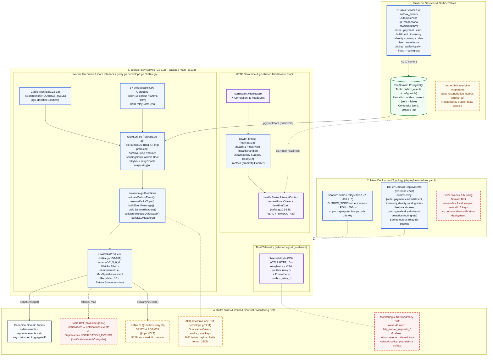
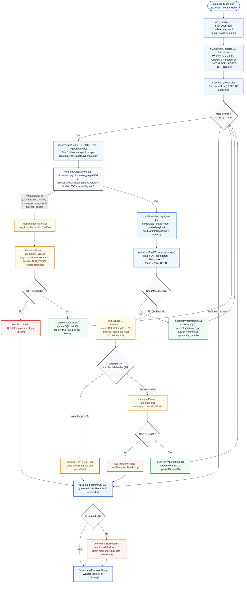
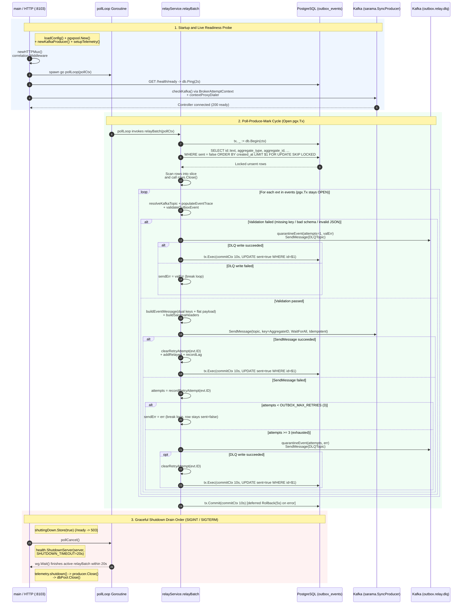

# Outbox Relay Service (`outbox-relay-service`) — Deep Code Walkthrough

> [!NOTE]
> **Part of the InstaCommerce Onboarding Suite:** [Onboarding Hub](../../README.md) · [Code Walkthrough Atlas](../README.md) · [Domain & Event Catalog (`05`)](../../05-domain-model-and-event-catalog.md) · [Incident Drills & Exam (`06`)](../../06-incident-drills-and-readiness-exam.md) · [Dependency Matrix & Cheatsheet (`07`)](../../07-service-dependency-and-command-cheatsheet.md)

> **Repo-Truth & Onboarding Posture:** Verified directly against [`services/outbox-relay-service/`](../../../../services/outbox-relay-service), [`services/go-shared/`](../../../../services/go-shared), [`contracts/`](../../../../contracts), [`services/order-service/`](../../../../services/order-service), [`deploy/helm/`](../../../../deploy/helm), [`prometheus/rules/`](../../../../prometheus/rules), [`monitoring/`](../../../../monitoring), and [`.github/workflows/ci.yml`](../../../../.github/workflows/ci.yml). All symbol names, SQL queries, Kafka headers, line anchors, and drift findings reflect checked-in code rather than the stale service `README.md`.

---

## 1. Service Identity Card

| Dimension | Verified Code Truth | Source |
|---|---|---|
| **Module / Runtime** | `github.com/instacommerce/outbox-relay-service` · Go `1.25.0` (toolchain `go1.25.1`), `pgxpool` (`v5.8.0`), IBM `sarama` (`v1.43.2`) | [`go.mod`](../../../../services/outbox-relay-service/go.mod#L1-L16) |
| **HTTP Port & Image** | `:8103` (`PORT` &rarr; `SERVER_PORT` &rarr; `"8103"`), multi-stage Alpine `3.23` non-root `app:1001` (`CGO_ENABLED=0`) | [`config.go`](../../../../services/outbox-relay-service/config.go#L41), [`Dockerfile`](../../../../services/outbox-relay-service/Dockerfile#L1-L17) |
| **Storage / Reads** | Polls & updates `outbox_events` (configurable via `OUTBOX_TABLE`) in each producer service's PostgreSQL DB (`sent = false` &rarr; `true`) | [`relay.go`](../../../../services/outbox-relay-service/relay.go#L54-L65) |
| **Kafka Topics** | Produces to canonical domain topics (`orders.events`, `payments.events`, etc.) + DLQ `outbox.relay.dlq` (`DLQ_TOPIC`) | [`envelope.go`](../../../../services/outbox-relay-service/envelope.go#L35-L67), [`config.go`](../../../../services/outbox-relay-service/config.go#L102) |
| **Helm Release Keys** | Generic `outbox-relay` (`2` replicas, HPA `2..6`, `orders.events`) **plus 13 per-domain `outbox-relay-{domain}` deployments** (`:8103`) | [`values.yaml`](../../../../deploy/helm/values.yaml#L863-L1168) |
| **SLO Tier Status** | Omitted from `error-budget-policy.yaml`; targeted by broken Spring-style query in `wave-40-complete-slo-alerts.yml` | [`error-budget-policy.yaml`](../../../../monitoring/error-budget-policy.yaml#L4-L45), [`wave-40-complete-slo-alerts.yml`](../../../../prometheus/rules/wave-40-complete-slo-alerts.yml#L634-L646) |
| **First-Principles Role** | Eliminates Postgres-vs-Kafka dual-write split-brain without 2PC: 13 Java services commit domain rows and `outbox_events` inside one local ACID transaction (`Propagation.MANDATORY`), and `outbox-relay-service` asynchronously relays rows to Kafka with `WaitForAll` + `Idempotent` delivery. It **never** reads Postgres WAL (that is Debezium). | [`OutboxService.java`](../../../../services/order-service/src/main/java/com/instacommerce/order/service/OutboxService.java#L22-L37), [`GLOSSARY.md`](../../../../GLOSSARY.md#L15-L17) |

---

## 2. Package & File Layout

All runtime code lives in `package main` across six focused files (no subdirectories), backed by four test files:

| File | Lines | Responsibility | Link |
|---|---|---|---|
| `main.go` | 195 | Entrypoint, dependency wiring (`pgxpool`, `sarama`, OTel, metrics), `go-shared` HTTP mux/readiness, signal & drain orchestration | [`main.go`](../../../../services/outbox-relay-service/main.go#L1-L195) |
| `config.go` | 181 | Env parsing, strict positive-int/duration validation, `isSafeIdentifier` table guard | [`config.go`](../../../../services/outbox-relay-service/config.go#L1-L181) |
| `relay.go` | 333 | `outboxDB` interface, `relayService`, SQL builders, `pollLoop`, `relayBatch` (`FOR UPDATE SKIP LOCKED`), in-memory `retryCounts`, `quarantineEvent` | [`relay.go`](../../../../services/outbox-relay-service/relay.go#L1-L333) |
| `envelope.go` | 324 | `outboxEvent` struct, `topicMappings` & `normalizeAggregateType`, `validateOutboxEvent`, dual-key `buildEventMessage`, `buildSaramaHeaders`, DLQ builders | [`envelope.go`](../../../../services/outbox-relay-service/envelope.go#L1-L324) |
| `kafka.go` | 161 | `contextProxyDialer`, `deadlineConn`, `healthKafkaConfig`, bounded `checkKafka` controller check, `newKafkaProducer` | [`kafka.go`](../../../../services/outbox-relay-service/kafka.go#L1-L161) |
| `telemetry.go` | 149 | OTel OTLP HTTP setup (`15s` metric interval) + Prometheus `outbox_relay_*` registration (`sync.Once`) + `relayMetrics` wrappers | [`telemetry.go`](../../../../services/outbox-relay-service/telemetry.go#L1-L149) |
| `main_test.go` | 423 | Unit tests for `resolveKafkaTopic`, `buildEventMessage`, `buildSaramaHeaders`, `checkKafka` deadline/cancel/mock broker, `retryCounts`, HTTP `/metrics` + `/health/ready` | [`main_test.go`](../../../../services/outbox-relay-service/main_test.go#L1-L423) |
| `relay_unit_test.go` | 483 | Unit tests for `buildEnrichedDLQMessage`, `loadConfig`, and `relayBatch` happy/validation-DLQ/transient-retry/DLQ-stall paths via `fakeOutboxDB`/`fakeTx` | [`relay_unit_test.go`](../../../../services/outbox-relay-service/relay_unit_test.go#L1-L483) |
| `relay_quarantine_test.go` | 196 | Validation/quarantine unit tests + DB rollback integration test (auto-skips if no `DATABASE_URL` or Docker daemon) | [`relay_quarantine_test.go`](../../../../services/outbox-relay-service/relay_quarantine_test.go#L1-L196) |
| `outbox_relay_integration_test.go` | 368 | End-to-end Postgres + `mocks.SyncProducer` batch/DLQ tests + `EventEnvelope.v1.json` compliance check | [`outbox_relay_integration_test.go`](../../../../services/outbox-relay-service/outbox_relay_integration_test.go#L1-L368) |
| `Dockerfile`, `go.mod`, `README.md` | 17 / 70 / 651 | Container build, module dependencies (`replace ../go-shared`), and legacy pre-refactor docs | [`Dockerfile`](../../../../services/outbox-relay-service/Dockerfile#L1-L17), [`go.mod`](../../../../services/outbox-relay-service/go.mod#L1-L70), [`README.md`](../../../../services/outbox-relay-service/README.md#L1-L651) |

---

## 3. Architecture LLD & Helm Deployment Topology

**Outbox Relay Service Architecture LLD** — *[Rendered PNG](../diagrams/services/outbox-relay-service-arch-lld.png) · [Mermaid Source](../diagrams/services/outbox-relay-service-arch-lld.mmd)*



### Startup, `go-shared` Middleware & Probe Chain

1. **Config & SQL Hardening ([`main.go`](../../../../services/outbox-relay-service/main.go#L20-L70), [`config.go`](../../../../services/outbox-relay-service/config.go#L40-L181)):**
   - `loadConfig()` exits (`os.Exit(1)`) if both `DATABASE_URL` and `POSTGRES_DSN` are blank, if `KAFKA_BROKERS` yields zero trimmed brokers, if `OUTBOX_BATCH_SIZE <= 0` or `OUTBOX_MAX_RETRIES <= 0`, or if `OUTBOX_TABLE` fails `isSafeIdentifier()` (only `[a-zA-Z0-9_]`).
   - `newRelayServiceWithDB()` wraps `cfg.OutboxTable` with `pgx.Identifier{cfg.OutboxTable}.Sanitize()` before interpolating it into `selectSQL` and `updateSQL` ([`relay.go`](../../../../services/outbox-relay-service/relay.go#L54-L64)).
2. **Database & Idempotent Kafka Producer ([`main.go`](../../../../services/outbox-relay-service/main.go#L37-L58), [`kafka.go`](../../../../services/outbox-relay-service/kafka.go#L138-L161)):**
   - `pgxpool.New` + `dbPool.Ping(ctx)` validate Postgres connectivity upfront.
   - `newKafkaProducer` configures `sarama.SyncProducer` with `Version = sarama.V2_5_0_0`, `Net.MaxOpenRequests = 1`, `Producer.RequiredAcks = sarama.WaitForAll`, `Producer.Retry.Max = 10`, `Producer.Return.Successes = true`, and `Producer.Idempotent = true`, clamping socket timeouts to `max(5s, READY_TIMEOUT)`.
3. **HTTP Server & `go-shared` Middleware ([`main.go`](../../../../services/outbox-relay-service/main.go#L72-L98), [`main.go`](../../../../services/outbox-relay-service/main.go#L156-L195)):**
   - Wraps `newHTTPMux` in [`correlation.Middleware`](../../../../services/go-shared/pkg/correlation/middleware.go#L17-L27), which reads or generates `X-Correlation-ID`, echoes it on the response, and stores it under `correlation.ContextKey`.
   - Registers [`health.NewHandler`](../../../../services/go-shared/pkg/health/handler.go#L46-L104) with two active checks (`database`: `service.db.Ping`, `kafka`: `service.checkKafka`) at `/health` (concurrent check execution with 5s timeout) and `/health/live` (unconditional `200 {"status":"alive"}`).
   - Overrides readiness at `/health/ready` and `/ready` with `readyFn`, which returns `503 {"status":"not_ready"}` immediately once `service.shuttingDown.Load()` is `true`, and otherwise pings Postgres and checks Kafka controller availability within `READY_TIMEOUT` (`2s`).
   - Exposes Prometheus metrics at `/metrics` via `promhttp.Handler()`.
4. **Custom Timeout-Bounded Kafka Readiness ([`kafka.go`](../../../../services/outbox-relay-service/kafka.go#L12-L136)):**
   - `checkKafka` obtains a bounded attempt context via [`health.BrokerAttemptContext`](../../../../services/go-shared/pkg/health/probes.go#L41-L78) and clones `sarama.Config` via `healthKafkaConfig`.
   - It disables `ApiVersionsRequest`, sets `Metadata.Retry.Max = 0`, and injects `contextProxyDialer` (which binds `context.AfterFunc(ctx, conn.SetDeadline(time.Now()))` on `deadlineConn`) so stalled TCP sockets unblock immediately on deadline expiration without leaking goroutines (verified by [`TestCheckKafkaHonorsContextDeadlineWithoutGoroutineLeak`](../../../../services/outbox-relay-service/main_test.go#L180-L251)).

### Helm Per-Domain Deployment Architecture

- **Generic Release (`outbox-relay`):** [`deploy/helm/values.yaml`](../../../../deploy/helm/values.yaml#L863-L881) sets `replicas: 2`, HPA `minReplicas: 2` / `maxReplicas: 6` (CPU `70%`), `OUTBOX_TOPIC: "orders.events"`, `OUTBOX_POLL_INTERVAL: "500ms"`, `OUTBOX_BATCH_SIZE: "100"`. Note it does **not** inject `DATABASE_URL` or `KAFKA_BROKERS` directly.
- **13 Per-Domain Releases (`outbox-relay-{domain}`):** [`deploy/helm/values.yaml`](../../../../deploy/helm/values.yaml#L883-L1168) defines dedicated `replicas: 1` deployments for `order`, `payment`, `cart`, `fulfillment`, `inventory`, `identity`, `catalog`, `rider-fleet`, `warehouse`, `pricing`, `wallet-loyalty`, `fraud-detection`, and `routing-eta`, each binding its domain DB URL from `secretKeyRef: outbox-relay-db-secrets`, pointing `KAFKA_BROKERS` to `kafka.default.svc.cluster.local:9092`, and setting `OUTBOX_TOPIC` explicitly (plus an unused `HEALTH_PORT: "8103"` env var).
- **NetworkPolicy & ServiceAccount:** [`values.yaml`](../../../../deploy/helm/values.yaml#L395-L438) defines `istio.servicePolicies` allowing ingress to each per-domain relay from `admin-gateway-service` and its paired domain producer service, rendered by [`network-policy.yaml`](../../../../deploy/helm/templates/network-policy.yaml#L1-L55).

---

## 4. SQL, Kafka & Envelope Wire Formats

### PostgreSQL Outbox Table Contract (Producer-Owned)

13 Java microservices maintain local `outbox_events` tables (e.g., `order-service`: [`V4__create_outbox.sql`](../../../../services/order-service/src/main/resources/db/migration/V4__create_outbox.sql#L1-L11), [`V10__add_outbox_envelope_fields.sql`](../../../../services/order-service/src/main/resources/db/migration/V10__add_outbox_envelope_fields.sql#L1-L13), [`V12__add_outbox_events_retention_index.sql`](../../../../services/order-service/src/main/resources/db/migration/V12__add_outbox_events_retention_index.sql#L1)). Upstream Java services write rows inside the same ACID transaction via [`OutboxService.publish`](../../../../services/order-service/src/main/java/com/instacommerce/order/service/OutboxService.java#L22-L37) (`@Transactional(propagation = Propagation.MANDATORY)`).

The relay executes these pre-built queries ([`relay.go`](../../../../services/outbox-relay-service/relay.go#L55-L64)):

```sql
-- selectSQL (bound arg $1 = OUTBOX_BATCH_SIZE)
SELECT id::text, aggregate_type, aggregate_id, event_type, payload, created_at,
    COALESCE(source_service, '') AS source_service,
    COALESCE(correlation_id, '') AS correlation_id,
    COALESCE(schema_version, 'v1') AS schema_version
FROM "outbox_events"
WHERE sent = false
ORDER BY created_at
LIMIT $1
FOR UPDATE SKIP LOCKED;

-- updateSQL (bound arg $1 = evt.ID)
UPDATE "outbox_events" SET sent = true WHERE id = $1;
```

- **Indexes:** Partial index `idx_outbox_unsent ON outbox_events (sent) WHERE sent = false` (`V4`) and composite index `idx_outbox_events_sent_created_at ON outbox_events (sent, created_at)` (`V12`).
- **Retention Cleanup:** Only `order-service` runs [`OutboxCleanupJob`](../../../../services/order-service/src/main/java/com/instacommerce/order/service/OutboxCleanupJob.java#L14-L39) calling [`deleteBatchSentEventsBefore`](../../../../services/order-service/src/main/java/com/instacommerce/order/repository/OutboxEventRepository.java#L18-L19) (`LIMIT 1000`).
- **Trace Context Note:** `outboxEvent.Traceparent` ([`envelope.go`](../../../../services/outbox-relay-service/envelope.go#L28)) is **not** selected from PostgreSQL; `populateEventTrace` synthesizes it from the active `outbox.relay.publish` OTel span when valid ([`relay.go`](../../../../services/outbox-relay-service/relay.go#L281-L294)).

### Aggregate-to-Topic Mapping (`resolveKafkaTopic`, [`envelope.go`](../../../../services/outbox-relay-service/envelope.go#L35-L67), [`#L162-L197`](../../../../services/outbox-relay-service/envelope.go#L162-L197))

If `OUTBOX_TOPIC` is non-empty (as in all 13 Helm per-domain deployments), `resolveKafkaTopic` returns `OUTBOX_TOPIC` verbatim. Otherwise, `normalizeAggregateType` lowercases and collapses non-alphanumeric characters to underscores (`_`), then looks up `topicMappings`:

| Normalized `aggregate_type` Keys | Resolved Kafka Topic | Notes |
|---|---|---|
| `order`, `orders` | `orders.events` | Matches `TopicNames.ORDERS_EVENTS` |
| `payment`, `payments` | `payments.events` | Matches `TopicNames.PAYMENTS_EVENTS` |
| `inventory`, `stockitem`, `stock_item`, `reservation`, `reservations`, `cyclecounttask`, `cycle_count_task`, `inbound_asn`, `inboundasn`, `stock_batch`, `stockbatch`, `inventory_safety_stock`, `inventorysafetystock` | `inventory.events` | Covers inventory & ASN/safety-stock sub-aggregates |
| `fulfillment`, `picktask`, `pick_task`, `pickbatch`, `pick_batch`, `deliveryfailure`, `delivery_failure`, `substitution`, `substitutions` | `fulfillment.events` | Covers picking, substitution, and delivery failure |
| `catalog`, `product`, `products`, `category`, `categories` | `catalog.events` | Matches `TopicNames.CATALOG_EVENTS` |
| `pricing`, `price`, `coupon`, `coupons`, `promotion`, `promotions` | `pricing.events` | Note: `promotion` maps here, not `promotion.events` |
| `identity`, `user`, `users` | `identity.events` | Matches `TopicNames.IDENTITY_EVENTS` |
| `rider`, `riders`, `riderfleet`, `rider_fleet` | `rider.events` | Matches `TopicNames.RIDER_EVENTS` |
| `geofence`, `rider_geofence`, `ridergeofence` | `rider.geofence.events` | Matches `TopicNames.RIDER_GEOFENCE_EVENTS` |
| `warehouse`, `store`, `stores`, `warehousebin`, `warehouse_bin`, `storecapacity`, `store_capacity`, `stagingbay`, `staging_bay` | `warehouse.events` | Matches `TopicNames.WAREHOUSE_EVENTS` |
| `fraud`, `fraudsignal`, `fraud_signal` | `fraud.events` | Matches `TopicNames.FRAUD_EVENTS` |
| `wallet`, `wallets`, `loyalty` | `wallet.events` | Matches `TopicNames.WALLET_EVENTS` |
| `audit`, `auditevent`, `audit_event` | `audit.events` | Note: `audit-trail-service` uses no `outbox_events` table |
| `notification`, `notifications` | **`notifications.events`** | **BUG:** plural vs `TopicNames.NOTIFICATION_EVENTS` (`"notification.events"`) |
| `config`, `featureflag`, `feature_flag`, `featureflags`, `feature_flags` | `config.events` | Matches config-feature-flag events |
| `cart`, `carts` | `cart.events` | Matches `TopicNames.CART_EVENTS` |
| `delivery`, `routing` | `delivery.events` | Matches `TopicNames.DELIVERY_EVENTS` |
| *(empty)* / *(unmapped)* | `unknown.events` / `{normalized}.events` | Fallback construction ([`envelope.go`](../../../../services/outbox-relay-service/envelope.go#L170-L173)) |

### Kafka Message Body, Headers & DLQ Wire Format

- **Partition Key:** `strings.TrimSpace(evt.AggregateID)` (`resolvePartitionKey`, [`envelope.go`](../../../../services/outbox-relay-service/envelope.go#L70-L75)), preserving per-aggregate FIFO ordering inside a Kafka partition.
- **Message Value (`buildEventMessage`, [`envelope.go`](../../../../services/outbox-relay-service/envelope.go#L199-L251)):** Emits **both** camelCase and snake_case aliases (`eventId`/`event_id`, `aggregateType`/`aggregate_type`, `aggregateId`/`aggregate_id`, `eventType`/`event_type`, `eventTime`/`event_time`, `schemaVersion`/`schema_version`, `sourceService`/`source_service`, `correlationId`/`correlation_id` when non-empty), embeds `payload`, **hoists** every top-level `payload` map key onto the root envelope if not already present, and sets `id` and `timestamp` fallbacks only if the hoisted `payload` did not define them ([`envelope.go`](../../../../services/outbox-relay-service/envelope.go#L232-L245)).
- **Message Headers (`buildSaramaHeaders`, [`envelope.go`](../../../../services/outbox-relay-service/envelope.go#L131-L160)):** Emits `event_id`, `event_type`, `aggregate_type`, `aggregate_id`, `partition_key`, `source_service`, `correlation_id`, `X-Correlation-Id`, `X-Source-Service`, `schema_version`, and (when `traceparent` / `traceID` is valid) `traceparent`, `X-Trace-Id`, and `X-B3-TraceId`.
- **DLQ Envelope & Headers (`buildEnrichedDLQMessage` & `buildDLQHeaders`, [`envelope.go`](../../../../services/outbox-relay-service/envelope.go#L274-L324)):** Publishes to `DLQ_TOPIC` (`outbox.relay.dlq`) with key `partitionKey` (falling back to `evt.ID` when missing), JSON body containing `eventId`, `originalTopic`, `partitionKey`, `error`, `errorCategory` (`partition_key_missing`, `schema_version_invalid`, `payload_invalid`, `publish_failure`), `attempts`, `timestamp`, `quarantinedAt`, `eventCreatedAt`, `aggregateType`, `aggregateId`, `eventType`, `schemaVersion`, `sourceService`, `correlationId`, and `payload` (falling back to raw string on invalid JSON), plus headers `original_topic`, `dlq_reason` (truncated via `sharedkafka.TruncateUTF8(..., 512)`), `error_category`, `quarantine_attempts`, and `quarantined_at`.

---

## 5. Poll-Produce-Quarantine Algorithm & Sequence Walkthrough

### Flowchart: Validation, Open-Tx Publishing, Retry & Quarantine

**Outbox Relay Flowchart** — *[Rendered PNG](../diagrams/services/outbox-relay-service-flowchart.png) · [Mermaid Source](../diagrams/services/outbox-relay-service-flowchart.mmd)*



1. **Batch Acquisition ([`relay.go`](../../../../services/outbox-relay-service/relay.go#L105-L185)):**
   - `pollLoop` executes `relayBatch(ctx)` immediately on startup and then on every `time.NewTicker(cfg.PollInterval)` tick (`1s` default, `500ms` Helm).
   - `relayBatch` begins an OTel span `outbox.relay.batch`, opens a PostgreSQL transaction (`s.db.Begin(ctx)`), runs `selectSQL` with `FOR UPDATE SKIP LOCKED` (ensuring multi-pod replicas skip rows locked by peers), scans all rows into `events []outboxEvent`, and **explicitly calls `rows.Close()`** before looping so `pgx` can run `tx.Exec` on the same connection.
   - A deferred rollback guard (`context.WithTimeout(context.Background(), 5*time.Second)`) rolls back if `!committed`, while `commitCtx` grants `10s` from `context.Background()` so an in-flight batch commit can finish cleanly even if `pollCancel()` fires mid-batch.
2. **Per-Event Validation & Poison Quarantine ([`relay.go`](../../../../services/outbox-relay-service/relay.go#L188-L221), [`envelope.go`](../../../../services/outbox-relay-service/envelope.go#L81-L95)):**
   - Inside `for _, evt := range events`, `populateEventTrace(&evt, msgSpan)` injects W3C `traceparent` if missing and the span context is valid.
   - `validateOutboxEvent` enforces: (1) non-empty trimmed `AggregateID`, (2) [`sharedkafka.ValidateSchemaVersion`](../../../../services/go-shared/pkg/kafka/envelope.go#L33-L42) matching `^(v[1-9][0-9]*|[0-9]+\.[0-9]+\.[0-9]+)$` (empty defaults to `"v1"`), and (3) valid JSON payload via `json.Unmarshal`.
   - Validation failures immediately call `quarantineEvent(msgCtx, evt, topic, traceID, partitionKey, schemaVersion, 1, valErr)`. If DLQ publish succeeds, `tx.Exec(commitCtx, updateSQL, evt.ID)` sets `sent = true` so the poison row stops blocking subsequent polls; if DLQ publish fails, the loop breaks (`sendErr = valErr`).
3. **Kafka Publish, In-Memory Retry Tracking & Partial Commit ([`relay.go`](../../../../services/outbox-relay-service/relay.go#L223-L279)):**
   - Valid events call `s.producer.SendMessage(message)` synchronously **while the `pgx.Tx` remains open**.
   - On success: `clearRetryAttempt(evt.ID)`, `addRelayed(1)`, `recordLag(time.Since(evt.CreatedAt).Seconds())`, and `tx.Exec(commitCtx, updateSQL, evt.ID)` marks `sent = true` inside the transaction.
   - On Kafka failure: `attempts := s.recordRetryAttempt(evt.ID)` increments the mutex-protected `retryCounts[evt.ID]` map. While `attempts < maxPublishRetries()` (`3`), `relayBatch` **breaks the loop** (`sendErr = err`), preserving batch ordering and leaving the failed row (plus all trailing rows in the slice) at `sent = false`, then commits `tx` so **prior** successfully relayed rows are persisted (`sent = true`).
   - Once `attempts >= maxPublishRetries()`, `quarantineEvent(..., attempts, err)` writes to `outbox.relay.dlq` with `publish_failure`. If DLQ succeeds, `clearRetryAttempt` + `sent = true`; if DLQ fails, it logs `"failed to publish to DLQ, pipeline stalled"` and breaks without marking `sent = true`.

### Sequence Diagram: Startup, Relay Transaction & Graceful Drain

**Outbox Relay Sequence Diagram** — *[Rendered PNG](../diagrams/services/outbox-relay-service-sequence.png) · [Mermaid Source](../diagrams/services/outbox-relay-service-sequence.mmd)*



**Graceful Shutdown Drain Order ([`main.go`](../../../../services/outbox-relay-service/main.go#L116-L154)):**
1. On `SIGINT`/`SIGTERM` (or HTTP bind error on `errCh`), `service.shuttingDown.Store(true)` flips `/health/ready` and `/ready` to HTTP `503`.
2. `pollCancel()` cancels the `pollLoop` context so no new batch starts and any idle loop exits `select { case <-ctx.Done(): }`.
3. [`health.ShutdownServer`](../../../../services/go-shared/pkg/health/probes.go#L17-L38) drains active HTTP requests within `SHUTDOWN_TIMEOUT` (`20s`).
4. `wg.Wait()` waits up to `SHUTDOWN_TIMEOUT` (`20s`) for any active `relayBatch` to finish `tx.Commit`, followed by `telemetry.shutdown(shutdownCtx)`, deferred `producer.Close()`, and deferred `dbPool.Close()`.

---

## 6. Configuration, Observability & Local Testing

### Environment Variables ([`config.go`](../../../../services/outbox-relay-service/config.go#L13-L109))

| Env Var | Code Default | Helm (`values.yaml`) | Behavior / Validation |
|---|---|---|---|
| `PORT` / `SERVER_PORT` | `"8103"` | `"8103"` | `PORT` checked first; `Dockerfile` sets `ENV PORT=8103` |
| `DATABASE_URL` / `POSTGRES_DSN` | *Required* | `secretKeyRef: outbox-relay-db-secrets` (on 13 per-domain) | `os.Exit(1)` if both missing; `DATABASE_URL` checked first |
| `KAFKA_BROKERS` | *Required* | `"kafka.default.svc.cluster.local:9092"` (on 13 per-domain) | Comma-separated broker list; `os.Exit(1)` if empty |
| `OUTBOX_TOPIC` | `""` | Explicit topic per release (`orders.events`, etc.) | Non-empty bypasses `topicMappings` in `resolveKafkaTopic` |
| `OUTBOX_POLL_INTERVAL` | `1s` | `"500ms"` | Go duration (`time.ParseDuration`) |
| `OUTBOX_BATCH_SIZE` | `100` | `"100"` | Must be `&gt; 0` |
| `OUTBOX_MAX_RETRIES` | `3` | *(unset &rarr; `3`)* | Must be `&gt; 0`; process-local retry cap before `DLQ_TOPIC` |
| `OUTBOX_TABLE` | `"outbox_events"` | *(unset)* | Alphanumeric + `_` only (`isSafeIdentifier` + `pgx.Identifier.Sanitize`) |
| `DLQ_TOPIC` | `"outbox.relay.dlq"` | *(unset)* | Destination topic for invalid or retry-exhausted rows |
| `KAFKA_CLIENT_ID` | `"outbox-relay-service"` | *(unset)* | Sarama `ClientID` |
| `SHUTDOWN_TIMEOUT` / `READY_TIMEOUT` | `20s` / `2s` | *(unset)* | Worker/HTTP drain grace & readiness probe timeout |
| `OTEL_SERVICE_NAME` / `OTEL_EXPORTER_OTLP_ENDPOINT` / `LOG_LEVEL` | `"outbox-relay-service"` / `""` / `"info"` | `"info"` (`values-staging.yaml`) | OTLP HTTP traces & metrics (`15s` period; noop when endpoint blank) |

### Telemetry Inventory ([`telemetry.go`](../../../../services/outbox-relay-service/telemetry.go#L24-L149))

- **Prometheus (`/metrics`):** `outbox_relay_events_total` (Counter), `outbox_relay_failures_total` (Counter), `outbox_relay_dlq_total` (Counter), `outbox_relay_lag_seconds` (Histogram, `prometheus.DefBuckets`).
- **OTel (OTLP HTTP, 15s):** `outbox.relay.count`, `outbox.relay.failures`, `outbox.relay.dlq.count`, `outbox.relay.lag.seconds`; spans `outbox.relay.batch` (`outbox.batch_size`, `outbox.table`) and `outbox.relay.publish` (`event.id`, `event.type`, `aggregate.type`, `aggregate.id`, `kafka.topic`).

### Verification & Test Commands

```bash
# Run unit & quarantine suite with race detector (verified locally: PASS in 2.349s;
# 3 Docker/Postgres integration tests auto-skip when Docker daemon & DATABASE_URL are absent)
cd services/outbox-relay-service && go test -v -race -count=1 ./...

# Targeted single-test run
cd services/outbox-relay-service && go test -race -run '^TestRelayBatchUnitPaths$' ./...
```

---

## 7. Verified Seams, Bugs & Doc-vs-Code Drift

1. **Notification Topic Singular/Plural Mismatch & Missing Helm Deployment:** [`envelope.go`](../../../../services/outbox-relay-service/envelope.go#L62) maps `"notification"` / `"notifications"` to **`"notifications.events"`** (plural), whereas [`TopicNames.java`](../../../../contracts/src/main/java/com/instacommerce/contracts/topics/TopicNames.java#L25), [`contracts/README.md`](../../../../contracts/README.md#L365), and [`notification-service/README.md`](../../../../services/notification-service/README.md#L25) use **`"notification.events"`** (singular). Helm defines 13 `outbox-relay-*` deployments, **none** for `notification-service` (nor does `notification-service` have an `outbox_events` table), yet [`outbox-relay-service/README.md`](../../../../services/outbox-relay-service/README.md#L81) & [`#L273`](../../../../services/outbox-relay-service/README.md#L273) falsely document `"notification.events"`.
2. **ADR-004 Envelope Dual-Emit & Hoisted Payload Drift:** [`buildEventMessage`](../../../../services/outbox-relay-service/envelope.go#L211-L245) emits **both** camelCase and snake_case keys *and* flattens top-level `payload` properties onto the root JSON envelope, contradicting [ADR-004](../../../../docs/adr/004-event-envelope.md#L50-L65) (strict 9 camelCase fields in body, trace headers only) — a backwards-compatibility shim also echoed in [`go-shared/pkg/kafka/envelope_json.go`](../../../../services/go-shared/pkg/kafka/envelope_json.go#L28-L89) and [`EventEnvelope.v1.json`](../../../../contracts/src/main/resources/schemas/common/EventEnvelope.v1.json#L4-L51).
3. **ADR-003 DLQ Naming Drift:** [`config.go`](../../../../services/outbox-relay-service/config.go#L102) defaults `DLQ_TOPIC` to `"outbox.relay.dlq"` instead of `{source-topic}.DLT` required by [ADR-003](../../../../docs/adr/003-kafka-dlt-naming.md#L38-L53) (though `TopicNames.OUTBOX_RELAY_DLQ` and `GLOSSARY.md#L18` explicitly grandfather this exception).
4. **Helm Overlay Drift (`values-dev.yaml`, `values-prod.yaml` & `ci.yml`):** [`values.yaml`](../../../../deploy/helm/values.yaml#L883-L1168) and [`values-staging.yaml`](../../../../deploy/helm/values-staging.yaml#L172-L287) configure all 13 `outbox-relay-*` releases, **but [`values-dev.yaml`](../../../../deploy/helm/values-dev.yaml#L39) and [`values-prod.yaml`](../../../../deploy/helm/values-prod.yaml#L72-L80) omit all 13 per-domain keys**, and [`.github/workflows/ci.yml`](../../../../.github/workflows/ci.yml#L846) only bumps `.services["outbox-relay"].tag`. Note also generic `outbox-relay` in `values.yaml` omits `DATABASE_URL` and `KAFKA_BROKERS`, so it crashes unless injected externally.
5. **In-Memory `retryCounts` & Open `pgx.Tx` Under Kafka Degradation:** [`relay.go`](../../../../services/outbox-relay-service/relay.go#L36-L37) stores retry attempts in a process-local `map[string]int` (`retryCounts`), so pod restarts or multi-pod `SKIP LOCKED` pickup across replicas reset `attempts` before reaching `OUTBOX_MAX_RETRIES` (`3`). Worse, `relayBatch` holds an open `pgx.Tx` (and row locks) across synchronous `sarama.SyncProducer.SendMessage` calls (`Retry.Max = 10`, timeout `>= 5s`), pinning a Postgres connection while Kafka brokers stall.
6. **Unused `event_id` / `event_timestamp` Columns & Single-Service Cleanup:** Wave 24 ([`V10__add_outbox_envelope_fields.sql`](../../../../services/order-service/src/main/resources/db/migration/V10__add_outbox_envelope_fields.sql#L4-L11)) added `event_id` and `event_timestamp`, but `selectSQL` (`relay.go#L55-L58`) ignores both and uses primary key `id::text` and `created_at` instead. Only `order-service` runs [`OutboxCleanupJob`](../../../../services/order-service/src/main/java/com/instacommerce/order/service/OutboxCleanupJob.java#L14-L39); the other 12 producers lack automated purging of `sent = true` rows, while `reconciliation-engine` maintains an incompatible [`reconciliation_outbox`](../../../../services/reconciliation-engine/src/main/resources/db/migration/V3__create_outbox_table.sql#L4-L13) table (`published` column) not polled by this relay.
7. **Prometheus, Grafana, NetworkPolicy & `README.md` Drift:** [`wave-40-complete-slo-alerts.yml`](../../../../prometheus/rules/wave-40-complete-slo-alerts.yml#L634-L646) alerts on Spring's nonexistent `http_server_requests_seconds_count{service="outbox-relay-service"}`; [`data-pipeline-health.json`](../../../../monitoring/grafana/dashboards/data-pipeline-health.json#L155) queries nonexistent `outbox_events_relayed_total` instead of `outbox_relay_events_total`; [`network-policy.yaml`](../../../../deploy/helm/templates/network-policy.yaml#L53) allows Prometheus scraping only on `port: metrics` while [`deployment.yaml`](../../../../deploy/helm/templates/deployment.yaml#L66) names container port `http`; and [`services/outbox-relay-service/README.md`](../../../../services/outbox-relay-service/README.md#L177-L475) still describes the pre-refactor single-file `main.go` with "No unit tests" and "No `/metrics` Prometheus endpoint".

---

**Previous:** [notification-service](./notification-service.md) | **Atlas Hub:** [Code Walkthrough Atlas](../README.md) | **Next:** [cdc-consumer-service](./cdc-consumer-service.md)
