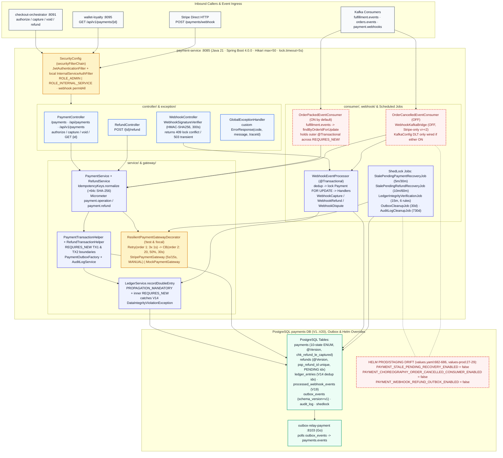
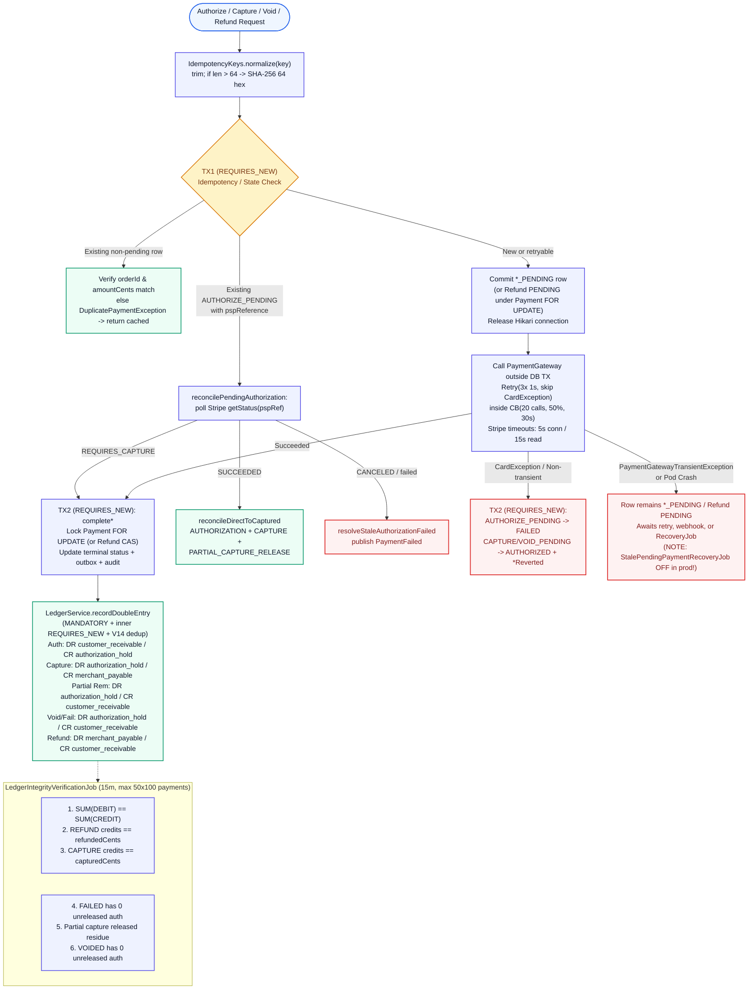
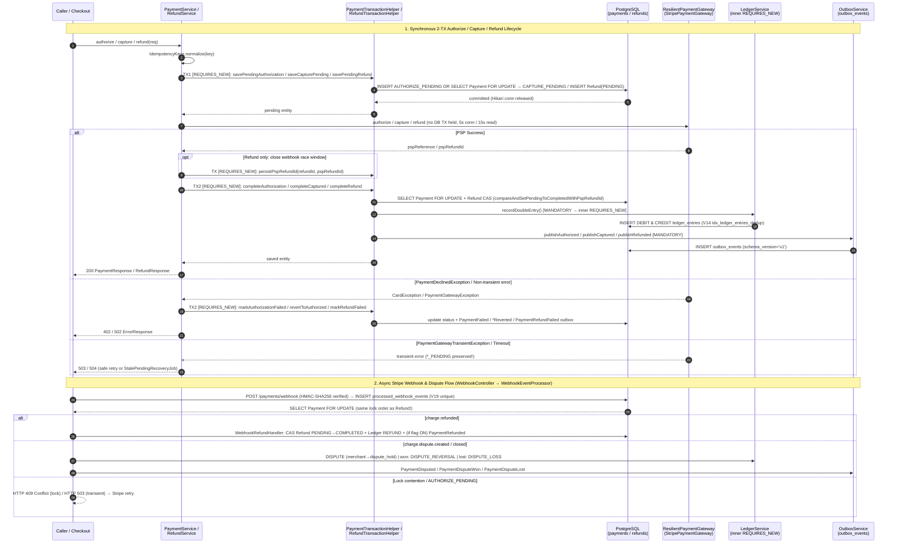

# `payment-service` — Code Walkthrough

> [!NOTE]
> **Part of the InstaCommerce Onboarding Suite:** [Onboarding Hub](../../README.md) · [Code Walkthrough Atlas](../README.md) · [Domain & Event Catalog (`05`)](../../05-domain-model-and-event-catalog.md) · [Incident Drills & Exam (`06`)](../../06-incident-drills-and-readiness-exam.md) · [Dependency Matrix & Cheatsheet (`07`)](../../07-service-dependency-and-command-cheatsheet.md)

> **Authoritative Payment State Machine, 2-TX PSP Isolation, Double-Entry Ledger & Webhook Processor**
>
> | Dimension | Verified Repo Truth |
> |---|---|
> | **Module & Runtime** | Java 21 / Spring Boot 4.0.0 ([build.gradle.kts](../../../../services/payment-service/build.gradle.kts#L1-L44)) · Stripe Java SDK (`com.stripe:stripe-java`), Resilience4j, ShedLock · Dependencies: `:contracts`, `:libs:platform-common` |
> | **HTTP Port** | `8085` (`${SERVER_PORT:8085}` in [application.yml](../../../../services/payment-service/src/main/resources/application.yml#L1-L3)) |
> | **Primary Storage** | PostgreSQL `payments` (`payment_db` in Helm), Flyway `V1`–`V20` incl. `V11_1` (`ddl-auto: validate`, `open-in-view: false`, Hikari `max=50`, `lock.timeout=5000ms`) — **zero Redis, zero Temporal SDK** |
> | **Kafka Topics** | **Produces** (via Go `outbox-relay-payment` `:8103`): `payments.events` (`PaymentAuthorized`, `PaymentCaptured`, `PaymentCaptureReverted`, `PaymentVoided`, `PaymentVoidReverted`, `PaymentFailed`, `PaymentRefunded`, `PaymentRefundFailed`, `PaymentDisputed`, `PaymentDisputeWon`, `PaymentDisputeLost`)<br>**Consumes:** `fulfillment.events` (`OrderPackedEventConsumer`, default ON) · `orders.events` (`OrderCancelledEventConsumer`, default OFF) · `payment.webhooks` (`PaymentWebhookEventConsumer`, default OFF) |
> | **Helm Keys** | `payment-service` ([values.yaml](../../../../deploy/helm/values.yaml#L670-L695)) · Relay: `outbox-relay-payment` ([values.yaml](../../../../deploy/helm/values.yaml#L905)) · **Critical:** staging/prod override 3 safety flags to `"false"` |
> | **SLO Tier** | **Tier 0** (`99.9%` availability, `500 ms` p99, `43.2 min/30d` budget) per [error-budget-policy.yaml](../../../../monitoring/error-budget-policy.yaml#L5-L13) *(doc drift: [service-slos.md](../../../../docs/slos/service-slos.md#L21-L27) still claims `99.95%` / `300 ms`)* |

---

## 1. Service Boundaries & Package Tree

`payment-service` is the monetary system of record for card/PSP authorizations, captures, voids, refunds, chargeback disputes, and double-entry ledger postings. `checkout-orchestrator-service` (`:8091`) calls `/payments/authorize`, `/payments/{id}/capture`, `/payments/{id}/void`, and `/payments/{id}/refund`; `wallet-loyalty-service` (`:8095`) calls `GET /api/v1/payments/{id}` to verify wallet top-ups; Stripe hits `POST /payments/webhook` directly with HMAC-SHA256 signatures.

Notice what `payment-service` intentionally excludes: it does **not** hold HTTP sessions, Redis, or Kafka producer templates for domain events (only [WebhookController](../../../../services/payment-service/src/main/java/com/instacommerce/payment/controller/WebhookController.java#L1-L51) and [OutboxService](../../../../services/payment-service/src/main/java/com/instacommerce/payment/service/OutboxService.java#L1-L67) persistence via the external Go outbox relay).

### Package Layout (`com.instacommerce.payment`)

```text
services/payment-service/src/main/java/com/instacommerce/payment/
├── PaymentServiceApplication.java            # Excludes Spring Cloud refresh autoconfig; binds PaymentProperties
├── config/
│   ├── KafkaConfig.java                      # Conditional CommonErrorHandler -> *.DLT (ONLY if cancelled/webhook consumer ON!)
│   ├── PaymentProperties.java                # @ConfigurationProperties(prefix = "payment")
│   ├── SecurityConfig.java                   # Stateless SecurityFilterChain + local InternalServiceAuthFilter
│   └── ShedLockConfig.java                   # JdbcTemplateLockProvider usingDbTime(), defaultLockAtMostFor = PT30M
├── consumer/
│   ├── OrderPackedEventConsumer.java         # @ConditionalOnProperty(matchIfMissing = true) -> auto-capture (SELF-DEADLOCK RISK)
│   ├── OrderCancelledEventConsumer.java      # @ConditionalOnProperty(default false) -> auto-void/refund on OrderCancelled
│   ├── PaymentWebhookEventConsumer.java      # @ConditionalOnProperty(default false) -> WebhookKafkaBridge
│   └── WebhookKafkaBridge.java               # Consumes payment.webhooks (requires schemaVersion >= 2, Stripe-only)
├── controller/
│   ├── PaymentController.java                # /payments, /api/payments, /api/v1/payments (authorize/capture/void/GET)
│   ├── RefundController.java                 # /payments/{id}/refund, /api/payments/{id}/refund, /api/v1/payments/{id}/refund
│   └── WebhookController.java                # POST /payments/webhook (permitAll, HMAC-SHA256)
├── domain/model/                             # Payment (10-state enum, @Version), Refund (@Version), LedgerEntry,
│                                             # LedgerEntryType, OutboxEvent, ProcessedWebhookEvent, AuditLog
├── exception/
│   └── GlobalExceptionHandler.java           # Custom ErrorResponse (code, message, traceId, timestamp, details)
├── gateway/
│   ├── PaymentGateway.java                   # authorize, capture, voidAuth, refund, getStatus
│   ├── ResilientPaymentGatewayDecorator.java # @Retry (order 1) wrapping @CircuitBreaker (order 2)
│   ├── StripePaymentGateway.java             # Stripe SDK v24+, 5s conn / 15s read, manual capture
│   └── MockPaymentGateway.java               # Active on local/test profiles
├── repository/                               # PaymentRepository (5000ms lock timeout), RefundRepository, LedgerEntryRepository
├── security/
│   ├── InternalServiceAuthFilter.java        # Local filter granting ROLE_INTERNAL_SERVICE (NOT SharedInternalServiceAuthFilter!)
│   └── JwtAuthenticationFilter.java          # RSA public-key JWT validator
├── service/
│   ├── PaymentService.java                   # 2-TX orchestration + reconcilePendingAuthorization + Micrometer timers
│   ├── PaymentTransactionHelper.java         # REQUIRES_NEW TX1 & TX2 + inner Ledger + MANDATORY Outbox
│   ├── RefundService.java                    # 2-TX refund orchestration + persistPspRefundId race-window close
│   ├── RefundTransactionHelper.java          # REQUIRES_NEW TX1 & TX2 + compareAndSetPendingToCompletedWithPspRefundId
│   ├── LedgerService.java                    # Double-entry invariant + inner REQUIRES_NEW + V14 DataIntegrityViolation catch
│   ├── PaymentOutboxFactory.java             # Builds schema_version="v1" EventEnvelope payloads
│   ├── OutboxService.java                    # Propagation.MANDATORY outbox_events writer
│   ├── IdempotencyKeys.java                  # Trim + >64-char SHA-256 hex normalization
│   ├── StalePendingPaymentRecoveryJob.java   # ShedLock (5m/30m, 100/batch): reconciles AUTHORIZE/CAPTURE/VOID_PENDING via PSP
│   ├── StalePendingRefundRecoveryJob.java    # ShedLock (10m/60m): marks stale >30m PENDING refunds FAILED
│   ├── LedgerIntegrityVerificationJob.java   # ShedLock (15m/60m, 50x100 window): verifies 6 double-entry accounting rules
│   ├── OutboxCleanupJob.java & AuditLogCleanupJob.java
└── webhook/
    ├── WebhookSignatureVerifier.java         # HMAC-SHA256 t=<epoch>,v1=<hex> (300s tolerance, constant-time compare)
    ├── WebhookEventProcessor.java            # @Transactional dedup (processed_webhook_events) + lock Payment FOR UPDATE
    ├── WebhookCaptureHandler.java            # succeeded / capture.failed / amount_capturable / canceled
    ├── WebhookRefundHandler.java             # charge.refunded -> CAS PENDING->COMPLETED + Ledger + flag-gated outbox
    └── WebhookDisputeHandler.java            # charge.dispute.created / closed (won/lost)
```

---

## 2. Startup, Configuration & Security Filter Chain

1. **Application Bootstrap:** [PaymentServiceApplication](../../../../services/payment-service/src/main/java/com/instacommerce/payment/PaymentServiceApplication.java#L8-L20) explicitly excludes five `org.springframework.cloud.autoconfigure.*Refresh*` / `ConfigurationPropertiesRebinder` classes to prevent cold-start crashes when Spring Cloud GCP config refresh beans collide with custom Hikari/property wiring.
2. **Database Pool & Lock Timeout:** [application.yml](../../../../services/payment-service/src/main/resources/application.yml#L15-L34) sizes HikariCP to `maximum-pool-size: 50` (minimum idle `10`, `connection-timeout: 5000`) and configures `hibernate.jakarta.persistence.lock.timeout: 5000` plus `@QueryHints(LockModeType.PESSIMISTIC_WRITE)` in [PaymentRepository](../../../../services/payment-service/src/main/java/com/instacommerce/payment/repository/PaymentRepository.java#L25-L28). Every `FOR UPDATE` query fails fast at `5s` instead of stalling threads indefinitely behind PostgreSQL lock queues.
3. **Security Chain:** [SecurityConfig](../../../../services/payment-service/src/main/java/com/instacommerce/payment/config/SecurityConfig.java#L1-L76) creates a stateless filter chain adding both [JwtAuthenticationFilter](../../../../services/payment-service/src/main/java/com/instacommerce/payment/security/JwtAuthenticationFilter.java) and a **service-local** [InternalServiceAuthFilter](../../../../services/payment-service/src/main/java/com/instacommerce/payment/security/InternalServiceAuthFilter.java#L28-L66) before `UsernamePasswordAuthenticationFilter`:
   - `POST /payments/webhook` (and actuator health/prometheus): `permitAll()`.
   - `GET /payments/{id}` / `GET /api/v1/payments/{id}` / `POST /payments/**`: requires `ROLE_ADMIN`, `ROLE_INTERNAL_SERVICE`, or authenticated caller matching authorization checks (note: `InternalServiceAuthFilter` uses `MessageDigest.isEqual` on `X-Internal-Token` and grants `ROLE_INTERNAL_SERVICE` only—unlike `platform-common`'s `SharedInternalServiceAuthFilter`, it does **not** emit `ROLE_SERVICE_{CALLER}`).
4. **Error Contract:** [GlobalExceptionHandler](../../../../services/payment-service/src/main/java/com/instacommerce/payment/exception/GlobalExceptionHandler.java#L21-L93) returns a custom JSON `ErrorResponse(code, message, traceId, timestamp, details)` rather than RFC 7807 `ProblemDetailFactory`.

---

## 3. PostgreSQL Schema, Migrations (`V1`–`V20`) & Double-Entry Ledger

Flyway enforces `21` migrations ([`V1`–`V20` plus `V11_1`](../../../../services/payment-service/src/main/resources/db/migration/)):

| Migration Range | Schema Evolution & Database Invariants Enforced |
|---|---|
| `V1`–`V6` | Core tables: `payments` (unique `(idempotency_key)`, `order_id`, `amount_cents > 0`, `captured_cents`, `refunded_cents`, `@Version`, DB check constraint `refunded_cents <= captured_cents`), `refunds` (`idempotency_key`), `ledger_entries` (immutable DEBIT/CREDIT rows), `outbox_events`, `audit_log`, `processed_webhook_events`. |
| `V7`–`V10` | `V7` adds `AUTHORIZE_PENDING`, `CAPTURE_PENDING`, `VOID_PENDING` payment statuses; `V8` adds `shedlock`; `V9` adds partial recovery index on pending payments; `V10` adds unique index on `refunds.psp_refund_id` (`WHERE psp_refund_id IS NOT NULL`) to block concurrent Stripe webhook + sync refund duplication. |
| `V11`–`V13` | `V11` + `V11_1` add and backfill `refunds.updated_at`; `V12` adds stale pending refund recovery index; `V13` adds optimistic-lock `refunds.version`. |
| `V14`–`V20` | `V14` creates `idx_ledger_entries_dedup` unique index per `(payment_id, entry_type, account, reference_id)`; `V15` adds webhook payload audit columns; `V16` adds `DISPUTED` / `DISPUTE_LOST` / dispute statuses; `V17` & `V18` align `outbox_events` to `EventEnvelope` (`schema_version = 'v1'`, `correlation_id`, `aggregate_type`, `aggregate_id`); `V19` adds unique constraint on `processed_webhook_events(event_id)` for atomic dedup; `V20` adds outbox retention cleanup index. |

### Double-Entry Ledger Rules (`LedgerService`)

[LedgerService.recordDoubleEntry](../../../../services/payment-service/src/main/java/com/instacommerce/payment/service/LedgerService.java#L1-L94) runs under `Propagation.MANDATORY` (requires an active parent transaction from `PaymentTransactionHelper`, `RefundTransactionHelper`, or webhook handlers) and delegates each paired `DEBIT` + `CREDIT` save into an inner `REQUIRES_NEW` sub-transaction so catching `DataIntegrityViolationException` from `V14 idx_ledger_entries_dedup` does **not** mark the outer business transaction rollback-only!

```text
AUTHORIZATION          : DR customer_receivable              / CR authorization_hold
CAPTURE                : DR authorization_hold               / CR merchant_payable
PARTIAL_CAPTURE_RELEASE: DR authorization_hold (remainder)   / CR customer_receivable
VOID / AUTH FAIL       : DR authorization_hold               / CR customer_receivable
REFUND                 : DR merchant_payable                 / CR customer_receivable
DISPUTE (chargeback)   : DR merchant_payable                 / CR dispute_hold
DISPUTE_REVERSAL (won) : DR dispute_hold                     / CR merchant_payable
DISPUTE_LOSS (lost)    : DR dispute_hold                     / CR chargeback_expense
```

---

## 4. Architecture & Low-Level Component Topology

**payment-service Architecture LLD** — *[Rendered PNG](../diagrams/services/payment-service-arch-lld.png) · [Mermaid Source](../diagrams/services/payment-service-arch-lld.mmd)*



**Reading the Diagram:**
- Inbound traffic arrives from `checkout-orchestrator-service` (`:8091`), `wallet-loyalty-service` (`:8095` verifying top-up payments), Stripe webhooks (`POST /payments/webhook`), and 3 Kafka consumers (`OrderPackedEventConsumer` ON, `OrderCancelledEventConsumer` OFF, `PaymentWebhookEventConsumer` OFF).
- Sync API controllers normalize `Idempotency-Key` via [IdempotencyKeys.normalize](../../../../services/payment-service/src/main/java/com/instacommerce/payment/service/IdempotencyKeys.java#L1-L53) (trims whitespace; hashes keys `> 64` chars with lowercase SHA-256 hex) and delegate to [PaymentService](../../../../services/payment-service/src/main/java/com/instacommerce/payment/service/PaymentService.java#L1-L291) and [RefundService](../../../../services/payment-service/src/main/java/com/instacommerce/payment/service/RefundService.java#L1-L116).
- All outbound Stripe SDK calls pass through [ResilientPaymentGatewayDecorator](../../../../services/payment-service/src/main/java/com/instacommerce/payment/gateway/ResilientPaymentGatewayDecorator.java#L1-L189) (`@Profile("!test & !local")`), which runs `@Retry` (`aspectOrder: 1`, 3 attempts x `1s`) *outside* `@CircuitBreaker` (`aspectOrder: 2`, 20 calls, 50% open threshold, 30s wait) so transient errors trip the breaker across retries while `PaymentDeclinedException` bypasses both.

---

## 5. Core Decision Logic: 2-TX Isolation, Pending Reconciliation & Accounting Checks

**payment-service Flowchart** — *[Rendered PNG](../diagrams/services/payment-service-flowchart.png) · [Mermaid Source](../diagrams/services/payment-service-flowchart.mmd)*



### Why Every PSP Call Must Execute Outside DB Transactions
Holding a PostgreSQL transaction across a `15s` Stripe read timeout exhausts the `50`-connection Hikari pool under burst latency and stalls row locks (`5000ms` timeout). [PaymentService](../../../../services/payment-service/src/main/java/com/instacommerce/payment/service/PaymentService.java#L1-L291) therefore splits every state mutation across two `REQUIRES_NEW` helper calls on [PaymentTransactionHelper](../../../../services/payment-service/src/main/java/com/instacommerce/payment/service/PaymentTransactionHelper.java#L1-L302):

1. **TX1 (`REQUIRES_NEW`) — Intent Persist & Lock Release:** `savePendingAuthorization` inserts an `AUTHORIZE_PENDING` row (or looks up an existing key, throwing `DuplicatePaymentException` if `orderId` or `amountCents` differs). For capture/void, `saveCapturePending` / `saveVoidPending` locks the `Payment` row `FOR UPDATE`, validates state/amount bounds, transitions to `CAPTURE_PENDING` / `VOID_PENDING`, and commits immediately—releasing the Hikari connection.
2. **Unheld External PSP Window:** [StripePaymentGateway](../../../../services/payment-service/src/main/java/com/instacommerce/payment/gateway/StripePaymentGateway.java#L1-L236) calls Stripe with `connect-timeout-ms: 5000` and `read-timeout-ms: 15000` (using manual capture so authorize holds funds without settling). Note: `resilience4j.timelimiter.instances.paymentGateway.timeoutDuration: 5s` in [application.yml](../../../../services/payment-service/src/main/resources/application.yml#L156-L159) is **unused** because the decorator performs synchronous calls, not `CompletableFuture`/`TimeLimiter`.
3. **Pre-PSP Stale Pending Reconciliation:** When TX1 finds an existing `AUTHORIZE_PENDING` row that already has a `pspReference`, `PaymentService` invokes `reconcilePendingAuthorization` (which calls `paymentGateway.getStatus(pspReference)`):
   - `REQUIRES_CAPTURE` -> completes TX2 authorization cleanly without charging twice.
   - `SUCCEEDED` -> invokes `reconcileDirectToCaptured`, writing `AUTHORIZATION`, `CAPTURE`, and (if partial) `PARTIAL_CAPTURE_RELEASE` ledger entries.
   - `CANCELED` / failed -> invokes `resolveStaleAuthorizationFailed`, publishing `PaymentFailed`.
4. **TX2 (`REQUIRES_NEW`) — Terminal State, Double-Entry Ledger & Outbox:** On PSP success, `completeAuthorization` / `completeCaptured` / `completeVoided` re-acquires `findByIdForUpdate(paymentId)`, updates status, records ledger entries via `LedgerService`, writes `AuditLog`, and calls `OutboxService` (`MANDATORY`). On `CardException`, TX2 marks `FAILED` (for authorize) or reverts `CAPTURE_PENDING`/`VOID_PENDING` back to `AUTHORIZED` while emitting `PaymentCaptureReverted` / `PaymentVoidReverted`. On `PaymentGatewayTransientException`, **no TX2 runs**: the row deliberately remains `*_PENDING` so caller retry, Stripe webhook, or `StalePendingPaymentRecoveryJob` reconciles truth.
5. **Periodic Accounting Gate:** [LedgerIntegrityVerificationJob](../../../../services/payment-service/src/main/java/com/instacommerce/payment/service/LedgerIntegrityVerificationJob.java#L1-L276) runs every `15m` (ShedLock `15m/60m`, up to `50` pages x `100` payments) and verifies six invariants across `payments` and `ledger_entries`: (1) `SUM(DEBIT) == SUM(CREDIT)`, (2) `REFUND` credits match `refundedCents`, (3) `CAPTURE` credits match `capturedCents`, (4) `FAILED` payments have zero unreleased auth hold, (5) partial captures released their uncaptured remainder, and (6) `VOIDED` payments have zero unreleased auth hold.

---

## 6. Call-Stack Sequence: Sync 2-TX Lifecycle & Webhook Convergence

**payment-service Sequence Diagram** — *[Rendered PNG](../diagrams/services/payment-service-sequence.png) · [Mermaid Source](../diagrams/services/payment-service-sequence.mmd)*



### Refund Race Closure (`RefundService` vs `WebhookRefundHandler`)
Notice steps `22`–`28` in [payment-service-sequence.mmd](../diagrams/services/payment-service-sequence.mmd) (and [RefundService](../../../../services/payment-service/src/main/java/com/instacommerce/payment/service/RefundService.java#L1-L116) / [RefundTransactionHelper](../../../../services/payment-service/src/main/java/com/instacommerce/payment/service/RefundTransactionHelper.java#L1-L230)):
- **TX1 (`savePendingRefund`):** Locks `Payment` `FOR UPDATE`, validates `refundedCents + amount <= capturedCents`, increments `refundedCents` pessimistically, and inserts `Refund(status=PENDING)`.
- **PSP Call:** Calls `StripePaymentGateway.refund(...)`, receiving `pspRefundId`.
- **Race-Closing Step (`persistPspRefundId`):** Immediately persists `pspRefundId` onto the `PENDING` `Refund` in a short `REQUIRES_NEW` TX so that if Stripe's asynchronous `charge.refunded` webhook arrives concurrently before TX2 runs, [WebhookRefundHandler](../../../../services/payment-service/src/main/java/com/instacommerce/payment/webhook/WebhookRefundHandler.java#L1-L300) finds the matching `Refund` by `pspRefundId`.
- **TX2 (`completeRefund`):** Acquires `Payment FOR UPDATE` **first** (matching the webhook handler's exact lock order to prevent deadlocks!), executes an atomic compare-and-set (`compareAndSetPendingToCompletedWithPspRefundId`), posts the `REFUND` ledger entry, and writes `PaymentRefunded` to `outbox_events`. If `charge.refunded` won the CAS (`0` rows updated in sync TX2), TX2 detects that the webhook already completed the refund and cleanly returns without double-posting.

### Webhook Processing & Lock Contention Strategy
[WebhookController](../../../../services/payment-service/src/main/java/com/instacommerce/payment/controller/WebhookController.java#L1-L51) verifies Stripe's `Stripe-Signature` (`t=...,v1=...`, `300s` replay window via [WebhookSignatureVerifier](../../../../services/payment-service/src/main/java/com/instacommerce/payment/webhook/WebhookSignatureVerifier.java#L1-L106)) and delegates to [WebhookEventProcessor](../../../../services/payment-service/src/main/java/com/instacommerce/payment/webhook/WebhookEventProcessor.java#L1-L129):
- Inserts `processed_webhook_events` (`V19` unique constraint on `event_id`).
- Acquires `Payment` via `FOR UPDATE`. If PostgreSQL lock contention (`PessimisticLockingFailureException`) occurs because an in-flight sync TX2 holds the row, `WebhookController` returns **HTTP `409 Conflict`**; if transient (`AUTHORIZE_PENDING` still mid-flight), it returns **HTTP `503`**—forcing Stripe to back off and retry later rather than dropping the webhook.
- [WebhookDisputeHandler](../../../../services/payment-service/src/main/java/com/instacommerce/payment/webhook/WebhookDisputeHandler.java#L1-L177) transitions `charge.dispute.created` / `closed` into `DISPUTE` -> `DISPUTE_REVERSAL` (`won`) or `DISPUTE_LOSS` (`lost`) and emits `PaymentDisputed`, `PaymentDisputeWon`, and `PaymentDisputeLost` outbox events.

---

## 7. Consumers, Scheduled Recovery Jobs & Outbox

| Component | Default / Trigger | Exact Runtime Behavior |
|---|---|---|
| [OrderPackedEventConsumer](../../../../services/payment-service/src/main/java/com/instacommerce/payment/consumer/OrderPackedEventConsumer.java#L24-L150) | **ON by default** (`matchIfMissing = true`) on `fulfillment.events` (`groupId = payment-service-order-packed`) | Consumes `OrderPacked`; captures authorized payments (partial if `packedTotalCents < amountCents`). **See critical bug in Section 9.** |
| [OrderCancelledEventConsumer](../../../../services/payment-service/src/main/java/com/instacommerce/payment/consumer/OrderCancelledEventConsumer.java#L1-L218) | Default **OFF** (`false`), **forced `"false"` in Helm** (`PAYMENT_CHOREOGRAPHY_ORDER_CANCELLED_CONSUMER_ENABLED`) | Consumes `orders.events` (`OrderCancelled`, `OrderFailed`); voids `AUTHORIZED` payments or refunds `CAPTURED` payments via `RefundService`. |
| [PaymentWebhookEventConsumer](../../../../services/payment-service/src/main/java/com/instacommerce/payment/consumer/PaymentWebhookEventConsumer.java#L1-L67) | Default **OFF** (`false`) on `payment.webhooks` | Delegates to [WebhookKafkaBridge](../../../../services/payment-service/src/main/java/com/instacommerce/payment/consumer/WebhookKafkaBridge.java#L1-L101), which rejects `schemaVersion < 2` and skips any non-`"stripe"` PSP (`SKIPPED_UNSUPPORTED_PSP`). |
| [StalePendingPaymentRecoveryJob](../../../../services/payment-service/src/main/java/com/instacommerce/payment/service/StalePendingPaymentRecoveryJob.java#L1-L255) | `fixedDelay: 120000ms` (ShedLock `5m/30m`), YAML `true`, **forced `"false"` in staging/prod Helm** | Scans `AUTHORIZE/CAPTURE/VOID_PENDING` older than `5m` (`batchSize: 100`), polls Stripe `getStatus`, and reconciles or expires stuck states. |
| [StalePendingRefundRecoveryJob](../../../../services/payment-service/src/main/java/com/instacommerce/payment/service/StalePendingRefundRecoveryJob.java#L1-L157) | `fixedDelay: 300000ms` (ShedLock `10m/60m`), YAML `true` (**active in prod**) | Marks `Refund(PENDING)` older than `30m` as `FAILED` and decrements `payments.refundedCents`. |
| [OutboxCleanupJob](../../../../services/payment-service/src/main/java/com/instacommerce/payment/service/OutboxCleanupJob.java#L1-L34) & [AuditLogCleanupJob](../../../../services/payment-service/src/main/java/com/instacommerce/payment/service/AuditLogCleanupJob.java#L1-L34) | Cron (`0 0 */6 * * *` 30d; `0 0 3 * * *` 730d) | Purges `sent=true` outbox rows >30 days and `audit_log` rows >730 days under ShedLock. |

---

## 8. Configuration, Helm Overrides & Narrow Test Verification

- **Helm Drift Matrix:**
  - `deploy/helm/values.yaml` ([lines 682–686](../../../../deploy/helm/values.yaml#L682-L686)), `values-staging.yaml` ([lines 57–59](../../../../deploy/helm/values-staging.yaml#L57-L59)), and `values-prod.yaml` ([lines 27–29](../../../../deploy/helm/values-prod.yaml#L27-L29)) override YAML defaults by setting:
    - `PAYMENT_CHOREOGRAPHY_ORDER_CANCELLED_CONSUMER_ENABLED: "false"`
    - `PAYMENT_WEBHOOK_REFUND_OUTBOX_ENABLED: "false"`
    - `PAYMENT_STALE_PENDING_RECOVERY_ENABLED: "false"`
  - `values-dev.yaml` ([lines 18–20](../../../../deploy/helm/values-dev.yaml#L18-L20)) flips those three back to `"true"`.
- **Unit & Testcontainers Suite:** `46` test classes exist under `services/payment-service/src/test` (e.g., `LedgerServiceDedupRaceTest`, `StalePendingPaymentRecoveryJobTest`, `WebhookDisputeHandlingTest`, `RefundTransactionHelperCasTest`, `PaymentGatewayResilienceTest`). Run targeted validation via:

```bash
./gradlew :services:payment-service:test --tests "com.instacommerce.payment.service.LedgerServiceDedupRaceTest"
```

---

## 9. Must-Fix Code Risks & Documentation Drift

| Severity | Finding | Exact Evidence & Impact |
|---|---|---|
| **MUST-FIX** | **Self-deadlock in `OrderPackedEventConsumer`** | [OrderPackedEventConsumer](../../../../services/payment-service/src/main/java/com/instacommerce/payment/consumer/OrderPackedEventConsumer.java#L24-L95) is **ON by default**, starts an outer `@Transactional` on `onFulfillmentEvent`, locks the `Payment` row via `findByOrderIdForUpdate` (`5000ms` lock timeout), and then calls `paymentService.capture(...)`, whose `txHelper.saveCapturePending` starts `Propagation.REQUIRES_NEW` and requests `findByIdForUpdate(paymentId)` on a second Hikari connection—waiting on the lock held by its own outer TX until `5000ms` lock timeout! |
| **MUST-FIX** | **`OrderPackedEventConsumer` has no Kafka DLT handler by default** | [KafkaConfig](../../../../services/payment-service/src/main/java/com/instacommerce/payment/config/KafkaConfig.java#L17-L34) only registers `CommonErrorHandler` (`DeadLetterPublishingRecoverer` -> `.DLT`) when `payment.choreography.order-cancelled-consumer-enabled` OR `payment.webhook.kafka-consumer-enabled` is `true`. In base config/prod where both are `false`, `OrderPackedEventConsumer` fails without `.DLT` routing. |
| **MUST-FIX** | **Prod/staging Helm disables pending payment recovery & webhook refund outbox** | Staging/prod Helm disables `StalePendingPaymentRecoveryJob` (`PAYMENT_STALE_PENDING_RECOVERY_ENABLED="false"`) and webhook refund outbox (`PAYMENT_WEBHOOK_REFUND_OUTBOX_ENABLED="false"`). Any PSP timeout leaving `AUTHORIZE_PENDING`/`CAPTURE_PENDING`/`VOID_PENDING` without a matching Stripe webhook cannot self-heal in prod, and async webhook-driven refunds stay invisible to `orders`/`wallet-loyalty` on `payments.events`. |
| **HIGH** | **Unused `timelimiter` config + Stripe-only Kafka bridge** | `resilience4j.timelimiter.instances.paymentGateway` ([application.yml](../../../../services/payment-service/src/main/resources/application.yml#L156-L159)) has no effect on synchronous Stripe calls (`15s` read timeout still governs). Separately, [WebhookKafkaBridge](../../../../services/payment-service/src/main/java/com/instacommerce/payment/consumer/WebhookKafkaBridge.java#L75-L99) ignores non-Stripe PSPs (`SKIPPED_UNSUPPORTED_PSP`). |
| **DRIFT** | **Non-standard auth filter, custom error DTO & SLO mismatch** | Uses local `InternalServiceAuthFilter` (no `ROLE_SERVICE_{CALLER}`) and custom `ErrorResponse` instead of `ProblemDetailFactory`; [service-slos.md](../../../../docs/slos/service-slos.md#L21-L27) lists `99.95% / 300ms` vs Tier 0 `99.9% / 500ms` in [error-budget-policy.yaml](../../../../monitoring/error-budget-policy.yaml#L5-L13). |

---

**Previous:** [checkout-orchestrator-service](./checkout-orchestrator-service.md) | **Atlas Hub:** [Code Walkthrough Atlas](../README.md) | **Next:** [wallet-loyalty-service](./wallet-loyalty-service.md)
