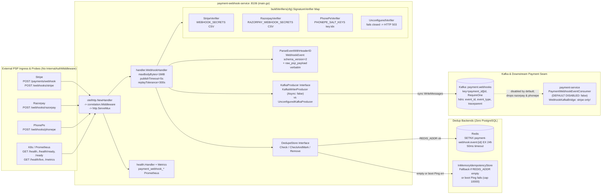
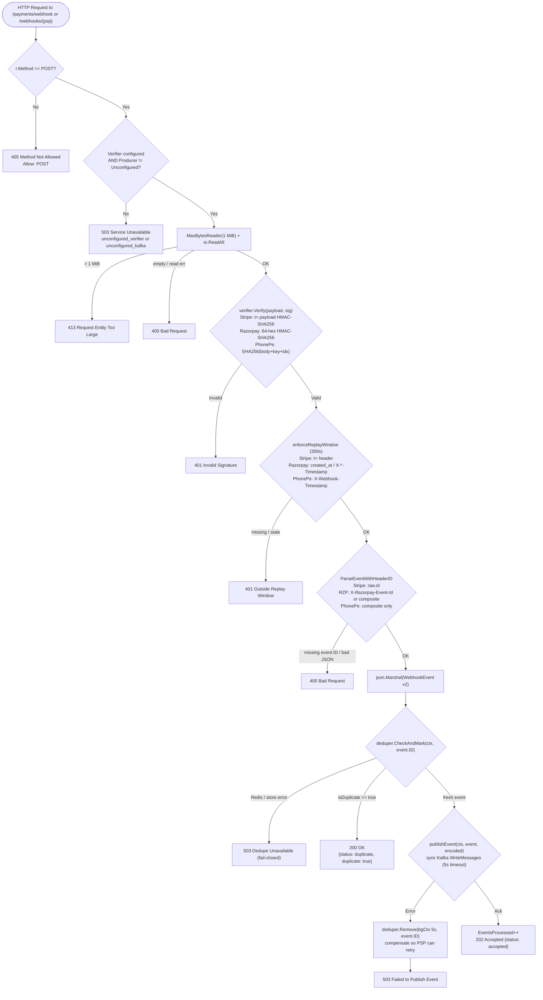
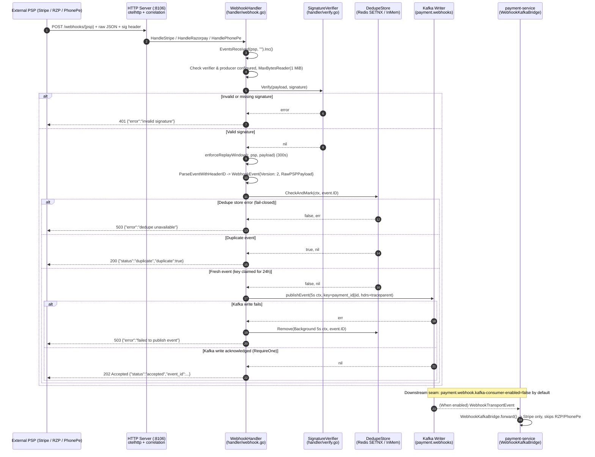

# `payment-webhook-service` Code Walkthrough

> [!NOTE]
> **Part of the InstaCommerce Onboarding Suite:** [Onboarding Hub](../../README.md) · [Code Walkthrough Atlas](../README.md) · [Domain & Event Catalog (`05`)](../../05-domain-model-and-event-catalog.md) · [Incident Drills & Exam (`06`)](../../06-incident-drills-and-readiness-exam.md) · [Dependency Matrix & Cheatsheet (`07`)](../../07-service-dependency-and-command-cheatsheet.md)

> **Service identity:** Go `1.25.0` HTTP-to-Kafka ingress gateway on port `8106` (`PAYMENT_WEBHOOK_PORT`) | **Domain:** External Payment Service Provider (PSP) webhook ingestion, cryptographic verification, replay protection, Redis/in-memory deduplication, and synchronous Kafka publishing (`payment.webhooks`) | **Database:** **None** (zero PostgreSQL; Redis `SETNX` with `InMemoryIdempotencyStore` fallback) | **Source root:** [`services/payment-webhook-service/`](../../../../services/payment-webhook-service/)

---

## 1. Service Boundaries & Package Layout

`payment-webhook-service` is the edge webhook receiver for external PSP callbacks (**Stripe**, **Razorpay**, and **PhonePe**). Unlike internal Go services, it sits on the public webhook ingress path and intentionally exposes **no `InternalAuthMiddleware`**—authentication is strictly cryptographic signature verification plus a replay timestamp window enforced per PSP.

| Attribute | Authoritative Code / Config Value | Source |
| :--- | :--- | :--- |
| **HTTP Port** | `:8106` (`PAYMENT_WEBHOOK_PORT`, fallback `SERVER_PORT`, default `8106`) | [`config.go`](../../../../services/payment-webhook-service/config.go) |
| **Ingress Routes** | `POST /payments/webhook`, `POST /webhooks/stripe`, `POST /webhooks/razorpay`, `POST /webhooks/phonepe` | [`main.go#L141-L151`](../../../../services/payment-webhook-service/main.go#L141-L151) |
| **Probe & Metrics Routes** | `GET /health`, `GET /health/live`, `GET /health/ready`, `GET /ready`, `GET /metrics` | [`main.go#L141-L151`](../../../../services/payment-webhook-service/main.go#L141-L151), [`main.go#L167-L175`](../../../../services/payment-webhook-service/main.go#L167-L175) |
| **Dedup Store** | Redis `SETNX payment-webhook:event:{id} "1" EX 24h` (`50ms` op timeout) or `InMemoryIdempotencyStore` (`cap=10000`) | [`main.go#L40-L59`](../../../../services/payment-webhook-service/main.go#L40-L59), [`handler/dedup.go#L11-L17`](../../../../services/payment-webhook-service/handler/dedup.go#L11-L17) |
| **Kafka Topic & Semantics** | Topic `payment.webhooks` (`KAFKA_TOPIC`), **synchronous** `segmentio/kafka-go` `Writer` (`Async: false`, `RequiredAcks: RequireOne`) | [`main.go#L69-L77`](../../../../services/payment-webhook-service/main.go#L69-L77), [`handler/kafka.go`](../../../../services/payment-webhook-service/handler/kafka.go) |
| **Downstream Seam** | `payment-service` [`PaymentWebhookEventConsumer`](../../../../services/payment-service/src/main/java/com/instacommerce/payment/consumer/PaymentWebhookEventConsumer.java) -> [`WebhookKafkaBridge`](../../../../services/payment-service/src/main/java/com/instacommerce/payment/consumer/WebhookKafkaBridge.java#L89-L93) | [`application.yml#L58`](../../../../services/payment-service/src/main/resources/application.yml#L58) |

### Module & File Inventory

```text
services/payment-webhook-service/
├── main.go               # Startup wiring: LoadConfig -> Redis/InMem dedup -> Kafka Writer -> verifiers -> ServeMux + OTEL/correlation
├── config.go             # Env parsing (Stripe/Razorpay secret CSV rotation, PhonePe salt key:index parsing, Kafka/Redis timeouts)
├── go.mod                # Go 1.25.0; replace github.com/instacommerce/go-shared => ../go-shared
├── Dockerfile            # Multi-stage golang:1.25-alpine build using local service build context (note go-shared replace seam)
└── handler/
    ├── webhook.go        # WebhookHandler HTTP handlers (HandleStripe, HandleRazorpay, HandlePhonePe), handlePSP, enforceReplayWindow
    ├── verify.go         # SignatureVerifier interface + StripeVerifier, RazorpayVerifier, PhonePeVerifier, UnconfiguredVerifier
    ├── parse.go          # ParseEventWithHeaderID normalizing Stripe/Razorpay/PhonePe JSON into WebhookEvent schema_version=2
    ├── dedup.go          # DedupeStore interface, RedisIdempotencyStore (SETNX/DEL), InMemoryIdempotencyStore (60s cleanup, cap 10k)
    ├── kafka.go          # KafkaProducer interface, KafkaWriterProducer (W3C traceparent injection), UnconfiguredKafkaProducer
    ├── metrics.go        # Prometheus counters & histograms (payment_webhook_*)
    └── types.go          # PSPType enum & canonical WebhookEvent envelope (schema_version, psp, event_id, raw_psp_payload)
```

---

## 2. Architecture & Startup Wiring (`arch-lld`)

**payment-webhook-service Low-Level Architecture** — *[Rendered PNG](../diagrams/services/payment-webhook-service-arch-lld.png) · [Mermaid Source](../diagrams/services/payment-webhook-service-arch-lld.mmd)*



### Startup & Middleware Execution Order ([`main.go`](../../../../services/payment-webhook-service/main.go))

1. **Telemetry & Config Load:** `main()` initializes structured slog logging and OpenTelemetry tracing, then calls `LoadConfig()` ([`config.go`](../../../../services/payment-webhook-service/config.go)).
   - Stripe secrets (`WEBHOOK_SECRETS`, fallback `STRIPE_WEBHOOK_SECRET`, fallback `PAYMENT_WEBHOOK_SECRET`) and Razorpay secrets (`RAZORPAY_WEBHOOK_SECRETS`, fallback `RAZORPAY_WEBHOOK_SECRET`) are parsed through `parseSecretList` ([`config.go#L88-L106`](../../../../services/payment-webhook-service/config.go#L88-L106)), which trims, splits CSV, and deduplicates preserving rotation order.
   - PhonePe salt keys (`PHONEPE_SALT_KEYS` CSV of `saltKey:saltIndex`, fallback `PHONEPE_SALT_KEY` + `PHONEPE_SALT_INDEX`) are parsed by `parsePhonePeSaltKeys` ([`config.go#L108-L126`](../../../../services/payment-webhook-service/config.go#L108-L126)).
2. **Idempotency Store Initialization ([`main.go#L40-L59`](../../../../services/payment-webhook-service/main.go#L40-L59)):**
   - If `REDIS_ADDR` is non-empty, dials Redis (`DialTimeout`, `ReadTimeout`, `WriteTimeout`) and runs `Ping(ctx)`.
   - **Silent Fallback Seam:** If `REDIS_ADDR` is blank **or** the initial boot `Ping` fails, startup logs a warning and falls back to `NewInMemoryIdempotencyStore(24*time.Hour, 10000)` ([`handler/dedup.go#L30-L158`](../../../../services/payment-webhook-service/handler/dedup.go#L30-L158)). Under multi-pod Kubernetes deployment, losing Redis at boot degrades deduplication to per-pod memory without failing startup readiness.
3. **Kafka Writer Initialization ([`main.go#L69-L77`](../../../../services/payment-webhook-service/main.go#L69-L77)):**
   - When `KAFKA_BROKERS` is set, creates `segmentio/kafka-go` `Writer` with `Topic: cfg.KafkaTopic` (`payment.webhooks`), `Balancer: &kafka.LeastBytes{}`, `RequiredAcks: kafka.RequireOne`, `BatchTimeout: 5 * time.Millisecond`, and **`Async: false`**.
   - When `KAFKA_BROKERS` is empty, injects `UnconfiguredKafkaProducer` ([`handler/kafka.go`](../../../../services/payment-webhook-service/handler/kafka.go)) so `Verify`/`Publish` fails closed with HTTP `503`.
4. **Verifier Map & Fail-Closed Readiness ([`main.go#L174`](../../../../services/payment-webhook-service/main.go#L174)):**
   - `buildVerifiers(cfg)` wires `StripeVerifier`, `RazorpayVerifier`, and `PhonePeVerifier`, substituting `UnconfiguredVerifier` when a PSP's secret list is empty.
   - `newHealthHandler` sets `hh.SetReady(secretSet && kafkaConfigured)`. Notice `/ready` and `/health/ready` inspect that atomic `ready` boolean ([`go-shared/pkg/health/handler.go#L83-L94`](../../../../services/go-shared/pkg/health/handler.go#L83-L94)), whereas `/health` runs an active Redis `Ping` ([`main.go#L167-L171`](../../../../services/payment-webhook-service/main.go#L167-L171)).
5. **HTTP Handler Stack ([`main.go#L141-L151`](../../../../services/payment-webhook-service/main.go#L141-L151)):**
   - Registers all PSP ingress, health, and `/metrics` routes on `http.ServeMux`.
   - Wraps the root `mux` with `otelhttp.NewHandler(correlation.Middleware(mux), "payment-webhook-service")`—**no `InternalAuthMiddleware`**.

---

## 3. Deduplication & Event Envelope Mechanics (`handler/dedup.go`, `handler/parse.go`, `handler/types.go`)

Because this service has **zero PostgreSQL tables**, all state lives either in Redis keys (24h TTL) or in-memory map buckets, and normalized events flow into Kafka `payment.webhooks`.

### Redis vs. In-Memory Deduplication ([`handler/dedup.go`](../../../../services/payment-webhook-service/handler/dedup.go))

| Backend | Key / Structure | Command / Semantics | Concurrency & Eviction Behavior |
| :--- | :--- | :--- | :--- |
| `RedisIdempotencyStore` ([`dedup.go#L248-L256`](../../../../services/payment-webhook-service/handler/dedup.go#L248-L256)) | `payment-webhook:event:{eventID}` | `SetNX(ctx, key, "1", 24h)` under `50ms` per-op timeout; `Remove` issues `DEL` | Atomic across pods; returns `ErrDedupeUnavailable` (HTTP `503`) on Redis/network errors (**fail-closed**). |
| `InMemoryIdempotencyStore` ([`dedup.go#L30-L158`](../../../../services/payment-webhook-service/handler/dedup.go#L30-L158)) | `map[string]time.Time` behind `sync.RWMutex` | Cleanup ticker every `60s`; evicts expired entries or oldest entries if `len >= 10000` | Pod-local only; deterministic cleanup on `Close()`. |

### Canonical Kafka Payload (`WebhookEvent`, [`handler/types.go`](../../../../services/payment-webhook-service/handler/types.go), [`handler/parse.go`](../../../../services/payment-webhook-service/handler/parse.go))

`ParseEventWithHeaderID` normalizes heterogeneous PSP JSON while preserving the exact raw bytes (`raw_psp_payload`) for downstream signature re-verification or audit:

- **Stripe:** Uses top-level `id` as `event_id`, maps `type` -> `event_type`, and inspects `data.object` (`id`/`payment_intent`, `amount`, `currency`, `status`).
- **Razorpay:** Prefers `headerEventID` (`X-Razorpay-Event-Id`) when present ([`handler/webhook.go#L173-L176`](../../../../services/payment-webhook-service/handler/webhook.go#L173-L176)); otherwise constructs a composite deterministic ID `razorpay:{event}:{paymentID}:{createdAt}`. Extracts `payload.payment.entity` (`id`, `order_id`, `amount`, `currency`, `status`).
- **PhonePe:** Accepts `headerEventID` in signature ([`handler/parse.go#L86-L90`](../../../../services/payment-webhook-service/handler/parse.go#L86-L90)) but always receives `""` from `webhook.go`, so `event_id` is always composite `phonepe:{event}:{txnID}:{state}` (decoded from Base64 `response` wrapper or top-level JSON). Hardcodes `Currency = "INR"` ([`handler/parse.go#L84`](../../../../services/payment-webhook-service/handler/parse.go#L84)).

Kafka messages use `Key = event.PaymentID` (falling back to `event.ID`) and attach headers `event_id`, `event_type`, and `traceparent` ([`handler/kafka.go`](../../../../services/payment-webhook-service/handler/kafka.go)).

---

## 4. Verification Decision Flow & Call-Stack Trace

### Decision & Guardrail Flowchart

**payment-webhook-service Decision Flowchart** — *[Rendered PNG](../diagrams/services/payment-webhook-service-flowchart.png) · [Mermaid Source](../diagrams/services/payment-webhook-service-flowchart.mmd)*



### End-to-End Sequence Diagram

**payment-webhook-service Call Sequence** — *[Rendered PNG](../diagrams/services/payment-webhook-service-sequence.png) · [Mermaid Source](../diagrams/services/payment-webhook-service-sequence.mmd)*



### Function-by-Function Execution Walkthrough

1. **Ingress & Configuration Gate ([`handler/webhook.go#L107`](../../../../services/payment-webhook-service/handler/webhook.go#L107)):**
   - Wrapper handlers (`HandleStripe`, `HandleRazorpay`, `HandlePhonePe`) call `handlePSP(w, r, psp)`.
   - Enforces `r.Method == http.MethodPost` (else `405 Method Not Allowed`).
   - Increments `EventsReceived.WithLabelValues(string(psp), "").Inc()` **before parsing** (leaving the `event_type` label blank).
   - Verifies both the `SignatureVerifier` for `psp` and `KafkaProducer` are configured; if either is an `Unconfigured*` implementation, returns `503 Service Unavailable` immediately.
2. **Bounded Body Read & Signature Verification ([`handler/verify.go`](../../../../services/payment-webhook-service/handler/verify.go)):**
   - Wraps `r.Body` in `http.MaxBytesReader(w, r.Body, maxBodyBytes)` (`1 MiB`) and calls `io.ReadAll` (`413` if oversized, `400` on empty/read error).
   - Calls `verifier.Verify(payload, sigHeader)` with constant-time `hmac.Equal`:
     - **Stripe (`Stripe-Signature`):** Parses `t=<ts>,v1=<hex>,...` and checks `HMAC-SHA256(secret, "<ts>." + rawBody)` against every `v1` tag across all rotated `WEBHOOK_SECRETS`.
     - **Razorpay (`X-Razorpay-Signature`):** Validates 64-char hex digest and checks `HMAC-SHA256(secret, rawBody)` across `RAZORPAY_WEBHOOK_SECRETS`.
     - **PhonePe (`X-VERIFY`):** Parses `<64-hex-sha256>###<saltIndex>`, looks up matching `saltIndex` keys in `PHONEPE_SALT_KEYS`, and checks `SHA256(rawBody + saltKey)` (supports both raw JSON and Base64 `{"response":...}` forms).
   - Failures increment `SignatureVerificationFailures` and return `401 Unauthorized`.
3. **Replay Window Enforcement (`enforceReplayWindow`, [`handler/webhook.go#L274-L279`](../../../../services/payment-webhook-service/handler/webhook.go#L274-L279)):**
   - Skips only if `replayTolerance <= 0`. Otherwise requires `abs(now - eventTime) <= 300s` (`WEBHOOK_TOLERANCE_SECONDS`):
     - Stripe reads `t=` from `Stripe-Signature`.
     - Razorpay prefers `X-Razorpay-Timestamp` / `X-Webhook-Timestamp`, falling back to JSON `created_at`.
     - PhonePe reads **only** `X-Webhook-Timestamp`—if PhonePe omits that header while tolerance > 0, `enforceReplayWindow` returns `401` (`outside replay window`).
4. **Parse -> Claim Idempotency Lock -> Sync Kafka Publish -> Compensate on Error ([`handler/webhook.go#L216-L220`](../../../../services/payment-webhook-service/handler/webhook.go#L216-L220)):**
   - `ParseEventWithHeaderID` normalizes `WebhookEvent{Version: 2, ...}`; missing `event.ID` or malformed JSON returns `400`.
   - `deduper.CheckAndMark(ctx, event.ID)` executes Redis `SETNX` (24h TTL):
     - Backend error -> `503 Service Unavailable` (**fail-closed** so PSP retries rather than dropping payments).
     - `isDuplicate == true` -> `200 OK` (`{"status":"duplicate","duplicate":true}`).
     - Fresh key claimed -> `publishEvent` runs synchronous `kafkaWriter.WriteMessages` under a `5s` publish timeout (`KAFKA_PUBLISH_TIMEOUT_SECONDS`).
     - **Crucial Compensation Path ([`webhook.go#L216-L220`](../../../../services/payment-webhook-service/handler/webhook.go#L216-L220)):** If `WriteMessages` fails, `handlePSP` creates a **fresh detached context** (`context.WithTimeout(context.Background(), 5*time.Second)`) to call `deduper.Remove(..., event.ID)`—ensuring an HTTP client disconnect does not prevent deleting the dedup lock—then returns `503`.
     - On broker `RequireOne` ack, increments `EventsProcessed` and returns `202 Accepted`.

---

## 5. Configuration, Observability & Testing

### Runtime Configuration ([`config.go`](../../../../services/payment-webhook-service/config.go), [`deploy/helm/values.yaml#L1180-L1205`](../../../../deploy/helm/values.yaml#L1180-L1205))

| Env Var | Default | Notes / Code Behavior |
| :--- | :--- | :--- |
| `PAYMENT_WEBHOOK_PORT` | `8106` | Falls back to `SERVER_PORT`, then `8106` |
| `WEBHOOK_SECRETS` / `STRIPE_WEBHOOK_SECRET` | `""` | CSV Stripe rotation secrets; deduplicated via `parseSecretList` |
| `RAZORPAY_WEBHOOK_SECRETS` / `RAZORPAY_WEBHOOK_SECRET` | `""` | CSV Razorpay rotation secrets |
| `PHONEPE_SALT_KEYS` / `PHONEPE_SALT_KEY` + `PHONEPE_SALT_INDEX` | `""` | `key:index` CSV; **not deduplicated** against fallback |
| `WEBHOOK_TOLERANCE_SECONDS` | `300` | Replay window for `enforceReplayWindow` (`<=0` disables) |
| `REDIS_ADDR` | `""` | Empty or failed boot `Ping` silently degrades to `InMemoryIdempotencyStore` |
| `KAFKA_BROKERS` / `KAFKA_TOPIC` | `""` / `payment.webhooks` | Empty brokers injects `UnconfiguredKafkaProducer` (`503`) |
| `KAFKA_PUBLISH_TIMEOUT_SECONDS` | `5` | Sync `WriteMessages` deadline |

### Prometheus Metrics ([`handler/metrics.go#L28-L51`](../../../../services/payment-webhook-service/handler/metrics.go#L28-L51))

Exported series on `:8106/metrics`:
- `payment_webhook_events_received_total{psp, event_type}` (`event_type` currently always `""`)
- `payment_webhook_events_processed_total{psp, event_type}`
- `payment_webhook_events_duplicate_total{psp}`
- `payment_webhook_events_failed_total{psp, reason}`
- `payment_webhook_signature_failures_total{psp}`
- `payment_webhook_processing_duration_seconds{psp}`

### Verification Command

```bash
cd services/payment-webhook-service && go test -race ./...
```

---

## 6. Verified Code-Level Bugs, Drift & Downstream Gaps

1. **Zero PostgreSQL vs. Stale `GLOSSARY.md`:** [`GLOSSARY.md#L83`](../../../../GLOSSARY.md#L83) lists a database for this service, whereas `payment-webhook-service` has **no PostgreSQL dependency** and relies exclusively on Redis `SETNX` or in-memory map deduplication.
2. **Synchronous Kafka Publish vs. Async `README.md` Claim:** [`README.md#L69-L104`](../../../../services/payment-webhook-service/README.md#L69-L104) documents an async channel-based Kafka publisher, but [`main.go#L69-L77`](../../../../services/payment-webhook-service/main.go#L69-L77) sets `Async: false` and `RequiredAcks: kafka.RequireOne` synchronously inside `handlePSP`.
3. **Downstream Consumer Disabled & Stripe-Only Bridge:** In `payment-service`, `payment.webhook.kafka-consumer-enabled` defaults to **`false`** ([`application.yml#L58`](../../../../services/payment-service/src/main/resources/application.yml#L58)), and [`WebhookKafkaBridge.forward()`](../../../../services/payment-service/src/main/java/com/instacommerce/payment/consumer/WebhookKafkaBridge.java#L89-L93) drops all Razorpay and PhonePe events with `SKIPPED_UNSUPPORTED_PSP`—routing only `"stripe"`.
4. **Silent In-Memory Fallback When Redis Unreachable at Boot:** Empty `REDIS_ADDR` or transient boot `Ping` failure silently creates `InMemoryIdempotencyStore` ([`main.go#L40-L59`](../../../../services/payment-webhook-service/main.go#L40-L59)), breaking cross-pod idempotency without failing readiness probes.
5. **Broken SLO Alert PromQL Names:** [`wave-40-complete-slo-alerts.yml#L88-L90`](../../../../prometheus/rules/wave-40-complete-slo-alerts.yml#L88-L90) references `payment_webhook_delivery_failed_total` and `payment_webhook_sent_total`, which do not exist in [`handler/metrics.go#L28-L51`](../../../../services/payment-webhook-service/handler/metrics.go#L28-L51) (`events_failed_total`, `events_received_total`, `events_processed_total`).
6. **PhonePe Replay Window, Header ID & Secret Deduplication Quirks:**
   - [`handler/webhook.go#L107`](../../../../services/payment-webhook-service/handler/webhook.go#L107) increments `EventsReceived` before parsing, emitting `event_type=""`.
   - [`handler/webhook.go#L173-L176`](../../../../services/payment-webhook-service/handler/webhook.go#L173-L176) passes `headerEventID` only for Razorpay (`X-Razorpay-Event-Id`), so [`ParseEventWithHeaderID`](../../../../services/payment-webhook-service/handler/parse.go#L86-L90) receives `""` for PhonePe; PhonePe also hardcodes `Currency = "INR"` ([`parse.go#L84`](../../../../services/payment-webhook-service/handler/parse.go#L84)) and returns `401` if PhonePe omits `X-Webhook-Timestamp` when `WEBHOOK_TOLERANCE_SECONDS > 0` ([`webhook.go#L274-L279`](../../../../services/payment-webhook-service/handler/webhook.go#L274-L279)).
   - `parsePhonePeSaltKeys` ([`config.go#L108-L126`](../../../../services/payment-webhook-service/config.go#L108-L126)) omits duplicate suppression when combining `PHONEPE_SALT_KEYS` with `PHONEPE_SALT_KEY:PHONEPE_SALT_INDEX`.
7. **Dockerfile Build Context Constraint:** [`go.mod#L55`](../../../../services/payment-webhook-service/go.mod#L55) uses `replace github.com/instacommerce/go-shared => ../go-shared`, whereas [`Dockerfile#L3-L6`](../../../../services/payment-webhook-service/Dockerfile#L3-L6) copies `go.mod ./` relative to the service directory and breaks unless `go-shared` is supplied or CI supplies vendor/context adjustments.

---

**Previous:** [location-ingestion-service](./location-ingestion-service.md) | **Atlas Hub:** [Code Walkthrough Atlas](../README.md) | **Next:** [dispatch-optimizer-service](./dispatch-optimizer-service.md)
