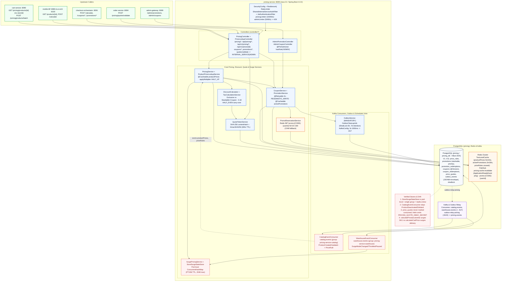
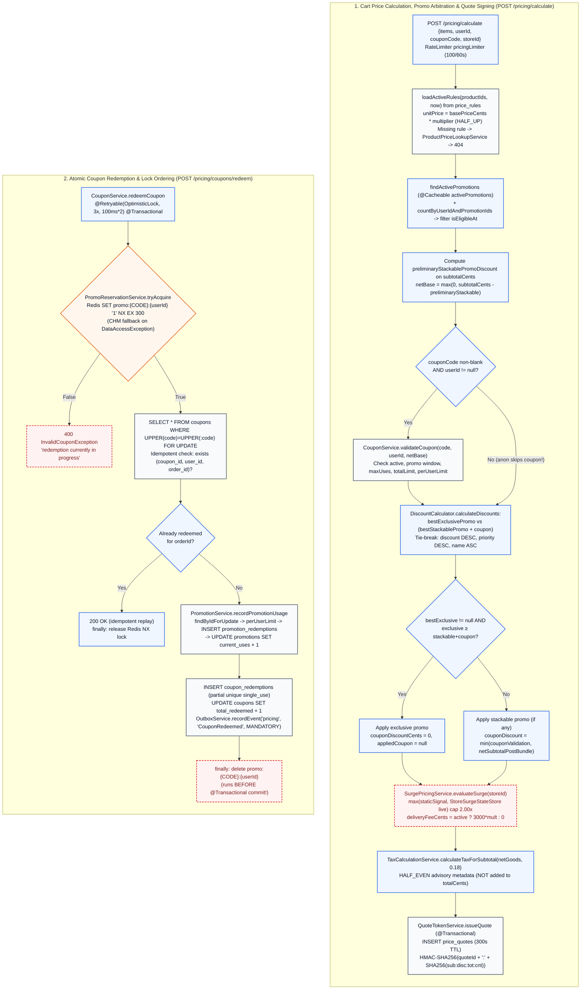
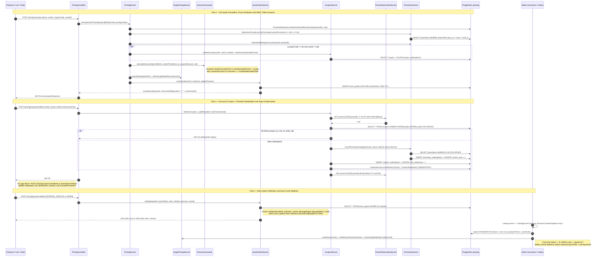

# `pricing-service` — Code Walkthrough

> [!NOTE]
> **Part of the InstaCommerce Onboarding Suite:** [Onboarding Hub](../../README.md) · [Code Walkthrough Atlas](../README.md) · [Domain & Event Catalog (`05`)](../../05-domain-model-and-event-catalog.md) · [Incident Drills & Exam (`06`)](../../06-incident-drills-and-readiness-exam.md) · [Dependency Matrix & Cheatsheet (`07`)](../../07-service-dependency-and-command-cheatsheet.md)

> **Service Identity Card**
>
> | Attribute | Verified Code & Config Truth | Source Reference |
> |---|---|---|
> | **Stack & Build** | Java 21 / Spring Boot 4.0.0 (`:services:pricing-service`, `:libs:platform-common`, `:contracts`), Spring Retry, Resilience4j RateLimiter, JMH test bench | [build.gradle.kts](../../../../services/pricing-service/build.gradle.kts#L1-L47), [Dockerfile](../../../../services/pricing-service/Dockerfile#L1-L17) |
> | **HTTP Port & Probes** | `8089` (`${SERVER_PORT:8089}`); Tomcat `620s` keep-alive/connection timeout; graceful shutdown `30s`; readiness `readinessState,db` | [application.yml](../../../../services/pricing-service/src/main/resources/application.yml#L1-L100) |
> | **Primary Storage** | PostgreSQL (`pricing` local / `pricing_db` Helm; Hikari `20` max / `5` min-idle), Flyway `V1`–`V11` + Redis (`TwoLevelCacheManager` + `promo:{CODE}:{userId}` NX locks) | [application.yml](../../../../services/pricing-service/src/main/resources/application.yml#L18-L33), [CacheConfig.java](../../../../services/pricing-service/src/main/java/com/instacommerce/pricing/config/CacheConfig.java#L36-L123) |
> | **Kafka & Outbox Relay** | **Consumes:** `catalog.events` (`pricing-service-catalog`), `warehouse.events` (`pricing-service-warehouse`), 3x `1s` → `.DLT` · **Publishes via Relay:** `pricing.events` (`outbox-relay-pricing :8103`) | [CatalogEventConsumer.java](../../../../services/pricing-service/src/main/java/com/instacommerce/pricing/consumer/CatalogEventConsumer.java#L37-L98), [WarehouseEventConsumer.java](../../../../services/pricing-service/src/main/java/com/instacommerce/pricing/consumer/WarehouseEventConsumer.java#L36-L118), [values.yaml](../../../../deploy/helm/values.yaml#L1081-L1101) |
> | **Helm & Scaling** | `pricing-service` (`replicas: 2`, HPA `2–15` at `70%` CPU, `500m–1000m` CPU, `512Mi–1024Mi` RAM) + `outbox-relay-pricing` (`replicas: 1`) | [values.yaml](../../../../deploy/helm/values.yaml#L752-L769), [values-prod.yaml](../../../../deploy/helm/values-prod.yaml#L42-L47) |
> | **SLO Tier** | **Tier 1** — `99.5%` availability / `1000ms` P99 in error budget policy (`99%` / `100ms` P99 in service SLO doc) | [error-budget-policy.yaml](../../../../monitoring/error-budget-policy.yaml#L15-L27), [service-slos.md](../../../../docs/slos/service-slos.md#L60-L65) |
> | **Upstream Callers** | `cart-service` (`/pricing/products/{id}`, `/batch`), `mobile-bff-service` (`ScreenAggregator`), `checkout-orchestrator-service` (`/calculate`, `/coupons/*`, `/promotions/*`), `order-service` (`/quotes/validate`), `ai-orchestrator-service`, `admin-gateway-service` | [PricingClient.java](../../../../services/cart-service/src/main/java/com/instacommerce/cart/client/PricingClient.java#L62-L104), [RestPricingQuoteClient.java](../../../../services/order-service/src/main/java/com/instacommerce/order/client/RestPricingQuoteClient.java#L37-L55) |
> | **Bounded Context** | Authoritative monetary calculation engine: base `PriceRule`s, exclusive vs. stackable promotions, capacity/weather surge fees, Banker's-rounded tax, atomic coupon/promo redemption, and HMAC-signed `PriceQuote` tokens | [PricingService.java](../../../../services/pricing-service/src/main/java/com/instacommerce/pricing/service/PricingService.java#L32-L281) |

---

## 1. Service Boundaries & Package Tree

`pricing-service` decouples monetary execution from `catalog-service` and `warehouse-service`. It projects SKU base prices from `catalog.events`, ingests live dark-store surge/throttle signals from `warehouse.events`, arbitrates promotions and coupons deterministically, issues HMAC-signed quotes verified by `order-service`, and records coupon/promotion mutations to `outbox_events` for external relay by `outbox-relay-pricing`.

```text
services/pricing-service/
├── build.gradle.kts                                         # Spring Boot 4 + Retry + Resilience4j + Redis + Caffeine + ShedLock + JMH
├── Dockerfile                                               # eclipse-temurin:21-jre-alpine, ZGC, port 8089, /actuator/health/liveness
├── README.md                                                # Legacy README (Caffeine-only & V1..V10 drift)
└── src/
    ├── main/
    │   ├── java/com/instacommerce/pricing/
    │   │   ├── PricingServiceApplication.java               # @SpringBootApplication + @EnableConfigurationProperties({PricingProperties, QuoteTokenProperties})
    │   │   ├── config/
    │   │   │   ├── CacheConfig.java                         # @Primary TwoLevelCacheManager + deferred ApplicationReadyEvent Pub/Sub ping+start
    │   │   │   ├── JacksonConfig.java                       # Primary ObjectMapper (ISO dates, FAIL_ON_UNKNOWN_PROPERTIES=false)
    │   │   │   ├── KafkaConfig.java                         # DefaultErrorHandler(DeadLetterPublishingRecoverer, FixedBackOff(1000L, 3))
    │   │   │   ├── PricingProperties.java                   # @ConfigurationProperties("pricing") -> jwt.issuer & jwt.publicKey
    │   │   │   ├── QuoteTokenProperties.java                # @ConfigurationProperties("pricing.quote") -> hmacSecret, ttlSeconds=300, validationEnabled
    │   │   │   ├── RetryConfig.java                         # @EnableRetry (Spring Retry for CouponService optimistic lock retries)
    │   │   │   ├── SchedulerConfig.java                     # @EnableScheduling + @EnableSchedulerLock(10m) JdbcTemplateLockProvider
    │   │   │   └── SecurityConfig.java                    # SharedInternalServiceAuthFilter + JwtAuthenticationFilter + route RBAC
    │   │   ├── consumer/
    │   │   │   ├── CatalogEventConsumer.java                # @KafkaListener(catalog.events) -> ProductCreated/Updated ONLY
    │   │   │   ├── CatalogProductEvent.java                 # Jackson record with @JsonAlias(productId/product_id, base_price_cents/priceCents)
    │   │   │   └── WarehouseEventConsumer.java              # @KafkaListener(warehouse.events) -> StoreSurgeModeChanged/Throttled/Paused
    │   │   ├── controller/
    │   │   │   ├── PricingController.java                   # /pricing, /api/pricing, /api/v1/pricing -> calculate, tax, products, coupons, promotions, quotes
    │   │   │   ├── PriceLookupController.java               # /api/v1/prices/{id} compatibility alias (+ optional storeId)
    │   │   │   ├── AdminPromotionController.java            # /admin/promotions (+ /api/v1/*), ROLE_ADMIN, @RateLimiter("adminLimiter")
    │   │   │   └── AdminCouponController.java               # /admin/coupons (+ /api/v1/*), ROLE_ADMIN, @RateLimiter("adminLimiter")
    │   │   ├── domain/
    │   │   │   ├── PriceRule.java                           # @Entity -> price_rules (base_price_cents, multiplier, rule_type, active window)
    │   │   │   ├── Promotion.java                           # @Entity -> promotions (stackable_with_coupon, priority, max_uses, max_redemptions_per_user)
    │   │   │   ├── PromotionRedemption.java                 # @Entity -> promotion_redemptions (UNIQUE (promotion_id, user_id, order_id))
    │   │   │   ├── Coupon.java                              # @Entity -> coupons (@Version optimistic lock, single_use, per_user_limit, total_limit)
    │   │   │   ├── CouponRedemption.java                    # @Entity -> coupon_redemptions (partial single_use unique + (coupon_id, order_id) unique)
    │   │   │   ├── PriceQuote.java                          # @Entity -> price_quotes (SHA-256 content_hash, expires_at; no consumed column)
    │   │   │   └── OutboxEvent.java                         # @Entity -> outbox_events (JSONB payload + Wave 24 envelope columns)
    │   │   ├── dto/{request,response}/                      # CartItem, PriceCalculation*, TaxCalculation*, QuoteValidation*, Redeem*, PricedItem, BatchPriceResponse
    │   │   ├── exception/
    │   │   │   ├── ApiException.java                        # RuntimeException carrying HttpStatus + machine code
    │   │   │   ├── CouponNotFoundException.java             # 404 COUPON_NOT_FOUND
    │   │   │   ├── InvalidCouponException.java              # 400 INVALID_COUPON
    │   │   │   ├── InvalidPromotionException.java           # 400 INVALID_PROMOTION
    │   │   │   ├── PriceRuleNotFoundException.java          # 404 PRICE_NOT_FOUND
    │   │   │   ├── PromotionNotFoundException.java          # 404 PROMOTION_NOT_FOUND
    │   │   │   ├── GlobalExceptionHandler.java              # Maps ApiException, validation, RequestNotPermitted (429), AccessDenied (403), 500
    │   │   │   └── TraceIdProvider.java                     # Resolves traceId from MDC/headers/traceparent
    │   │   ├── repository/                                  # PriceRule, Promotion, PromotionRedemption, Coupon, CouponRedemption, PriceQuote, OutboxEvent
    │   │   ├── security/                                    # JwtService, DefaultJwtService, JwtKeyLoader, JwtAuthenticationFilter, EntryPoint/DeniedHandler
    │   │   └── service/
    │   │       ├── PricingService.java                      # Cart calculation, single-SKU (+ store surge), batch lookup, tax delegation
    │   │       ├── ProductPriceLookupService.java           # Separate @Cacheable("productPrices") bean + HALF_UP applyMultiplier
    │   │       ├── DiscountCalculator.java                  # Deterministic item-sort, bundle rules, exclusive vs stackable+coupon arbitration
    │   │       ├── TaxCalculationService.java               # 0.18 Banker's rounding (HALF_EVEN) + fractional remainder carry-over
    │   │       ├── QuoteTokenService.java                   # Issues price_quotes + SHA-256/HmacSHA256 tokens; constant-time validate()
    │   │       ├── PromotionService.java                    # @Cacheable("activePromotions"), pessimistic recordPromotionUsage, outbox CRUD
    │   │       ├── CouponService.java                       # @Retryable(3x) redeem/unredeem/rollbackUsage + PESSIMISTIC_WRITE + Outbox
    │   │       ├── PromoReservationService.java             # Redis SET promo:{CODE}:{userId} "1" NX EX 300 + local ConcurrentHashMap fallback
    │   │       ├── SurgePricingService.java                 # Combines static DarkStoreDemandSignal + StoreSurgeStateStore, max 2.00x, base 3000c
    │   │       ├── StoreSurgeStateStore.java                # Pod-local bounded ConcurrentHashMap (max 2048, PT15M TTL) for warehouse surge events
    │   │       ├── OutboxService.java                       # Propagation.MANDATORY outbox writer resolving correlationId from MDC
    │   │       └── OutboxCleanupJob.java                    # @Scheduled(0 0 */6 * * *) @SchedulerLock deletes sent rows older than 7 days
    │   └── resources/
    │       ├── application.yml                              # Port 8089, Tomcat 620s, Hikari 20/5, Resilience4j rate limiters, quote HMAC, internal auth
    │       ├── application-local.yml                        # Disables GCP Secret Manager/Cloud SQL/OTLP; sets local internal token & dev HMAC secret
    │       └── db/migration/V1..V11__*.sql                  # price_rules..promotions_stacking_and_priority
    └── test/java/com/instacommerce/pricing/                 # 14 test classes (unit, WebMvc slices, Testcontainers Flyway, concurrency, JMH benchmark)
```

---

## 2. Startup, Configuration & Security Filter Chain

1. **Bootstrap, Retry & Scheduling:** [`PricingServiceApplication`](../../../../services/pricing-service/src/main/java/com/instacommerce/pricing/PricingServiceApplication.java#L9-L15) registers [`PricingProperties`](../../../../services/pricing-service/src/main/java/com/instacommerce/pricing/config/PricingProperties.java#L5-L33) and [`QuoteTokenProperties`](../../../../services/pricing-service/src/main/java/com/instacommerce/pricing/config/QuoteTokenProperties.java#L5-L34). [`RetryConfig`](../../../../services/pricing-service/src/main/java/com/instacommerce/pricing/config/RetryConfig.java#L6-L9) activates `@EnableRetry` for `CouponService`'s optimistic-lock retries, and [`SchedulerConfig`](../../../../services/pricing-service/src/main/java/com/instacommerce/pricing/config/SchedulerConfig.java#L12-L25) configures ShedLock (`defaultLockAtMostFor = "10m"`, `.usingDbTime()`) for [`OutboxCleanupJob`](../../../../services/pricing-service/src/main/java/com/instacommerce/pricing/service/OutboxCleanupJob.java#L24-L31).
2. **Servlet & HikariCP Settings:** [`application.yml`](../../../../services/pricing-service/src/main/resources/application.yml#L1-L33) sets Tomcat `keep-alive-timeout: 620s` and `connection-timeout: 620s` to stay above GKE/Envoy idle timeouts, `lifecycle.timeout-per-shutdown-phase: 30s`, `jpa.open-in-view: false`, `ddl-auto: validate`, and HikariCP `maximum-pool-size: 20`, `minimum-idle: 5`, `connection-timeout: 5000`.
3. **Resilience4j Rate Limiters:** [`application.yml`](../../../../services/pricing-service/src/main/resources/application.yml#L54-L65) defines two pod-local limiters (both fail immediately with `timeoutDuration: 0s`, mapped by [`GlobalExceptionHandler`](../../../../services/pricing-service/src/main/java/com/instacommerce/pricing/exception/GlobalExceptionHandler.java#L57-L61) from `RequestNotPermitted` to `429 RATE_LIMIT_EXCEEDED`):
   - `pricingLimiter`: `100` permits per `60s` across every method in [`PricingController`](../../../../services/pricing-service/src/main/java/com/instacommerce/pricing/controller/PricingController.java#L58-L162) and [`PriceLookupController`](../../../../services/pricing-service/src/main/java/com/instacommerce/pricing/controller/PriceLookupController.java#L24-L34).
   - `adminLimiter`: `50` permits per `60s` across [`AdminCouponController`](../../../../services/pricing-service/src/main/java/com/instacommerce/pricing/controller/AdminCouponController.java#L33-L57) and [`AdminPromotionController`](../../../../services/pricing-service/src/main/java/com/instacommerce/pricing/controller/AdminPromotionController.java#L34-L65).
4. **Dual Security Filter Chain (`JwtAuthenticationFilter` + `SharedInternalServiceAuthFilter`):**
   - [`SecurityConfig`](../../../../services/pricing-service/src/main/java/com/instacommerce/pricing/config/SecurityConfig.java#L25-L62) imports [`InternalServiceSecurityConfiguration`](../../../../libs/platform-common/src/main/java/com/instacommerce/platform/security/InternalServiceSecurityConfiguration.java#L12-L21) and registers **both** `SharedInternalServiceAuthFilter` and `JwtAuthenticationFilter` before `UsernamePasswordAuthenticationFilter`.
   - Public `permitAll` routes: `POST /pricing/calculate`, `/pricing/tax`, `/pricing/products/batch`, `GET /pricing/products/**` (plus `/api/pricing/*`, `/api/v1/pricing/*`, and `GET /api/v1/prices/**`), `/actuator/**`, `/error`.
   - Service-authenticated routes (`hasAnyRole("INTERNAL_SERVICE", "ADMIN")`, also enforced via `@PreAuthorize` on controller methods): `/pricing/coupons/**`, `/pricing/promotions/**`, `/pricing/quotes/validate` (+ `/api/*` and `/api/v1/*` aliases). Verified in [`PricingSecuritySliceTest`](../../../../services/pricing-service/src/test/java/com/instacommerce/pricing/security/PricingSecuritySliceTest.java#L124-L253): customer JWTs get `403`, missing/invalid internal tokens get `401`, and valid `X-Internal-Service`/`X-Internal-Token` headers receive `ROLE_INTERNAL_SERVICE` + `ROLE_SERVICE_<CALLER>`.
   - Admin routes (`/admin/**`, `/api/v1/admin/**`) require `ROLE_ADMIN`.
   - [`JwtKeyLoader`](../../../../services/pricing-service/src/main/java/com/instacommerce/pricing/security/JwtKeyLoader.java#L16-L51) parses the RSA public key at startup and throws `IllegalStateException` if blank. [`application.yml`](../../../../services/pricing-service/src/main/resources/application.yml#L102-L105) binds `internal.service.token: ${INTERNAL_SERVICE_TOKEN}` (defaulted to `local-dev-internal-token` in [`application-local.yml`](../../../../services/pricing-service/src/main/resources/application-local.yml#L21-L23)).

---

## 3. Architecture LLD, Flyway Schema (`V1`–`V11`), Redis & Locking

**pricing-service architecture LLD** — *[Rendered PNG](../diagrams/services/pricing-service-arch-lld.png) · [Mermaid Source](../diagrams/services/pricing-service-arch-lld.mmd)*



### Flyway Schema (`V1`–`V11`) & Constraints

| Migrations | Table | Key Columns, Constraints & Concurrency Role |
|---|---|---|
| [`V1`](../../../../services/pricing-service/src/main/resources/db/migration/V1__create_price_rules.sql#L1-L14) | `price_rules` | `id UUID PK`, `product_id UUID`, `base_price_cents BIGINT`, `effective_from..effective_to TIMESTAMPTZ`, `rule_type VARCHAR(30) DEFAULT 'STANDARD'`, `multiplier DECIMAL(5,2) DEFAULT 1.00`, `active BOOLEAN`. Partial index `idx_price_rules_product_active (product_id, active) WHERE active = true`. |
| [`V2`](../../../../services/pricing-service/src/main/resources/db/migration/V2__create_promotions.sql#L1-L18), [`V9`](../../../../services/pricing-service/src/main/resources/db/migration/V9__promotion_redemption_and_user_limits.sql#L1-L19), [`V11`](../../../../services/pricing-service/src/main/resources/db/migration/V11__add_promotion_stacking_and_priority.sql#L1-L2) | `promotions`, `promotion_redemptions` | `promotions`: `discount_type`, `discount_value DECIMAL(12,2)`, `min_order_cents`, `max_discount_cents`, `start_at..end_at`, `active`, `max_uses`, `current_uses`, `max_redemptions_per_user DEFAULT 1` (`V9`), `stackable_with_coupon BOOLEAN DEFAULT TRUE` (`V11`), `priority INTEGER DEFAULT 0` (`V11`). Partial index `idx_promotions_active_dates (active, start_at, end_at) WHERE active = true`. `promotion_redemptions` (`V9`) adds `UNIQUE (promotion_id, user_id, order_id)` (`idx_promo_redemption_user_order`) + `(promotion_id, user_id)`. |
| [`V3`](../../../../services/pricing-service/src/main/resources/db/migration/V3__create_coupons.sql#L1-L25), [`V8`](../../../../services/pricing-service/src/main/resources/db/migration/V8__coupon_version_and_redemption_uniqueness.sql#L1-L6) | `coupons`, `coupon_redemptions` | `coupons`: `code VARCHAR(50) UNIQUE`, `promotion_id FK`, `single_use`, `per_user_limit DEFAULT 1`, `total_limit`, `total_redeemed`, `active`, `version BIGINT DEFAULT 0` (`V8`, JPA `@Version`). `coupon_redemptions`: partial unique `idx_coupon_single_use (coupon_id, user_id) WHERE single_use = true`, plus `V8` `UNIQUE (coupon_id, order_id)` (`idx_coupon_redemption_order`) for retry idempotency. |
| [`V7`](../../../../services/pricing-service/src/main/resources/db/migration/V7__create_price_quotes.sql#L1-L16) | `price_quotes` | `id UUID PK`, `user_id UUID`, `content_hash VARCHAR(64)`, `subtotal_cents`, `discount_cents`, `total_cents`, `currency VARCHAR(3) DEFAULT 'INR'`, `coupon_code VARCHAR(64)`, `item_count`, `expires_at`. Indexes on `(user_id, expires_at)` and `(expires_at)`. No `consumed` column. |
| [`V4`](../../../../services/pricing-service/src/main/resources/db/migration/V4__create_outbox_events.sql#L1-L11), [`V6`](../../../../services/pricing-service/src/main/resources/db/migration/V6__add_outbox_envelope_fields.sql#L1-L13), [`V10`](../../../../services/pricing-service/src/main/resources/db/migration/V10__add_outbox_events_retention_index.sql#L1) | `outbox_events` | `aggregate_type`, `aggregate_id`, `event_type`, `payload JSONB`, `sent` (partial index `WHERE sent = false`), Wave 24 envelope columns (`event_id`, `schema_version='v1'`, `source_service='pricing-service'`, `correlation_id`, `event_timestamp`), and `V10` `idx_outbox_events_sent_created_at (sent, created_at)` for 7-day cleanup. |
| [`V5`](../../../../services/pricing-service/src/main/resources/db/migration/V5__create_shedlock.sql#L1-L7) | `shedlock` | Distributed lock table for `outbox-cleanup` (`PT5M`–`PT30M` every 6h). |

### Two-Level Cache (`pricing:`) & Redis Coupon NX Lock

- **Cache Configuration ([`CacheConfig.java`](../../../../services/pricing-service/src/main/java/com/instacommerce/pricing/config/CacheConfig.java#L44-L122)):** Uses the 4-argument `TwoLevelCacheManager` constructor (passing `null` connectionFactory so it does not auto-subscribe at bean init), creates a separate `RedisMessageListenerContainer` with `autoStartup = false`, and registers an `ApplicationListener<ApplicationReadyEvent>` that pings Redis (`connection.ping()`) before starting the listener on `pricing:cache:invalidate`—ensuring Redis outages at boot log a warning and degrade cleanly to Caffeine L1.
  - `productPrices`: `5m` L2 / `15s` L1 (`10,000` max). Used by `ProductPriceLookupService.calculateBasePrice(productId)` (`@Cacheable`).
  - `activePromotions`: `2m` L2 / `30s` L1 (`10,000` max). Used by `PromotionService.findActivePromotions()` (`key = "'all'"`), evicted with `allEntries = true` on promotion create/update/delete/usage/rollback.
  - `priceRules`: `5m` L2 / `15s` L1. Configured in `CacheConfig` and explicitly evicted by `CatalogEventConsumer`, but **has zero `@Cacheable("priceRules")` annotations** in the service.
- **Distributed Coupon Lock ([`PromoReservationService`](../../../../services/pricing-service/src/main/java/com/instacommerce/pricing/service/PromoReservationService.java#L23-L112)):** Uses `StringRedisTemplate.opsForValue().setIfAbsent(key, "1", Duration.ofSeconds(ttl))` on `promo:{UPPERCASE_CODE}:{userId}` with default `300s` TTL (`NX EX 300`). If `StringRedisTemplate` is absent or throws `DataAccessException`, it falls back to a pod-local `ConcurrentHashMap` (`PRUNE_THRESHOLD = 1024`).

---

## 4. Algorithmic & Concurrency Walkthrough

**pricing-service algorithmic flowchart** — *[Rendered PNG](../diagrams/services/pricing-service-flowchart.png) · [Mermaid Source](../diagrams/services/pricing-service-flowchart.mmd)*



### Cart Calculation, Promo Arbitration & Quote Signing (`POST /pricing/calculate`)

1. **Rule Loading & Single-SKU vs. Cart Surge Divergence ([`PricingService.java`](../../../../services/pricing-service/src/main/java/com/instacommerce/pricing/service/PricingService.java#L63-L132)):**
   - `calculatePrice(productId)` delegates to `ProductPriceLookupService.calculateBasePrice(productId)` (`@Cacheable("productPrices")`), applying `basePriceCents * multiplier` (`RoundingMode.HALF_UP`).
   - `calculatePrice(productId, storeId)` fetches the cached base price and then **multiplies the item unit price itself** by `surge.surgeMultiplier()` if surge is active (`PricingService.java#L67-L75`).
   - By contrast, `calculateCartPrice(request)` batch-loads `PriceRule`s via `PriceRuleRepository.findActiveRulesByProductIds` (falling back to `productPriceLookupService.calculateBasePrice`—which throws `PriceRuleNotFoundException` `404`—only if a product had no active rule in the batch map). Cart line items **never** get multiplied by store surge; instead `storeId` is passed to `resolveDeliveryFeeCents(request.storeId())` ([`PricingService.java#L176`](../../../../services/pricing-service/src/main/java/com/instacommerce/pricing/service/PricingService.java#L176)).
2. **Active Promotion Eligibility & Preliminary Coupon Base ([`PricingService.java`](../../../../services/pricing-service/src/main/java/com/instacommerce/pricing/service/PricingService.java#L133-L166)):**
   - Calls `promotionService.findActivePromotions()` (`@Cacheable("activePromotions")`), fetches per-user counts in one grouped query (`PromotionRedemptionRepository.countByUserIdAndPromotionIds`), and filters with [`PromotionService.isEligibleAt`](../../../../services/pricing-service/src/main/java/com/instacommerce/pricing/service/PromotionService.java#L91-L100): `active == true`, `startAt <= now < endAt` (exclusive upper bound), `currentUses < maxUses`, and `userRedemptionCount < maxRedemptionsPerUser`.
   - Computes `preliminaryStackablePromoDiscount` across eligible `stackableWithCoupon == true` promos on `subtotalCents`, then validates `request.couponCode()` **only if `request.userId() != null`** against `netBase = max(0, subtotalCents - preliminaryStackablePromoDiscount)` via `CouponService.validateCoupon`. (Requests with `userId == null` silently skip coupon validation.)
3. **Exclusive vs. Stackable Arbitration ([`DiscountCalculator.calculateDiscounts`](../../../../services/pricing-service/src/main/java/com/instacommerce/pricing/service/DiscountCalculator.java#L70-L196)):**
   - Sorts items deterministically by `productId`, evaluates any `BundleRule`s first (`PricingService` currently passes `List.of()`), then partitions eligible promotions into `bestStackablePromo` (`stackableWithCoupon == true` or no coupon applied) and `bestExclusivePromo` (`hasCoupon && !stackableWithCoupon`), breaking ties in [`isBetterPromotion`](../../../../services/pricing-service/src/main/java/com/instacommerce/pricing/service/DiscountCalculator.java#L244-L258) by `discount DESC`, `priority DESC`, `name ASC`.
   - Computes `combinedStackableTotal = stackablePromoDiscount + couponDiscountWithStackable`. If `bestExclusivePromo != null && exclusivePromoDiscount >= combinedStackableTotal`, the exclusive promo wins (even on ties!) and `couponDiscount` becomes `0` (`appliedCoupon = null`).
4. **Live Surge & Static Demand Evaluation ([`SurgePricingService`](../../../../services/pricing-service/src/main/java/com/instacommerce/pricing/service/SurgePricingService.java#L64-L166), [`StoreSurgeStateStore`](../../../../services/pricing-service/src/main/java/com/instacommerce/pricing/service/StoreSurgeStateStore.java#L77-L264)):**
   - `SurgePricingService.evaluateSurge(storeId)` evaluates both pod-local `storeSignals` (static weather/fleet thresholds: `1.25x` high utilization `>= 0.85` or queue `>= 15`, `1.30x` severe weather, `1.60x` critical `>= 0.95`, `1.75x` weather + high demand) and `StoreSurgeStateStore` live Kafka state (`1.25x` surge mode, `1.35x` ETA extension `>= 25m`, `1.25x`/`1.50x` throttled `>= 0.95` utilization, `1.60x` paused; bounded `maxEntries = 2048`, `PT15M` TTL), taking `liveMultiplier.max(staticMultiplier)` clamped to `MAX_SURGE_MULTIPLIER = 2.00`.
   - `calculateDeliveryFee` scales `BASE_DELIVERY_FEE_CENTS = 3000` (`HALF_UP`). When surge is inactive, `PricingService.resolveDeliveryFeeCents` returns `0L` (whereas `SurgePricingService.evaluateSurge` returns `3000L` in `surgeDeliveryFeeCents`).
5. **Banker's Rounding Tax & HMAC Quote Issuance ([`TaxCalculationService`](../../../../services/pricing-service/src/main/java/com/instacommerce/pricing/service/TaxCalculationService.java#L62-L126), [`QuoteTokenService`](../../../../services/pricing-service/src/main/java/com/instacommerce/pricing/service/QuoteTokenService.java#L33-L129)):**
   - `calculateCartPrice` attaches `estimatedTaxCents = calculateTaxForSubtotal(netGoodsTotal, 0.18)` (`HALF_EVEN`) as metadata—`totalCents = netGoodsTotal + deliveryFeeCents` (excluding tax). Separately, `POST /pricing/tax` iterates line items propagating `remainderCarryOver = unroundedTax - roundedTax` under `RoundingMode.HALF_EVEN` so itemized tax sums always match total tax.
   - `QuoteTokenService.issueQuote` (`@Transactional`) computes `contentHash = SHA-256(subtotal + ":" + discount + ":" + total + ":" + itemCount)`, saves `PriceQuote` (`expiresAt = now + ttlSeconds`), and signs `quoteId + ":" + contentHash` with `HmacSHA256` using `pricing.quote.hmac-secret`.

### Atomic Coupon Redemption (`POST /pricing/coupons/redeem`)

[`CouponService.redeemCoupon`](../../../../services/pricing-service/src/main/java/com/instacommerce/pricing/service/CouponService.java#L99-L193) layers five concurrency defenses:
1. `@Retryable(retryFor = ObjectOptimisticLockingFailureException.class, maxAttempts = 3, backoff = @Backoff(delay = 100, multiplier = 2))` around `@Transactional`.
2. Redis `SET promo:{CODE}:{userId} "1" NX EX 300` via `PromoReservationService.tryAcquire` (rejects concurrent in-flight attempts for the same user/code).
3. `SELECT ... FOR UPDATE` (`CouponRepository.findByCodeIgnoreCaseForUpdate`) locking the `coupons` row, followed by an idempotency check on `(coupon_id, user_id, order_id)`.
4. `PromotionService.recordPromotionUsage(promoId, userId, orderId, discountCents)` locking the `promotions` row (`findByIdForUpdate`), checking `maxUses` and `maxRedemptionsPerUser`, inserting `PromotionRedemption`, and running atomic `UPDATE promotions SET current_uses = current_uses + 1 WHERE ...`.
5. Inserting `CouponRedemption` (`singleUse = coupon.isSingleUse() || coupon.getPerUserLimit() <= 1`), catching `DataIntegrityViolationException` for concurrent idempotent order replays vs. single-use violations, incrementing `total_redeemed`, and emitting `"CouponRedeemed"` (`aggregateType = "pricing"`) via `OutboxService` (`Propagation.MANDATORY`), before `finally` deletes the Redis NX lock.

---

## 5. Call-Stack Sequence, Consumers & Caller Integration

**pricing-service end-to-end sequence** — *[Rendered PNG](../diagrams/services/pricing-service-sequence.png) · [Mermaid Source](../diagrams/services/pricing-service-sequence.mmd)*



### Kafka Consumers, Outbox Relay & Downstream Caller Resilience

- **`CatalogEventConsumer` ([`CatalogEventConsumer.java`](../../../../services/pricing-service/src/main/java/com/instacommerce/pricing/consumer/CatalogEventConsumer.java#L37-L118)):** Consumes `catalog.events` (`groupId = "pricing-service-catalog"`). Uses `StringDeserializer` + manual `ObjectMapper` (`EventEnvelope` -> `CatalogProductEvent`). On `"ProductCreated"`/`"ProductUpdated"` only: evicts `productPrices` and `priceRules` caches by `event.id()`, deactivates `PriceRule`s if `!event.active()`, or inserts/updates `STANDARD` `PriceRule` (`multiplier = 1.0`). Rethrows JSON/runtime exceptions so `KafkaConfig`'s `DefaultErrorHandler` retries `3x` at `1000ms` before sending to `catalog.events.DLT`.
- **`WarehouseEventConsumer` ([`WarehouseEventConsumer.java`](../../../../services/pricing-service/src/main/java/com/instacommerce/pricing/consumer/WarehouseEventConsumer.java#L36-L197)):** Consumes `warehouse.events` (`groupId = "pricing-service-warehouse"`). Extracts `storeId` from `payload.storeId`/`store_id` or `root.aggregateId`, updating `StoreSurgeStateStore` on `StoreSurgeModeChanged`, `StoreCapacityThrottled`, and `StoreCapacityPaused`.
- **Outbox Relay & Retention:** [`OutboxService`](../../../../services/pricing-service/src/main/java/com/instacommerce/pricing/service/OutboxService.java#L22-L56) writes `CouponRedeemed`, `PromotionCreated`, `PromotionUpdated`, and `PromotionDeactivated` (`Propagation.MANDATORY`) into `outbox_events`. The Go `outbox-relay-pricing` Helm release ([`values.yaml`](../../../../deploy/helm/values.yaml#L1081-L1101)) polls every `500ms` (`batch 100`) and publishes to `pricing.events`. [`OutboxCleanupJob`](../../../../services/pricing-service/src/main/java/com/instacommerce/pricing/service/OutboxCleanupJob.java#L24-L31) purges `sent = true` rows older than `7` days every `6h` under ShedLock.
- **Caller Contracts:**
  - `checkout-orchestrator-service` invokes `/pricing/calculate` ([`PricingActivityImpl.java`](../../../../services/checkout-orchestrator-service/src/main/java/com/instacommerce/checkout/workflow/activity/PricingActivityImpl.java#L25-L37)), `/pricing/coupons/{redeem,unredeem,rollback-usage}` ([`CouponActivityImpl.java`](../../../../services/checkout-orchestrator-service/src/main/java/com/instacommerce/checkout/workflow/activity/CouponActivityImpl.java#L23-L46)), and `/pricing/promotions/{redeem,rollback}` ([`PromotionActivityImpl.java`](../../../../services/checkout-orchestrator-service/src/main/java/com/instacommerce/checkout/workflow/activity/PromotionActivityImpl.java#L26-L52)) behind Resilience4j `@CircuitBreaker(name = "pricingService")`.
  - `order-service` calls `/pricing/quotes/validate` via [`RestPricingQuoteClient`](../../../../services/order-service/src/main/java/com/instacommerce/order/client/RestPricingQuoteClient.java#L37-L55) (`2s` connect / `10s` read timeout, `@CircuitBreaker` + `@Retry` + `@Bulkhead`, `409` → `false`, fail-closed on fallback), enforced for any order with `discountCents > 0` or a `couponCode` ([`OrderCreationService.java`](../../../../services/order-service/src/main/java/com/instacommerce/order/service/OrderCreationService.java#L142-L152)).
  - `cart-service` calls `/pricing/products/{productId}` and `/pricing/products/batch` via [`PricingClient`](../../../../services/cart-service/src/main/java/com/instacommerce/cart/client/PricingClient.java#L62-L105) (`2s`/`3s` timeouts, `@CircuitBreaker` + `@Retry`, **without** passing `storeId`).

---

## 6. Config Matrix, Metrics & Test Commands

| Key / Env Var | Default (`application.yml` / Helm) | Local Override (`application-local.yml`) | Notes |
|---|---|---|---|
| `SERVER_PORT` | `8089` | `8089` | Helm `pricing-service` port `8089` ([values.yaml](../../../../deploy/helm/values.yaml#L755-L761)) |
| `PRICING_DB_URL` / `SPRING_DATASOURCE_URL` | `jdbc:postgresql://localhost:5432/pricing` | Same (`devpass`) | Helm uses `pricing_db` via Cloud SQL socket factory ([values.yaml](../../../../deploy/helm/values.yaml#L762)) |
| `PRICING_QUOTE_HMAC_SECRET` | `${sm://pricing-quote-hmac-secret:dev-hmac-secret-change-in-prod}` | `dev-hmac-secret-change-in-prod` | **Omitted from Helm `values.yaml`** |
| `PRICING_QUOTE_TTL_SECONDS` / `VALIDATION_ENABLED` | `300` / `true` | Inherited (`300` / `true`) | Controls `price_quotes.expires_at` and `QuoteTokenService.validate` short-circuit |
| `pricing.surge.state-ttl` / `max-stores` | `PT15M` / `2048` | — | Bound in [`StoreSurgeStateStore.java`](../../../../services/pricing-service/src/main/java/com/instacommerce/pricing/service/StoreSurgeStateStore.java#L65-L68) |
| `pricing.cache.redis.enabled` | `true` | `true` (falls back if no Redis) | Pub/Sub channel `pricing:cache:invalidate` |
| `INTERNAL_SERVICE_TOKEN` | `${INTERNAL_SERVICE_TOKEN}` | `local-dev-internal-token` | Verified by `SharedInternalServiceAuthFilter` (`X-Internal-Token`) |
| `PRICING_JWT_PUBLIC_KEY` | `${sm://jwt-rsa-public-key}` | `${JWT_PUBLIC_KEY:}` | Blank key fails `JwtKeyLoader` at boot |

- **Metrics & Observability:** Standard Micrometer HTTP (`http_server_requests_seconds_*`), Hikari, Resilience4j rate-limiter, Kafka consumer, and JVM metrics exported at `/actuator/prometheus` and OTLP (`TRACING_PROBABILITY` `1.0` default, `0.0` local).
- **Test Inventory (14 classes):**
  - Cache & WebMvc: [`CacheConfigPubSubTest`](../../../../services/pricing-service/src/test/java/com/instacommerce/pricing/config/CacheConfigPubSubTest.java#L36-L122), [`PricingSecuritySliceTest`](../../../../services/pricing-service/src/test/java/com/instacommerce/pricing/security/PricingSecuritySliceTest.java#L51-L254), [`PricingControllerTest`](../../../../services/pricing-service/src/test/java/com/instacommerce/pricing/controller/PricingControllerTest.java#L35-L200), [`PricingTaxCompatibilityTest`](../../../../services/pricing-service/src/test/java/com/instacommerce/pricing/controller/PricingTaxCompatibilityTest.java#L42-L204)
  - Integration & Concurrency: [`PricingPostgresFlywayIntegrationTest`](../../../../services/pricing-service/src/test/java/com/instacommerce/pricing/integration/PricingPostgresFlywayIntegrationTest.java#L26-L152) (Testcontainers PG 16), [`CouponConcurrencyTest`](../../../../services/pricing-service/src/test/java/com/instacommerce/pricing/service/CouponConcurrencyTest.java#L41-L201), [`PricingCacheProxyIntegrationTest`](../../../../services/pricing-service/src/test/java/com/instacommerce/pricing/service/PricingCacheProxyIntegrationTest.java#L41-L157)
  - Domain & Consumers: [`CouponServiceTest`](../../../../services/pricing-service/src/test/java/com/instacommerce/pricing/service/CouponServiceTest.java#L31-L311), [`DiscountCalculatorTest`](../../../../services/pricing-service/src/test/java/com/instacommerce/pricing/service/DiscountCalculatorTest.java#L16-L234), [`PromotionServiceAndStackingBehaviorTest`](../../../../services/pricing-service/src/test/java/com/instacommerce/pricing/service/PromotionServiceAndStackingBehaviorTest.java#L44-L582), [`SurgePricingServiceTest`](../../../../services/pricing-service/src/test/java/com/instacommerce/pricing/service/SurgePricingServiceTest.java#L11-L71), [`TaxCalculationServiceTest`](../../../../services/pricing-service/src/test/java/com/instacommerce/pricing/service/TaxCalculationServiceTest.java#L14-L90), [`WarehouseSurgePricingTest`](../../../../services/pricing-service/src/test/java/com/instacommerce/pricing/service/WarehouseSurgePricingTest.java#L39-L247), [`PricingCalculationBenchmark`](../../../../services/pricing-service/src/test/java/com/instacommerce/pricing/benchmark/PricingCalculationBenchmark.java#L23-L133) (asserts `> 50,000 ops/sec`)

```bash
# Run all pricing-service tests (unit + Testcontainers + JMH throughput test)
./gradlew :services:pricing-service:test

# Run a targeted test class
./gradlew :services:pricing-service:test --tests "com.instacommerce.pricing.service.WarehouseSurgePricingTest"
```

---

## 7. Verified Bugs, Architectural Seams & Doc Drift

1. **Pod-Local `StoreSurgeStateStore` + Single Consumer Group Split-Brain:**
   - [`StoreSurgeStateStore`](../../../../services/pricing-service/src/main/java/com/instacommerce/pricing/service/StoreSurgeStateStore.java#L55-L58) and [`SurgePricingService.storeSignals`](../../../../services/pricing-service/src/main/java/com/instacommerce/pricing/service/SurgePricingService.java#L43) store surge state in JVM-local `ConcurrentHashMap`s rather than Redis, while [`WarehouseEventConsumer`](../../../../services/pricing-service/src/main/java/com/instacommerce/pricing/consumer/WarehouseEventConsumer.java#L36) shares one Kafka consumer group (`pricing-service-warehouse`) across `2–15` HPA pods. Each `warehouse.events` partition delivers to only one pod, so sibling pods serve `deliveryFeeCents = 0` for the same throttled/paused dark store. Moreover, `SurgePricingService.recordStoreSignal` has zero production callers outside unit tests.
2. **`CatalogEventConsumer` Ignores `ProductDeactivated` & `ProductDelisted`:**
   - [`CatalogEventConsumer.onCatalogEvent`](../../../../services/pricing-service/src/main/java/com/instacommerce/pricing/consumer/CatalogEventConsumer.java#L41-L43) returns immediately unless `eventType` is `"ProductCreated"` or `"ProductUpdated"`. When `catalog-service`'s [`ProductService.deactivateProduct`](../../../../services/catalog-service/src/main/java/com/instacommerce/catalog/service/ProductService.java#L188) emits `"ProductDeactivated"`, `pricing-service` leaves `price_rules` active indefinitely.
3. **Unconsumed `price_quotes`, Unbounded Quote Growth & Missing Helm HMAC Secret:**
   - [`V7__create_price_quotes.sql`](../../../../services/pricing-service/src/main/resources/db/migration/V7__create_price_quotes.sql#L1-L16) has no `consumed` column and [`QuoteTokenService.validate`](../../../../services/pricing-service/src/main/java/com/instacommerce/pricing/service/QuoteTokenService.java#L67-L104) never marks a quote redeemed, allowing replay for the full `300s` TTL (`ttl-seconds`). `price_quotes` also lacks any scheduled cleanup job (unlike `OutboxCleanupJob` for `outbox_events`).
   - [`deploy/helm/values.yaml`](../../../../deploy/helm/values.yaml#L752-L769) does **not** inject `PRICING_QUOTE_HMAC_SECRET`; if `sm://pricing-quote-hmac-secret` is missing or Secret Manager fails, [`application.yml`](../../../../services/pricing-service/src/main/resources/application.yml#L50) silently falls back to the hardcoded literal `dev-hmac-secret-change-in-prod`.
4. **Single-SKU vs. Cart Surge Semantics & `cart-service` Omitting `storeId`:**
   - [`PricingService.calculatePrice(productId, storeId)`](../../../../services/pricing-service/src/main/java/com/instacommerce/pricing/service/PricingService.java#L67-L75) applies `surgeMultiplier` to the **SKU unit price**, whereas [`PricingService.calculateCartPrice`](../../../../services/pricing-service/src/main/java/com/instacommerce/pricing/service/PricingService.java#L176) leaves SKU prices un-surged and applies surge **only to `deliveryFeeCents`**. Meanwhile, `cart-service`'s [`PricingClient.getPrice`](../../../../services/cart-service/src/main/java/com/instacommerce/cart/client/PricingClient.java#L62-L65) never forwards `storeId`.
5. **`PromoReservationService` Lock Released Before `@Transactional` Commit & Anonymous Coupon Skip:**
   - In [`CouponService.redeemCoupon`](../../../../services/pricing-service/src/main/java/com/instacommerce/pricing/service/CouponService.java#L101-L192), `finally { promoReservationService.release(...); }` runs inside the Spring-proxied `@Transactional` method—deleting Redis `promo:{CODE}:{userId}` **before** PostgreSQL commits. Durable correctness relies on `SELECT ... FOR UPDATE` (`findByCodeIgnoreCaseForUpdate`) and DB unique indexes (`idx_coupon_redemption_order`, `idx_coupon_single_use`), while the `300s` Redis TTL only guards crashed pods.
   - [`PricingService.calculateCartPrice`](../../../../services/pricing-service/src/main/java/com/instacommerce/pricing/service/PricingService.java#L160) silently ignores `couponCode` whenever `request.userId() == null`, and [`CacheConfig`](../../../../services/pricing-service/src/main/java/com/instacommerce/pricing/config/CacheConfig.java#L67) provisions a `priceRules` cache that is never populated by `@Cacheable`.
6. **`pricing-service/README.md` Drift:**
   - [`pricing-service/README.md`](../../../../services/pricing-service/README.md#L10-L382) claims Caffeine-only caching (missing `TwoLevelCacheManager` & `pricing:cache:invalidate`), lists `V1`–`V10` (missing `V11`), misnames `V10`'s index as `idx_outbox_events_retention` on `(processed_at, created_at)` ([line 382](../../../../services/pricing-service/README.md#L382); actual index is `idx_outbox_events_sent_created_at` on `(sent, created_at)`), and omits `WarehouseEventConsumer`, `StoreSurgeStateStore`, `SurgePricingService`, `TaxCalculationService`, `PromoReservationService`, `PriceLookupController`, `/pricing/tax`, `/pricing/products/batch`, `/pricing/promotions/*`, and `storeId` surge handling.

---

**Previous:** [search-service](./search-service.md) | **Atlas Hub:** [Code Walkthrough Atlas](../README.md) | **Next:** [cart-service](./cart-service.md)
