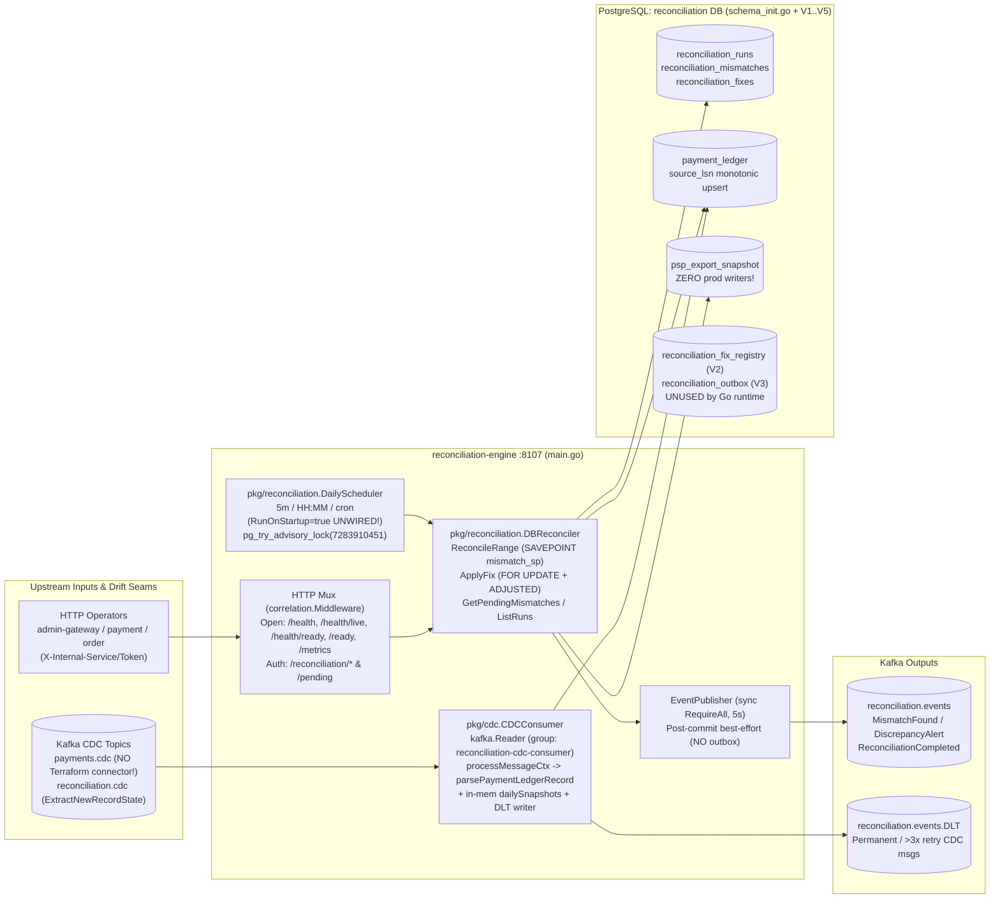
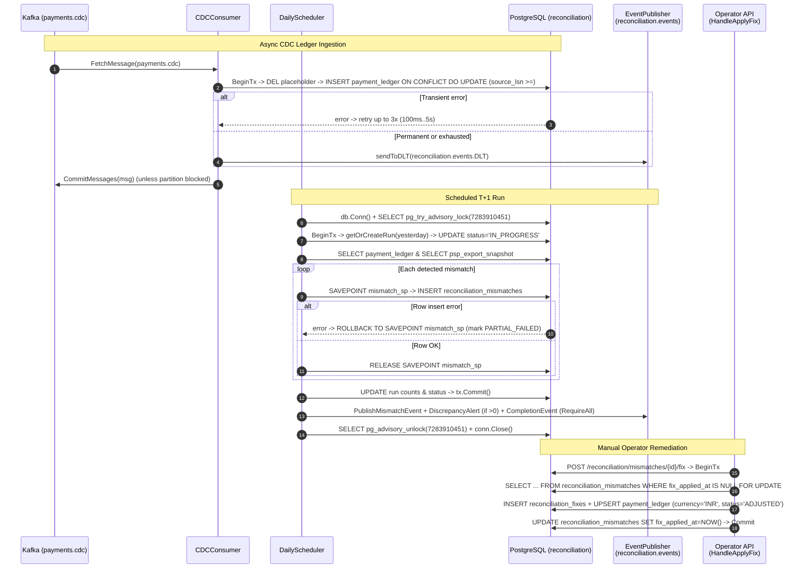

# `reconciliation-engine` Code Walkthrough

> [!NOTE]
> **Part of the InstaCommerce Onboarding Suite:** [Onboarding Hub](../../README.md) · [Code Walkthrough Atlas](../README.md) · [Domain & Event Catalog (`05`)](../../05-domain-model-and-event-catalog.md) · [Incident Drills & Exam (`06`)](../../06-incident-drills-and-readiness-exam.md) · [Dependency Matrix & Cheatsheet (`07`)](../../07-service-dependency-and-command-cheatsheet.md)

> **Service identity:** Go `1.25.0` financial ledger CDC consumer, T+1 settlement reconciler, and remediation API on port `8107` (`RECONCILIATION_PORT`) | **Domain:** Debezium CDC ingestion into `payment_ledger`, distributed-locked T+1 matching against `psp_export_snapshot`, `SAVEPOINT`-isolated mismatch classification, and operator `ApplyFix` adjustments | **Database:** PostgreSQL (`reconciliation` DB, `V1`–`V5` schema auto-applied via `schema_init.go`) | **Source root:** [`services/reconciliation-engine/`](../../../../services/reconciliation-engine/)

---

## 1. Service Boundaries & Package Layout

`reconciliation-engine` runs two concurrent loops inside a single Go binary plus a protected operator API:

1. **CDC Ingestion Loop (`pkg/cdc.CDCConsumer`):** Consumes Debezium envelope records from Kafka (`payments.cdc`, `reconciliation.cdc`), maintains `payment_ledger` monotonically via `source_lsn`, routes malformed or exhausted records to `reconciliation.events.DLT`, and holds partition offset commits if DLT publication itself fails.
2. **Scheduled T+1 Matcher (`pkg/reconciliation.DailyScheduler` + `DBReconciler`):** Acquires an instance-level `atomic.Bool` + PostgreSQL session-pinned `pg_try_advisory_lock(7283910451)` and reconciles `payment_ledger` vs. `psp_export_snapshot` for `yesterday`.
3. **Operator API (`api`):** Exposes run inspection, pending mismatches, manual re-runs, and `FOR UPDATE`-locked `ApplyFix` ledger adjustments behind `InternalAuthMiddleware`.

| Attribute | Authoritative Code / Config Value | Source |
| :--- | :--- | :--- |
| **HTTP Port** | `:8107` (`RECONCILIATION_PORT` / `SERVER_PORT`) | [`config.go`](../../../../services/reconciliation-engine/config.go), [`main.go#L25-L158`](../../../../services/reconciliation-engine/main.go#L25-L158) |
| **Readiness Probe** | Actively executes `db.PingContext(3s)` and `health.CheckTCPBrokers(2s)` | [`main.go#L168-L204`](../../../../services/reconciliation-engine/main.go#L168-L204) |
| **PostgreSQL Tables** | `reconciliation_runs`, `reconciliation_mismatches`, `reconciliation_fixes`, `payment_ledger`, `psp_export_snapshot`, `reconciliation_fix_registry` (unused), `reconciliation_outbox` (unused by Go) | [`schema_init.go#L9-L112`](../../../../services/reconciliation-engine/schema_init.go#L9-L112), [`V1..V5`](../../../../services/reconciliation-engine/src/main/resources/db/migration/V1__create_reconciliation_schema.sql) |
| **Advisory Lock Key** | `int64(7283910451)` via dedicated `*sql.Conn` | [`pkg/reconciliation/scheduler.go#L17`](../../../../services/reconciliation-engine/pkg/reconciliation/scheduler.go#L17), [`scheduler.go#L187-L212`](../../../../services/reconciliation-engine/pkg/reconciliation/scheduler.go#L187-L212) |
| **Kafka Consumer & Producers** | Consumer group `reconciliation-cdc-consumer` (`payments.cdc`, `reconciliation.cdc`); Producers `reconciliation.events` (`RequireAll`, `5s`) & `reconciliation.events.DLT` | [`pkg/cdc/payment_ledger_consumer.go`](../../../../services/reconciliation-engine/pkg/cdc/payment_ledger_consumer.go), [`pkg/reconciliation/event_publisher.go`](../../../../services/reconciliation-engine/pkg/reconciliation/event_publisher.go) |

### Module & File Inventory

```text
services/reconciliation-engine/
├── main.go                           # Startup: Config -> DB pool -> ensureReconciliationSchema -> EventPublisher -> DBReconciler -> DailyScheduler -> CDCConsumer -> HTTP + /ready
├── config.go                         # Env parsing (SCHEDULE='5m', CDC_MAX_RETRIES=3, RunOnStartup=true & ReconciliationTimeout=2m [unwired!])
├── schema_init.go                    # Embedded idempotent DDL mirror of V1–V5 migrations executed on startup
├── telemetry.go                      # OpenTelemetry + Prometheus metrics (reconciliation_mismatches_total, fixed_total, manual_review_total, etc.)
├── api/
│   └── reconciliation_handlers.go    # Mux routes: /reconciliation/runs, /reconciliation/mismatches/{pending,{id}/fix}, /reconciliation/run, /reconciliation/summary
├── pkg/cdc/
│   ├── payment_ledger_consumer.go    # CDCConsumer FetchMessage -> retry/DLT loop -> CommitMessages (blockedPartitions on DLT failure)
│   ├── parser.go                     # Debezium payload extraction, parsePaymentLedgerRecord (transaction_id -> psp_reference -> payment_id)
│   ├── record_handlers.go            # upsertPaymentLedger (delete placeholder + ON CONFLICT DO UPDATE WHERE EXCLUDED.source_lsn >= ...)
│   └── types.go                      # DebeziumEnvelope, PaymentLedgerRecord, BatchSize=500, BatchTimeout=5s (unused)
└── pkg/reconciliation/
    ├── scheduler.go                  # DailyScheduler (ticker/cron/HH:MM), compare-and-swap + pg_try_advisory_lock(7283910451)
    ├── reconciler.go                 # DBReconciler.ReconcileRange: SAVEPOINT mismatch_sp inserts, queryLedgerEntries, run summary updates
    ├── classification.go             # detectMismatches, WithinRoundingTolerance (2c), ShouldAutoFix (<=100c & <=5%), parseAmountCentsStrict
    ├── queries.go                    # GetPendingMismatches, ListRuns, GetRunMismatches, ApplyFix (FOR UPDATE + status='ADJUSTED')
    ├── event_publisher.go            # Sync Kafka writer (RequireAll, 5s timeout) for MismatchFound, DiscrepancyAlert, ReconciliationCompleted
    ├── models.go                     # ReconciliationRun, ReconciliationMismatch, LedgerEntry, PSPExportEntry
    └── errors.go                     # ErrReconciliationAlreadyRunning
```

---

## 2. Architecture & Boot Wiring (`arch-lld`)

**reconciliation-engine Low-Level Architecture** — *[Rendered PNG](../diagrams/services/reconciliation-engine-arch-lld.png) · [Mermaid Source](../diagrams/services/reconciliation-engine-arch-lld.mmd)*



### Startup & Readiness Behavior ([`main.go#L25-L204`](../../../../services/reconciliation-engine/main.go#L25-L204))

1. Opens PostgreSQL connection pool and synchronously runs `ensureReconciliationSchema(ctx, db)` ([`schema_init.go#L9-L112`](../../../../services/reconciliation-engine/schema_init.go#L9-L112)), applying idempotent DDL equivalent to [`V1`](../../../../services/reconciliation-engine/src/main/resources/db/migration/V1__create_reconciliation_schema.sql) through [`V5`](../../../../services/reconciliation-engine/src/main/resources/db/migration/V5__allow_partial_failed_status.sql) (including `PARTIAL_FAILED` status).
2. Initializes `EventPublisher` targeting `reconciliation.events` (Kafka `RequireAll`, `5s` write timeout), `DBReconciler`, and `DailyScheduler` (supports interval strings like `5m`, daily `HH:MM`, or cron via `robfig/cron`).
3. If `CDCEnabled && len(KafkaBrokers) > 0`, launches `CDCConsumer` in a background goroutine.
4. Mounts `api.RegisterRoutes` behind `InternalAuthMiddleware` and leaves `/health`, `/health/live`, `/health/ready`, `/ready`, and `/metrics` open inside `correlation.Middleware`.
5. **Active Dependency Readiness ([`main.go#L168-L204`](../../../../services/reconciliation-engine/main.go#L168-L204)):** Unlike services using static readiness booleans, `/ready` and `/health/ready` execute live `db.PingContext` (`3s`) and `health.CheckTCPBrokers` (`2s`) checks.

---

## 3. PostgreSQL Schema, CDC Upsert & Locking Semantics

### Schema Inventory ([`V1`–`V5`](../../../../services/reconciliation-engine/src/main/resources/db/migration/V4__create_payment_ledger_and_psp_snapshot.sql))

| Table | Writer in Go Runtime | Reader / Role | Key Constraints & Drift Notes |
| :--- | :--- | :--- | :--- |
| `payment_ledger` | `CDCConsumer.upsertPaymentLedger` & `ApplyFix` (`status='ADJUSTED'`) | `DBReconciler.queryLedgerEntries` | Unique `transaction_id`; `source_lsn` monotonic guard prevents out-of-order stale CDC overwrites |
| `psp_export_snapshot` | **ZERO non-test Go writers!** | `DBReconciler` (yesterday `export_date`) | Requires external batch loader or ETL; empty in standalone deployments |
| `reconciliation_runs` | `DBReconciler` | `ListRuns` (`api`) | Tracks `run_date`, `status` (`IN_PROGRESS`, `COMPLETED`, `PARTIAL_FAILED`), totals |
| `reconciliation_mismatches` | `DBReconciler` (`SAVEPOINT mismatch_sp`) | `GetPendingMismatches`, `ApplyFix` | **No `UNIQUE(run_id, transaction_id)` constraint**; re-runs delete `WHERE run_id = $1 AND fix_applied_at IS NULL` |
| `reconciliation_fixes` | `ApplyFix` | Audit trail | Records `fix_type`, `previous_amount_cents`, `adjusted_amount_cents`, `reason` |
| `reconciliation_fix_registry` ([`V2`](../../../../services/reconciliation-engine/src/main/resources/db/migration/V2__create_fix_registry.sql)) | **Unused** | **Unused** | Orphan DDL from earlier design |
| `reconciliation_outbox` ([`V3`](../../../../services/reconciliation-engine/src/main/resources/db/migration/V3__create_outbox_table.sql)) | **Unused by Go** | Debezium heartbeat only | `EventPublisher` publishes directly post-commit rather than transacting via outbox |

### CDC Monotonic Upsert & Placeholder Cleanup ([`pkg/cdc/record_handlers.go`](../../../../services/reconciliation-engine/pkg/cdc/record_handlers.go))

1. `parsePaymentLedgerRecord` extracts canonical `transaction_id` preferring `transaction_id -> psp_reference -> payment_id`.
2. Inside a PostgreSQL transaction, `upsertPaymentLedger` deletes any pre-settlement placeholder row (`WHERE transaction_id = payment_id AND psp_reference = ''`) before executing:
   `INSERT INTO payment_ledger (...) ON CONFLICT (transaction_id) DO UPDATE SET ... WHERE EXCLUDED.source_lsn >= payment_ledger.source_lsn`.
3. `BatchSize` (`500`) and `BatchTimeout` (`5s`) are defaulted in [`pkg/cdc/payment_ledger_consumer.go#L107-L112`](../../../../services/reconciliation-engine/pkg/cdc/payment_ledger_consumer.go#L107-L112) **but never used**—`runConsumerLoopWithFetcher` fetches and commits **1 message per iteration**.

---

## 4. Dual-Loop Flowchart & End-to-End Call Sequence

### Dual-Loop Decision & Classification Flowchart

**reconciliation-engine Dual-Loop Flowchart** — *[Rendered PNG](../diagrams/services/reconciliation-engine-flowchart.png) · [Mermaid Source](../diagrams/services/reconciliation-engine-flowchart.mmd)*

```mermaid
flowchart TD
    subgraph LaneA["Lane A: CDC Ingestion Loop (pkg/cdc)"]
        F1["FetchMessage(2*MaxWait)"] --> F2{"empty/null or<br/>op not in c,i,u,r?"}
        F2 -->|Yes| FCOM["CommitMessages"]
        F2 -->|No| FTBL{"source.table<br/>(or topic contains payment)"}
        FTBL -->|"reconciliation_*"| FSNAP["Update in-mem dailySnapshots"] --> FCOM
        FTBL -->|"payments"| FUP["parsePaymentLedgerRecord<br/>upsertPaymentLedger:<br/>DEL placeholder + INSERT ON CONFLICT<br/>WHERE EXCLUDED.source_lsn >= current"]
        FUP -->|OK| FCOM
        FUP -->|Err| FRET{"isPermanentCDCError or<br/>retries >= CDC_MAX_RETRIES(3)?"}
        FRET -->|No| FBACK["Wait backoff (100ms..5s) & retry"] --> FUP
        FRET -->|Yes| FDLT{"sendToDLT -> reconciliation.events.DLT"}
        FDLT -->|OK| FCOM
        FDLT -->|Fail| FBLK["blockedPartitions[p]=true<br/>Hold offset commit & backoff"]
    end

    subgraph LaneB["Lane B: T+1 Scheduled Matcher (pkg/reconciliation)"]
        S1(["DailyScheduler tick<br/>(RunOnStartup UNWIRED)"]) --> S2{"running.CompareAndSwap<br/>& pg_try_advisory_lock(7283910451)?"}
        S2 -->|"Busy"| SSKIP["Skip run (already running)"]
        S2 -->|Acquired| S3["BeginTx -> getOrCreateRun(yesterday)<br/>If existing: DEL WHERE fix_applied_at IS NULL"]
        S3 --> S4["Load payment_ledger (amount_cents by created_at)<br/>& psp_export_snapshot (export_date)"]
        S4 --> S5{"detectMismatches Classification"}
        S5 -->|"Only in PSP / Ledger"| M1["missing_ledger_entry / missing_psp_export<br/>ManualReview=true (HIGH)"]
        S5 -->|"abs(diff) <= 2c (same sign)"| M2["fee_tax_rounding_within_tolerance<br/>AutoFixed=true"]
        S5 -->|"abs(diff) <= 100c & <= 5%"| M3["amount_mismatch_auto_fixable<br/>AutoFixed=true"]
        S5 -->|"Otherwise"| M4["amount_mismatch_manual_review<br/>ManualReview=true"]
        M1 & M2 & M3 & M4 --> SSP["SAVEPOINT mismatch_sp<br/>INSERT mismatch or ROLLBACK TO SAVEPOINT<br/>(failedCount>0 -> PARTIAL_FAILED)"]
        SSP --> SCOM["tx.Commit() -> EventPublisher (best-effort)<br/>-> pg_advisory_unlock"]
    end
```



### CDC Ingestion, T+1 Run & Manual `ApplyFix` Sequence Diagram

**reconciliation-engine Execution Sequence** — *[Rendered PNG](../diagrams/services/reconciliation-engine-sequence.png) · [Mermaid Source](../diagrams/services/reconciliation-engine-sequence.mmd)*



### Function-by-Function Execution Walkthrough

#### Lane A: CDC Consumer Loop ([`pkg/cdc/payment_ledger_consumer.go`](../../../../services/reconciliation-engine/pkg/cdc/payment_ledger_consumer.go))

1. Reads one message via `FetchMessage(2 * MaxWait)`.
2. Calls `processMessageCtx` ([`payment_ledger_consumer.go#L458-L478`](../../../../services/reconciliation-engine/pkg/cdc/payment_ledger_consumer.go#L458-L478)): ignores tombstones/unsupported operations (`op` outside `c`/`i`/`u`/`r`), then routes by `source.table` (or topic name heuristic `"payment"`):
   - **`payments`:** Parses `PaymentLedgerRecord` and runs monotonic `upsertPaymentLedger`.
   - **`reconciliation_*`:** Updates in-memory `dailySnapshots` map (used for CDC self-observation rather than DB storage).
3. **Retry, Permanent Error Short-Circuit & Partition Blocking:**
   - Permanent errors (`json.SyntaxError`, `json.UnmarshalTypeError`, `"failed to unmarshal"`, `"missing "`) immediately skip retries and call `sendToDLT` (`reconciliation.events.DLT`).
   - Transient DB/network errors retry up to `CDC_MAX_RETRIES` (`3`, backoff `100ms..5s`) before sending to `reconciliation.events.DLT`.
   - If `sendToDLT` succeeds, commits the Kafka offset. If `sendToDLT` fails, sets `blockedPartitions[msg.Partition] = true`, halting offset commits on that partition and backing off to prevent silent financial ledger loss.

#### Lane B: Scheduled T+1 Match & `SAVEPOINT` Loop ([`scheduler.go`](../../../../services/reconciliation-engine/pkg/reconciliation/scheduler.go), [`reconciler.go`](../../../../services/reconciliation-engine/pkg/reconciliation/reconciler.go), [`classification.go`](../../../../services/reconciliation-engine/pkg/reconciliation/classification.go))

1. **`DailyScheduler.executeWithLock` ([`scheduler.go#L168`](../../../../services/reconciliation-engine/pkg/reconciliation/scheduler.go#L168)):**
   - Guarded locally by `running.CompareAndSwap(false, true)`.
   - Pins a single `*sql.Conn` and calls `SELECT pg_try_advisory_lock(7283910451)` ([`scheduler.go#L187-L212`](../../../../services/reconciliation-engine/pkg/reconciliation/scheduler.go#L187-L212)); returns immediately if another pod holds the lock. Note: timeout is **hardcoded `2*time.Minute`**, ignoring config.
2. **Run Preparation & Idempotent Re-Run Cleanup ([`reconciler.go#L85-L88`](../../../../services/reconciliation-engine/pkg/reconciliation/reconciler.go#L85-L88)):**
   - Starts `BeginTx`, calls `getOrCreateRun(yesterday)`, marks `IN_PROGRESS`, and deletes only **unfixed** prior mismatches (`WHERE run_id = $1 AND fix_applied_at IS NULL`), preserving previously applied remediations.
   - Loads `payment_ledger` via `queryLedgerEntries` ([`reconciler.go#L241`](../../../../services/reconciliation-engine/pkg/reconciliation/reconciler.go#L241)) filtered by `created_at` (using authorized `amount_cents`) and loads `psp_export_snapshot` filtered by `export_date`.
3. **Classification (`detectMismatches`, [`reconciler.go#L281-L352`](../../../../services/reconciliation-engine/pkg/reconciliation/reconciler.go#L281-L352), [`classification.go#L31-L200`](../../../../services/reconciliation-engine/pkg/reconciliation/classification.go#L31-L200)):**
   - Only in PSP -> `missing_ledger_entry` (`ManualReview: true`, `HIGH`).
   - Only in Ledger -> `missing_psp_export` (`ManualReview: true`, `HIGH`).
   - Same sign & `abs(diff) <= 2` (`WithinRoundingTolerance(..., 2)`) -> `fee_tax_rounding_within_tolerance` (`AutoFixed: true`).
   - `ShouldAutoFix` (`diff <= 100` AND `diff * 100 <= base * 5`, i.e., `<= 100` minor units and `<= 5%`) -> `amount_mismatch_auto_fixable` (`AutoFixed: true`).
   - Otherwise -> `amount_mismatch_manual_review` (`ManualReview: true`).
4. **Per-Row `SAVEPOINT` Persistence & Post-Commit Publish ([`reconciler.go#L154-L168`](../../../../services/reconciliation-engine/pkg/reconciliation/reconciler.go#L154-L168)):**
   - Each mismatch inserts inside `SAVEPOINT mismatch_sp` ... `RELEASE SAVEPOINT mismatch_sp`; a row insert failure triggers `ROLLBACK TO SAVEPOINT mismatch_sp` and sets final run status to `PARTIAL_FAILED` instead of aborting valid rows.
   - Commits SQL transaction, then publishes `MismatchFound`, `DiscrepancyAlert` (if mismatches > 0), and `ReconciliationCompleted` synchronously (`RequireAll`) to `reconciliation.events` before releasing `pg_advisory_unlock(7283910451)` on the pinned connection.

#### Lane C: Operator Remediation (`ApplyFix`, [`pkg/reconciliation/queries.go#L116-L203`](../../../../services/reconciliation-engine/pkg/reconciliation/queries.go#L116-L203))

- Handles `POST /reconciliation/mismatches/{id}/fix`: begins DB tx, locks mismatch row (`SELECT ... FROM reconciliation_mismatches WHERE id = $1 FOR UPDATE`), checks `fix_applied_at IS NULL` idempotently, inserts `reconciliation_fixes`, upserts `payment_ledger` with **`status = 'ADJUSTED'`** and **`currency = 'INR'`**, stamps `fix_applied_at = NOW()`, and commits.

---

## 5. Configuration, Observability & Testing

### Key Environment & Deployment Settings

- `SCHEDULE` (`5m` default in `config.go`, `02:00` in some overlays), `CDC_ENABLED`, `CDC_TOPICS`, `CDC_MAX_RETRIES` (`3`), `KAFKA_BROKERS`, `RECONCILIATION_PORT` (`8107`).
- Telemetry ([`telemetry.go`](../../../../services/reconciliation-engine/telemetry.go)) exports `reconciliation_mismatches_total`, `reconciliation_fixed_total`, and `reconciliation_manual_review_total`.

### Verification Command

```bash
cd services/reconciliation-engine && go test -race ./...
```

---

## 6. Verified Code-Level Bugs, Drift & Production Gaps

1. **Empty `psp_export_snapshot` Pipeline:** No production writer populates `psp_export_snapshot` anywhere in the service or repo (`V4`), meaning live runs only detect `missing_psp_export` unless an external loader populates snapshot rows.
2. **Broken Debezium Terraform Config ([`debezium-connector-reconciliation.tf`](../../../../infra/terraform/debezium-connector-reconciliation.tf)):**
   - Only defines `reconciliation.cdc`—there is **no `payments.cdc` connector** defined in Terraform despite `CDCConsumer` primarily ingesting `payments`.
   - Applies `ExtractNewRecordState` ([`#L40`](../../../../infra/terraform/debezium-connector-reconciliation.tf#L40), [`#L98`](../../../../infra/terraform/debezium-connector-reconciliation.tf#L98)) **without** `add.fields=op,table,lsn`, stripping `op` and `source.table` that `processMessageCtx` ([`payment_ledger_consumer.go#L458-L478`](../../../../services/reconciliation-engine/pkg/cdc/payment_ledger_consumer.go#L458-L478)) inspects to route messages.
3. **Unwired Config Flags (`RunOnStartup`, `ReconciliationTimeout`, `BatchSize`):** [`config.go#L57-L58`](../../../../services/reconciliation-engine/config.go#L57-L58) parses `RunOnStartup` (`true`) and `ReconciliationTimeout` (`2m`), but neither `main.go` nor `scheduler.go` reads them (`executeWithLock` hardcodes `2*time.Minute`). Likewise `BatchSize=500` / `BatchTimeout=5s` ([`payment_ledger_consumer.go#L107-L112`](../../../../services/reconciliation-engine/pkg/cdc/payment_ledger_consumer.go#L107-L112)) are never batched.
4. **Authorized vs. Captured Amount, Hardcoded `'INR'`, Unused Outbox & Missing `currency_mismatch`:**
   - `queryLedgerEntries` ([`reconciler.go#L241`](../../../../services/reconciliation-engine/pkg/reconciliation/reconciler.go#L241)) compares `amount_cents` by `created_at` instead of settled/captured amounts (`captured_cents`).
   - `detectMismatches` never emits `"currency_mismatch"`, and `ApplyFix` ([`queries.go#L116-L203`](../../../../services/reconciliation-engine/pkg/reconciliation/queries.go#L116-L203)) hardcodes `'INR'`.
   - Note `parseAmountCentsStrict` ([`classification.go#L101-L156`](../../../../services/reconciliation-engine/pkg/reconciliation/classification.go#L101-L156)) treats bare integer strings as minor units (matching `queryLedgerEntries`) while scaling dotted decimal strings by `100`.
   - `reconciliation_outbox` (`V3`) and `reconciliation_fix_registry` (`V2`) are unused by Go; post-commit Kafka publication ([`reconciler.go#L154-L168`](../../../../services/reconciliation-engine/pkg/reconciliation/reconciler.go#L154-L168)) can lose events if the pod crashes between `tx.Commit()` and `WriteMessages`.
5. **Broken Helm Config, Stale `README.md` & Broken PromQL Alerts:**
   - [`deploy/helm/values.yaml#L1229-L1231`](../../../../deploy/helm/values.yaml#L1229-L1231) omits PostgreSQL and Kafka env vars for `reconciliation-engine`.
   - [`README.md`](../../../../services/reconciliation-engine/README.md) documents superseded local JSON file reconciliation.
   - [`wave-40-complete-slo-alerts.yml#L387`](../../../../prometheus/rules/wave-40-complete-slo-alerts.yml#L387), [`#L400`](../../../../prometheus/rules/wave-40-complete-slo-alerts.yml#L400) query nonexistent `reconciliation_job_failures_total` and `reconciliation_mismatches_count` instead of `telemetry.go`'s `reconciliation_{mismatches,fixed,manual_review}_total`.

---

**Previous:** [dispatch-optimizer-service](./dispatch-optimizer-service.md) | **Atlas Hub:** [Code Walkthrough Atlas](../README.md) | **Next:** [reverse-etl-orchestrator](./reverse-etl-orchestrator.md)
