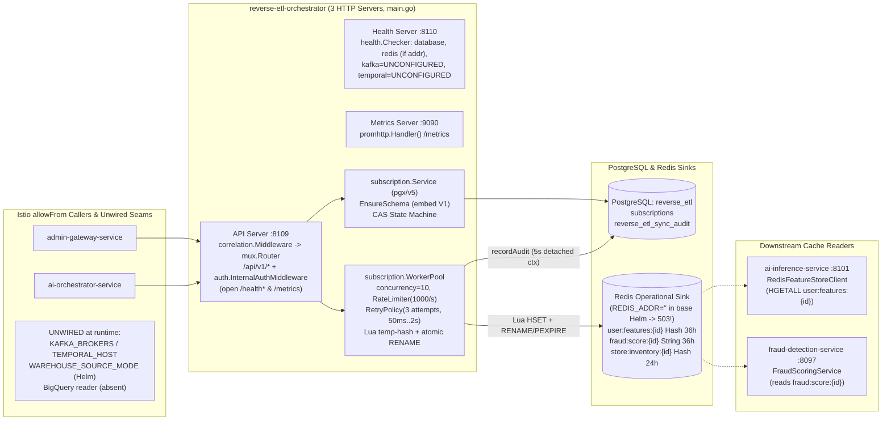
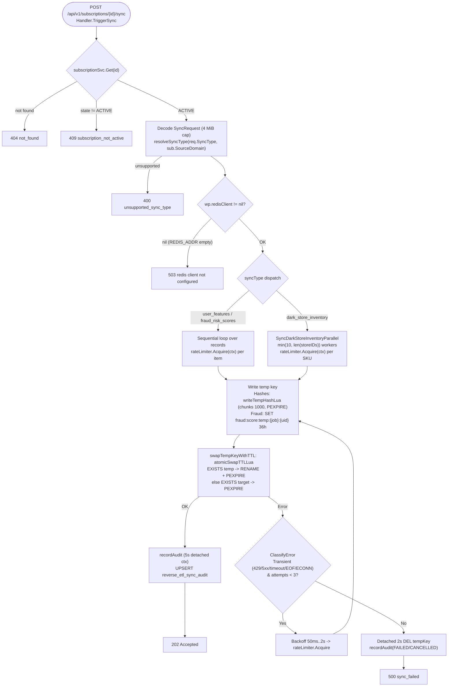
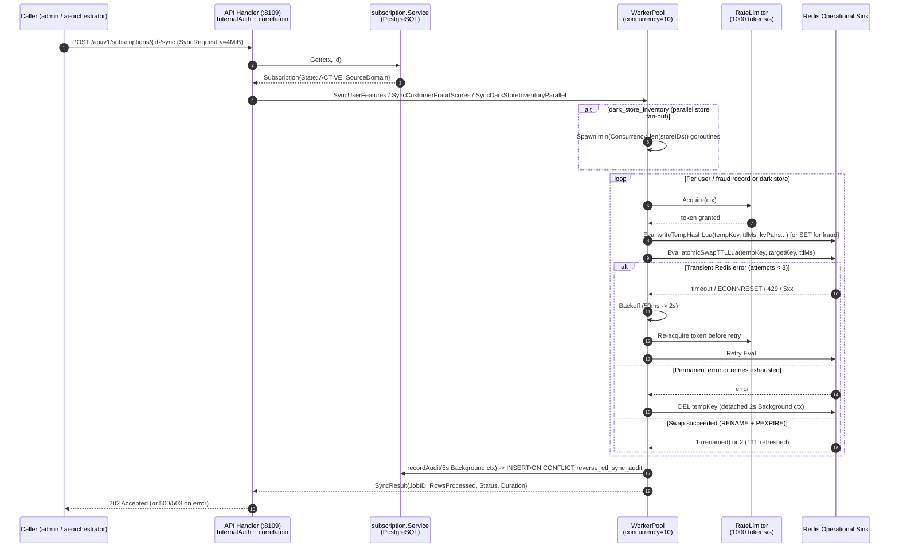

# `reverse-etl-orchestrator` Code Walkthrough

> [!NOTE]
> **Part of the InstaCommerce Onboarding Suite:** [Onboarding Hub](../../README.md) · [Code Walkthrough Atlas](../README.md) · [Domain & Event Catalog (`05`)](../../05-domain-model-and-event-catalog.md) · [Incident Drills & Exam (`06`)](../../06-incident-drills-and-readiness-exam.md) · [Dependency Matrix & Cheatsheet (`07`)](../../07-service-dependency-and-command-cheatsheet.md)

> **Service identity:** Go `1.25.0` HTTP-push subscription manager & Redis cache writer across 3 listeners (`:8109` API, `:8110` health, `:9090` Prometheus metrics) | **Domain:** Feature/fraud/inventory sink subscriptions in PostgreSQL and two-phase Lua atomic Redis cache refreshes | **Database:** PostgreSQL (`subscriptions`, `reverse_etl_sync_audit`) + Redis operational sinks (`user:features:{id}`, `fraud:score:{id}`, `store:inventory:{id}`) | **Source root:** [`services/reverse-etl-orchestrator/`](../../../../services/reverse-etl-orchestrator/)

---

## 1. Service Boundaries & Package Layout

`reverse-etl-orchestrator` manages sink subscription lifecycles in PostgreSQL and writes operational lookup state to Redis using rate-limited retries and two-phase Lua temp-key swaps. **Despite its name and health/Helm scaffolding, the current binary contains zero Kafka, Temporal, or BigQuery clients—every sync executes synchronously via HTTP JSON push (`POST /api/v1/subscriptions/{id}/sync`).**

| Attribute | Authoritative Code / Config Value | Source |
| :--- | :--- | :--- |
| **HTTP Listeners** | `:8109` API mux, `:8110` standalone `health.Checker`, `:9090` `promhttp` metrics | [`cmd/server/main.go#L143-L166`](../../../../services/reverse-etl-orchestrator/cmd/server/main.go#L143-L166) |
| **API Auth Boundary** | `correlation.Middleware` over router; `/api/v1/*` protected by `auth.InternalAuthMiddleware`; `/health*` & `/metrics` open | [`cmd/server/main.go#L143-L166`](../../../../services/reverse-etl-orchestrator/cmd/server/main.go#L143-L166), [`internal/api/handler.go`](../../../../services/reverse-etl-orchestrator/internal/api/handler.go) |
| **PostgreSQL Schema** | `subscriptions` & `reverse_etl_sync_audit` applied via embedded `V1` schema on boot | [`db/migration/V1__create_reverse_etl_schema.sql`](../../../../services/reverse-etl-orchestrator/db/migration/V1__create_reverse_etl_schema.sql), [`db/migration/schema.go`](../../../../services/reverse-etl-orchestrator/db/migration/schema.go) |
| **Redis Sink Keyspaces** | `user:features:{id}` (`36h` Hash), `fraud:score:{id}` (`36h` String), `store:inventory:{id}` (`24h` Hash) | [`internal/subscription/worker.go`](../../../../services/reverse-etl-orchestrator/internal/subscription/worker.go), [`worker_inventory.go`](../../../../services/reverse-etl-orchestrator/internal/subscription/worker_inventory.go) |
| **Downstream Consumers** | `ai-inference-service` `RedisFeatureStoreClient` reads `user:features:{id}` (`HGETALL`); `fraud-detection-service` consumes `fraud:score:{id}` | [`ai-inference-service` `redis_client.py`](../../../../services/ai-inference-service/app/features/redis_client.py) |

### Module & File Inventory

```text
services/reverse-etl-orchestrator/
├── cmd/server/main.go                        # Boots PG pgxpool -> EnsureSchema -> Redis -> subscription.Service -> WorkerPool -> 3 http.Servers
├── go.mod                                    # Go 1.25.0 + pgx/v5, go-redis/v9, gorilla/mux, go-shared (no Kafka/Temporal/BQ deps)
├── Dockerfile                                # Multi-stage build exposing :8109/:8110/:9090; HEALTHCHECK polls :8110/health
├── db/migration/
│   ├── V1__create_reverse_etl_schema.sql     # subscriptions + reverse_etl_sync_audit tables & indexes
│   └── schema.go                             # //go:embed V1__create_reverse_etl_schema.sql
└── internal/
    ├── config/config.go                      # Env loader (HTTPPort, HealthPort, MetricsPort, DB, Redis, Retry, Concurrency=10, RateLimit=1000)
    ├── health/handler.go                     # Checker probing PG + optional Redis; hardcodes kafka=UNCONFIGURED, temporal=UNCONFIGURED
    ├── api/handler.go                        # HTTP CRUD/lifecycle routes + TriggerSync + Prometheus metrics
    └── subscription/
        ├── types.go                          # Subscription, SyncRequest, SyncResult, State enums
        ├── service.go                        # pgxpool EnsureSchema, CRUD, CAS Activate/Pause/Archive, orphan Validate()
        ├── worker.go                         # WorkerPool, writeTempHashLua, atomicSwapTTLLua, SyncUserFeatures, SyncCustomerFraudScores, recordAudit
        ├── worker_inventory.go               # SyncDarkStoreInventoryParallel (bounded fan-out <=10 goroutines)
        ├── ratelimiter.go                    # Token-bucket channel RateLimiter (1000 ops/sec default)
        └── retry.go                          # RetryPolicy ExecuteWithRetry (3 attempts, 50ms..2s backoff) + ClassifyError
```

---

## 2. Three-Server Architecture & Boot Wiring (`arch-lld`)

**reverse-etl-orchestrator Low-Level Architecture** — *[Rendered PNG](../diagrams/services/reverse-etl-orchestrator-arch-lld.png) · [Mermaid Source](../diagrams/services/reverse-etl-orchestrator-arch-lld.mmd)*



### Startup & Three-Listener Topology ([`cmd/server/main.go#L143-L166`](../../../../services/reverse-etl-orchestrator/cmd/server/main.go#L143-L166))

1. Loads configuration via [`internal/config/config.go`](../../../../services/reverse-etl-orchestrator/internal/config/config.go).
2. Connects PostgreSQL `pgxpool` and runs `subscription.Service.EnsureSchema` using embedded [`V1__create_reverse_etl_schema.sql`](../../../../services/reverse-etl-orchestrator/db/migration/V1__create_reverse_etl_schema.sql).
3. Conditionally initializes `go-redis/v9` client **only when `REDIS_ADDR` is non-empty**; if `REDIS_ADDR` is blank, `redisClient` stays `nil`.
4. Instantiates `WorkerPool` (`concurrency = 10`, `RateLimiter = 1000/s`, `RetryPolicy = 3 attempts`) and `health.NewChecker`.
5. Starts three concurrent `http.Server` listeners inside `correlation.Middleware`:
   - **`:8109` (API):** Protected `/api/v1/subscriptions*` routes via `auth.InternalAuthMiddleware`, plus open `/health*` and `/metrics` aliases.
   - **`:8110` (Health):** Dedicated health port (`GET /health`) polled by Docker `HEALTHCHECK` ([`Dockerfile#L18`](../../../../services/reverse-etl-orchestrator/Dockerfile#L18)).
   - **`:9090` (Metrics):** Dedicated Prometheus `promhttp.Handler()` server.

---

## 3. PostgreSQL CAS State Machine & Lua Two-Phase Redis Writes

### Subscription Lifecycle ([`internal/subscription/service.go`](../../../../services/reverse-etl-orchestrator/internal/subscription/service.go))

Subscriptions follow optimistic compare-and-set state transitions in SQL (`WHERE subscription_id = $3 AND state = $4`), returning `409 Conflict` when callers attempt invalid state jumps:
- `PENDING` -> `ACTIVE` (`Activate`)
- `ACTIVE` <-> `PAUSED` (`Pause` / `Activate`)
- `ACTIVE` / `PAUSED` -> `ARCHIVED` (`Archive`)
- `Service.Validate` ([`service.go#L329-L331`](../../../../services/reverse-etl-orchestrator/internal/subscription/service.go#L329-L331)) exists in Go code but has no registered HTTP route.

### Two-Phase Lua Atomic Redis Swap ([`internal/subscription/worker.go#L14-L33`](../../../../services/reverse-etl-orchestrator/internal/subscription/worker.go#L14-L33), [`worker.go#L125-L156`](../../../../services/reverse-etl-orchestrator/internal/subscription/worker.go#L125-L156))

1. **Phase 1 (`writeTempHashLua`):** `DEL tempKey`, followed by chunked `HSET` batches (up to `1000` field/value ARGV elements per batch) and `PEXPIRE tempKey ttlMs`. For scalar fraud scores, issues `SET fraud:score:temp:{job}:{uid} value PX 36h`.
2. **Phase 2 (`atomicSwapTTLLua`):**
   - If `EXISTS KEYS[1]` (`tempKey`): `RENAME tempKey targetKey` then `PEXPIRE targetKey ARGV[1]` (`return 1`).
   - Else if `EXISTS KEYS[2]` (`targetKey`): `PEXPIRE targetKey ARGV[1]` (`return 2`) so idempotent retries never fail if `tempKey` was already renamed on a partial prior attempt.
3. **Failure Cleanup:** If retry exhaustion or permanent error occurs, `WorkerPool` launches a detached `2s` `context.Background()` `DEL tempKey` cleanup so partial temp keys do not linger.
4. **Detached Audit Persistence:** `recordAudit` runs under a `5s` `context.Background()` `UPSERT` into `reverse_etl_sync_audit` regardless of caller HTTP cancellation.

---

## 4. Sync Decision Flow & Lua Retry Call-Stack Trace

### `TriggerSync` Decision & Retry Flowchart

**reverse-etl-orchestrator Sync Flowchart** — *[Rendered PNG](../diagrams/services/reverse-etl-orchestrator-flowchart.png) · [Mermaid Source](../diagrams/services/reverse-etl-orchestrator-flowchart.mmd)*



### Concurrent Inventory / Feature Sync Sequence Diagram

**reverse-etl-orchestrator Sync Sequence** — *[Rendered PNG](../diagrams/services/reverse-etl-orchestrator-sequence.png) · [Mermaid Source](../diagrams/services/reverse-etl-orchestrator-sequence.mmd)*



### Function-by-Function Walkthrough ([`internal/api/handler.go#L284-L325`](../../../../services/reverse-etl-orchestrator/internal/api/handler.go#L284-L325), [`internal/subscription/worker.go#L106-L110`](../../../../services/reverse-etl-orchestrator/internal/subscription/worker.go#L106-L110))

1. **`TriggerSync` (`POST /api/v1/subscriptions/{id}/sync`, [`handler.go#L284-L325`](../../../../services/reverse-etl-orchestrator/internal/api/handler.go#L284-L325)):**
   - Calls `subscriptionSvc.Get(ctx, id)` (`404` if missing, `409 subscription_not_active` unless `state == ACTIVE`).
   - Decodes JSON `SyncRequest` (capped at `4 MiB`) and resolves `syncType` via `resolveSyncType(req.SyncType, sub.SourceDomain)`.
   - Checks `wp.redisClient != nil`; if nil (empty `REDIS_ADDR`), returns **`503 Service Unavailable` (`redis client not configured`)**.
2. **Dispatch by Domain (`SyncUserFeatures`, `SyncCustomerFraudScores`, `SyncDarkStoreInventoryParallel`):**
   - `user_features` and `fraud_risk_scores` iterate **sequentially** over submitted items, calling `rateLimiter.Acquire(ctx)` per record.
   - `dark_store_inventory` ([`worker_inventory.go`](../../../../services/reverse-etl-orchestrator/internal/subscription/worker_inventory.go)) spawns bounded worker goroutines (`min(10, len(storeIDs))`), acquiring one rate-limiter token per SKU before updating `store:inventory:{storeID}`.
3. **Rate-Limited Retry Loop ([`worker.go#L106-L110`](../../../../services/reverse-etl-orchestrator/internal/subscription/worker.go#L106-L110), [`retry.go`](../../../../services/reverse-etl-orchestrator/internal/subscription/retry.go)):**
   - Wraps Phase 1 + Phase 2 writes inside `ExecuteWithRetry(3 attempts, 50ms..2s)`.
   - `ClassifyError` retries only transient errors (`429`, `5xx`, network timeout, `EOF`, `ECONNRESET`, Redis `LOADING`/`BUSY`).
   - **Important Concurrency Invariant:** Before each retry attempt inside `ExecuteWithRetry`, the closure re-acquires a token via `rateLimiter.Acquire(ctx)` ([`worker.go#L106-L110`](../../../../services/reverse-etl-orchestrator/internal/subscription/worker.go#L106-L110)) so retry storms still obey the `1000 rps` global cap.
4. On completion (or terminal failure), calls `recordAudit` (`5s` detached PG upsert) and returns `202 Accepted` (`SyncResult`) or `500 sync_failed`.

---

## 5. Configuration, Deployment Manifests & Testing

### Configuration ([`internal/config/config.go`](../../../../services/reverse-etl-orchestrator/internal/config/config.go))

| Env Var | Default | Notes |
| :--- | :--- | :--- |
| `HTTP_PORT` / `HEALTH_PORT` / `METRICS_PORT` | `8109` / `8110` / `9090` | Three separate HTTP listeners |
| `REDIS_ADDR` | `""` | **Must be set**; empty `REDIS_ADDR` causes `503` on all `/sync` calls |
| `WORKER_CONCURRENCY` / `RATE_LIMIT_PER_SECOND` | `10` / `1000` | Worker fan-out cap & token bucket RPS |
| `RETRY_MAX_ATTEMPTS` | `3` | Transient backoff `50ms..2s` |

### Verification Command

```bash
cd services/reverse-etl-orchestrator && go test -race ./...
```

---

## 6. Verified Code-Level Bugs, Drift & Infrastructure Misconfigurations

1. **Default Helm & K8s Manifest Break Every Sync (`REDIS_ADDR: ""`):** Both [`deploy/helm/values.yaml#L1272`](../../../../deploy/helm/values.yaml#L1272) and [`k8s/reverse-etl-orchestrator-deployment.yaml#L27`](../../../../k8s/reverse-etl-orchestrator-deployment.yaml#L27) set `REDIS_ADDR: ""`, making every `POST /api/v1/subscriptions/{id}/sync` fail immediately with HTTP `503 redis client not configured` ([`handler.go#L323-L325`](../../../../services/reverse-etl-orchestrator/internal/api/handler.go#L323-L325)).
2. **Unwired Kafka, Temporal & BigQuery Integrations:** Zero Kafka, Temporal, or BigQuery packages exist in `go.mod` or Go source; [`internal/health/handler.go#L104-L109`](../../../../services/reverse-etl-orchestrator/internal/health/handler.go#L104-L109) statically emits `"kafka": "UNCONFIGURED"` and `"temporal": "UNCONFIGURED"`. All syncs depend purely on callers POSTing JSON payloads to `TriggerSync`.
3. **Dead Deployment Flags, Port Drift & Static Sink YAML Templates:**
   - [`deploy/helm/values.yaml#L1273`](../../../../deploy/helm/values.yaml#L1273) sets `WAREHOUSE_SOURCE_MODE: "mock"`, which Go config never reads.
   - [`deploy/helm/values.yaml#L1257-L1258`](../../../../deploy/helm/values.yaml#L1257-L1258) probes port `8109` (`/health/ready`), whereas [`Dockerfile#L18`](../../../../services/reverse-etl-orchestrator/Dockerfile#L18) polls `:8110/health`.
   - [`docs/reverse-etl/sinks/warehouse-sink.yaml`](../../../../docs/reverse-etl/sinks/warehouse-sink.yaml), [`analytics-sink.yaml`](../../../../docs/reverse-etl/sinks/analytics-sink.yaml), and [`marketing-sink.yaml`](../../../../docs/reverse-etl/sinks/marketing-sink.yaml) are static documentation templates not loaded by the binary.
4. **Disconnected Cross-Service Consumer Defaults:** While `SyncUserFeatures` writes hashes into `user:features:{id}` (`36h` TTL) matching `ai-inference-service`'s `RedisFeatureStoreClient.get_user_features` (`HGETALL`), `ai-inference-service` disables Redis feature reads by default (`AI_INFERENCE_FEATURE_STORE_BACKEND="none"`).
5. **Orphan `Validate` Service Method:** `subscription.Service.Validate` ([`service.go#L329-L331`](../../../../services/reverse-etl-orchestrator/internal/subscription/service.go#L329-L331)) is implemented but has no HTTP route in [`internal/api/handler.go`](../../../../services/reverse-etl-orchestrator/internal/api/handler.go).

---

**Previous:** [reconciliation-engine](./reconciliation-engine.md) | **Atlas Hub:** [Code Walkthrough Atlas](../README.md) | **Next:** [ai-orchestrator-service](./ai-orchestrator-service.md)
