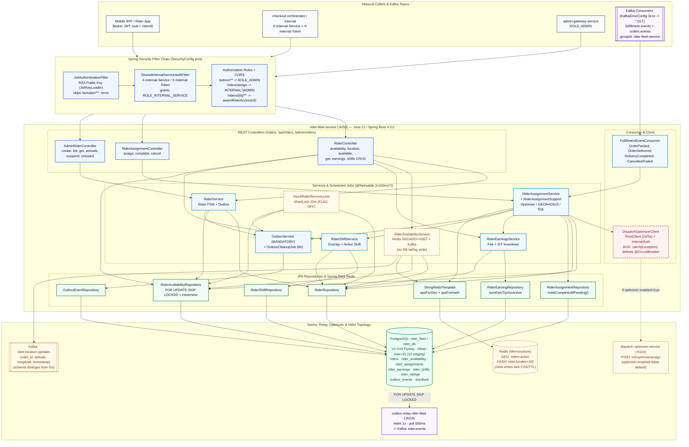
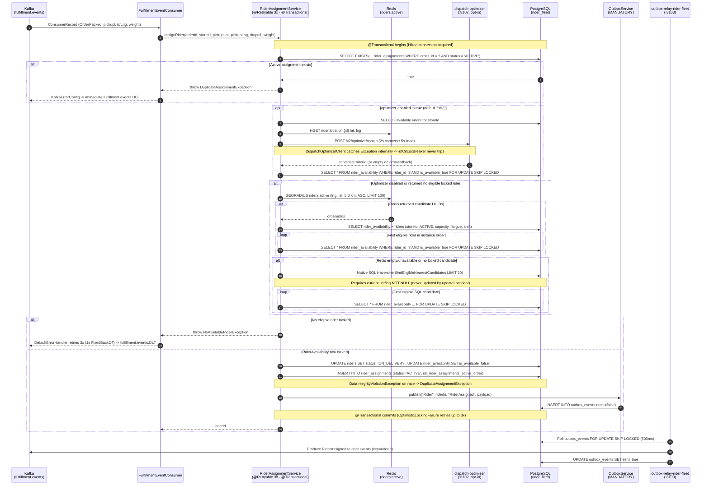

# `rider-fleet-service` (`:8093`) — Code Walkthrough

> [!NOTE]
> **Part of the InstaCommerce Onboarding Suite:** [Onboarding Hub](../../README.md) · [Code Walkthrough Atlas](../README.md) · [Domain & Event Catalog (`05`)](../../05-domain-model-and-event-catalog.md) · [Incident Drills & Exam (`06`)](../../06-incident-drills-and-readiness-exam.md) · [Dependency Matrix & Cheatsheet (`07`)](../../07-service-dependency-and-command-cheatsheet.md)

> **Ground Truth Posture:** Verified directly against source files under [`services/rider-fleet-service/`](../../../../services/rider-fleet-service/build.gradle.kts), Flyway migrations `V1`–`V14`, [`libs/platform-common/`](../../../../libs/platform-common/src/main/java/com/instacommerce/platform/security/SharedInternalServiceAuthFilter.java), [`deploy/helm/values.yaml`](../../../../deploy/helm/values.yaml#L1297-L1315), [`monitoring/error-budget-policy.yaml`](../../../../monitoring/error-budget-policy.yaml#L15-L27), and [`docs/adr/002-dispatch-authority.md`](../../../../docs/adr/002-dispatch-authority.md). Line anchors match checked-in files rather than stale `README.md` claims.

---

## 1. Service Identity & Architectural Role

| Dimension | Verified Truth | Source |
|---|---|---|
| **Module / Build** | `:services:rider-fleet-service` · Java 21 · Spring Boot `4.0.0` · Gradle | [`settings.gradle.kts`](../../../../settings.gradle.kts), [`build.gradle.kts`](../../../../services/rider-fleet-service/build.gradle.kts#L1-L45) |
| **HTTP Port & Runtime** | `:8093` (`SERVER_PORT`) · ZGC (`-XX:+UseZGC`, `MaxRAMPercentage=75.0`), non-root `app:1001` | [`application.yml`](../../../../services/rider-fleet-service/src/main/resources/application.yml#L1-L3), [`Dockerfile`](../../../../services/rider-fleet-service/Dockerfile#L1-L17) |
| **Primary Storage** | PostgreSQL `rider_fleet` (`rider_db` in Helm), Flyway `V1`–`V14`, HikariCP `max=20` (`10` in staging) | [`application.yml`](../../../../services/rider-fleet-service/src/main/resources/application.yml#L15-L30), [`values-staging.yaml`](../../../../deploy/helm/values-staging.yaml#L347) |
| **Redis State** | GEO index `riders:active`; Hash `rider:location:{id}` (overwritten by Java pings without CAS or TTL) | [`RiderAvailabilityService.java`](../../../../services/rider-fleet-service/src/main/java/com/instacommerce/riderfleet/service/RiderAvailabilityService.java#L108-L120) |
| **Kafka Consumed** | `fulfillment.events` & `orders.events` (group `rider-fleet-service`, `3x 1000ms` retries then `{topic}.DLT`) | [`FulfillmentEventConsumer.java`](../../../../services/rider-fleet-service/src/main/java/com/instacommerce/riderfleet/consumer/FulfillmentEventConsumer.java#L26-L73), [`KafkaErrorConfig.java`](../../../../services/rider-fleet-service/src/main/java/com/instacommerce/riderfleet/config/KafkaErrorConfig.java#L35-L55) |
| **Kafka Produced** | `rider.events` via transactional `outbox_events` + `outbox-relay-rider-fleet` (`:8103`); direct `KafkaTemplate` to `rider.location.updates` | [`TopicNames.java`](../../../../contracts/src/main/java/com/instacommerce/contracts/topics/TopicNames.java#L24-L46), [`RiderAvailabilityService.java`](../../../../services/rider-fleet-service/src/main/java/com/instacommerce/riderfleet/service/RiderAvailabilityService.java#L123-L138) |
| **Downstream HTTP** | Optional `dispatch-optimizer-service` (`:8102`, `POST /v2/optimize/assign`), guarded by `optimizer-enabled=false` | [`DispatchOptimizerClient.java`](../../../../services/rider-fleet-service/src/main/java/com/instacommerce/riderfleet/client/DispatchOptimizerClient.java#L24-L53), [`RiderFleetProperties.java`](../../../../services/rider-fleet-service/src/main/java/com/instacommerce/riderfleet/config/RiderFleetProperties.java#L132-L135) |
| **Helm & SLO Tier** | Helm keys `rider-fleet-service` & `outbox-relay-rider-fleet`; **Tier 1** (`99.5%` / 30d = `216 min`, `1000 ms` P99) | [`values.yaml`](../../../../deploy/helm/values.yaml#L1037-L1315), [`error-budget-policy.yaml`](../../../../monitoring/error-budget-policy.yaml#L15-L27) |
| **Domain Mandate** | Sole dispatch and rider lifecycle authority ([ADR-002](../../../../docs/adr/002-dispatch-authority.md)): owns rider onboarding/status FSM, shift overlaps, 3-tier assignment with `FOR UPDATE SKIP LOCKED`, fatigue cooldowns, and IST dynamic earnings | [`RiderAssignmentService.java`](../../../../services/rider-fleet-service/src/main/java/com/instacommerce/riderfleet/service/RiderAssignmentService.java#L90-L193) |

---

## 2. Package & File Layout

The service comprises `43` Java source files under `com.instacommerce.riderfleet`, `14` Flyway migrations (`V1`–`V14`), and `10` JUnit/Testcontainers test classes:

```text
services/rider-fleet-service/
├── Dockerfile                                          # eclipse-temurin:21-jre-alpine, ZGC, SERVER_PORT=8093
├── build.gradle.kts                                    # Spring Boot 4, JPA, Redis, Kafka, Retry, Resilience4j, ShedLock, JJWT
└── src/
    ├── main/
    │   ├── java/com/instacommerce/riderfleet/
    │   │   ├── RiderFleetServiceApplication.java       # @SpringBootApplication, @EnableConfigurationProperties, Clock UTC bean
    │   │   ├── client/DispatchOptimizerClient.java     # RestClient (2s/5s) + InternalServiceAuthInterceptor + @CircuitBreaker
    │   │   ├── config/
    │   │   │   ├── JacksonConfig.java                  # Primary ObjectMapper (JavaTimeModule, FAIL_ON_UNKNOWN_PROPERTIES=false)
    │   │   │   ├── KafkaErrorConfig.java               # DefaultErrorHandler: 3x 1000ms FixedBackOff -> {topic}.DLT
    │   │   │   ├── RetryConfig.java                    # @EnableRetry for @Retryable optimistic-lock retries
    │   │   │   ├── RiderFleetProperties.java           # @ConfigurationProperties("rider-fleet")
    │   │   │   ├── SecurityConfig.java                 # Stateless SecurityFilterChain, CORS, JWT + InternalService filters
    │   │   │   └── ShedLockConfig.java                 # @EnableScheduling + JdbcTemplateLockProvider (defaultLockAtMostFor=10m)
    │   │   ├── consumer/
    │   │   │   ├── FulfillmentEventConsumer.java       # @KafkaListener(fulfillment.events, orders.events)
    │   │   │   └── FulfillmentEventPayload.java        # Permissive UUID/BigDecimal deserialization + UTF-8 UUID fallback for storeId
    │   │   ├── controller/
    │   │   │   ├── AdminRiderController.java           # /admin/riders/** (create, list, get, activate, suspend, onboard)
    │   │   │   ├── RiderAssignmentController.java      # /riders|/api/riders/{assign, assignments/{orderId}/{complete,cancel}}
    │   │   │   └── RiderController.java                # /riders|/api/riders/{id}/{availability,location,earnings,shifts} & /available
    │   │   ├── domain/model/                           # Rider, RiderAvailability, RiderAssignment, RiderEarning, RiderRating, RiderShift, RiderStatus, VehicleType, OutboxEvent
    │   │   ├── dto/{request,response}/                 # AssignRiderRequest, CreateRiderRequest, CreateShiftRequest, LocationUpdateRequest, UpdateShiftRequest, RiderResponse, ShiftResponse, EarningsSummaryResponse, ErrorResponse, ErrorDetail
    │   │   ├── exception/                              # ApiException, GlobalExceptionHandler, TraceIdProvider, DuplicateAssignmentException, InvalidRiderStateException, InvalidShiftStateException, NoAvailableRiderException, RiderNotFoundException, ShiftNotFoundException
    │   │   ├── repository/                             # 6 JPA repositories (FOR UPDATE SKIP LOCKED + native Haversine + sum aggregates)
    │   │   ├── security/                               # JwtAuthenticationFilter, DefaultJwtService, JwtKeyLoader, InternalServiceAuthInterceptor, RestAuthenticationEntryPoint, RestAccessDeniedHandler
    │   │   └── service/                                # RiderService, RiderAvailabilityService, RiderAssignmentService, RiderAssignmentSupport, RiderEarningsService, RiderShiftService, OutboxService, OutboxCleanupJob, StuckRiderRecoveryJob
    │   └── resources/
    │       ├── application.yml                         # Prod/GCP defaults + sm:// Secret Manager placeholders + Resilience4j CB config
    │       ├── application-local.yml                   # Local dev overrides (disables GCP SM/SQL, OTLP export, sets local RSA pubkey)
    │       └── db/migration/V1__..V14__*.sql           # Core tables, outbox envelope, optimistic lock versions, partial unique active order index
    └── test/java/com/instacommerce/riderfleet/         # 10 test classes (unit, MockMvc security/shifts, Postgres+Flyway Testcontainers)
```

---

## 3. Startup, Security & Middleware Chain

1. **Application Bootstrap ([`RiderFleetServiceApplication.java`](../../../../services/rider-fleet-service/src/main/java/com/instacommerce/riderfleet/RiderFleetServiceApplication.java#L10-L21)):**
   - Enables `RiderFleetProperties`, registers a UTC `Clock` bean, activates `@EnableRetry` ([`RetryConfig.java`](../../../../services/rider-fleet-service/src/main/java/com/instacommerce/riderfleet/config/RetryConfig.java#L6-L9)), and initializes `JdbcTemplateLockProvider` for ShedLock ([`ShedLockConfig.java`](../../../../services/rider-fleet-service/src/main/java/com/instacommerce/riderfleet/config/ShedLockConfig.java#L11-L19)).
   - Flyway migrates `V1`–`V14` with `spring.jpa.hibernate.ddl-auto=validate` ([`application.yml`](../../../../services/rider-fleet-service/src/main/resources/application.yml#L25-L30)).
2. **HTTP Filter & Authorization Chain ([`SecurityConfig.java`](../../../../services/rider-fleet-service/src/main/java/com/instacommerce/riderfleet/config/SecurityConfig.java#L34-L72)):**
   - Disables CSRF, enforces `SessionCreationPolicy.STATELESS`, configures CORS for `riderfleet.cors.allowed-origins` (`Authorization`, `Content-Type`, `X-Request-Id`, `X-Idempotency-Key`), and registers two filters before `UsernamePasswordAuthenticationFilter`:
     - [`JwtAuthenticationFilter`](../../../../services/rider-fleet-service/src/main/java/com/instacommerce/riderfleet/security/JwtAuthenticationFilter.java#L38-L77): skips `/actuator/**` and `/error`; verifies RSA Bearer JWT via [`DefaultJwtService`](../../../../services/rider-fleet-service/src/main/java/com/instacommerce/riderfleet/security/DefaultJwtService.java#L26-L53) (issuer `instacommerce-identity`, normalizes `roles` to `ROLE_*`), returning HTTP `401` `TOKEN_INVALID` JSON on failure.
     - [`SharedInternalServiceAuthFilter`](../../../../libs/platform-common/src/main/java/com/instacommerce/platform/security/SharedInternalServiceAuthFilter.java#L64-L115): validates `X-Internal-Service` and `X-Internal-Token` using constant-time `MessageDigest.isEqual`, granting `ROLE_INTERNAL_SERVICE` and `ROLE_SERVICE_<CALLER>`.
   - Authorization matrix:
     - `/actuator/**`, `/error` → `permitAll`
     - `/admin/**` → `hasRole("ADMIN")`
     - `POST /riders/assign`, `/riders/assignments/**`, `/api/riders/assign`, `/api/riders/assignments/**` → `hasAnyRole("INTERNAL", "INTERNAL_SERVICE", "ADMIN")` (also reinforced by class-level `@PreAuthorize` in [`RiderAssignmentController.java`](../../../../services/rider-fleet-service/src/main/java/com/instacommerce/riderfleet/controller/RiderAssignmentController.java#L19))
     - `GET /riders/available`, `/api/riders/available` → `hasAnyRole("INTERNAL", "INTERNAL_SERVICE", "ADMIN")`
     - All other `/riders/{id}/**` endpoints → `authenticated()`, plus [`RiderController.assertRiderAccess`](../../../../services/rider-fleet-service/src/main/java/com/instacommerce/riderfleet/controller/RiderController.java#L124-L137) requiring `ROLE_ADMIN`, `ROLE_INTERNAL`, `ROLE_INTERNAL_SERVICE`, or `riderId.toString().equals(authentication.getName())`.
   - Istio `servicePolicies` in [`deploy/helm/values.yaml`](../../../../deploy/helm/values.yaml#L280-L288) permit inbound mesh traffic only from `mobile-bff-service`, `admin-gateway-service`, `fulfillment-service`, `dispatch-optimizer-service`, `routing-eta-service`, `location-ingestion`, and `order-service`.
3. **Kafka Consumer Error Handling & Exception Mapping:**
   - [`KafkaErrorConfig.java`](../../../../services/rider-fleet-service/src/main/java/com/instacommerce/riderfleet/config/KafkaErrorConfig.java#L35-L55) configures `DefaultErrorHandler` with `FixedBackOff(1000L, 3)` and routes exhausted or non-retryable records (`JsonProcessingException`, `IllegalArgumentException`, `NullPointerException`, `DuplicateAssignmentException`) to `<record.topic()>.DLT`.
   - [`GlobalExceptionHandler.java`](../../../../services/rider-fleet-service/src/main/java/com/instacommerce/riderfleet/exception/GlobalExceptionHandler.java#L31-L91) renders [`ErrorResponse`](../../../../services/rider-fleet-service/src/main/java/com/instacommerce/riderfleet/dto/response/ErrorResponse.java#L1-L13) (`code`, `message`, `traceId`, `timestamp`, `details`) for `ApiException` (`404 RIDER_NOT_FOUND`, `409 INVALID_RIDER_STATE`, `409 ASSIGNMENT_DUPLICATE`, `503 NO_AVAILABLE_RIDER`), Bean Validation (`400`), `AccessDeniedException` (`403`), and unhandled errors (`500`).

---

## 4. API, Event & Storage Contracts

### 4.1 HTTP Surface (`:8093`)

| Controller | Route(s) | Access Rule | Handler & Side Effects | Source |
|---|---|---|---|---|
| `RiderController` | `POST /riders/{id}/availability?available=` | `riderId == sub` or `ADMIN`/`INTERNAL*` | Enforces `ACTIVE` + 45m fatigue cooldown when `available=true` | [`RiderController.java`](../../../../services/rider-fleet-service/src/main/java/com/instacommerce/riderfleet/controller/RiderController.java#L65-L71) |
| `RiderController` | `POST /riders/{id}/location` | `riderId == sub` or `ADMIN`/`INTERNAL*` | Redis `GEOADD riders:active`, `HSET rider:location:{id}`, Kafka `rider.location.updates` | [`RiderController.java`](../../../../services/rider-fleet-service/src/main/java/com/instacommerce/riderfleet/controller/RiderController.java#L73-L79) |
| `RiderController` | `GET /riders/available?storeId=` | `INTERNAL \| INTERNAL_SERVICE \| ADMIN` | Queries `rider_availability` where `is_available=true AND store_id=?` | [`RiderController.java`](../../../../services/rider-fleet-service/src/main/java/com/instacommerce/riderfleet/controller/RiderController.java#L81-L86) |
| `RiderController` | `GET /riders/{id}`, `GET /riders/{id}/earnings?from=&to=` | `riderId == sub` or `ADMIN`/`INTERNAL*` | Rider profile or aggregated fee + tip + incentive summary | [`RiderController.java`](../../../../services/rider-fleet-service/src/main/java/com/instacommerce/riderfleet/controller/RiderController.java#L88-L100) |
| `RiderController` | `POST/GET /riders/{id}/shifts`, `PATCH /riders/{id}/shifts/{shiftId}` | `riderId == sub` or `ADMIN`/`INTERNAL*` | Shift CRUD with `SCHEDULED`/`ACTIVE` overlap check & state machine | [`RiderController.java`](../../../../services/rider-fleet-service/src/main/java/com/instacommerce/riderfleet/controller/RiderController.java#L102-L122) |
| `RiderAssignmentController` | `POST /riders/assign` (also `/api/riders/*`) | `INTERNAL \| INTERNAL_SERVICE \| ADMIN` | Runs 3-tier selection + `SKIP LOCKED`; returns `{riderId, orderId}` | [`RiderAssignmentController.java`](../../../../services/rider-fleet-service/src/main/java/com/instacommerce/riderfleet/controller/RiderAssignmentController.java#L27-L40) |
| `RiderAssignmentController` | `POST /riders/assignments/{orderId}/complete?tipCents=` | `INTERNAL \| INTERNAL_SERVICE \| ADMIN` | Idempotently completes assignment, updates fatigue & earnings | [`RiderAssignmentController.java`](../../../../services/rider-fleet-service/src/main/java/com/instacommerce/riderfleet/controller/RiderAssignmentController.java#L42-L51) |
| `RiderAssignmentController` | `POST /riders/assignments/{orderId}/cancel?reason=` | `INTERNAL \| INTERNAL_SERVICE \| ADMIN` | Cancels `ACTIVE` assignment, restores rider to `ACTIVE` + available | [`RiderAssignmentController.java`](../../../../services/rider-fleet-service/src/main/java/com/instacommerce/riderfleet/controller/RiderAssignmentController.java#L53-L58) |
| `AdminRiderController` | `POST/GET /admin/riders`, `GET /{id}`, `POST /{id}/{activate,suspend,onboard}` | `ROLE_ADMIN` | Rider onboarding & lifecycle transitions (`INACTIVE` ↔ `ACTIVE` ↔ `SUSPENDED`) | [`AdminRiderController.java`](../../../../services/rider-fleet-service/src/main/java/com/instacommerce/riderfleet/controller/AdminRiderController.java#L27-L55) |

### 4.2 Kafka Contracts & Outbox Events

- **Inbound (`FulfillmentEventConsumer` on `fulfillment.events` & `orders.events`):**
  - `OrderPacked` → validates `pickupLat`/`pickupLng` non-null and calls `assignRider(...)`.
  - `OrderDelivered` / `DeliveryCompleted` → resolves `orderId` + optional `tipCents`/`tip_cents` and calls `completeDelivery(orderId, tipCents)`.
  - `OrderCancelled` / `DeliveryFailed` / `PickTaskCancelled` → calls `cancelAssignment(orderId, eventType)`.
- **Outbound via `outbox_events` → [`outbox-relay-rider-fleet`](./outbox-relay-service.md) (`rider.events`):**
  - `RiderCreated`, `RiderActivated`, `RiderSuspended`, `RiderOnboarded` (`RiderService`), `RiderAssigned` (`riderId`, `orderId`, `storeId`, `riderName`, `vehicleType`, `pickupLat/Lng`, `dropoffLat/Lng`, `orderWeightGrams`, `assignedAt`), `RiderFatigueLimitReached`, `DeliveryCompleted`, `RiderAssignmentCancelled`, `RiderReleased` (`StuckRiderRecoveryJob`).
- **Outbound Direct (`KafkaTemplate` → `rider.location.updates`):**
  - Key: `riderId`; JSON value: `{"rider_id", "latitude", "longitude", "timestamp"}` (ISO-8601 string from `Instant.now().toString()`).

### 4.3 PostgreSQL Schema (Flyway `V1`–`V14`) & Redis Keys

| Store / Table | Key Columns, Constraints & Indexes | Purpose |
|---|---|---|
| `riders` (`V1`, `V10`, `V13`) | `phone UNIQUE`, `vehicle_type` (`BICYCLE` `8000g`, `MOTORCYCLE` `25000g`, `CAR` `100000g`), `status` (`INACTIVE`/`ACTIVE`/`ON_DELIVERY`/`SUSPENDED`/`BLOCKED`), `consecutive_deliveries`, `last_delivery_completed_at`, `max_capacity_grams`, `rating_avg`, `version`; idx `(status, store_id)`, `(phone)` | Master rider profile, weight capacity, fatigue counters, optimistic lock |
| `rider_availability` (`V3`, `V10`) | `rider_id UNIQUE FK`, `is_available`, `current_lat`, `current_lng`, `store_id`, `version`; idx `(is_available, store_id)` | Store-scoped dispatch eligibility & pessimistic lock target |
| `rider_assignments` (`V8`, `V12`, `V13`, `V14`) | Partial unique index `uk_rider_assignments_active_order ON (order_id) WHERE status = 'ACTIVE'` (`V13` dropped global `uk_rider_assignments_order_id`), `distance_km`, `order_weight_grams`, `completed_at`, `cancelled_at`; idx `(rider_id)`, `(order_id, status)` | Active & historical assignments (supports re-assignment after cancel) |
| `rider_earnings` (`V4`, `V8`) | `uk_rider_earnings_order_id UNIQUE (order_id)`, `delivery_fee_cents`, `tip_cents`, `incentive_cents`, `earned_at`; idx `(rider_id, earned_at)` | Idempotent per-order delivery earnings ledger (cents) |
| `rider_shifts` (`V2`) | `rider_id FK`, `shift_start`, `shift_end`, `status` (`SCHEDULED`/`ACTIVE`/`COMPLETED`/`CANCELLED`); idx `(rider_id, status)` | Shift windows enforced when `enforce-shift-validation=true` |
| `rider_ratings`, `outbox_events`, `shedlock` (`V5`–`V7`, `V9`, `V11`) | `order_id UNIQUE` on ratings; standard outbox envelope columns + `idx_outbox_unsent` + `(sent, created_at)` retention index; ShedLock table | Ratings schema, outbox relay polling, `OutboxCleanupJob` & `StuckRiderRecoveryJob` locks |
| Redis (`riders:active`, `rider:location:{id}`) | GEO set `riders:active` (`GEOADD` lng, lat, riderId); Hash `rider:location:{id}` (`lat`, `lng`, `updated_at`) | Written by `RiderAvailabilityService.updateLocation`; read by `RiderAssignmentService` & `RiderAssignmentSupport` |

---

## 5. Architecture & Low-Level Design

**rider-fleet-service Architecture LLD** — *[Rendered PNG](../diagrams/services/rider-fleet-service-arch-lld.png) · [Mermaid Source](../diagrams/services/rider-fleet-service-arch-lld.mmd)*



### Package & Dependency Trace
- **Controller-to-Service Wiring:** `RiderController` injects `RiderService`, `RiderAvailabilityService`, `RiderEarningsService`, `RiderShiftService`, and `RiderAvailabilityRepository` directly (for `GET /riders/available`, [`RiderController.java#L81-L86`](../../../../services/rider-fleet-service/src/main/java/com/instacommerce/riderfleet/controller/RiderController.java#L81-L86)). `RiderAssignmentController` delegates exclusively to `RiderAssignmentService`. `AdminRiderController` delegates exclusively to `RiderService`.
- **Transactional Outbox (`Propagation.MANDATORY`):** [`OutboxService.publish`](../../../../services/rider-fleet-service/src/main/java/com/instacommerce/riderfleet/service/OutboxService.java#L22-L48) requires an active transaction, populates `correlationId` from explicit argument or SLF4J MDC (`correlationId` / `X-Correlation-ID`), and writes `outbox_events` (`source_service = "rider-fleet-service"`, `schema_version = "v1"` via [`OutboxEvent.prePersist`](../../../../services/rider-fleet-service/src/main/java/com/instacommerce/riderfleet/domain/model/OutboxEvent.java#L57-L74)). [`OutboxCleanupJob`](../../../../services/rider-fleet-service/src/main/java/com/instacommerce/riderfleet/service/OutboxCleanupJob.java#L24-L31) purges `sent = true` rows older than 7 days every 6 hours under ShedLock `outbox-cleanup`.
- **Stuck-Rider Recovery Job ([`StuckRiderRecoveryJob.java#L34-L113`](../../../../services/rider-fleet-service/src/main/java/com/instacommerce/riderfleet/service/StuckRiderRecoveryJob.java#L34-L113)):** Activated only when `rider-fleet.recovery.stuck-rider-enabled=true` (defaults `false`). Every 10 minutes under ShedLock `stuckRiderRecovery`, fetches up to `batchSize` (`50`) riders in `ON_DELIVERY` whose `updated_at < now - 60m`, calls `@Retryable` `releaseRider` to flip status back to `ACTIVE` + `is_available = true`, emits `RiderReleased` via outbox, and records `rider.recovery.{duration,found,released,errors}` Micrometer metrics.

---

## 6. Core Dispatch, Fatigue & Earnings Decision Flow

**rider-fleet-service Decision Flowchart** — *[Rendered PNG](../diagrams/services/rider-fleet-service-flowchart.png) · [Mermaid Source](../diagrams/services/rider-fleet-service-flowchart.mmd)*

```mermaid
flowchart TB
    classDef step fill:#EFF6FF,stroke:#2563EB,stroke-width:1.8px,color:#0F172A
    classDef dec fill:#F8FAFC,stroke:#475569,stroke-width:1.8px,color:#0F172A
    classDef ok fill:#ECFDF5,stroke:#059669,stroke-width:1.8px,color:#064E3B
    classDef warn fill:#FFFBEB,stroke:#D97706,stroke-width:2px,stroke-dasharray:5 4,color:#78350F
    classDef err fill:#FEF2F2,stroke:#DC2626,stroke-width:2px,stroke-dasharray:6 4,color:#7F1D1D

    subgraph SPLIT["GPS Telemetry Split-Brain Context"]
        direction LR
        GO_GPS["location-ingestion-service (:8105)<br/>Writes rider:location:{id} (Lua CAS)<br/>+ riders:h3:{idx} ONLY"]:::err
        JAVA_GPS["POST /riders/{id}/location<br/>Writes GEOADD riders:active + HSET<br/>NEVER updates DB current_lat/lng"]:::warn
    end

    subgraph DISPATCH["1. Three-Tier Rider Selection (RiderAssignmentService.executeAssignment)"]
        direction TB
        D0["existsByOrderId(orderId)<br/>(status = 'ACTIVE')"]:::step
        D0_DEC{"Already active<br/>assignment?"}:::dec
        D0_ERR["Throw DuplicateAssignmentException (409)<br/>KafkaErrorConfig -> immediate DLT"]:::err

        D1{"dispatch.optimizer-enabled?<br/>(default: false)"}:::dec
        D2["Tier 1: tryOptimizerAssignment()<br/>Load DB store-available + Redis/DB coords<br/>POST /v2/optimize/assign (battery=100.0)"]:::warn
        D2_LOCK{"Locked via SKIP LOCKED<br/>& isRiderEligible?"}:::dec

        D3["Tier 2 (DEFAULT): resolveCandidateFromRedis()<br/>GEORADIUS riders:active r=5.0km ASC limit=100<br/>Filter storeId + isRiderEligible()"]:::step
        D3_OK{"Eligible candidate locked<br/>FOR UPDATE SKIP LOCKED?"}:::dec

        D4["Tier 3: PostgreSQL Haversine Fallback<br/>findEligibleNearestCandidates(..., limit=20)<br/>BLIND SPOT: requires current_lat/lng NOT NULL"]:::warn
        D4_OK{"Eligible candidate locked<br/>FOR UPDATE SKIP LOCKED?"}:::dec
        D4_ERR["Throw NoAvailableRiderException (503)<br/>Kafka retries 3x1s -> *.DLT"]:::err

        D5["Eligibility Guard (RiderAssignmentSupport):<br/>status == ACTIVE & canCarry(weight)<br/>& (consecutive &lt; 8 OR idle &ge; 45m)<br/>& (!enforceShift OR hasActiveShift)"]:::step
        D6["Reset consecutive=0 if cooldown expired<br/>Rider -> ON_DELIVERY · available=false<br/>INSERT rider_assignments (uk_active_order)<br/>Outbox: RiderAssigned -> rider.events"]:::ok

        D0 --> D0_DEC
        D0_DEC -->|"Yes"| D0_ERR
        D0_DEC -->|"No"| D1
        D1 -->|"true"| D2 --> D2_LOCK
        D2_LOCK -->|"Yes"| D6
        D2_LOCK -->|"No / Fail"| D3
        D1 -->|"false (DEFAULT)"| D3
        D3 --> D5 --> D3_OK
        D3_OK -->|"Yes"| D6
        D3_OK -->|"No / Redis empty"| D4 --> D4_OK
        D4_OK -->|"Yes"| D6
        D4_OK -->|"No"| D4_ERR
    end

    subgraph COMPLETE["2. Completion, Fatigue Lock & IST Earnings (completeDelivery)"]
        direction TB
        C1["markCompletedIfPending(orderId, now)<br/>(atomic UPDATE WHERE status=ACTIVE)"]:::step
        C1_DEC{"Rows updated<br/>== 1?"}:::dec
        C1_SKIP["Idempotent no-op return"]:::ok
        C2["nextConsecutive = (idle &ge; 45m) ? 1 : prev + 1<br/>totalDeliveries++ · Rider -> ACTIVE"]:::step
        C3{"nextConsecutive<br/>&ge; 8?"}:::dec
        C4["Hold is_available = false<br/>Outbox: RiderFatigueLimitReached"]:::warn
        C5["Restore is_available = true"]:::ok
        C6["RiderEarningsService.computeEarnings (IST):<br/>fee = max(2500c, 2500c + round(km*600c) + [300c if &ge;10kg])<br/>+500c peak (12-14,19-22) +250c Sat/Sun<br/>+400c streak(&ge;5) +300c rating(&ge;4.75) + tip<br/>Outbox: DeliveryCompleted"]:::ok

        C1 --> C1_DEC
        C1_DEC -->|"0 (duplicate)"| C1_SKIP
        C1_DEC -->|"1"| C2 --> C3
        C3 -->|"Yes"| C4 --> C6
        C3 -->|"No"| C5 --> C6
    end

    GO_GPS -. "Does NOT populate riders:active" .-> D3
    JAVA_GPS -->|"GEOADD riders:active"| D3
    D6 -.->|"OrderDelivered"| C1
```



### Function-by-Function Walkthrough
1. **Duplicate Guard & 3-Tier Candidate Selection ([`RiderAssignmentService.executeAssignment`](../../../../services/rider-fleet-service/src/main/java/com/instacommerce/riderfleet/service/RiderAssignmentService.java#L119-L261)):**
   - Guarded by `@Retryable(ObjectOptimisticLockingFailureException, maxAttempts=3, backoff=100ms*2)` and `@Transactional`.
   - Fast-path check `assignmentRepository.existsByOrderId(orderId)` (scoped to `status = 'ACTIVE'`) throws `DuplicateAssignmentException` (`409`).
   - **Tier 1 (Disabled by default):** If `rider-fleet.dispatch.optimizer-enabled == true`, [`RiderAssignmentSupport.tryOptimizerAssignment`](../../../../services/rider-fleet-service/src/main/java/com/instacommerce/riderfleet/service/RiderAssignmentSupport.java#L118-L167) queries `findByIsAvailableTrueAndStoreId(storeId)`, filters by `isRiderEligible`, resolves coordinates via Redis `HGET rider:location:{id}` (fallback to DB `currentLat`/`currentLng`), calls `dispatchOptimizerClient.requestAssignment(...)`, and re-acquires `findAvailableByRiderIdForUpdateSkipLocked(optimizedRiderId)`.
   - **Tier 2 (Default primary path):** [`resolveCandidateFromRedis`](../../../../services/rider-fleet-service/src/main/java/com/instacommerce/riderfleet/service/RiderAssignmentService.java#L263-L337) runs `GEORADIUS riders:active` centered at `(pickupLng, pickupLat)` with `defaultRadiusKm` (`5.0 km`), ascending distance, `limit(100)`. It preserves Redis distance order via `LinkedHashSet<UUID>`, batch-loads `RiderAvailability` (filtering by `storeId` when provided) and `Rider`, checks [`RiderAssignmentSupport.isRiderEligible`](../../../../services/rider-fleet-service/src/main/java/com/instacommerce/riderfleet/service/RiderAssignmentSupport.java#L30-L44), and locks the first winner with `FOR UPDATE SKIP LOCKED`.
   - **Tier 3 (PostgreSQL Haversine fallback):** [`RiderAvailabilityRepository.findEligibleNearestCandidates`](../../../../services/rider-fleet-service/src/main/java/com/instacommerce/riderfleet/repository/RiderAvailabilityRepository.java#L37-L94) evaluates distance, `store_id`, `ACTIVE` status, `max_capacity_grams`, fatigue limit/cooldown, and optional `rider_shifts` in SQL (`LIMIT 20`, ordered by distance ASC, `rating_avg DESC`), then locks with `FOR UPDATE SKIP LOCKED`. Throws `NoAvailableRiderException` (`503`) if empty.
2. **Assignment Mutation & Race Protection ([`RiderAssignmentService.java#L132-L192`](../../../../services/rider-fleet-service/src/main/java/com/instacommerce/riderfleet/service/RiderAssignmentService.java#L132-L192)):**
   - Resets `consecutiveDeliveries = 0` if the 45-minute cooldown has expired, sets `RiderStatus.ON_DELIVERY` and `availability.setAvailable(false)`, computes straight-line `distanceKm` via `GeoUtils.haversineKm` when dropoff coords exist, inserts `RiderAssignment(status='ACTIVE')` (converting `DataIntegrityViolationException` on `uk_rider_assignments_active_order` to `DuplicateAssignmentException`), and emits `RiderAssigned`.
3. **Completion, Fatigue Lock & IST Earnings ([`completeDelivery`](../../../../services/rider-fleet-service/src/main/java/com/instacommerce/riderfleet/service/RiderAssignmentService.java#L356-L427), [`RiderEarningsService.computeEarnings`](../../../../services/rider-fleet-service/src/main/java/com/instacommerce/riderfleet/service/RiderEarningsService.java#L110-L175)):**
   - `assignmentRepository.markCompletedIfPending(orderId, now)` performs an atomic `UPDATE ... WHERE status = 'ACTIVE' AND completed_at IS NULL` so duplicate `OrderDelivered` events return `0` and short-circuit cleanly.
   - Increments `consecutiveDeliveries` (resetting to `1` if `lastDeliveryCompletedAt + 45m <= now`), transitions `ON_DELIVERY -> ACTIVE`, and checks `nextConsecutive >= 8`. If reached, keeps `is_available = false` and emits `RiderFatigueLimitReached`; otherwise restores `is_available = true`.
   - `RiderEarningsService.recordDeliveryEarning` deduplicates on `earningRepository.findByOrderId(orderId)` + `uk_rider_earnings_order_id`, computes `fee = max(2500c, 2500c + round(distanceKm * 600c) + [300c if weight >= 10000g])`, adds `Asia/Kolkata` incentives (`+500c` during `12–14` / `19–22` IST, `+250c` Sat/Sun, `+400c` if `consecutiveDeliveries >= 5`, `+300c` if `ratingAvg >= 4.75`), preserves `tipCents >= 0`, and writes `DeliveryCompleted` via outbox.

---

## 7. End-to-End Execution Sequence

**rider-fleet-service Sequence Diagram** — *[Rendered PNG](../diagrams/services/rider-fleet-service-sequence.png) · [Mermaid Source](../diagrams/services/rider-fleet-service-sequence.mmd)*



### Concurrency & Transaction Trace
- **Why `SKIP LOCKED` + Optimistic `@Version` Both Exist:** Two concurrent `OrderPacked` messages (or `POST /riders/assign` calls) for different orders at the same dark store can read the same `GEORADIUS` result set concurrently. `findAvailableByRiderIdForUpdateSkipLocked` (`RiderAvailabilityRepository.java#L23-L29`) acquires an exclusive PostgreSQL row lock on `rider_availability` only if unlocked and still `is_available = true`; any contending transaction skips that rider without blocking and advances to the next candidate in Redis distance order. Meanwhile, `@Version` on `Rider` and `RiderAvailability` (`V10`) protects concurrent state changes (e.g., `AdminRiderController.suspendRider` racing with `completeDelivery`) via `@Retryable` (`3` attempts, `100ms` exponential x2).
- **High-Frequency GPS Ingestion Bypass ([`RiderAvailabilityService.updateLocation`](../../../../services/rider-fleet-service/src/main/java/com/instacommerce/riderfleet/service/RiderAvailabilityService.java#L102-L141)):** Intentionally has **no `@Transactional` annotation** and executes zero PostgreSQL reads/writes (`Issue #584`), calling `redisTemplate.opsForGeo().add("riders:active", ...)` + `opsForHash().putAll("rider:location:{id}", ...)` + `kafkaTemplate.send("rider.location.updates", ...)`.

---

## 8. Configuration, Helm Overrides & Local Verification

### 8.1 Environment Variables & Helm Alignment

| Property / Env Var | `application.yml` Default | Helm Overrides (`values*.yaml`) | Notes |
|---|---|---|---|
| `SERVER_PORT` | `8093` | `"8093"` (`values.yaml`) | Matches `Dockerfile` `EXPOSE 8093` |
| `RIDER_DB_URL` / `RIDER_DB_USER` / `RIDER_DB_PASSWORD` | `jdbc:postgresql://localhost:5432/rider_fleet` | `SPRING_DATASOURCE_URL` (`rider_db` Cloud SQL) | `values-staging.yaml` caps HikariCP `max=10` |
| `REDIS_HOST` / `REDIS_PORT` | `localhost` / `6379` | `SPRING_DATA_REDIS_HOST` (`values.yaml` dev, `values-prod.yaml` prod; `values-staging.yaml` sets both `REDIS_HOST` & `SPRING_DATA_REDIS_HOST`) | `application.yml` uses `${REDIS_HOST:localhost}`, overridden at runtime via Spring relaxed env binding for `SPRING_DATA_REDIS_HOST` |
| `RIDER_DISPATCH_OPTIMIZER_ENABLED` / `_URL` | `false` / `http://dispatch-optimizer-service:8102` | `RIDER_DISPATCH_OPTIMIZER_URL` in `values.yaml` | `-local` overrides URL to `http://localhost:8102` |
| `RIDER_ASSIGNMENT_RADIUS_KM` | `5.0` | *(unset → `5.0`)* | Used by both `GEORADIUS` and SQL Haversine |
| `rider-fleet.assignment.{max-consecutive-deliveries,fatigue-reset-minutes,enforce-shift-validation}` | `8` / `45` / `false` | *(unset)* | Hardcoded property defaults (no env placeholder in `application.yml`) |
| `RIDER_RECOVERY_STUCK_ENABLED` / `_THRESHOLD_MINUTES` / `_BATCH_SIZE` / `_CRON` | `false` / `60` / `50` / `0 */10 * * * *` | *(unset → disabled)* | Enables `StuckRiderRecoveryJob` bean |
| `INTERNAL_SERVICE_TOKEN` | *(required in prod; `local-dev-internal-token` in `-local`)* | Secret `internal-service-tokens` (`rider-fleet-service-token`) | Used by `SharedInternalServiceAuthFilter` & `DispatchOptimizerClient` |

### 8.2 Local Build & Test Commands

```bash
# Run all 10 rider-fleet-service test classes (includes Postgres+Flyway Testcontainers)
./gradlew :services:rider-fleet-service:test

# Run a targeted test class
./gradlew :services:rider-fleet-service:test --tests "com.instacommerce.riderfleet.service.RiderAssignmentServiceTest"

# Build runnable JAR
./gradlew :services:rider-fleet-service:bootJar
```

---

## 9. Verified Seams, Bugs & Doc-vs-Code Drift

1. **`DispatchOptimizerClient` Swallows Exceptions, Defeating Resilience4j `@CircuitBreaker`:**
   - [`DispatchOptimizerClient.requestAssignment`](../../../../services/rider-fleet-service/src/main/java/com/instacommerce/riderfleet/client/DispatchOptimizerClient.java#L34-L53) is annotated with `@CircuitBreaker(name = "dispatchOptimizer", fallbackMethod = "requestAssignmentFallback")`, yet catches `Exception ex` inside the method body and returns `Optional.empty()`. Because Spring AOP intercepts only uncaught exceptions escaping `requestAssignment`, `dispatchOptimizer` never records failures, never transitions to `OPEN`, and never invokes `requestAssignmentFallback` (though `RiderAssignmentService` still falls back to `GEORADIUS` on empty `Optional`).
2. **GPS Telemetry Split-Brain (`location-ingestion-service` vs `rider-fleet-service`):**
   - [`location-ingestion-service`](./location-ingestion-service.md) (`:8105`) writes `rider:location:{id}` (with Lua CAS + `10m` TTL) and custom axial hex sets `riders:h3:{idx}`, **never** Redis GEO `riders:active`. When `optimizer-enabled=false` (default), `RiderAssignmentService` queries `GEORADIUS riders:active`, which is populated **only** by Java `POST /riders/{id}/location`. Conversely, Java [`updateLocation`](../../../../services/rider-fleet-service/src/main/java/com/instacommerce/riderfleet/service/RiderAvailabilityService.java#L111-L132) overwrites `rider:location:{id}` using `Instant.now()` with **no CAS and no TTL**, and emits `{rider_id, latitude, longitude, timestamp}` rather than Go's `{lat, lng, timestamp_ms}`.
3. **PostgreSQL Haversine Fallback Blind Spot (`current_lat` / `current_lng` Never Populated):**
   - `RiderAvailabilityService.updateLocation` intentionally avoids touching `rider_availability` (`Issue #584`), and `setCurrentLat` / `setCurrentLng` have zero callers in `src/main/java`. Consequently, if Redis `riders:active` is empty or unreachable, [`findEligibleNearestCandidates`](../../../../services/rider-fleet-service/src/main/java/com/instacommerce/riderfleet/repository/RiderAvailabilityRepository.java#L60-L61) (`AND ra.current_lat IS NOT NULL AND ra.current_lng IS NOT NULL`) matches only rows seeded manually in SQL.
4. **Optimizer Disabled + Capacity/Battery Drift + Dormant Caffeine + Reactivation Gap:**
   - `optimizer-enabled` defaults `false`; when enabled, [`buildOptimizerRiderState`](../../../../services/rider-fleet-service/src/main/java/com/instacommerce/riderfleet/service/RiderAssignmentSupport.java#L71-L90) hardcodes `battery_percent = 100.0`, and Java `VehicleType` defaults (`MOTORCYCLE = 25kg`, `CAR = 100kg`) disagree with `dispatch-optimizer-service` (`20kg` / `60kg`).
   - [`RiderService.activateRider`](../../../../services/rider-fleet-service/src/main/java/com/instacommerce/riderfleet/service/RiderService.java#L85-L88) requires `status == INACTIVE`, preventing `SUSPENDED -> ACTIVE` reactivation via `/admin/riders/{id}/activate`.
   - `spring.cache.caffeine` is configured in [`application.yml`](../../../../services/rider-fleet-service/src/main/resources/application.yml#L41-L43), yet zero `@Cacheable` annotations exist in `rider-fleet-service`.
5. **Stuck-Rider Recovery Disabled & `README.md` Drift:**
   - `stuck-rider-enabled` defaults `false`, leaving riders in `ON_DELIVERY` indefinitely if completion/cancellation events are dropped.
   - [`services/rider-fleet-service/README.md`](../../../../services/rider-fleet-service/README.md#L12-L55) cites `V1–V11` (actual `V1–V14`), claims `src/test/java` is empty (actual `10` test classes), labels `rider_shifts` "schema only" despite full `RiderShiftService` CRUD, and omits Redis `GEORADIUS` and `DispatchOptimizerClient`.

---

**Previous:** [fulfillment-service](./fulfillment-service.md) | **Atlas Hub:** [Code Walkthrough Atlas](../README.md) | **Next:** [routing-eta-service](./routing-eta-service.md)
