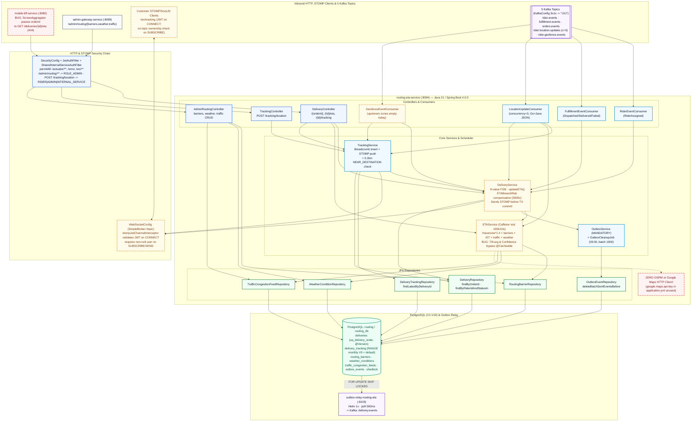
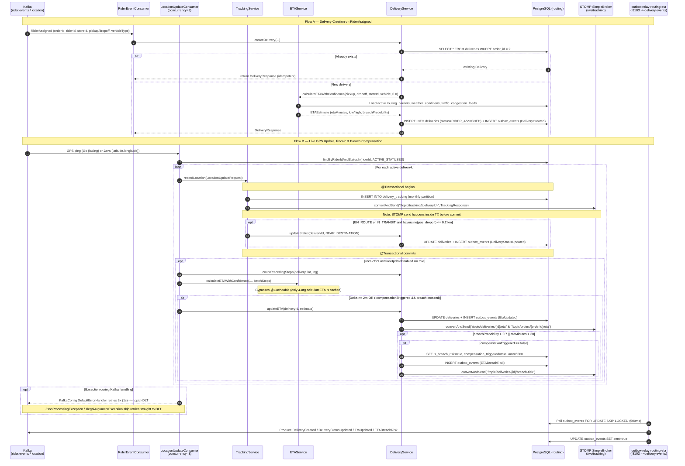

# `routing-eta-service` (`:8094`) — Code Walkthrough

> [!NOTE]
> **Part of the InstaCommerce Onboarding Suite:** [Onboarding Hub](../../README.md) · [Code Walkthrough Atlas](../README.md) · [Domain & Event Catalog (`05`)](../../05-domain-model-and-event-catalog.md) · [Incident Drills & Exam (`06`)](../../06-incident-drills-and-readiness-exam.md) · [Dependency Matrix & Cheatsheet (`07`)](../../07-service-dependency-and-command-cheatsheet.md)

> **Ground Truth Posture:** Verified directly against source files under [`services/routing-eta-service/`](../../../../services/routing-eta-service/build.gradle.kts), Flyway migrations `V1`–`V10`, [`libs/platform-common/`](../../../../libs/platform-common/src/main/java/com/instacommerce/platform/geo/GeoUtils.java), [`mobile-bff-service` `ScreenAggregator.java`](../../../../services/mobile-bff-service/src/main/java/com/instacommerce/mobilebff/aggregator/ScreenAggregator.java#L297-L321), [`deploy/helm/values.yaml`](../../../../deploy/helm/values.yaml#L1316-L1330), and [`monitoring/error-budget-policy.yaml`](../../../../monitoring/error-budget-policy.yaml#L15-L27). Line anchors reflect checked-in code rather than stale `README.md` or `GLOSSARY.md` claims.

---

## 1. Service Identity & Architectural Role

| Dimension | Verified Truth | Source |
|---|---|---|
| **Module / Build** | `:services:routing-eta-service` · Java 21 · Spring Boot `4.0.0` · Gradle | [`settings.gradle.kts`](../../../../settings.gradle.kts), [`build.gradle.kts`](../../../../services/routing-eta-service/build.gradle.kts#L1-L45) |
| **HTTP / WS Port** | `:8094` (`SERVER_PORT`) · ZGC (`-XX:+UseZGC`, `MaxRAMPercentage=75.0`), non-root `app:1001` | [`application.yml`](../../../../services/routing-eta-service/src/main/resources/application.yml#L1-L3), [`Dockerfile`](../../../../services/routing-eta-service/Dockerfile#L1-L17) |
| **Primary Storage** | PostgreSQL `routing` (`routing_db` in Helm), Flyway `V1`–`V10` (`delivery_tracking` monthly range partitions), HikariCP `max=20` (`10` staging) | [`application.yml`](../../../../services/routing-eta-service/src/main/resources/application.yml#L15-L30), [`V2__create_tracking_events.sql`](../../../../services/routing-eta-service/src/main/resources/db/migration/V2__create_tracking_events.sql#L1-L15) |
| **In-Process Cache & WS** | Caffeine `eta` (`max=100,000`, `10s` TTL); STOMP/SockJS `SimpleBroker` (`/topic`) on `/ws/tracking` | [`application.yml`](../../../../services/routing-eta-service/src/main/resources/application.yml#L40-L43), [`WebSocketConfig.java`](../../../../services/routing-eta-service/src/main/java/com/instacommerce/routing/config/WebSocketConfig.java#L50-L66) |
| **Kafka Consumed** | `rider.events`, `fulfillment.events`, `orders.events`, `rider.location.updates` (`concurrency="3"`), `rider.geofence.events` | [`LocationUpdateConsumer.java`](../../../../services/routing-eta-service/src/main/java/com/instacommerce/routing/consumer/LocationUpdateConsumer.java#L53-L55), [`KafkaConfig.java`](../../../../services/routing-eta-service/src/main/java/com/instacommerce/routing/config/KafkaConfig.java#L19-L33) |
| **Kafka Produced** | `delivery.events` via `outbox_events` + `outbox-relay-routing-eta` (`:8103`), plus `{topic}.DLT` on consumer error | [`TopicNames.java`](../../../../contracts/src/main/java/com/instacommerce/contracts/topics/TopicNames.java#L37-L38), [`values.yaml`](../../../../deploy/helm/values.yaml#L1147-L1167) |
| **External Routing APIs** | **Zero** OSRM or Google Maps HTTP clients (`google.maps.api-key` in YAML is completely unused) | [`ETAService.java`](../../../../services/routing-eta-service/src/main/java/com/instacommerce/routing/service/ETAService.java#L92-L135), [`application.yml`](../../../../services/routing-eta-service/src/main/resources/application.yml#L65-L67) |
| **Helm & SLO Tier** | Helm keys `routing-eta-service` & `outbox-relay-routing-eta`; **Tier 1** (`99.5%` / 30d = `216 min`, `1000 ms` P99) | [`values.yaml`](../../../../deploy/helm/values.yaml#L1147-L1330), [`error-budget-policy.yaml`](../../../../monitoring/error-budget-policy.yaml#L15-L27) |
| **Domain Mandate** | Authoritative delivery lifecycle & ETA engine: enforces 9-value `DeliveryStatus` FSM, calculates multi-factor Haversine ETAs with barriers/traffic/weather/incline/batching, broadcasts live STOMP tracking/ETA pushes, and triggers idempotent `ETABreachRisk` compensation (`5000` paise INR) | [`DeliveryService.java`](../../../../services/routing-eta-service/src/main/java/com/instacommerce/routing/service/DeliveryService.java#L62-L178) |

---

## 2. Package & File Layout

The service contains `38` Java source files under `com.instacommerce.routing`, `10` Flyway migrations (`V1`–`V10`), and `9` test classes:

```text
services/routing-eta-service/
├── Dockerfile                                          # eclipse-temurin:21-jre-alpine, ZGC, SERVER_PORT=8094
├── build.gradle.kts                                    # Spring Boot 4, JPA, Kafka, WebSocket, Cache/Caffeine, Resilience4j, ShedLock, JJWT
└── src/
    ├── main/
    │   ├── java/com/instacommerce/routing/
    │   │   ├── RoutingEtaServiceApplication.java       # @SpringBootApplication, @EnableConfigurationProperties, @EnableCaching, Clock UTC
    │   │   ├── config/
    │   │   │   ├── JacksonConfig.java                  # Primary ObjectMapper (JavaTimeModule, FAIL_ON_UNKNOWN_PROPERTIES=false)
    │   │   │   ├── KafkaConfig.java                    # DefaultErrorHandler: 3x 1000ms FixedBackOff -> {topic}.DLT
    │   │   │   ├── RoutingProperties.java              # @ConfigurationProperties("routing") (Jwt, Eta, Breach)
    │   │   │   ├── SchedulingConfig.java               # @EnableScheduling + ShedLock JdbcTemplateLockProvider (10m default)
    │   │   │   ├── SecurityConfig.java                 # Stateless SecurityFilterChain, permitAll /actuator/**, /error, /ws/**
    │   │   │   └── WebSocketConfig.java                # /ws/tracking SockJS + SimpleBroker(/topic) + STOMP JwtChannelInterceptor
    │   │   ├── consumer/
    │   │   │   ├── FulfillmentEventConsumer.java       # fulfillment.events + orders.events -> Dispatched/Delivered/Failed
    │   │   │   ├── GeofenceEventConsumer.java          # rider.geofence.events -> ENTERED_STORE (PICKED_UP), NEAR_DELIVERY (NEAR_DESTINATION)
    │   │   │   ├── LocationUpdateConsumer.java         # rider.location.updates (c=3) -> Go/Java JSON + TrackingService + delta ETA
    │   │   │   └── RiderEventConsumer.java             # rider.events -> RiderAssigned -> createDelivery()
    │   │   ├── controller/
    │   │   │   ├── AdminRoutingController.java         # /admin/routing/{barriers,weather,traffic}
    │   │   │   ├── DeliveryController.java             # /deliveries/{orderId}, /{id}/eta, /{id}/tracking
    │   │   │   └── TrackingController.java             # POST /tracking/location
    │   │   ├── domain/model/                           # Delivery, DeliveryStatus (9 values), DeliveryTracking, RoutingBarrier, WeatherCondition, TrafficCongestionFeed, OutboxEvent
    │   │   ├── dto/{request,response}/                 # CreateDeliveryRequest, LocationUpdateRequest, DeliveryResponse, ETAResponse, ETAEstimate, TrackingResponse, ErrorResponse, ErrorDetail
    │   │   ├── exception/                              # ApiException, GlobalExceptionHandler, TraceIdProvider, DeliveryNotFoundException, InvalidDeliveryStateException
    │   │   ├── repository/                             # DeliveryRepository, DeliveryTrackingRepository, RoutingBarrierRepository, WeatherConditionRepository, TrafficCongestionFeedRepository, OutboxEventRepository
    │   │   ├── security/                               # JwtAuthenticationFilter, DefaultJwtService, JwtKeyLoader, RestAuthenticationEntryPoint, RestAccessDeniedHandler
    │   │   └── service/                                # DeliveryService, ETAService, TrackingService, DeliveryPayloadSupport, OutboxService, OutboxCleanupJob
    │   └── resources/
    │       ├── application.yml                         # DB, Kafka, Caffeine (100k/10s), routing.eta/breach, unused google.maps.api-key
    │       ├── application-local.yml                   # Local dev overrides
    │       └── db/migration/V1__..V10__*.sql           # Deliveries, partitioned tracking, outbox, shedlock, legacy enums, V9 barriers/weather/traffic/breach
    └── test/java/com/instacommerce/routing/            # 9 test classes (WebSocket security, 4 consumers, FSM, ETA/Delivery services, integration)
```

---

## 3. Startup, Security & WebSocket/Kafka Chain

1. **Startup & Scheduled Maintenance:**
   - [`RoutingEtaServiceApplication`](../../../../services/routing-eta-service/src/main/java/com/instacommerce/routing/RoutingEtaServiceApplication.java#L11-L24) activates `@EnableCaching` (backed by Caffeine `maximumSize=100000,expireAfterWrite=10s`) and [`SchedulingConfig`](../../../../services/routing-eta-service/src/main/java/com/instacommerce/routing/config/SchedulingConfig.java#L12-L21) enables ShedLock for [`OutboxCleanupJob`](../../../../services/routing-eta-service/src/main/java/com/instacommerce/routing/service/OutboxCleanupJob.java#L25-L37) (`0 0 3 * * *` daily, batched 1000-row deletes with 7-day retention).
   - **Important:** `routing-eta-service` uses `internal:service` only if configured by `InternalServiceSecurityConfiguration` (`@Import(InternalServiceSecurityConfiguration.class)` in [`SecurityConfig.java`](../../../../services/routing-eta-service/src/main/java/com/instacommerce/routing/config/SecurityConfig.java#L28)). Notice [`application.yml`](../../../../services/routing-eta-service/src/main/resources/application.yml) does **not** explicitly declare `internal.service.token` (unlike `rider-fleet-service`); [`SharedInternalServiceAuthFilter`](../../../../libs/platform-common/src/main/java/com/instacommerce/platform/security/SharedInternalServiceAuthFilter.java#L58-L114) reads `internal.service.*` via `InternalServiceProperties` from environment (`INTERNAL_SERVICE_TOKEN`, injected in Helm via `internal-service-tokens` `routing-eta-service-token`).
2. **HTTP Security Chain ([`SecurityConfig.java`](../../../../services/routing-eta-service/src/main/java/com/instacommerce/routing/config/SecurityConfig.java#L34-L68)):**
   - Stateless sessions, CORS (`routing.cors.allowed-origins`), `SharedInternalServiceAuthFilter` + `JwtAuthenticationFilter` (`shouldNotFilter` skips `/actuator`, `/ws`, and `/error` in [`JwtAuthenticationFilter.java#L38-L44`](../../../../services/routing-eta-service/src/main/java/com/instacommerce/routing/security/JwtAuthenticationFilter.java#L38-L44)):
     - `/actuator/**`, `/error`, `/ws/**` → `permitAll` at HTTP handshake layer (STOMP authentication happens in `ChannelInterceptor`).
     - `/admin/routing/**` → `hasRole("ADMIN")`.
     - `POST /tracking/location` → `hasAnyRole("RIDER", "ADMIN", "INTERNAL_SERVICE")`.
     - All other routes (`/deliveries/**`) → `authenticated()`.
   - Istio `servicePolicies` ([`deploy/helm/values.yaml`](../../../../deploy/helm/values.yaml#L364-L375)) allow inbound mesh calls from `mobile-bff-service`, `admin-gateway-service`, `fulfillment-service`, `rider-fleet-service`, `order-service`, `dispatch-optimizer-service`, and `location-ingestion`.
3. **STOMP / SockJS Interceptor ([`WebSocketConfig.java`](../../../../services/routing-eta-service/src/main/java/com/instacommerce/routing/config/WebSocketConfig.java#L50-L109)):**
   - Registers SockJS endpoint `/ws/tracking` with `routing.ws.allowed-origins` (fallback `routing.cors.allowed-origins`, then `http://localhost:3000,https://*.instacommerce.dev`) and an in-memory `SimpleBroker` on `/topic`.
   - `stompJwtChannelInterceptor()` intercepts inbound STOMP frames:
     - `CONNECT`: extracts `Authorization: Bearer ...` native header, validates RSA JWT via `jwtService.validateAccessToken`, and calls `accessor.setUser(auth)` (throws `AccessDeniedException` if missing/invalid).
     - `SUBSCRIBE` / `SEND`: checks `accessor.getUser() != null` (does **not** verify delivery/order ownership).
4. **Kafka Error Handling ([`KafkaConfig.java`](../../../../services/routing-eta-service/src/main/java/com/instacommerce/routing/config/KafkaConfig.java#L18-L33)):**
   - `DefaultErrorHandler` retries `3` times at `1000ms` fixed backoff and routes permanent failures (`JsonProcessingException`, `IllegalArgumentException`) or exhausted retries to `<topic>.DLT`.

---

## 4. API, Event, WebSocket & Storage Contracts

### 4.1 HTTP & STOMP Surfaces (`:8094`)

| Surface | Path / Destination | Auth Rule | Behavior | Source |
|---|---|---|---|---|
| `DeliveryController` | `GET /deliveries/{orderId}` | `authenticated` | Lookup by **`order_id`** (`uq_delivery_order`) | [`DeliveryController.java`](../../../../services/routing-eta-service/src/main/java/com/instacommerce/routing/controller/DeliveryController.java#L37-L40) |
| `DeliveryController` | `GET /deliveries/{id}/eta?batchStops=` | `authenticated` | Lookup by **`deliveries.id`** (PK!), recomputes ETA from latest breadcrumb or pickup coords | [`DeliveryController.java`](../../../../services/routing-eta-service/src/main/java/com/instacommerce/routing/controller/DeliveryController.java#L42-L66) |
| `DeliveryController` | `GET /deliveries/{id}/tracking` | `authenticated` | Paginated `delivery_tracking` (default `50`, clamped `[1, 100]`, `recordedAt DESC`) | [`DeliveryController.java`](../../../../services/routing-eta-service/src/main/java/com/instacommerce/routing/controller/DeliveryController.java#L68-L73) |
| `TrackingController` | `POST /tracking/location` | `RIDER \| ADMIN \| INTERNAL_SERVICE` | Persists GPS breadcrumb, pushes `/topic/tracking/{id}`, runs `0.2 km` geofence check | [`TrackingController.java`](../../../../services/routing-eta-service/src/main/java/com/instacommerce/routing/controller/TrackingController.java#L23-L27) |
| `AdminRoutingController` | `POST/GET /admin/routing/barriers`, `DELETE /barriers/{id}` | `ROLE_ADMIN` | Creates/lists/soft-deactivates bounding-box road closures (`detourPenaltyKm`, `detourPenaltyMinutes`) | [`AdminRoutingController.java`](../../../../services/routing-eta-service/src/main/java/com/instacommerce/routing/controller/AdminRoutingController.java#L72-L105) |
| `AdminRoutingController` | `POST /admin/routing/weather`, `GET /weather/{storeId}` | `ROLE_ADMIN` | Upserts store `conditionType`, `speedPenaltyMultiplier`, `monsoonDelayBanner` | [`AdminRoutingController.java`](../../../../services/routing-eta-service/src/main/java/com/instacommerce/routing/controller/AdminRoutingController.java#L109-L131) |
| `AdminRoutingController` | `POST /admin/routing/traffic`, `GET /traffic/{zoneId}` | `ROLE_ADMIN` | Upserts `zoneId` (or `DEFAULT_ZONE`) `congestionFactor` (`>= 0.1`) | [`AdminRoutingController.java`](../../../../services/routing-eta-service/src/main/java/com/instacommerce/routing/controller/AdminRoutingController.java#L135-L157) |
| STOMP Endpoint | `/ws/tracking` (SockJS) | HTTP `permitAll`; STOMP `CONNECT` JWT | Broadcasts `/topic/tracking/{deliveryId}`, `/topic/deliveries/{id}/eta`, `/topic/orders/{orderId}/eta`, `/topic/deliveries/{id}/breach-risk` | [`WebSocketConfig.java`](../../../../services/routing-eta-service/src/main/java/com/instacommerce/routing/config/WebSocketConfig.java#L57-L108) |

### 4.2 Kafka Contracts (5 Inbound Topics + Outbox `delivery.events`)

- **`rider.events` ([`RiderEventConsumer.java`](../../../../services/routing-eta-service/src/main/java/com/instacommerce/routing/consumer/RiderEventConsumer.java#L27-L79)):** On `RiderAssigned`, extracts `orderId`, `riderId`, `storeId`, `pickupLat/Lng`, `dropoffLat/Lng`, `vehicleType` (camelCase or snake_case) and idempotently calls `DeliveryService.createDelivery`.
- **`fulfillment.events` & `orders.events` ([`FulfillmentEventConsumer.java`](../../../../services/routing-eta-service/src/main/java/com/instacommerce/routing/consumer/FulfillmentEventConsumer.java#L26-L67)):**
  - `OrderDispatched` / `RiderHandoffCompleted` → `advanceOrderDispatched(orderId, riderId)` (walks `PENDING -> RIDER_ASSIGNED -> PICKED_UP -> EN_ROUTE`).
  - `OrderDelivered` → `advanceOrderDelivered(orderId)` (advances to `DELIVERED`, sets `actualMinutes`, emits `DeliveryCompleted`).
  - `DeliveryFailed` / `PickTaskCancelled` / `OrderCancelled` → `markDeliveryFailed(orderId, reason)`.
- **`rider.location.updates` ([`LocationUpdateConsumer.java`](../../../../services/routing-eta-service/src/main/java/com/instacommerce/routing/consumer/LocationUpdateConsumer.java#L53-L116)):** `concurrency = "3"`; tolerates both Java (`latitude`/`longitude`) and Go (`lat`/`lng`/`speed_kmh`/`heading`) fields, resolves explicit `deliveryId`/`delivery_id` or queries active deliveries for `riderId`/`rider_id`, records tracking, and runs delta ETA recalc.
- **`rider.geofence.events` ([`GeofenceEventConsumer.java`](../../../../services/routing-eta-service/src/main/java/com/instacommerce/routing/consumer/GeofenceEventConsumer.java#L40-L97)):** Routes `ENTERED_STORE` → `PICKED_UP` and `NEAR_DELIVERY` → `NEAR_DESTINATION`, plus records breadcrumb if `lat`/`lng` present.
- **Outbound `delivery.events` (via `outbox_events` → [`outbox-relay-routing-eta`](./outbox-relay-service.md)):** `DeliveryCreated`, `DeliveryStatusUpdated`, `EtaUpdated`, `ETABreachRisk`, `DeliveryCompleted`.

### 4.3 PostgreSQL Schema (Flyway `V1`–`V10`)

| Table | Key Columns & Constraints | Purpose |
|---|---|---|
| `deliveries` (`V1`, `V7`–`V9`) | `uq_delivery_order UNIQUE (order_id)`, `delivery_status` enum (9 values: `PENDING`, `ASSIGNED`, `RIDER_ASSIGNED`, `PICKED_UP`, `IN_TRANSIT`, `EN_ROUTE`, `NEAR_DESTINATION`, `DELIVERED`, `FAILED`), `eta_low_minutes`, `eta_high_minutes`, `is_breach_risk`, `compensation_triggered`, `compensation_amount_cents`, `vehicle_type`, `weather_delay_active`, `version` (`@Version`); idx `(status)`, `(rider_id, status)`, `(order_id)` | Delivery FSM, latest ETA confidence window, SLA compensation state |
| `delivery_tracking` (`V2`, `V5`) | `PRIMARY KEY (id, recorded_at) PARTITION BY RANGE (recorded_at)`; `V5` creates 6 monthly `delivery_tracking_YYYY_MM` partitions + `V2` `delivery_tracking_default`; idx `(delivery_id, recorded_at DESC)` | Time-series GPS breadcrumb log |
| `routing_barriers` (`V9`) | `min_lat/lng`, `max_lat/lng`, `detour_penalty_km=3.5`, `detour_penalty_minutes=12`, `is_active`, `expires_at`; idx `(is_active)` | Bounding-box closures / bridge detours |
| `weather_conditions` (`V9`) | `store_id UNIQUE`, `condition_type`, `speed_penalty_multiplier`, `monsoon_delay_banner`, `notes` | Per-store weather multipliers & banners |
| `traffic_congestion_feeds` (`V9`) | `zone_id UNIQUE`, `congestion_factor`, `source` | Zone (`storeId` string) or `DEFAULT_ZONE` congestion divisor |
| `outbox_events`, `shedlock` (`V3`, `V4`, `V6`, `V10`) | Standard envelope fields (`source_service='routing-eta-service'`), `idx_outbox_unsent`, `idx_outbox_events_sent_created_at`; `shedlock` PK `name` | Transactional outbox relay + `OutboxCleanupJob` locking |

---

## 5. Architecture & Low-Level Design

**routing-eta-service Architecture LLD** — *[Rendered PNG](../diagrams/services/routing-eta-service-arch-lld.png) · [Mermaid Source](../diagrams/services/routing-eta-service-arch-lld.mmd)*



### Package & Collaboration Trace
- **Nine-Value Delivery FSM Reconciliation ([`DeliveryStatus.java`](../../../../services/routing-eta-service/src/main/java/com/instacommerce/routing/domain/model/DeliveryStatus.java#L5-L42), [`DeliveryPayloadSupport.java#L152-L172`](../../../../services/routing-eta-service/src/main/java/com/instacommerce/routing/service/DeliveryPayloadSupport.java#L152-L172)):** Legacy `ASSIGNED` and `IN_TRANSIT` enum values (added in `V8`) are normalized to `RIDER_ASSIGNED` and `EN_ROUTE` on JSON deserialization (`@JsonCreator fromString`) and handled identically inside `validateTransition` so events from `fulfillment-service` never fail enum mapping.
- **No External Map Client:** [`ETAService`](../../../../services/routing-eta-service/src/main/java/com/instacommerce/routing/service/ETAService.java#L40-L50) injects only `RoutingProperties`, `RoutingBarrierRepository`, `WeatherConditionRepository`, `TrafficCongestionFeedRepository`, and `Clock` — zero HTTP clients (`RestClient`/`WebClient`) exist in the module.

---

## 6. ETA Engine, Delta Gate & Compensation Flowchart

**routing-eta-service Decision Flowchart** — *[Rendered PNG](../diagrams/services/routing-eta-service-flowchart.png) · [Mermaid Source](../diagrams/services/routing-eta-service-flowchart.mmd)*

```mermaid
flowchart TB
    classDef step fill:#EFF6FF,stroke:#2563EB,stroke-width:1.8px,color:#0F172A
    classDef dec fill:#F8FAFC,stroke:#475569,stroke-width:1.8px,color:#0F172A
    classDef ok fill:#ECFDF5,stroke:#059669,stroke-width:1.8px,color:#064E3B
    classDef warn fill:#FFFBEB,stroke:#D97706,stroke-width:2px,stroke-dasharray:5 4,color:#78350F
    classDef err fill:#FEF2F2,stroke:#DC2626,stroke-width:2px,stroke-dasharray:6 4,color:#7F1D1D

    subgraph INGEST["1. Dual-Schema GPS Ingestion & 0.2km Geofence"]
        direction TB
        L1["LocationUpdateConsumer (concurrency=3)<br/>Parse latitude/lat, longitude/lng, speed, heading<br/>Resolve deliveryId OR active deliveries by riderId"]:::step
        L2["TrackingService.recordLocation()<br/>INSERT delivery_tracking (monthly range partition)<br/>STOMP -> /topic/tracking/{deliveryId}"]:::step
        L3{"status in {EN_ROUTE, IN_TRANSIT}<br/>AND haversine &le; 0.2 km?"}:::dec
        L4["updateStatus(NEAR_DESTINATION)<br/>Outbox: DeliveryStatusUpdated"]:::ok
        L5{"recalc-on-location-update-enabled<br/>== true?"}:::dec

        L1 --> L2 --> L3
        L3 -->|"Yes"| L4 --> L5
        L3 -->|"No"| L5
    end

    subgraph ETA_MATH["2. Local Multi-Factor ETA Calculation (ETAService.calculateETAWithConfidence)"]
        direction TB
        E1["straightKm = GeoUtils.haversineKm(from, to)<br/>roadKm = straightKm * 1.4 (roadDistanceMultiplier)"]:::step
        E2["Barrier Check (RoutingBarrier.intersects):<br/>Active &amp; unexpired bbox overlaps endpoint/segment<br/>-> add detourPenaltyKm (3.5) + detourPenaltyMin (12)"]:::step
        E3["IST Speed Adjustment (Asia/Kolkata):<br/>base=25 km/h · 0.6x peak (7-10, 17-20) · 1.2x night (22-5)<br/>div by traffic_congestion_feeds.congestion_factor<br/>clamp &ge; minSpeedKmh (5.0 km/h)"]:::step
        E4["Weather &amp; Incline Penalties:<br/>travelMin = (roadKm / speed) * 60 * weatherMult<br/>(rainy &le;1.0 defaults to 1.35x; banner if &ge;1.3)<br/>if BICYCLE &amp; incline &gt; 4%: *(1 + (incline-0.04)*12), suggest EV_2W if &ge;6%"]:::step
        E5["Batch Dwell + Bounds + Breach Sigmoid:<br/>rawTotal = travelMin + 3m prep + barrierMin + (batchStops * 3m)<br/>eta = ceil(rawTotal) · low = 0.8x · high = 1.3x (*1.1 uncertainty)<br/>breachProb = 1 / (1 + exp(-5 * (rawTotal - 30) / 30))"]:::step

        E1 --> E2 --> E3 --> E4 --> E5
    end

    subgraph BREACH["3. Delta Gate, STOMP Push & Idempotent Compensation"]
        direction TB
        G1{"|eta - currentEta| &ge; 2 min<br/>OR (!compTriggered &amp;&amp; (prob &gt; 0.7 || eta &gt; 30m))?"}:::dec
        G2["Skip DB/STOMP/Outbox update (jitter suppression)"]:::warn
        G3["DeliveryService.updateETA():<br/>Update delivery · Outbox: EtaUpdated<br/>STOMP -> /topic/deliveries/{id}/eta &amp; /topic/orders/{orderId}/eta"]:::step
        G4{"prob &gt; 0.7 OR<br/>eta &gt; 30 min?"}:::dec
        G5{"compensationTriggered<br/>already true?"}:::dec
        G6["Set isBreachRisk=true, compensationTriggered=true, amt=5000 INR<br/>Outbox: ETABreachRisk -> delivery.events<br/>STOMP -> /topic/deliveries/{id}/breach-risk"]:::err

        G1 -->|"No"| G2
        G1 -->|"Yes"| G3 --> G4
        G4 -->|"Yes"| G5
        G5 -->|"No (first breach)"| G6
    end

    L5 -->|"true"| E1
    E5 --> G1
```



### Function-by-Function Walkthrough
1. **Six-Stage Local ETA Formula ([`ETAService.calculateETAWithConfidence`](../../../../services/routing-eta-service/src/main/java/com/instacommerce/routing/service/ETAService.java#L92-L255)):**
   - **Road distance & barriers:** `roadDistanceKm = GeoUtils.haversineKm(fromLat, fromLng, toLat, toLng) * 1.4` (`roadDistanceMultiplier`), then loads all active barriers (`barrierRepository.findByIsActiveTrue()`) and checks [`RoutingBarrier.intersects`](../../../../services/routing-eta-service/src/main/java/com/instacommerce/routing/domain/model/RoutingBarrier.java#L66-L91) (unexpired, either endpoint inside barrier bbox OR segment bbox overlaps barrier bbox), summing `detourPenaltyKm` (`3.5`) and `detourPenaltyMinutes` (`12`).
   - **Time-of-day & traffic speed:** Resolves `hour` in `Asia/Kolkata` (`routing.eta.timezone`), multiplying base `25 km/h` by `0.6x` during peak (`7 <= h < 10` or `17 <= h < 20`) or `1.2x` during night (`h >= 22` or `h < 5`), then looks up `traffic_congestion_feeds` by `storeId.toString()` falling back to `"DEFAULT_ZONE"` and divides speed if `congestionFactor > 1.0`, clamping to `minSpeedKmh` (`5.0 km/h`).
   - **Weather & incline penalties:** Looks up `weather_conditions` by `storeId`; if `conditionType` matches rain/monsoon/storm and `speedPenaltyMultiplier <= 1.0`, applies `monsoonDefaultMultiplier` (`1.35x`) and raises `monsoonDelayActive` (`monsoonDelayBanner || multiplier >= 1.3`). For bicycles (`vehicleType` containing `BICYCLE`/`CYCLE`), `inclinePercent > 0.04` adds `1 + (incline - 0.04) * 12` and recommends `"EV_2W"` at `>= 6%` grade; non-bicycles take `1.05x` above `6%`.
   - **Batch dwell, bounds & SLA sigmoid:** [`DeliveryPayloadSupport.countPrecedingStops`](../../../../services/routing-eta-service/src/main/java/com/instacommerce/routing/service/DeliveryPayloadSupport.java#L117-L150) counts active deliveries assigned to the same `riderId` whose dropoff is closer to the rider than the target dropoff (tie-broken by `createdAt`), adding `batchStops * 3m`. Finally:
     - `rawTotal = travelMinutes + 3 + barrierDetourMin + dwellMinutes`
     - `etaMinutes = max(1, ceil(rawTotal))`
     - `etaLow = min(etaMinutes, max(1, round(etaMinutes * 0.8)))`
     - `etaHigh = max(etaMinutes, round(etaMinutes * 1.3 * (rain || barrier || batch ? 1.1 : 1.0)))`
     - `breachProbability = 1.0 / (1.0 + exp(-5.0 * (rawTotal - 30) / 30))`
2. **Delta Suppression & Idempotent Breach Compensation ([`LocationUpdateConsumer.recalculateETA`](../../../../services/routing-eta-service/src/main/java/com/instacommerce/routing/consumer/LocationUpdateConsumer.java#L118-L158), [`DeliveryService.updateETA`](../../../../services/routing-eta-service/src/main/java/com/instacommerce/routing/service/DeliveryService.java#L123-L178)):**
   - Only calls `DeliveryService.updateETA` when `|estimate.etaMinutes() - currentEta| >= 2` (`etaRecalcMinDeltaMinutes`) **or** `!delivery.isCompensationTriggered() && (breachProbability > 0.7 || etaMinutes > 30)`.
   - `updateETA` updates `deliveries`, publishes `EtaUpdated` to outbox, pushes STOMP `/topic/deliveries/{id}/eta` and `/topic/orders/{orderId}/eta`, and on first breach calls `recordBreachRiskIfFirst` to latch `isBreachRisk = true`, `compensationTriggered = true`, `compensationAmountCents = 5000`, publish `ETABreachRisk` (`priorityEscalation: true`, INR apology message) to outbox, and broadcast `/topic/deliveries/{id}/breach-risk`.

---

## 7. End-to-End Execution Sequence

**routing-eta-service Sequence Diagram** — *[Rendered PNG](../diagrams/services/routing-eta-service-sequence.png) · [Mermaid Source](../diagrams/services/routing-eta-service-sequence.mmd)*



### Transaction & Real-Time Push Trace
- **Delivery Creation (`RiderEventConsumer` → `DeliveryService.createDelivery`):** Idempotently checks `deliveryRepository.findByOrderId(orderId)` first (`DeliveryService.java#L66-L70`), computes initial ETA from pickup to dropoff coordinates, inserts `deliveries` (`RIDER_ASSIGNED`, `startedAt = now`), and writes `DeliveryCreated` in the same local transaction.
- **Breadcrumb Write + Auto Geofence (`TrackingService.recordLocation`):** Inserts `DeliveryTracking` into the range-partitioned `delivery_tracking` table, sends `TrackingResponse` over `SimpMessagingTemplate` to `/topic/tracking/{deliveryId}`, and invokes `maybeTriggerNearDestination` (`TrackingService.java#L120-L133`): if `status` is `EN_ROUTE` or `IN_TRANSIT` and `GeoUtils.haversineKm <= 0.2`, calls `deliveryService.updateStatus(id, DeliveryStatus.NEAR_DESTINATION)` inside the same transaction.
- **STOMP Pre-Commit Timing Caveat:** Both `TrackingService.recordLocation` (`TrackingService.java#L63-L66`) and `DeliveryService.updateETA` (`DeliveryService.java#L142-L153`) invoke `messagingTemplate.convertAndSend(...)` **inside** the `@Transactional` method before `PlatformTransactionManager` commits to PostgreSQL. If a concurrent `@Version` optimistic lock failure triggers rollback at commit time, clients subscribed to `/topic/**` have already received the WebSocket frame while DB and `outbox_events` rolled back.

---

## 8. Configuration, Helm Overrides & Local Verification

### 8.1 Environment Variables & Helm Alignment

| Property / Env Var | `application.yml` Default | Helm Overrides (`values*.yaml`) | Notes |
|---|---|---|---|
| `SERVER_PORT` | `8094` | `"8094"` (`values.yaml`) | Matches `Dockerfile` `EXPOSE 8094` |
| `ROUTING_DB_URL` / `_USER` / `_PASSWORD` | `jdbc:postgresql://localhost:5432/routing` | `SPRING_DATASOURCE_URL` (`routing_db` Cloud SQL) | `values-staging.yaml` caps HikariCP `max=10` |
| `ETA_AVG_SPEED_KMH` / `_PREP_TIME_MINUTES` / `_ROAD_DISTANCE_MULTIPLIER` | `25` / `3` / `1.4` | *(unset)* | Core Haversine ETA inputs |
| `ETA_PEAK_SPEED_MULTIPLIER` / `_NIGHT_SPEED_MULTIPLIER` | `0.6` / `1.2` | *(unset)* | IST `7–10`, `17–20`, `22–5` multipliers |
| `ETA_SLA_THRESHOLD_MINUTES` / `_BREACH_ALERT_THRESHOLD` | `30` / `0.7` | *(unset)* | Sigmoid breach & compensation trigger |
| `ETA_RECALC_MIN_DELTA` / `ETA_RECALC_ON_LOCATION_ENABLED` | `2` / `true` | *(unset)* | Suppresses `< 2 min` ETA churn |
| `ETA_APOLOGY_CREDIT_CENTS` / `_CURRENCY` | `5000` / `INR` | *(unset)* | `ETABreachRisk` compensation fields |
| `ROUTING_WS_ALLOWED_ORIGINS` | `http://localhost:3000,https://*.instacommerce.dev` | *(unset)* | SockJS allowed origin patterns in `WebSocketConfig` |
| `GOOGLE_MAPS_API_KEY` | `CHANGE_ME` (`local-dev-disabled` in `-local`) | *(unset)* | Secret `sm://google-maps-api-key`, unused in code |

### 8.2 Local Build & Test Commands

```bash
# Run all 9 routing-eta-service test classes (includes Postgres+Flyway Testcontainers)
./gradlew :services:routing-eta-service:test

# Narrow single test class
./gradlew :services:routing-eta-service:test --tests "com.instacommerce.routing.service.ETAServiceTest"

# Build runnable JAR
./gradlew :services:routing-eta-service:bootJar
```

---

## 9. Verified Seams, Bugs & Doc-vs-Code Drift

1. **Zero OSRM or Google Maps HTTP Client:**
   - Despite `GLOSSARY.md` listing `PostgreSQL + OSRM` ([`GLOSSARY.md`](../../../../GLOSSARY.md#L72)), `google.maps.api-key` in [`application.yml`](../../../../services/routing-eta-service/src/main/resources/application.yml#L65-L67), and `V9` referencing `"OSRM real-time municipal traffic speed updates"` ([`V9` migration](../../../../services/routing-eta-service/src/main/resources/db/migration/V9__add_routing_barriers_weather_and_breach_compensation.sql#L33)), `routing-eta-service` performs **zero external routing calls** — all ETAs rely on `Haversine * 1.4` plus local PostgreSQL admin tables.
2. **`mobile-bff-service` Passes `orderId` to `GET /deliveries/{id}/eta`:**
   - [`ScreenAggregator.java`](../../../../services/mobile-bff-service/src/main/java/com/instacommerce/mobilebff/aggregator/ScreenAggregator.java#L312-L315) sends `validOrderId` to `/deliveries/{id}/eta`, whereas [`DeliveryController.getETA`](../../../../services/routing-eta-service/src/main/java/com/instacommerce/routing/controller/DeliveryController.java#L42-L45) executes `deliveryService.getById(id)` (querying `deliveries.id` primary key instead of `order_id`), causing `404 DELIVERY_NOT_FOUND` whenever `orderId != delivery.id`.
3. **Caffeine `eta` Cache Bypassed by All Active Callers:**
   - `@Cacheable(value = "eta", key = "#root.target.cacheKey(#fromLat, #fromLng, #toLat, #toLng)")` in [`ETAService.java`](../../../../services/routing-eta-service/src/main/java/com/instacommerce/routing/service/ETAService.java#L52-L70) only annotates the 4-argument `calculateETA` overload. Both `DeliveryController.getETA` (calling the 7/8-arg overloads) and `LocationUpdateConsumer.recalculateETA` (calling `calculateETAWithConfidence`) **bypass Caffeine completely**, and the 4-arg cache key omits `storeId`, `vehicleType`, `inclinePercent`, `batchStops`, and IST time window.
4. **Empty Upstream Geofence Feed, Unscoped STOMP Subscriptions & Missing `@Retryable`:**
   - [`location-ingestion-service/main.go`](../../../../services/location-ingestion-service/main.go#L99) instantiates `GeofenceChecker` with an empty `zones` map, so `GeofenceEventConsumer` receives zero production events on `rider.geofence.events` — leaving `TrackingService.maybeTriggerNearDestination` (`0.2 km`) as the sole live `NEAR_DESTINATION` trigger.
   - [`WebSocketConfig.stompJwtChannelInterceptor`](../../../../services/routing-eta-service/src/main/java/com/instacommerce/routing/config/WebSocketConfig.java#L101-L105) validates JWT on `CONNECT` and requires `accessor.getUser() != null` on `SUBSCRIBE`, but never authorizes whether the caller owns the `deliveryId` or `orderId` topic suffix.
   - `Delivery` uses `@Version`, yet neither `DeliveryService` nor `TrackingService` has `@Retryable` (relying on `KafkaConfig` `3x 1s` retries on optimistic-lock races across `concurrency=3` consumers) and STOMP broadcasts fire before DB commit.
5. **Partition Window Expiry & `README.md` Drift:**
   - [`V5__create_tracking_partitions.sql`](../../../../services/routing-eta-service/src/main/resources/db/migration/V5__create_tracking_partitions.sql#L1-L15) creates only 6 monthly partitions at initial migration time without a recurring partition-creation job, so older deployments fall back into `delivery_tracking_default`.
   - [`services/routing-eta-service/README.md`](../../../../services/routing-eta-service/README.md#L42-L78) still documents V1–V5 schema, Debezium relay (replaced by `outbox-relay-routing-eta`), `setAllowedOriginPatterns("*")` (now configurable), `ZoneId.systemDefault()` (now `Asia/Kolkata`), dormant `OutboxEventRepository.deleteSentEventsBefore` (now scheduled by `OutboxCleanupJob`), and 0 test files (actual `9` test classes).

---

**Previous:** [rider-fleet-service](./rider-fleet-service.md) | **Atlas Hub:** [Code Walkthrough Atlas](../README.md) | **Next:** [notification-service](./notification-service.md)
