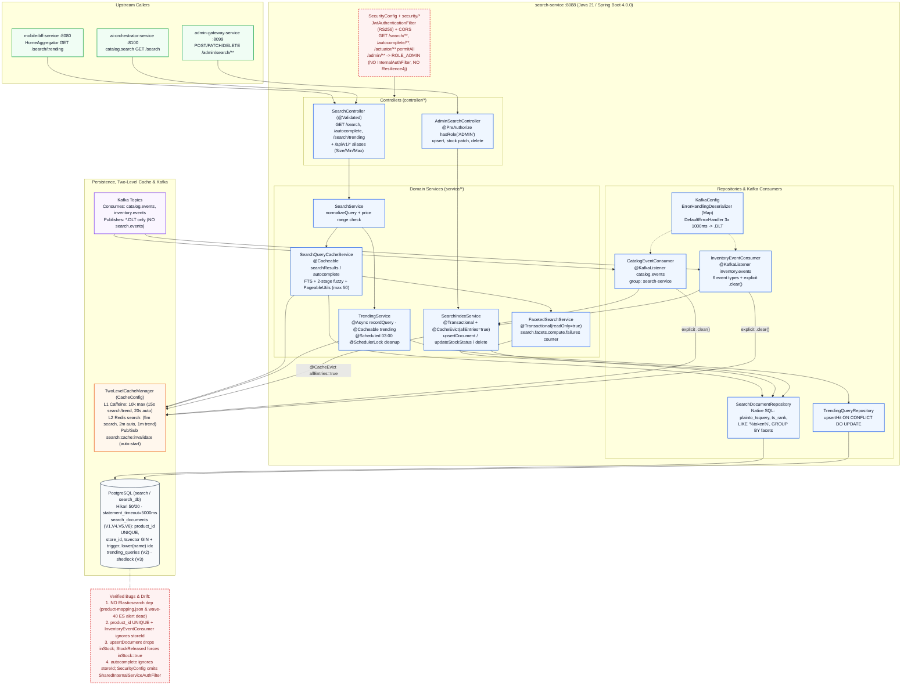
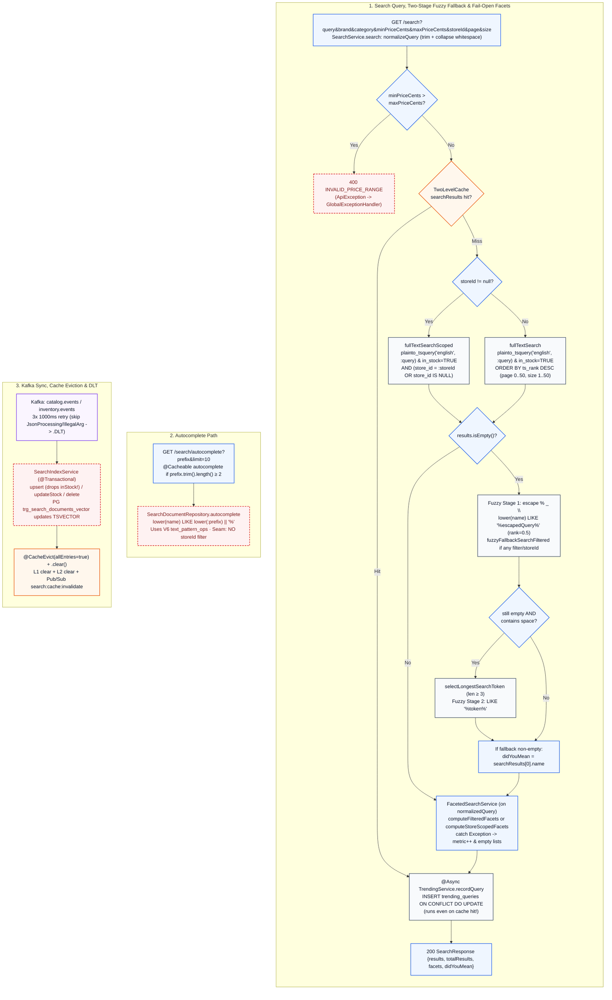
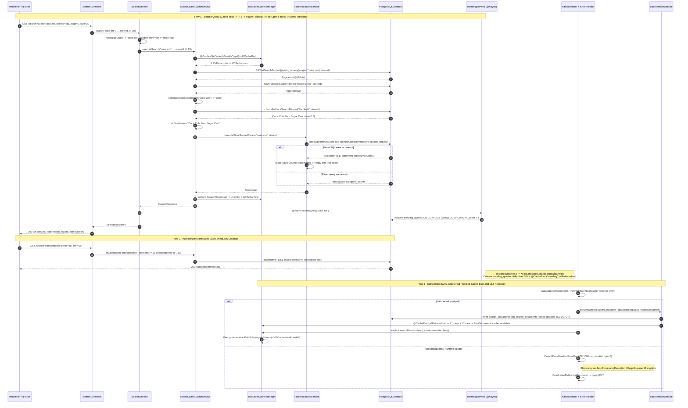

# `search-service` — Code Walkthrough

> [!NOTE]
> **Part of the InstaCommerce Onboarding Suite:** [Onboarding Hub](../../README.md) · [Code Walkthrough Atlas](../README.md) · [Domain & Event Catalog (`05`)](../../05-domain-model-and-event-catalog.md) · [Incident Drills & Exam (`06`)](../../06-incident-drills-and-readiness-exam.md) · [Dependency Matrix & Cheatsheet (`07`)](../../07-service-dependency-and-command-cheatsheet.md)

> **Service Identity Card**
>
> | Attribute | Verified Code & Config Truth | Source Reference |
> |---|---|---|
> | **Stack & Build** | Java 21 / Spring Boot 4.0.0 (`:services:search-service`, `:libs:platform-common`, `:contracts`), ZGC (`-XX:MaxRAMPercentage=75.0`) | [build.gradle.kts](../../../../services/search-service/build.gradle.kts#L1-L42), [Dockerfile](../../../../services/search-service/Dockerfile#L1-L17) |
> | **HTTP Port & Probes** | `8088` (`${SERVER_PORT:8088}`); graceful shutdown `30s`; readiness `readinessState,db`; liveness `livenessState` | [application.yml](../../../../services/search-service/src/main/resources/application.yml#L1-L91) |
> | **Primary Storage** | PostgreSQL (`search` local / `search_db` Helm; Hikari `50` max / `20` min-idle, `statement_timeout=5000ms`), Flyway `V1`–`V6` (`TSVECTOR` + GIN — **zero Elasticsearch**) | [application.yml](../../../../services/search-service/src/main/resources/application.yml#L15-L33), [V1__create_search_documents.sql](../../../../services/search-service/src/main/resources/db/migration/V1__create_search_documents.sql#L1-L37) |
> | **Caching** | `TwoLevelCacheManager` (`@Primary`): L1 Caffeine (`10,000` max, `15s`/`20s`) + L2 Redis `search:` (`5m`/`2m`/`1m`) + Pub/Sub `search:cache:invalidate` | [CacheConfig.java](../../../../services/search-service/src/main/java/com/instacommerce/search/config/CacheConfig.java#L28-L84), [TwoLevelCacheManager.java](../../../../libs/platform-common/src/main/java/com/instacommerce/platform/cache/TwoLevelCacheManager.java#L30-L143) |
> | **Kafka Topology** | **Consumes:** `catalog.events`, `inventory.events` (`groupId = search-service`, 3x `1000ms` retry → `.DLT`) · **Publishes:** `.DLT` only (no outbox table, no `search.events`) | [KafkaConfig.java](../../../../services/search-service/src/main/java/com/instacommerce/search/config/KafkaConfig.java#L65-L99), [CatalogEventConsumer.java](../../../../services/search-service/src/main/java/com/instacommerce/search/kafka/CatalogEventConsumer.java#L34-L62), [InventoryEventConsumer.java](../../../../services/search-service/src/main/java/com/instacommerce/search/kafka/InventoryEventConsumer.java#L38-L83) |
> | **Helm & Scaling** | `search-service` (`replicas: 2`, HPA `2–15` at `70%` CPU, `500m–1000m` CPU, `512Mi–1024Mi` RAM) | [values.yaml](../../../../deploy/helm/values.yaml#L734-L751), [values-prod.yaml](../../../../deploy/helm/values-prod.yaml#L36-L41) |
> | **SLO Tier** | **Tier 2** — `99.0%` availability / `2000ms` P99 in error budget policy (`99%` / `200ms` P99 in service SLO doc) | [error-budget-policy.yaml](../../../../monitoring/error-budget-policy.yaml#L29-L44), [service-slos.md](../../../../docs/slos/service-slos.md#L38-L44) |
> | **Upstream Callers** | `mobile-bff-service` (`GET /search/trending`), `ai-orchestrator-service` (`catalog.search` → `GET /search`), `admin-gateway-service` (`/admin/search/**`) | [HomeAggregator.java](../../../../services/mobile-bff-service/src/main/java/com/instacommerce/mobilebff/aggregator/HomeAggregator.java#L103-L113), [tools.py](../../../../services/ai-orchestrator-service/app/graph/tools.py#L91-L96) |
> | **Bounded Context** | Read-only CQRS discovery projection for full-text search, two-stage fuzzy fallback, brand/category facets, prefix autocomplete, and async trending query tracking | [SearchController.java](../../../../services/search-service/src/main/java/com/instacommerce/search/controller/SearchController.java#L20-L59) |

---

## 1. Service Boundaries & Package Tree

`search-service` owns the denormalized `search_documents` projection, `trending_queries` hit counters, and `shedlock` scheduler coordination table. It does **not** call `catalog-service`, `inventory-service`, or `pricing-service` synchronously over HTTP; all mutations arrive asynchronously from Kafka (`catalog.events` and `inventory.events`) or manually via `AdminSearchController`.

```text
services/search-service/
├── build.gradle.kts                                         # Spring Boot 4 + JPA + Redis + Caffeine + Kafka + ShedLock (NO Elasticsearch dep)
├── Dockerfile                                               # eclipse-temurin:21-jre-alpine, ZGC, port 8088, /actuator/health/liveness probe
├── README.md                                                # Legacy service README (contains Caffeine-only & missing-test drift)
└── src/
    ├── main/
    │   ├── java/com/instacommerce/search/
    │   │   ├── SearchServiceApplication.java                # @SpringBootApplication, @EnableConfigurationProperties(SearchProperties), @EnableAsync
    │   │   ├── config/
    │   │   │   ├── CacheConfig.java                         # @Primary TwoLevelCacheManager (L1 Caffeine + L2 Redis search: + Pub/Sub)
    │   │   │   ├── JacksonConfig.java                       # Primary ObjectMapper (ISO dates, FAIL_ON_UNKNOWN_PROPERTIES=false)
    │   │   │   ├── KafkaConfig.java                         # ErrorHandlingDeserializer(Map) + DeadLetterPublishingRecoverer (3x 1s -> .DLT)
    │   │   │   ├── SearchProperties.java                    # @ConfigurationProperties("search") -> jwt.issuer & jwt.publicKey
    │   │   │   ├── SecurityConfig.java                    # Stateless CORS/CSRF, GET permitAll, /admin/** ROLE_ADMIN, JwtAuthenticationFilter
    │   │   │   └── ShedLockConfig.java                      # @EnableScheduling + @EnableSchedulerLock(10m) via JdbcTemplateLockProvider
    │   │   ├── controller/
    │   │   │   ├── SearchController.java                    # /search, /search/autocomplete, /autocomplete, /search/trending (+ /api/v1/*)
    │   │   │   └── AdminSearchController.java               # /admin/search/documents (POST, PATCH /{productId}/stock, DELETE /{productId})
    │   │   ├── domain/model/
    │   │   │   ├── SearchDocument.java                      # @Entity -> search_documents (product_id UNIQUE, store_id, in_stock, search_vector)
    │   │   │   └── TrendingQuery.java                       # @Entity -> trending_queries (query UNIQUE, hit_count, last_searched_at)
    │   │   ├── dto/
    │   │   │   ├── AutocompleteResult.java                  # record(suggestion, category, productId)
    │   │   │   ├── ErrorDetail.java                         # record(field, message)
    │   │   │   ├── ErrorResponse.java                       # record(code, message, traceId, timestamp, details)
    │   │   │   ├── FacetValue.java                          # record(value, count)
    │   │   │   ├── SearchRequest.java                       # UNUSED DTO record (declares max size=100; controller clamps to 50)
    │   │   │   ├── SearchResponse.java                      # record(results, totalResults, page, totalPages, facets, didYouMean)
    │   │   │   └── SearchResult.java                        # record(productId, name, brand, category, priceCents, imageUrl, inStock, score)
    │   │   ├── exception/
    │   │   │   ├── ApiException.java                        # RuntimeException carrying HttpStatus + machine code
    │   │   │   ├── GlobalExceptionHandler.java              # @RestControllerAdvice for ApiException, validation, AccessDenied, 500
    │   │   │   └── TraceIdProvider.java                     # Resolves MDC traceId / X-B3-TraceId / traceparent / X-Request-Id
    │   │   ├── kafka/
    │   │   │   ├── CatalogEventConsumer.java                # @KafkaListener(catalog.events) -> ProductCreated/Updated/Deactivated/Delisted
    │   │   │   └── InventoryEventConsumer.java              # @KafkaListener(inventory.events) -> 6 inventory event types
    │   │   ├── repository/
    │   │   │   ├── SearchDocumentRepository.java            # Native SQL: FTS, store-scoped FTS, autocomplete, facets, fuzzy LIKE
    │   │   │   └── TrendingQueryRepository.java             # Native ON CONFLICT upsertHit, top-N query, retention deleteOlderThan
    │   │   ├── security/
    │   │   │   ├── JwtService.java                          # Interface: validateAccessToken, extractAuthorities
    │   │   │   ├── DefaultJwtService.java                   # JJWT RS256 verification + issuer check + ROLE_ prefix normalization
    │   │   │   ├── JwtKeyLoader.java                        # Parses PEM/Base64 RSA public key at startup (fail-fast if blank)
    │   │   │   ├── JwtAuthenticationFilter.java             # OncePerRequestFilter (skips /actuator, /error; writes 401 JSON on failure)
    │   │   │   ├── RestAuthenticationEntryPoint.java        # 401 AUTHENTICATION_REQUIRED JSON writer
    │   │   │   └── RestAccessDeniedHandler.java             # 403 ACCESS_DENIED JSON writer
    │   │   └── service/
    │   │       ├── SearchService.java                       # Normalizes query, validates minPrice <= maxPrice, delegates cache + async trending
    │   │       ├── SearchQueryCacheService.java             # Separate AOP proxy bean: @Cacheable searchResults/autocomplete, FTS + fuzzy
    │   │       ├── FacetedSearchService.java                # @Transactional(readOnly=true) brand/category facets + failure metric (fail-open)
    │   │       ├── TrendingService.java                     # @Async recordQuery, @Cacheable trending, @Scheduled 03:00 ShedLock cleanup
    │   │       └── SearchIndexService.java                  # @Transactional upserts/deletes/stock + @CacheEvict(allEntries=true)
    │   └── resources/
    │       ├── application.yml                              # Port 8088, Hikari 50/20 + 5s statement_timeout, Kafka ErrorHandlingDeserializer
    │       ├── application-local.yml                        # Disables GCP Secret Manager/Cloud SQL & OTLP; local DB devpass + JWT fallback
    │       ├── logback-spring.xml                           # Logstash JSON stdout with service + environment custom fields
    │       ├── elasticsearch/product-mapping.json           # Dead legacy ES mapping (0 ES clients in code or Gradle)
    │       └── db/migration/V1..V6__*.sql                   # search_documents, trending_queries, shedlock, autocomplete & store_id indexes
    └── test/java/com/instacommerce/search/
        ├── config/CacheConfigPubSubTest.java                # Redis Pub/Sub cross-instance L1 eviction + graceful no-Redis fallback
        ├── kafka/CatalogEventConsumerTest.java              # ProductCreated/Updated(active=false)/Deactivated/null eventType
        ├── kafka/InventoryEventConsumerTest.java            # StockAdjusted, LowStockAlert, OutOfStock, ExpiredWriteOff, Confirmed, Released
        ├── security/SearchSecuritySliceTest.java            # WebMvc slice: GET /search/trending permitAll, POST 401, /admin/** ROLE_ADMIN
        ├── service/FacetedSearchServiceTest.java            # Store-scoped facets + search.facets.compute.failures counter increment
        ├── service/SearchEdgeFixesTest.java                 # upsertDocument inStock preservation, cached trending recording, DLT serializer
        ├── service/SearchFallbackTest.java                  # Zero-hit FTS -> fuzzy fallback + didYouMean
        └── service/SearchNormalizationAndFilteringTest.java # Query trim, INVALID_PRICE_RANGE, storeId propagation, PageableUtils clamping
```

---

## 2. Startup, Configuration & Security Filter Chain

1. **Application Bootstrap & Scheduling:** [`SearchServiceApplication`](../../../../services/search-service/src/main/java/com/instacommerce/search/SearchServiceApplication.java#L9-L16) enables `@EnableConfigurationProperties(SearchProperties.class)` and `@EnableAsync` (used by `TrendingService.recordQuery` so trending hit writes run off the HTTP request thread). [`ShedLockConfig`](../../../../services/search-service/src/main/java/com/instacommerce/search/config/ShedLockConfig.java#L12-L25) activates `@EnableScheduling` and `@EnableSchedulerLock(defaultLockAtMostFor = "10m")` backed by `JdbcTemplateLockProvider` using database time (`.usingDbTime()`).
2. **Datasource & HikariCP Limits:** [`application.yml`](../../../../services/search-service/src/main/resources/application.yml#L15-L33) configures `spring.jpa.open-in-view: false`, `ddl-auto: validate`, Flyway enabled, and HikariCP with `maximum-pool-size: 50`, `minimum-idle: 20`, `connection-timeout: 3000`, `leak-detection-threshold: 60000`, and `options: "-c statement_timeout=5000"` so runaway FTS or `LIKE '%...%'` queries terminate after `5s` rather than exhausting the connection pool.
3. **JWT Key Fail-Fast & Secret Manager:** [`SearchProperties`](../../../../services/search-service/src/main/java/com/instacommerce/search/config/SearchProperties.java#L5-L33) binds `search.jwt.issuer` (default `instacommerce-identity`) and `search.jwt.public-key` (`${sm://jwt-rsa-public-key:${SEARCH_JWT_PUBLIC_KEY}}`). [`JwtKeyLoader`](../../../../services/search-service/src/main/java/com/instacommerce/search/security/JwtKeyLoader.java#L16-L51) parses the RSA public key eagerly in its constructor—if `publicKey` is blank at startup, context initialization fails immediately with `IllegalStateException("JWT public key is not configured")`.
4. **Stateless Security Filter Chain & Missing Internal Filter:** [`SecurityConfig`](../../../../services/search-service/src/main/java/com/instacommerce/search/config/SecurityConfig.java#L31-L51) disables CSRF, enforces `SessionCreationPolicy.STATELESS`, applies CORS (`${search.cors.allowed-origins:http://localhost:3000,https://*.instacommerce.dev}`), permits `HttpMethod.GET` on `/search/**`, `/api/v1/search/**`, `/autocomplete`, `/autocomplete/**`, `/api/v1/autocomplete`, `/api/v1/autocomplete/**`, and all methods on `/actuator/**` and `/error`. Routes under `/admin/**` and `/api/v1/admin/**` require `ROLE_ADMIN`, and `anyRequest().authenticated()` catches non-`GET` calls to `/search/**` (verified in [`SearchSecuritySliceTest`](../../../../services/search-service/src/test/java/com/instacommerce/search/security/SearchSecuritySliceTest.java#L94-L108)).
   - **Important Gap:** Unlike `pricing-service`, `search-service` never imports `InternalServiceSecurityConfiguration` or registers [`SharedInternalServiceAuthFilter`](../../../../libs/platform-common/src/main/java/com/instacommerce/platform/security/SharedInternalServiceAuthFilter.java#L30-L115), even though `libs:platform-common` is on its classpath and Helm provisions `SEARCH_SERVICE_TOKEN` in [`values.yaml`](../../../../deploy/helm/values.yaml#L524-L527). Internal services authenticating solely with `X-Internal-Service`/`X-Internal-Token` receive `401` on protected endpoints.
   - **Filter Error Handling:** [`JwtAuthenticationFilter`](../../../../services/search-service/src/main/java/com/instacommerce/search/security/JwtAuthenticationFilter.java#L37-L76) skips `/actuator*` and `/error`, parses `Authorization: Bearer <token>` via [`DefaultJwtService`](../../../../services/search-service/src/main/java/com/instacommerce/search/security/DefaultJwtService.java#L26-L53) (verifying RS256 signature and `issuer`, normalizing `roles` claim with `ROLE_` prefix), and writes `401 TOKEN_INVALID` directly if JWT verification throws `JwtException` or `IllegalArgumentException`. Unauthenticated hits to protected paths fall through to [`RestAuthenticationEntryPoint`](../../../../services/search-service/src/main/java/com/instacommerce/search/security/RestAuthenticationEntryPoint.java#L27-L40) (`401 AUTHENTICATION_REQUIRED`), while insufficient roles hit [`RestAccessDeniedHandler`](../../../../services/search-service/src/main/java/com/instacommerce/search/security/RestAccessDeniedHandler.java#L27-L40) (`403 ACCESS_DENIED`). Application exceptions route to [`GlobalExceptionHandler`](../../../../services/search-service/src/main/java/com/instacommerce/search/exception/GlobalExceptionHandler.java#L22-L84) using [`TraceIdProvider`](../../../../services/search-service/src/main/java/com/instacommerce/search/exception/TraceIdProvider.java#L9-L38).
   - **Zero Resilience4j:** Neither [`build.gradle.kts`](../../../../services/search-service/build.gradle.kts#L7-L33) nor [`application.yml`](../../../../services/search-service/src/main/resources/application.yml#L1-L96) includes `resilience4j`. Rate limiting / circuit breaking is left to upstream callers (`mobile-bff-service`, `ai-orchestrator-service`) and Istio ingress.

---

## 3. Architecture LLD, Flyway Schema & Two-Level Cache

**search-service architecture LLD** — *[Rendered PNG](../diagrams/services/search-service-arch-lld.png) · [Mermaid Source](../diagrams/services/search-service-arch-lld.mmd)*



### Flyway Schema (`V1`–`V6`) & PostgreSQL Trigger

| Migration | Table / Index | Exact DDL & Invariants |
|---|---|---|
| [`V1`](../../../../services/search-service/src/main/resources/db/migration/V1__create_search_documents.sql#L1-L37) | `search_documents` | `id UUID PK`, **`product_id UUID NOT NULL UNIQUE`**, `name VARCHAR(512) NOT NULL`, `description TEXT`, `brand VARCHAR(255)`, `category VARCHAR(255)`, `price_cents BIGINT NOT NULL DEFAULT 0`, `image_url VARCHAR(2048)`, `in_stock BOOLEAN NOT NULL DEFAULT TRUE`, `search_vector TSVECTOR`, `created_at`/`updated_at TIMESTAMP`. Indexes: `GIN (search_vector)` (`idx_search_documents_search_vector`), B-trees on `category`, `brand`, `price_cents`, `in_stock`. Trigger `trg_search_documents_vector` (`BEFORE INSERT OR UPDATE`) executes `search_documents_update_vector()`, weighting `A`=`name`, `B`=`brand \|\| category`, `C`=`description` under `'english'` dictionary and refreshing `updated_at := now()`. |
| [`V2`](../../../../services/search-service/src/main/resources/db/migration/V2__create_trending_queries.sql#L1-L9) | `trending_queries` | `id UUID PK`, `query VARCHAR(512) NOT NULL UNIQUE`, `hit_count BIGINT NOT NULL DEFAULT 1`, `last_searched_at TIMESTAMP NOT NULL DEFAULT now()`. Indexes: `idx_trending_queries_hit_count (hit_count DESC)` and `idx_trending_queries_last_searched (last_searched_at DESC)`. |
| [`V3`](../../../../services/search-service/src/main/resources/db/migration/V3__create_shedlock.sql#L1-L7) | `shedlock` | `name VARCHAR(64) PK`, `lock_until TIMESTAMP`, `locked_at TIMESTAMP`, `locked_by VARCHAR(255)`. Guards daily `cleanupTrendingQueries` cron across replicas. |
| [`V4`](../../../../services/search-service/src/main/resources/db/migration/V4__add_autocomplete_index.sql#L1-L2) | `idx_search_documents_name_pattern` | `(name text_pattern_ops)` — case-sensitive pattern index, superseded for `lower(sd.name)` queries by `V6`. |
| [`V5`](../../../../services/search-service/src/main/resources/db/migration/V5__add_store_id_to_search_documents.sql#L1-L5) | `store_id` column + index | `ALTER TABLE search_documents ADD COLUMN IF NOT EXISTS store_id UUID` + `idx_search_documents_store_id (store_id)` (`NULL` means global/all-store product). |
| [`V6`](../../../../services/search-service/src/main/resources/db/migration/V6__add_lower_name_text_pattern_index.sql#L1-L3) | `idx_search_documents_lower_name` | `(lower(name) text_pattern_ops)` — aligns with `WHERE lower(sd.name) LIKE lower(:prefix) \|\| '%'` in [`SearchDocumentRepository.autocomplete`](../../../../services/search-service/src/main/java/com/instacommerce/search/repository/SearchDocumentRepository.java#L82-L90). |

In [`SearchDocument`](../../../../services/search-service/src/main/java/com/instacommerce/search/domain/model/SearchDocument.java#L48-L49), `searchVector` is mapped with `insertable = false, updatable = false` so JPA never overwrites the trigger-computed `TSVECTOR`.

### Two-Level Cache (`TwoLevelCacheManager`) Mechanics

Although [`application.yml`](../../../../services/search-service/src/main/resources/application.yml#L47-L50) declares `spring.cache.type: caffeine`, [`CacheConfig`](../../../../services/search-service/src/main/java/com/instacommerce/search/config/CacheConfig.java#L36-L83) registers a `@Primary CacheManager` returning [`TwoLevelCacheManager`](../../../../libs/platform-common/src/main/java/com/instacommerce/platform/cache/TwoLevelCacheManager.java#L49-L60) whenever `search.cache.redis.enabled` is `true` (default):

| Cache Name | L1 Caffeine (`maximumSize`) | L1 TTL | L2 Redis Key Prefix (`search:`) | L2 TTL | Cache Key / Condition |
|---|---|---|---|---|---|
| `searchResults` | `10,000` | `15s` | `search:searchResults::...` | `5m` | `query_brand_category_minPrice_maxPrice_storeId_page_size`; skips blank queries |
| `autocomplete` | `10,000` | `20s` | `search:autocomplete::...` | `2m` | `prefix_limit`; cached only when `#prefix != null && #prefix.trim().length() >= 2` |
| `trending` | `10,000` | `15s` | `search:trending::...` | `1m` | `#limit` |

- **Pub/Sub Lifecycle Subtlety:** `search-service` passes `redisEnabled ? connectionFactory : null` directly to the 5-argument `TwoLevelCacheManager` constructor ([`CacheConfig.java`](../../../../services/search-service/src/main/java/com/instacommerce/search/config/CacheConfig.java#L72-L76)), which immediately runs `initListenerContainer` (`container.start()`) during bean creation ([`TwoLevelCacheManager.java`](../../../../libs/platform-common/src/main/java/com/instacommerce/platform/cache/TwoLevelCacheManager.java#L62-L80))—catching connection failures and returning `null` so pods still start without Redis. (Contrast `pricing-service`, which defers subscription until `ApplicationReadyEvent` after an explicit `connection.ping()`.)
- **Self-Echo Avoidance:** [`TwoLevelCache.put`](../../../../libs/platform-common/src/main/java/com/instacommerce/platform/cache/TwoLevelCache.java#L102-L111) populates L1 and L2 silently; only `evict()` and `clear()` publish `{instanceId}\|{cacheName}:{keyPattern}` on `search:cache:invalidate`. Receiving pods check `instanceId` in [`TwoLevelCacheManager.onMessage`](../../../../libs/platform-common/src/main/java/com/instacommerce/platform/cache/TwoLevelCacheManager.java#L100-L123) before invalidating L1 (`*` clears all entries).

---

## 4. Core Query, Fuzzy Fallback & Concurrency Flows

**search-service algorithmic flowchart** — *[Rendered PNG](../diagrams/services/search-service-flowchart.png) · [Mermaid Source](../diagrams/services/search-service-flowchart.mmd)*



### Method-by-Method Search Walkthrough

1. **Input Normalization & Validation ([`SearchService.search`](../../../../services/search-service/src/main/java/com/instacommerce/search/service/SearchService.java#L47-L64)):**
   - [`SearchController.search`](../../../../services/search-service/src/main/java/com/instacommerce/search/controller/SearchController.java#L30-L43) binds `query` (`@Size(min = 1, max = 256)`), optional `brand`, `category`, `minPriceCents` (`@Min(0)`), `maxPriceCents` (`@Min(0)`), `storeId`, `page` (`0..50`, default `0`), and `size` (`1..50`, default `20`).
   - `SearchService` normalizes whitespace (`query.trim().replaceAll("\\s+", " ")`), trims `brand`/`category` to `null` if blank, and throws `ApiException(HttpStatus.BAD_REQUEST, "INVALID_PRICE_RANGE", ...)` if `minPrice > maxPrice`.
2. **AOP Proxy Boundary ([`SearchQueryCacheService`](../../../../services/search-service/src/main/java/com/instacommerce/search/service/SearchQueryCacheService.java#L24-L45)):**
   - Caching lives on a **separate Spring bean** (`SearchQueryCacheService.executeSearch`) rather than `SearchService` for two reasons: (a) preventing Spring AOP `@Cacheable` self-invocation bypass, and (b) ensuring `SearchService` line 61 **always** invokes `@Async trendingService.recordQuery(normalizedQuery)` even when `executeSearch` hits L1/L2 cache (verified by [`SearchEdgeFixesTest`](../../../../services/search-service/src/test/java/com/instacommerce/search/service/SearchEdgeFixesTest.java#L69-L92)).
   - `sanitizePageable` ([`SearchQueryCacheService.java`](../../../../services/search-service/src/main/java/com/instacommerce/search/service/SearchQueryCacheService.java#L127-L131)) clamps `page` to `[0, 50]` and delegates to [`PageableUtils.sanitize`](../../../../libs/platform-common/src/main/java/com/instacommerce/platform/web/PageableUtils.java#L21-L43) with `defaultSize=20, maxSize=50`—matching `buildCacheKey` so keys never drift on out-of-range parameters.
3. **Primary FTS & Store Scoping ([`SearchDocumentRepository`](../../../../services/search-service/src/main/java/com/instacommerce/search/repository/SearchDocumentRepository.java#L19-L80)):**
   - When `storeId == null`, `executePrimarySearch` calls `fullTextSearch`, matching `sd.search_vector @@ plainto_tsquery('english', :query) AND sd.in_stock = TRUE` with optional `brand`, `category`, `minPrice`, `maxPrice`, ordered by `ts_rank(sd.search_vector, plainto_tsquery('english', :query)) DESC`.
   - When `storeId != null`, `fullTextSearchScoped` adds `AND (:storeId IS NULL OR sd.store_id = :storeId OR sd.store_id IS NULL)` so store-specific documents and global (`store_id IS NULL`) catalog entries both surface.
4. **Two-Stage Fuzzy Fallback & `didYouMean` ([`SearchQueryCacheService.java`](../../../../services/search-service/src/main/java/com/instacommerce/search/service/SearchQueryCacheService.java#L64-L79), [`L152-L222`](../../../../services/search-service/src/main/java/com/instacommerce/search/service/SearchQueryCacheService.java#L152-L222)):**
   - If primary FTS returns zero rows, `escapeLikePattern` escapes `\`, `%`, and `_`, then `runFuzzyFallback` runs `lower(sd.name) LIKE '%' || lower(:token) || '%'` with a synthetic `0.5 AS rank` (`fuzzyFallbackSearch` when `hasFilters == false`, or `fuzzyFallbackSearchFiltered` when any of `brand`, `category`, `minPrice`, `maxPrice`, or `storeId` is non-null).
   - If the full query still returns zero rows **and** `normalizedQuery.contains(" ")`, `selectLongestSearchToken` splits on spaces, keeps tokens with `length >= 3`, picks the longest (`Comparator.comparingInt(String::length)`), and re-runs `runFuzzyFallback` on that single token.
   - Whenever fallback yields rows, `didYouMean` is populated from `searchResults.get(0).name()`.
5. **Fail-Open Facets ([`FacetedSearchService`](../../../../services/search-service/src/main/java/com/instacommerce/search/service/FacetedSearchService.java#L46-L101)):**
   - Chooses between `facetByBrand`/`facetByCategory`, `facetByBrandAndStore`/`facetByCategoryAndStore`, or `facetByBrandFiltered`/`facetByCategoryFiltered` (`GROUP BY` sorted `ORDER BY cnt DESC`).
   - Any exception (including PostgreSQL `5000ms` statement timeout) is caught on line 84, increments Micrometer counter `search.facets.compute.failures`, logs a warning, and returns empty `brand`/`category` lists so search results still return `200 OK`.
   - **Quirk:** Facet queries always execute `plainto_tsquery('english', :query)` against the **original** `normalizedQuery` (`SearchQueryCacheService.java#L83-L86`), even when results came from Stage-1/Stage-2 fuzzy fallback—returning empty facets on typo recoveries.
6. **Autocomplete & Trending ([`SearchQueryCacheService.autocomplete`](../../../../services/search-service/src/main/java/com/instacommerce/search/service/SearchQueryCacheService.java#L91-L108), [`TrendingService`](../../../../services/search-service/src/main/java/com/instacommerce/search/service/TrendingService.java#L30-L55)):**
   - `autocomplete` caches only prefixes with `prefix.trim().length() >= 2`, escapes LIKE wildcards, clamps `limit` (`1..50`, default `10`), and runs `lower(sd.name) LIKE lower(:prefix) \|\| '%'` leveraging `V6` `idx_search_documents_lower_name`.
   - `TrendingService.recordQuery` runs `@Async @Transactional`, lowercases the query, and executes `TrendingQueryRepository.upsertHit` (`INSERT ... ON CONFLICT (query) DO UPDATE SET hit_count = trending_queries.hit_count + 1, last_searched_at = now()`). `cleanupOldEntries` runs daily at `03:00` (`@Scheduled(cron = "0 0 3 * * *")`) under ShedLock (`cleanupTrendingQueries`, `5m`–`30m`), deletes rows older than `30` days, and evicts `@CacheEvict(value = "trending", allEntries = true)`.

---

## 5. Call-Stack Sequence, Kafka Consumers & Cache Busting

**search-service end-to-end sequence** — *[Rendered PNG](../diagrams/services/search-service-sequence.png) · [Mermaid Source](../diagrams/services/search-service-sequence.mmd)*



### Kafka Deserialization, Consumers & Retry/DLT Pipeline

- **Deserialization ([`KafkaConfig`](../../../../services/search-service/src/main/java/com/instacommerce/search/config/KafkaConfig.java#L65-L99)):** Uses `ErrorHandlingDeserializer` wrapping `StringDeserializer` (key) and `JsonDeserializer` (value, `USE_TYPE_INFO_HEADERS=false`, `VALUE_DEFAULT_TYPE=Map.class`, `TRUSTED_PACKAGES=com.instacommerce.*,java.util,java.lang`). Poison messages that fail deserialization or throw inside listeners hit `DefaultErrorHandler` configured with `FixedBackOff(1000L, 3)` (`3` retries at `1s` spacing) before `DeadLetterPublishingRecoverer` (`DelegatingByTypeSerializer` supporting `byte[]`, `String`, and JSON `Object`) routes the record to `{record.topic()}.DLT` on the same partition. `JsonProcessingException` and `IllegalArgumentException` bypass retries and go straight to `.DLT`.
- **`CatalogEventConsumer` ([`CatalogEventConsumer.java`](../../../../services/search-service/src/main/java/com/instacommerce/search/kafka/CatalogEventConsumer.java#L34-L112)):** Listens on `catalog.events` (`groupId = "search-service"`). Extracts nested `payload` if present (else flat envelope):
  - `"ProductCreated"`, `"ProductUpdated"`: if `payload.get("active")` is `Boolean.FALSE`, deletes by `productId`; otherwise resolves `priceCents` (falling back to `basePriceCents`, else `0L`), `inStock = Boolean.TRUE.equals(...)`, optional `storeId`, and calls `SearchIndexService.upsertDocument(...)`.
  - `"ProductDeactivated"`, `"ProductDelisted"`: calls `SearchIndexService.deleteDocument(productId)`.
  - Calls `evictSearchCaches()` afterward, explicitly clearing `searchResults` and `autocomplete` caches on `CacheManager` (on top of `@CacheEvict(allEntries = true)` on `SearchIndexService`).
- **`InventoryEventConsumer` ([`InventoryEventConsumer.java`](../../../../services/search-service/src/main/java/com/instacommerce/search/kafka/InventoryEventConsumer.java#L38-L214)):** Listens on `inventory.events` (`groupId = "search-service"`). Reads both camelCase and snake_case field variants across 6 event types, calling `SearchIndexService.updateStockStatus(productId, inStock)` followed by `evictSearchCaches()`:
  - `StockAdjusted`: `newOnHand > 0`
  - `LowStockAlert`: `currentQuantity > 0`
  - `OutOfStock`: `false`
  - `ExpiredStockWrittenOff`: explicit `inStock` boolean, else `remainingAvailable` / `remainingOnHand` / `newOnHand` / `currentQuantity > 0` (false if absent)
  - `StockConfirmed`: iterates `items` list (or root payload), checking `inStock`, `remainingAvailable`, `remainingOnHand`
  - `StockReleased`: iterates `items` list (or root payload) and unconditionally passes `inStock = true`

---

## 6. Config Matrix, Metrics & Test Commands

| Key / Env Var | Default (`application.yml` / Helm) | Local Override (`application-local.yml`) | Notes |
|---|---|---|---|
| `SERVER_PORT` | `8088` | `8088` | Matches Helm port `8088` ([values.yaml](../../../../deploy/helm/values.yaml#L737-L743)) |
| `SEARCH_DB_URL` / `SPRING_DATASOURCE_URL` | `jdbc:postgresql://localhost:5432/search` | Same (`devpass`) | Helm uses `search_db` via Cloud SQL socket factory ([values.yaml](../../../../deploy/helm/values.yaml#L744)) |
| `SEARCH_DB_PASSWORD` | `${sm://db-password-search:...}` | `devpass` | `spring.config.import: optional:sm://` |
| `KAFKA_BOOTSTRAP_SERVERS` | `localhost:9092` | `localhost:9092` | Consumer group `search-service`, `auto-offset-reset: earliest` |
| `SPRING_DATA_REDIS_HOST` / `PORT` | Helm: `instacommerce-redis-{dev,prod}.redis.cache.goog:6379` | Unset (falls back to L1 Caffeine) | Controlled by `search.cache.redis.enabled` (default `true` in `CacheConfig`) |
| `SEARCH_JWT_ISSUER` / `SEARCH_JWT_PUBLIC_KEY` | `instacommerce-identity` / `${sm://jwt-rsa-public-key}` | `${JWT_PUBLIC_KEY:}` | Blank key fails `JwtKeyLoader` at boot unless test slice mocks `JwtService` |
| `search.cors.allowed-origins` | `http://localhost:3000,https://*.instacommerce.dev` | — | Defined in [`SecurityConfig.java`](../../../../services/search-service/src/main/java/com/instacommerce/search/config/SecurityConfig.java#L27) |

### Metrics, Alerts & Test Inventory

- **Micrometer Metrics:** `search.facets.compute.failures` counter ([`FacetedSearchService.java`](../../../../services/search-service/src/main/java/com/instacommerce/search/service/FacetedSearchService.java#L36-L37)) + standard Spring Boot HTTP (`http_server_requests_seconds_*`), Hikari, JVM, and Kafka consumer metrics exported via `/actuator/prometheus` and OTLP (`management.tracing.sampling.probability: ${TRACING_PROBABILITY:1.0}`).
- **Test Inventory (8 suites):**
  - [`CacheConfigPubSubTest`](../../../../services/search-service/src/test/java/com/instacommerce/search/config/CacheConfigPubSubTest.java#L37-L223) — L1/L2 no-Redis graceful fallback, `search:cache:invalidate` Pub/Sub peer eviction, `DisposableBean` cleanup
  - [`CatalogEventConsumerTest`](../../../../services/search-service/src/test/java/com/instacommerce/search/kafka/CatalogEventConsumerTest.java#L18-L108) — `ProductCreated`, `ProductUpdated(active=false)`, `ProductDeactivated`, null `eventType`
  - [`InventoryEventConsumerTest`](../../../../services/search-service/src/test/java/com/instacommerce/search/kafka/InventoryEventConsumerTest.java#L23-L228) — all 6 inventory event types + flat payload + cache `.clear()`
  - [`SearchSecuritySliceTest`](../../../../services/search-service/src/test/java/com/instacommerce/search/security/SearchSecuritySliceTest.java#L37-L109) — WebMvc slice verifying public GET routes, `401` on `POST /search/trending`, `401`/`403` on `/admin/**`
  - [`FacetedSearchServiceTest`](../../../../services/search-service/src/test/java/com/instacommerce/search/service/FacetedSearchServiceTest.java#L25-L100) — store-scoped facet rollups + fail-open failure counter
  - [`SearchEdgeFixesTest`](../../../../services/search-service/src/test/java/com/instacommerce/search/service/SearchEdgeFixesTest.java#L37-L151) — `upsertDocument` preserving `inStock`, trending recorded on cache hits, DLT serializer
  - [`SearchFallbackTest`](../../../../services/search-service/src/test/java/com/instacommerce/search/service/SearchFallbackTest.java#L25-L76) — zero-hit FTS → fuzzy fallback → `didYouMean`
  - [`SearchNormalizationAndFilteringTest`](../../../../services/search-service/src/test/java/com/instacommerce/search/service/SearchNormalizationAndFilteringTest.java#L28-L127) — whitespace collapse, `INVALID_PRICE_RANGE`, `storeId` propagation, `PageableUtils` clamping

```bash
# Run all search-service tests
./gradlew :services:search-service:test

# Run a single test class or method
./gradlew :services:search-service:test --tests "com.instacommerce.search.service.SearchNormalizationAndFilteringTest"
```

---

## 7. Verified Bugs, Architectural Seams & Doc Drift

1. **Multi-Store Collision (`product_id UNIQUE`) + Global Stock Overwrites:**
   - [`V1__create_search_documents.sql`](../../../../services/search-service/src/main/resources/db/migration/V1__create_search_documents.sql#L3) and [`SearchDocument.java`](../../../../services/search-service/src/main/java/com/instacommerce/search/domain/model/SearchDocument.java#L21-L22) constrain `product_id` as globally `UNIQUE`, making per-dark-store rows for the same SKU impossible (despite `V5` adding nullable `store_id`). Worse, [`InventoryEventConsumer`](../../../../services/search-service/src/main/java/com/instacommerce/search/kafka/InventoryEventConsumer.java#L99-L214) never extracts `storeId` from `inventory.events`, so a single dark store emitting `OutOfStock` marks `in_stock = FALSE` for that `product_id` across every store.
2. **`StockReleased` Unconditionally Forces `inStock = true`:**
   - [`InventoryEventConsumer.handleStockReleased`](../../../../services/search-service/src/main/java/com/instacommerce/search/kafka/InventoryEventConsumer.java#L197-L214) calls `searchIndexService.updateStockStatus(productId, true)` for every released item without checking remaining sellable stock—compounded upstream by [`ReservationSupport.buildStockReleasedPayload`](../../../../services/inventory-service/src/main/java/com/instacommerce/inventory/service/ReservationSupport.java#L194-L202), which hardcodes `"inStock": true` even if other stock remains frozen or damaged.
3. **`SearchIndexService.upsertDocument` Silently Drops `inStock` on Existing Documents:**
   - [`SearchIndexService.upsertDocument`](../../../../services/search-service/src/main/java/com/instacommerce/search/service/SearchIndexService.java#L28-L39) sets `inStock` only in the insert branch (`() -> new SearchDocument(...)`). On updates to existing rows, it overwrites `name`, `description`, `brand`, `category`, `priceCents`, `imageUrl`, and `storeId` while ignoring the `inStock` parameter (behavior locked in by [`SearchEdgeFixesTest`](../../../../services/search-service/src/test/java/com/instacommerce/search/service/SearchEdgeFixesTest.java#L40-L57)).
4. **Autocomplete Ignores `storeId` & Service Omits `SharedInternalServiceAuthFilter`:**
   - [`SearchController.autocomplete`](../../../../services/search-service/src/main/java/com/instacommerce/search/controller/SearchController.java#L45-L51) and [`SearchDocumentRepository.autocomplete`](../../../../services/search-service/src/main/java/com/instacommerce/search/repository/SearchDocumentRepository.java#L82-L90) accept no `storeId` parameter, leaking OOS items in other dark stores into prefix suggestions.
   - [`SecurityConfig`](../../../../services/search-service/src/main/java/com/instacommerce/search/config/SecurityConfig.java#L31-L51) does not register [`SharedInternalServiceAuthFilter`](../../../../libs/platform-common/src/main/java/com/instacommerce/platform/security/SharedInternalServiceAuthFilter.java#L30-L115), rendering `X-Internal-Service`/`X-Internal-Token` unusable against `/admin/search/**`.
5. **Dead Elasticsearch Artifacts, Ghost `search.events` Topic & Unused `SearchRequest` DTO:**
   - [`elasticsearch/product-mapping.json`](../../../../services/search-service/src/main/resources/elasticsearch/product-mapping.json#L1-L115) is unreferenced dead config (zero ES dependencies in [`build.gradle.kts`](../../../../services/search-service/build.gradle.kts#L7-L33)), yet [`wave-40-complete-slo-alerts.yml`](../../../../prometheus/rules/wave-40-complete-slo-alerts.yml#L234-L243) still alerts on `elasticsearch_indices_last_indexed_timestamp{index="products"}` and [`service-slos.md`](../../../../docs/slos/service-slos.md#L41) cites *"Elasticsearch index lag"*.
   - [`GLOSSARY.md`](../../../../GLOSSARY.md#L66) and [`TopicNames.java`](../../../../contracts/src/main/java/com/instacommerce/contracts/topics/TopicNames.java#L26) list `search.events`, which `search-service` never produces (zero outbox, zero Kafka producers beyond `.DLT`).
   - [`SearchRequest.java`](../../../../services/search-service/src/main/java/com/instacommerce/search/dto/SearchRequest.java#L7-L26) is unreferenced dead code whose `@Max(100)` disagrees with `SearchController`'s `@Max(50)` / `PageableUtils` ceiling (`50`).
   - [`search-service/README.md`](../../../../services/search-service/README.md#L12-L859) suffers severe drift: claims Caffeine-only local cache (omitting `TwoLevelCacheManager`), omits `AdminSearchController`, `storeId` scoping, and `didYouMean`, claims `src/test/` is absent ([line 842](../../../../services/search-service/README.md#L842)), claims no `inventory.events` consumer ([line 835](../../../../services/search-service/README.md#L835)), and falsely claims `catalog-service` outbox is a stub dropping 7 fields ([lines 833–834](../../../../services/search-service/README.md#L833-L834); `catalog-service` emits full [`ProductChangedEvent`](../../../../services/catalog-service/src/main/java/com/instacommerce/catalog/event/ProductChangedEvent.java#L7-L29) via `outbox-relay-catalog`).
6. **Cache Stampede & Facet/Fuzzy Mismatch:**
   - Every `CatalogEventConsumer` or `InventoryEventConsumer` write invokes `allEntries = true` eviction on `searchResults` and `autocomplete`, broadcasting `*` across Redis Pub/Sub and flushing L1+L2 across all `2–15` pods simultaneously. Additionally, fuzzy fallback hits run `FacetedSearchService` with the uncorrected `normalizedQuery`, producing empty facets alongside `didYouMean` results ([`SearchQueryCacheService.java`](../../../../services/search-service/src/main/java/com/instacommerce/search/service/SearchQueryCacheService.java#L81-L88)).

---

**Previous:** [catalog-service](./catalog-service.md) | **Atlas Hub:** [Code Walkthrough Atlas](../README.md) | **Next:** [pricing-service](./pricing-service.md)
