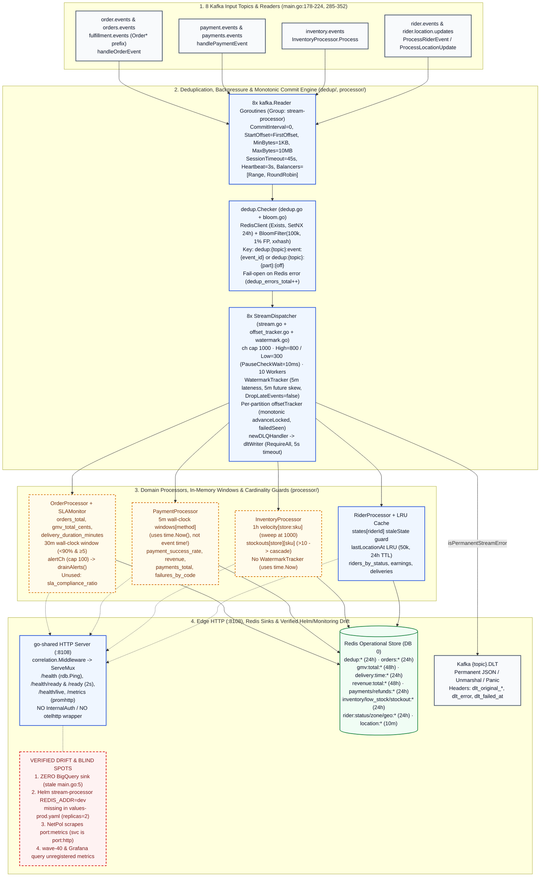
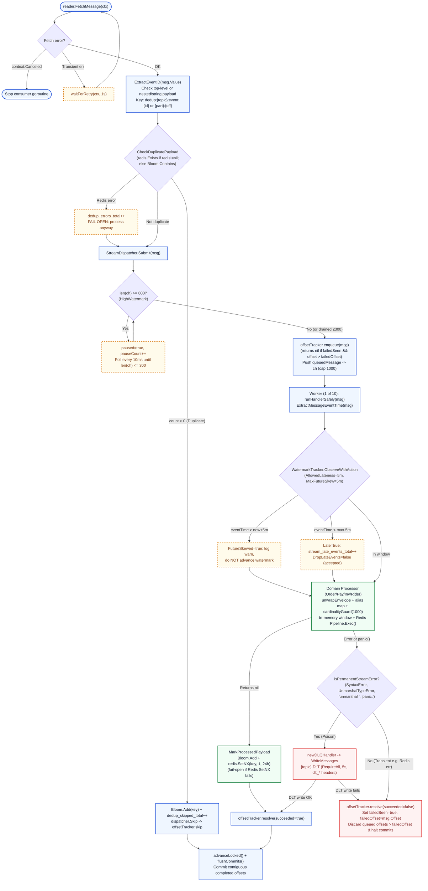
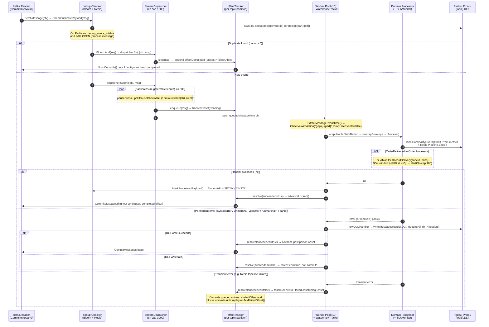

# Stream Processor Service (`stream-processor-service`)

> [!NOTE]
> **Part of the InstaCommerce Onboarding Suite:** [Onboarding Hub](../../README.md) · [Code Walkthrough Atlas](../README.md) · [Domain & Event Catalog (`05`)](../../05-domain-model-and-event-catalog.md) · [Incident Drills & Exam (`06`)](../../06-incident-drills-and-readiness-exam.md) · [Dependency Matrix & Cheatsheet (`07`)](../../07-service-dependency-and-command-cheatsheet.md)

> **Onboarding Scope & Repo-Truth Posture:** Every claim, line anchor, Redis key, Prometheus metric, and gap below is verified directly from source in [`services/stream-processor-service/`](../../../../services/stream-processor-service), [`deploy/helm/values.yaml`](../../../../deploy/helm/values.yaml#L1237-L1251), [`deploy/helm/values-prod.yaml`](../../../../deploy/helm/values-prod.yaml#L154-L162), [`prometheus/rules/wave-40-complete-slo-alerts.yml`](../../../../prometheus/rules/wave-40-complete-slo-alerts.yml#L438-L451), and [`monitoring/grafana/dashboards/data-pipeline-health.json`](../../../../monitoring/grafana/dashboards/data-pipeline-health.json#L293-L302). Despite the stale comment in [`main.go`](../../../../services/stream-processor-service/main.go#L5), **this service has zero BigQuery dependency or sink**—it writes exclusively to Redis and Prometheus `/metrics` (plus `{topic}.DLT` on permanent poison messages).

---

## 1. Service Identity Card

| Dimension | Verified Value | Source |
|---|---|---|
| **Module / Stack** | `github.com/instacommerce/stream-processor-service` · Go `1.25.0` (`toolchain go1.25.1`), `segmentio/kafka-go` `v0.4.50`, `redis/go-redis/v9` `v9.18.0`, `cespare/xxhash/v2` `v2.3.0` | [`go.mod`](../../../../services/stream-processor-service/go.mod#L1-L15) |
| **HTTP Port & Container** | `:8108` (`PORT` → `SERVER_PORT` → `HTTP_PORT` → `"8108"`); static `CGO_ENABLED=0` Alpine `3.23` binary running as non-root `app` (`UID 1001`) | [`main.go`](../../../../services/stream-processor-service/main.go#L46-L60), [`Dockerfile`](../../../../services/stream-processor-service/Dockerfile#L7-L18) |
| **Storage / Outputs** | Redis (`DB 0`) TTL-bounded operational counters, hashes, lists, geo sets, and dedup keys + Prometheus `/metrics` (**zero PostgreSQL, zero BigQuery**) | [`main.go`](../../../../services/stream-processor-service/main.go#L107-L124) |
| **Kafka Topics** | Consumes **8 topics** (`order.events`, `orders.events`, `fulfillment.events`, `rider.events`, `rider.location.updates`, `payment.events`, `payments.events`, `inventory.events`) in group `stream-processor`; routes poison pills to `{topic}.DLT` | [`main.go`](../../../../services/stream-processor-service/main.go#L178-L224), [`main.go`](../../../../services/stream-processor-service/main.go#L365-L404) |
| **Helm Release Key** | Shortened key **`stream-processor`** (`replicas: 1` base, `2` in staging/prod; `500m`/`512Mi` base, `250m..1000m`/`256Mi..512Mi` prod) | [`values.yaml`](../../../../deploy/helm/values.yaml#L1237-L1251), [`ci.yml`](../../../../.github/workflows/ci.yml#L850) |
| **SLO Tier Status** | **Unlisted** in [`monitoring/error-budget-policy.yaml`](../../../../monitoring/error-budget-policy.yaml#L4-L45); targeted by drifted Spring/Grafana rules | [`wave-40-complete-slo-alerts.yml`](../../../../prometheus/rules/wave-40-complete-slo-alerts.yml#L438-L451) |
| **First-Principles Role** | Computes sub-second operational aggregates (order throughput/GMV, zone 10-min delivery SLA compliance, payment 5-min success rates, 1-hr SKU velocity/stockout cascades, rider status/geo indices) using bounded-channel backpressure (`800`/`300`), fail-open Bloom+Redis deduplication, and contiguous monotonic partition offset commits. | [`processor/stream.go`](../../../../services/stream-processor-service/processor/stream.go#L29-L110), [`processor/offset_tracker.go`](../../../../services/stream-processor-service/processor/offset_tracker.go#L61-L299) |

---

## 2. Package & File Layout

```text
services/stream-processor-service/
├── main.go                                # Config, OTel/HTTP/health wiring, 8 Kafka readers, DLT & dedup wrappers (455 lines)
├── Dockerfile                             # Multi-stage golang:1.25-alpine -> alpine:3.23 non-root UID 1001, EXPOSE 8108 (18 lines)
├── go.mod                                 # Go 1.25.0 + local replace ../go-shared (57 lines)
├── README.md                              # Stale service docs (720 lines; see Section 9 for drift)
├── dedup/
│   ├── bloom.go                           # Concurrent-safe bitset BloomFilter using xxhash.Sum64 double hashing (112 lines)
│   └── dedup.go                           # Checker (Exists + SetNX 24h fail-open), ExtractEventID nested unwrapper (270 lines)
└── processor/
    ├── stream.go                          # StreamDispatcher: bounded ch (1000), 800/300 pause/resume, 10 workers, panic recover (336 lines)
    ├── offset_tracker.go                  # Per-(topic, partition) FIFO queue, contiguous monotonic commits, failedSeen hold (299 lines)
    ├── watermark.go                       # WatermarkTracker (5m lateness, 5m future skew), ExtractMessageEventTime (268 lines)
    ├── envelope.go                        # labelCardinalityGuard (cap 1000), unwrapEnvelope, type/time coercion, evictExpired (247 lines)
    ├── order_processor.go                 # OrderProcessor + OrderMetrics + GMV + delivery duration + Redis pipeline (272 lines)
    ├── sla_monitor.go                     # SLAMonitor: 30m sliding window (<90% & >=5 orders -> alertCh cap 100) (195 lines)
    ├── payment_processor.go               # PaymentProcessor + 5m wall-clock method success rate window (276 lines)
    ├── inventory_processor.go             # InventoryProcessor + 1h SKU velocity window + >10 stockout cascade detector (304 lines)
    ├── rider_processor.go                 # RiderProcessor: status transitions, earnings, rider:location + riders:geo (339 lines)
    └── rider_location_cache.go            # Bounded 50,000-entry / 24h TTL LRU guarding out-of-order GPS pings (72 lines)
```

Test suites spanning all 3 Go packages (`root`, `dedup`, `processor`):
- [`main_test.go`](../../../../services/stream-processor-service/main_test.go#L58-L145) (1 test: `TestFailedAndPanickedOffsetsReprocessedOnReplayAfterRestart`)
- [`hardening_test.go`](../../../../services/stream-processor-service/hardening_test.go#L37-L125) (3 tests: port precedence, retry cancellation, DLT routing vs transient offset hold)
- [`stream_processor_test.go`](../../../../services/stream-processor-service/stream_processor_test.go#L50-L313) (15 tests: dedup partition/topic scoping, error metrics, envelope unwrapping)
- [`dedup/dedup_test.go`](../../../../services/stream-processor-service/dedup/dedup_test.go#L67-L290) (12 tests: `CheckDuplicate`, `IsDuplicate`, fail-open, concurrent Bloom/Redis)
- [`processor/stream_test.go`](../../../../services/stream-processor-service/processor/stream_test.go#L17-L324) (5 tests: 80%/30% backpressure, panic recovery, monotonic commit, failed hold, `Skip` ordering)
- [`processor/watermark_test.go`](../../../../services/stream-processor-service/processor/watermark_test.go#L1-L334) (8 tests: watermark progression, late events, future skew rejection)
- [`processor/processor_test.go`](../../../../services/stream-processor-service/processor/processor_test.go#L15-L366) (12 tests: JSON round-trips, SLA alerts, velocity/cascade, payment rate, rider transitions, `evictExpired`)
- [`processor/processor_cardinality_test.go`](../../../../services/stream-processor-service/processor/processor_cardinality_test.go#L195-L349) (1 test: verifies raw IDs in Redis keys while Prometheus labels stay bounded at 1000)

---

## 3. Architecture LLD & Startup / Middleware Chain

**Stream Processor Architecture LLD** — *[Rendered PNG](../diagrams/services/stream-processor-service-arch-lld.png) · [Mermaid Source](../diagrams/services/stream-processor-service-arch-lld.mmd)*



### Startup Sequence ([`main.go`](../../../../services/stream-processor-service/main.go#L100-L273))

1. **Logger & Config (`L101-L105`):** Configures `slog.NewJSONHandler(os.Stdout, LevelInfo)` as default logger and reads env vars via `loadConfig` (`L41-L49`).
2. **Redis Client & Two-Phase Deduper (`L107-L115`):** Initializes `go-redis/v9` client (`DB: 0`, no ping fail-fast at boot) and attaches `dedup.NewBloomFilter(100000, 0.01)` to `dedup.NewChecker(rdb, logger)`.
3. **Domain Processors & SLA Monitor (`L116-L124`):** Instantiates `OrderMetrics`, `SLAMonitor(0.90, logger)` (spawning `drainAlerts` goroutine at [`sla_monitor.go`](../../../../services/stream-processor-service/processor/sla_monitor.go#L91)), and the four domain processors (`OrderProcessor`, `RiderProcessor`, `PaymentProcessor`, `InventoryProcessor`).
4. **OTel Initialization (`L128-L145`):** Calls [`observability.InitOTel`](../../../../services/go-shared/pkg/observability/otel.go#L58-L108) with `OTelProtocolGRPC`, `ResolveEnv: true`, `NoopIfNoEndpoint: true`, `FallbackNoop: true`. *(Note: global `TracerProvider` is registered, but neither HTTP handlers nor Kafka consumers extract/start spans—see Section 9).*
5. **DLT Producer & 8 Kafka Consumer Loops (`L149-L224`):** Parses comma-separated `KAFKA_BROKERS`, constructs a shared `&kafka.Writer{Balancer: &kafka.LeastBytes{}, RequiredAcks: kafka.RequireAll}` for DLT writes (`L156-L168`), and launches 8 `startConsumerWithDLQ` loops (`L285-L352`). Each topic loop spawns its own `StreamDispatcher` (`10` worker goroutines) plus `1` `FetchMessage` goroutine.
   - `order.events` and `orders.events` share `handleOrderEvent` (`L170-L179`).
   - `fulfillment.events` unmarshals into `OrderEvent` and processes **only** events where `strings.HasPrefix(event.EventType, "Order")` (`L180-L189`).
   - `payment.events` and `payments.events` share `handlePaymentEvent` (`L207-L216`).
   - `rider.events`, `rider.location.updates`, and `inventory.events` invoke `ProcessRiderEvent`, `ProcessLocationUpdate`, and `InventoryProcessor.Process` respectively (`L191-L224`).
6. **HTTP Server & `go-shared` Middleware Stack (`L70-L98`, `L226-L254`):**
   - Registers [`health.Handler`](../../../../services/go-shared/pkg/health/handler.go#L46-L112) with a `"redis"` ping check, calls `hHandler.SetReady(true)`, and mounts custom `/health/ready` and `/ready` handlers (`L78-L95`) that verify `rdb.Ping(checkCtx)` within a `2s` timeout before delegating to `hHandler.ReadyHandler()`.
   - Mounts `promhttp.Handler()` on `/metrics` (`L96`).
   - Wraps `mux` **only** in [`correlation.Middleware`](../../../../services/go-shared/pkg/correlation/middleware.go#L17-L27) (`L240`) with `ReadHeaderTimeout: 5s`, `ReadTimeout: 10s`, `WriteTimeout: 10s`, `IdleTimeout: 60s`. Unlike `location-ingestion-service`, there is **no** `auth.InternalAuthMiddleware` and **no** `otelhttp.NewHandler` (because there are zero business API routes; Istio `allowFrom` covers `admin-gateway-service`, `location-ingestion`, `routing-eta-service`, and `rider-fleet-service` per [`values.yaml`](../../../../deploy/helm/values.yaml#L469-L474)).
7. **Graceful Shutdown (`L256-L273`):** On `SIGINT`/`SIGTERM`, sets `hHandler.SetReady(false)`, cancels root `ctx` (stopping `FetchMessage` loops), runs `srv.Shutdown` with a `15s` timeout, calls `wg.Wait()` (wait for all 8 consumers + HTTP server; each `defer dispatcher.Stop()` closes `sd.ch` and drains buffered items using a `5s` fallback context at [`stream.go`](../../../../services/stream-processor-service/processor/stream.go#L133-L135)), then closes `dltWriter`, `slaMonitor.Close()`, `otelProviders`, and `rdb`.

---

## 4. Redis Keys, Kafka Envelopes & Dead-Letter Contracts

### Kafka Input & DLT Contract ([`main.go`](../../../../services/stream-processor-service/main.go#L285-L417), [`processor/envelope.go`](../../../../services/stream-processor-service/processor/envelope.go#L53-L233))

- **Reader Configuration (`L286-L302`):** `MinBytes: 1e3` (`1 KB`), `MaxBytes: 10e6` (`10 MB`), `CommitInterval: 0` (manual commits only via `offsetTracker`), `StartOffset: kafka.FirstOffset`, `SessionTimeout: 45s`, `HeartbeatInterval: 3s`, `RebalanceTimeout: 60s`, `JoinGroupBackoff: 3s`, `GroupBalancers: [RangeGroupBalancer, RoundRobinGroupBalancer]`.
- **Dual Envelope & Case Tolerance (`envelope.go:L63-L233`):** `unwrapEnvelope(data)` checks for a nested `"payload"` field (either a JSON object `map[string]any` or a stringified JSON object) and returns `(meta, body, nil)`; flat JSON objects return `(raw, raw, nil)`. Every domain `UnmarshalJSON` builds `sources := []map[string]any{body, meta}` and probes camelCase + snake_case aliases:
  - `OrderEvent` ([`order_processor.go`](../../../../services/stream-processor-service/processor/order_processor.go#L34-L90)): normalizes `ORDER_CREATED` / `ORDERPLACED` / `ORDER_DELIVERED` / `ORDER_CANCELED` etc.; reads `items` array length if `itemCount` absent; falls back `DeliveredAt` to `eventTime`/`timestamp` on `OrderDelivered`.
  - `PaymentEvent` ([`payment_processor.go`](../../../../services/stream-processor-service/processor/payment_processor.go#L29-L72)): maps `PAYMENT_AUTHORIZED`, `PAYMENT_CAPTURED`, `PAYMENT_SUCCESS`, `PAYMENT_FAILED`, `PAYMENT_REFUNDED`, `REFUND_INITIATED`, `REFUND_COMPLETED`.
  - `InventoryEvent` ([`inventory_processor.go`](../../../../services/stream-processor-service/processor/inventory_processor.go#L29-L89)): extracts `skuId` / `storeId` (falling back to `body["items"][0]` for batch reserve/confirm/release events).
  - `RiderEvent` & `LocationUpdate` ([`rider_processor.go`](../../../../services/stream-processor-service/processor/rider_processor.go#L29-L102)): maps `RIDER_ACTIVATED` -> `RiderOnline`, `RIDER_SUSPENDED` -> `RiderOffline`, and extracts `ZoneID` from `zoneId`, `zone_id`, `h3Index`, or `h3_index` (`L88`), supporting both `latitude`/`lat` and `longitude`/`lng`/`lon`.
- **Permanent Error DLT Routing (`main.go:L365-L417`):** `isPermanentStreamError` classifies `*json.SyntaxError`, `*json.UnmarshalTypeError`, or error strings containing `"unmarshal "` or `"panic:"`. `newDLQHandler` clones `msg.Headers`, appends:
  - `dlt_original_topic`, `dlt_original_partition`, `dlt_original_offset`, `dlt_error`, `dlt_failed_at` (RFC3339 UTC)
  - Publishes synchronously (`5s` timeout, `RequiredAcks: kafka.RequireAll`) to `msg.Topic + ".DLT"`.

### Complete Redis Key Inventory

All domain Redis writes execute inside a single `p.redis.Pipeline()` per event (`Exec(ctx)`). **Crucial invariant** verified by [`processor_cardinality_test.go`](../../../../services/stream-processor-service/processor/processor_cardinality_test.go#L195-L349): Redis keys always preserve **raw** `storeId` / `zoneId` / `skuId` / `riderId` / `method`, whereas Prometheus label values pass through `labelCardinalityGuard`.

| Domain | Redis Key Pattern | Command / Value | TTL | Source |
|---|---|---|---|---|
| **Deduplication** | `dedup:{topic}:event:{event_id}` (or `dedup:{topic}:{partition}:{offset}`) | `EXISTS` (check), `SETNX` `"1"` (mark) | `24h` | [`dedup/dedup.go`](../../../../services/stream-processor-service/dedup/dedup.go#L25-L214) |
| **Order Volume** | `orders:count:{YYYY-MM-DDTHH:MM}`, `orders:store:{storeId}:{min}`, `orders:zone:{zoneId}:{min}`, `orders:stage:{lower(type)}:{min}`, `orders:cancelled:{zoneId}:{min}` | `INCR` | `24h` | [`order_processor.go`](../../../../services/stream-processor-service/processor/order_processor.go#L204-L259) |
| **GMV & Delivery** | `gmv:total:{YYYY-MM-DD}` / `delivery:time:{zoneId}:{min}` | `INCRBY` (`totalCents`) / `LPUSH` (`deliveryMinutes`) | `48h` / `24h` | [`order_processor.go`](../../../../services/stream-processor-service/processor/order_processor.go#L225-L249) |
| **Payments & Rev** | `revenue:total:{YYYY-MM-DD}`, `payments:{authorized,success,failed}:{method}:{min}`, `refunds:{initiated,completed}:{min}` | `INCRBY` / `INCR` | `48h` / `24h` | [`payment_processor.go`](../../../../services/stream-processor-service/processor/payment_processor.go#L186-L230) |
| **Inventory** | `inventory:{storeId}:{skuId}`, `low_stock:{storeId}:{skuId}`, `stockout:{storeId}:{skuId}` | `SET` (`quantity` or `unix`) / `DEL` on replenish/release | `24h` | [`inventory_processor.go`](../../../../services/stream-processor-service/processor/inventory_processor.go#L197-L231) |
| **Rider Status** | `rider:status:{riderId}` (`HSET` `{status, zone_id, updated}`), `riders:zone:{zoneId}:{status}`, `rider:earnings:{riderId}:{date}` | `HSET` / `INCR` / `INCRBY` | `24h` / `24h` / `48h` | [`rider_processor.go`](../../../../services/stream-processor-service/processor/rider_processor.go#L265-L282) |
| **Rider Geo** | `rider:location:{riderId}` (`HSET` `{lat, lng, zone_id, speed, timestamp}`), `riders:geo:{zoneId}` | `HSET` / `GEOADD` | `10m` / `24h` | [`rider_processor.go`](../../../../services/stream-processor-service/processor/rider_processor.go#L314-L331) |

---

## 5. Deduplication, Watermark Backpressure & Processor Logic

**Stream Processor Flowchart** — *[Rendered PNG](../diagrams/services/stream-processor-service-flowchart.png) · [Mermaid Source](../diagrams/services/stream-processor-service-flowchart.mmd)*



### Function-by-Function Walkthrough

1. **Two-Phase Fail-Open Deduplication ([`dedup/bloom.go`](../../../../services/stream-processor-service/dedup/bloom.go#L21-L92), [`dedup/dedup.go`](../../../../services/stream-processor-service/dedup/dedup.go#L89-L214), [`main.go`](../../../../services/stream-processor-service/main.go#L419-L455)):**
   - `NewBloomFilter(100000, 0.01)` allocates `numWords = 14977` (`958,528` bits) with `k = 7` hash probes derived from `xxhash.Sum64(data)` and salted `xxhash.Sum64(0x5A, 0xC3, data...)`.
   - `ExtractEventID(payload)` inspects `"event_id"`, `"eventId"`, `"id"` at top-level, nested `payload` object, or stringified `payload` JSON, building `dedup:{topic}:event:{id}` (or falling back to `dedup:{topic}:{partition}:{offset}`).
   - **Critical subtlety in `checkDuplicateKey` ([`dedup.go`](../../../../services/stream-processor-service/dedup/dedup.go#L154-L182)):** When `c.redis != nil`, `checkDuplicateKey` queries `c.redis.Exists(ctx, key)` directly—it does **not** short-circuit on `c.bloom.Contains(key)`, preventing the 1% Bloom false-positive rate from ever dropping valid events (Bloom acts as standalone fallback only when `c.redis == nil`, and is warmed on Redis hits via `c.bloom.Add(key)`).
   - On Redis error, `dedup_errors_total` increments and processing **fails open** (`return false, err`). When a duplicate is confirmed (`count > 0`), `dedup_skipped_total{topic}` increments and `dispatcher.Skip(ctx, msg)` queues the offset as `offsetCompleted` so duplicates still advance Kafka offsets monotonically.
   - `MarkProcessedPayload` (`Bloom.Add` + `redis.SetNX(..., 24h)`) executes inside `wrapHandlerWithDedup` **only after** `handler(ctx, msg)` returns `nil`, guaranteeing failed or panicked messages remain replayable.
2. **800 / 300 Backpressure Gate ([`processor/stream.go`](../../../../services/stream-processor-service/processor/stream.go#L241-L306)):**
   - `StreamDispatcher.Submit` uses `BufferSize = 1000`, `HighWatermark = 800`, `LowWatermark = 300`, `PauseCheckWait = 10ms`.
   - When `len(sd.ch) >= 800`, `sd.paused.Swap(true)` fires once (`pauseCount++`, warning log) and the consumer goroutine sleeps in `10ms` ticker steps until worker goroutines drain `len(sd.ch) <= 300`, flipping `paused = false` (`resumeCount++`).
3. **Event-Time Watermarks & Late-Event Semantics ([`processor/watermark.go`](../../../../services/stream-processor-service/processor/watermark.go#L84-L268), [`processor/stream.go`](../../../../services/stream-processor-service/processor/stream.go#L169-L194)):**
   - Each worker extracts `evTime` via `ExtractMessageEventTime` (probing `eventTime`, `timestamp`, `timestamp_ms`, `occurredAt`, `deliveredAt`, `placedAt`, `createdAt`, then `msg.Time`) and calls `ObserveWithAction("{topic}:{partition}", evTime, DropLateEvents=false)`.
   - Events with `eventTime > now + 5m` (`MaxFutureSkew`) are flagged `FutureSkewed = true` and do **not** advance `maxEventTime`.
   - Events with `eventTime < maxEventTime - 5m` (`AllowedLateness`) increment `stream_late_events_total{stream, action="accepted"}` and log a warning without being dropped (`DropLateEvents=false`).
   - Three domain processors (`OrderProcessor`, `PaymentProcessor`, `RiderProcessor`) also instantiate stream-level `WatermarkTracker` instances (`"order.events"`, `"payment.events"`, `"rider.events"`, `"rider.location.updates"`).
4. **Domain Aggregations & Cardinality Guards ([`processor/envelope.go`](../../../../services/stream-processor-service/processor/envelope.go#L11-L51)):**
   - `labelCardinalityGuard` truncates label values `> 64` chars and caps unique values (`1000` for store/zone/SKU/rider/stream, `128` for failure codes, `64` for event/method), mapping overflow values to `"other"`.
   - **`OrderProcessor` + `SLAMonitor` ([`order_processor.go`](../../../../services/stream-processor-service/processor/order_processor.go#L175-L272), [`sla_monitor.go`](../../../../services/stream-processor-service/processor/sla_monitor.go#L78-L195)):** On `OrderDelivered` (`deliveryMinutes >= 0`), observes `delivery_duration_minutes`, writes `delivery:time:{zoneId}:{min}`, and calls `SLAMonitor.RecordDelivery(zoneID, deliveryMinutes)` (`slaTargetMinutes = 10.0`, `windowDuration = 30m`, `threshold = 0.90`). When `SLAPercent < 0.90 && TotalOrders >= 5`, sends `SLAAlert` to `alertCh` (`cap 100`, non-blocking drop with warn log) drained asynchronously by `drainAlerts()`.
   - **`PaymentProcessor` ([`payment_processor.go`](../../../../services/stream-processor-service/processor/payment_processor.go#L157-L276)):** On `PaymentSuccess`/`PaymentCaptured`/`PaymentFailed`, maintains a `5m` sliding window `windows[method]` and recomputes `payment_success_rate{method}`.
   - **`InventoryProcessor` ([`inventory_processor.go`](../../../../services/stream-processor-service/processor/inventory_processor.go#L164-L304)):** Infers negative delta for `StockReserved`/`StockConfirmed` when `PrevQty == 0 && Quantity > 0`, maintains `1h` `velocity[store:sku]` (evicting expired buckets when `len(velocity) >= 1000`), and tracks zero-stock SKUs in `stockouts[store]`; when `len(stockouts[store]) > 10`, increments `inventory_cascade_alerts_total{store_id}` and logs a cascade warning.
   - **`RiderProcessor` + LRU ([`rider_processor.go`](../../../../services/stream-processor-service/processor/rider_processor.go#L200-L339), [`rider_location_cache.go`](../../../../services/stream-processor-service/processor/rider_location_cache.go#L8-L72)):** Rejects out-of-order rider status transitions (`event.Timestamp.Before(prev.UpdatedAt)` -> `staleState = true`), decrements the previous `riders_by_status` gauge before incrementing the new state, and guards `ProcessLocationUpdate` via `recordLocationTimestampLocked` (`50,000` capacity / `24h` TTL LRU).

---

## 6. Concurrency, Panic Recovery & Monotonic Offset Commit Sequence

**Stream Processor Sequence** — *[Rendered PNG](../diagrams/services/stream-processor-service-sequence.png) · [Mermaid Source](../diagrams/services/stream-processor-service-sequence.mmd)*



### Offset Ordering & Poison-Pill Trace ([`processor/stream.go`](../../../../services/stream-processor-service/processor/stream.go#L128-L238), [`processor/offset_tracker.go`](../../../../services/stream-processor-service/processor/offset_tracker.go#L49-L299))

1. **Per-Partition FIFO Queue (`offsetTracker.enqueue` at `L61-L75`):** Because 10 worker goroutines execute a partition's buffered messages concurrently out of order, `Submit` calls `tracker.enqueue(msg)` before pushing into `sd.ch`, appending `&trackedOffset{msg, status: offsetPending}` to `partitionTracker.queue`. If `pt.failedSeen` is already true:
   - An arriving `msg.Offset <= pt.failedOffset` (indicating consumer restart / partition rebalance replay) calls `pt.resetFailedLocked()` (`L66-L67`, `L77-L87`), discarding stale queued entries and resuming tracking.
   - An arriving `msg.Offset > pt.failedOffset` returns `nil` (`L68-L70`) so later offsets are never committed past the failed offset.
2. **Contiguous Prefix Commit (`resolve` + `advanceLocked` at `L110-L148`, `L229-L252`):**
   - When worker `i` finishes, `processWithRecovery` calls `tracker.resolve(ctx, msg, entry, succeeded, sd.commit)`.
   - On `succeeded == true`, `entry.status` flips to `offsetCompleted`. `advanceLocked()` walks from `pt.queue[0]`, popping every contiguous `offsetCompleted` item and storing only the highest contiguous message in `pt.readyToCommit`.
   - `flushCommits()` serializes `reader.CommitMessages(ctx, msg)` using `pt.committing` (restoring `readyToCommit` via `restoreReadyCommit` if `commitFn` fails). If offset `10` is still pending while `11` and `12` finish, `pt.queue[0]` remains `offsetPending` and **neither `11` nor `12` commits** until `10` resolves.
3. **Permanent DLT vs Transient Rollback (`runHandlerSafely` at `stream.go:L148-L212`, `resolve` at `offset_tracker.go:L125-L140`):**
   - On a recovered worker `panic` (`defer recover()`) or handler `error`, `runHandlerSafely` passes the error to `newDLQHandler`. If `isPermanentStreamError` matches and `dltWriter.WriteMessages` to `{topic}.DLT` succeeds, `runHandlerSafely` returns `succeeded = true`, allowing `offsetTracker` to advance past the poison pill.
   - On transient failures (e.g., Redis `Pipeline.Exec` error or failed DLT write), `runHandlerSafely` returns `succeeded = false`. `resolve` sets `entry.status = offsetFailed`, `pt.failedSeen = true`, `pt.failedOffset = msg.Offset`, marks all queued items at indices `> i` as `discarded = true`, truncates `pt.queue[:i+1]`, and commits only already-completed offsets strictly `< failedOffset`. Higher offsets stay blocked until consumer replay or `AckFailedOffset(ctx, msg)` (`L150-L181`).

---

## 7. Configuration, Helm Deployments, Observability & Testing

### Environment Variables & Helm Matrix

| Env Var | Code Default | Base Helm ([`values.yaml`](../../../../deploy/helm/values.yaml#L1237-L1251)) | Staging / Prod Helm | Source / Notes |
|---|---|---|---|---|
| `PORT` / `SERVER_PORT` / `HTTP_PORT` | `"8108"` | `HTTP_PORT: "8108"`, `SERVER_PORT: "8108"` | *(inherited)* | Checked in order `PORT` → `SERVER_PORT` → `HTTP_PORT` ([`main.go`](../../../../services/stream-processor-service/main.go#L46)) |
| `KAFKA_BROKERS` | `"localhost:9092"` | `"kafka.default.svc.cluster.local:9092"` | *(inherited)* | Comma-separated broker list ([`main.go`](../../../../services/stream-processor-service/main.go#L43)) |
| `REDIS_ADDR` | `"localhost:6379"` | `"instacommerce-redis-dev.redis.cache.goog:6379"` | **Unset in `values-prod.yaml` & `values-staging.yaml`!** | Prod points to dev Redis unless overridden externally ([`values-prod.yaml`](../../../../deploy/helm/values-prod.yaml#L154-L162)) |
| `REDIS_PASSWORD` | `""` | *(unset)* | *(unset)* | [`main.go`](../../../../services/stream-processor-service/main.go#L45) |
| `CONSUMER_GROUP_ID` | `"stream-processor"` | *(unset)* | *(unset)* | Shared across all 8 `kafka.Reader` loops ([`main.go`](../../../../services/stream-processor-service/main.go#L47)) |
| `HEALTH_PORT` / `LOG_LEVEL` | *(unused)* | `HEALTH_PORT: "8108"` | `LOG_LEVEL: info` (staging) | Neither variable is read in `main.go` ([`values-staging.yaml`](../../../../deploy/helm/values-staging.yaml#L422-L429)) |

### Registered Prometheus Metrics (`/metrics`)

- **Dedup (`dedup/dedup.go:L32-L44`):** `dedup_skipped_total{topic}`, `dedup_errors_total`
- **Watermarks (`processor/watermark.go:L39-L58`):** `stream_late_events_total{stream,action}`, `stream_out_of_order_events_total{stream}`, `stream_watermark_lag_seconds{stream}`, `stream_watermark_timestamp_seconds{stream}`
- **Orders & SLA (`order_processor.go:L101-L134`, `sla_monitor.go:L59-L76`):** `orders_total{event_type,store_id,zone_id}`, `gmv_total_cents`, `delivery_duration_minutes{zone_id,store_id}`, `sla_compliance_ratio{zone_id}` *(unused)*, `order_cancellations_total{store_id,zone_id}`, `order_processing_errors_total`, `sla_window_percent{zone_id}`, `sla_alerts_total{zone_id}`, `sla_window_orders{zone_id}`
- **Payments (`payment_processor.go:L88-L120`):** `payments_total{event_type,method}`, `payment_revenue_total_cents`, `refunds_total{event_type}`, `payment_success_rate{method}`, `payment_failures_by_code{failure_code,method}`, `payment_processing_errors_total`
- **Inventory (`inventory_processor.go:L104-L131`):** `inventory_stock_updates_total{event_type,store_id}`, `inventory_stockouts_total{store_id}`, `inventory_cascade_alerts_total{store_id}`, `inventory_velocity_per_hour{sku_id,store_id}`, `inventory_processing_errors_total`
- **Riders (`rider_processor.go:L119-L146`):** `riders_by_status{status,zone_id}`, `rider_deliveries_total{rider_id,zone_id}`, `rider_earnings_total_cents{rider_id,zone_id}`, `rider_location_updates_total`, `rider_processing_errors_total`

### Narrow Test & Verification Commands

```bash
# Verified passing with race detector (uncached run: root 3.709s, dedup 4.233s, processor 44.821s)
cd services/stream-processor-service && go test -count=1 -race ./...

# Single package or targeted test
cd services/stream-processor-service && go test -race ./processor -run '^TestStreamDispatcherMonotonicOffsetCommitWhenEarlierStalls$'
```

---

## 8. Verified Seams, Bugs & Doc-vs-Code Drift

1. **Zero BigQuery Sink vs `main.go:5` & `GLOSSARY.md` Drift:** [`main.go`](../../../../services/stream-processor-service/main.go#L5) advertises `+ optional BigQuery sink`, and [`GLOSSARY.md`](../../../../GLOSSARY.md#L86) lists storage as `Kafka Streams`. There is zero BigQuery client in [`go.mod`](../../../../services/stream-processor-service/go.mod#L7-L14) or any `.go` file; analytical BigQuery ingestion runs through `cdc-consumer-service` and Beam pipelines. Similarly, [`README.md`](../../../../services/stream-processor-service/README.md#L5-L603) is heavily stale (claims "seven" topics, `CommitInterval: 1s`, `StartOffset: LastOffset`, "No DLQ", "2h" TTLs, `stream-processor-service` Helm key, and "no test files"—all false against current Go source).
2. **Prod Helm Points `REDIS_ADDR` to Dev Redis:** [`deploy/helm/values.yaml`](../../../../deploy/helm/values.yaml#L1250) sets `REDIS_ADDR: "instacommerce-redis-dev.redis.cache.goog:6379"`, and neither [`values-prod.yaml`](../../../../deploy/helm/values-prod.yaml#L154-L162) nor [`values-staging.yaml`](../../../../deploy/helm/values-staging.yaml#L422-L429) defines an `REDIS_ADDR` override (unlike `rider-fleet-service` and `config-feature-flag-service`).
3. **Wall-Clock Sliding Windows in `PaymentProcessor`, `SLAMonitor`, and `InventoryProcessor`:** [`PaymentProcessor.recordWindowEntry`](../../../../services/stream-processor-service/processor/payment_processor.go#L258-L263), [`SLAMonitor.RecordDelivery`](../../../../services/stream-processor-service/processor/sla_monitor.go#L116-L131), and [`InventoryProcessor.Process`](../../../../services/stream-processor-service/processor/inventory_processor.go#L178) stamp and evict sliding windows using `time.Now()` instead of event timestamps (`InventoryProcessor` lacks a `WatermarkTracker` entirely). Replaying historical backlog or recovery bursts corrupts the 5-minute payment rate, 30-minute SLA gauge, and 1-hour velocity window.
4. **Blind Prometheus Alerts, Unused Gauge & `NetworkPolicy` Port Mismatch:**
   - [`wave-40-complete-slo-alerts.yml`](../../../../prometheus/rules/wave-40-complete-slo-alerts.yml#L438-L451) queries Spring's `http_server_requests_seconds_count{service="stream-processor-service"}` (never emitted by Go).
   - [`data-pipeline-health.json`](../../../../monitoring/grafana/dashboards/data-pipeline-health.json#L295) queries `stream_processor_events_processed_total` (never registered).
   - `OrderMetrics.SLACompliance` (`sla_compliance_ratio` at [`order_processor.go`](../../../../services/stream-processor-service/processor/order_processor.go#L119-L122)) is registered and exposed on `/metrics` at `0` forever while `SLAMonitor` sets `sla_window_percent`.
   - [`network-policy.yaml`](../../../../deploy/helm/templates/network-policy.yaml#L53) allows Prometheus scraping only to `port: metrics`, whereas [`service.yaml`](../../../../deploy/helm/templates/service.yaml#L14-L16) and [`deployment.yaml`](../../../../deploy/helm/templates/deployment.yaml#L65-L66) name the `:8108` container/service port `http`.
5. **Single-Pod Stateful Windows vs `replicas: 2` & Unwired OTel Spans:** `SLAMonitor`, `PaymentProcessor`, `InventoryProcessor`, `RiderProcessor.states`, `lastLocationAt` LRU, and `BloomFilter` live solely in pod RAM. Base Helm sets `replicas: 1`, but [`values-prod.yaml`](../../../../deploy/helm/values-prod.yaml#L155) and [`values-staging.yaml`](../../../../deploy/helm/values-staging.yaml#L423) scale to `replicas: 2`, partitioning per-zone SLA, payment success rates, and stockout cascade counts across pods. Additionally, `main.go` initializes `observability.InitOTel` (`L128-L134`) without wrapping HTTP in `otelhttp` or extracting Kafka trace headers, so zero spans are emitted.

---

**Previous:** [cdc-consumer-service](./cdc-consumer-service.md) | **Atlas Hub:** [Code Walkthrough Atlas](../README.md) | **Next:** [location-ingestion-service](./location-ingestion-service.md)
