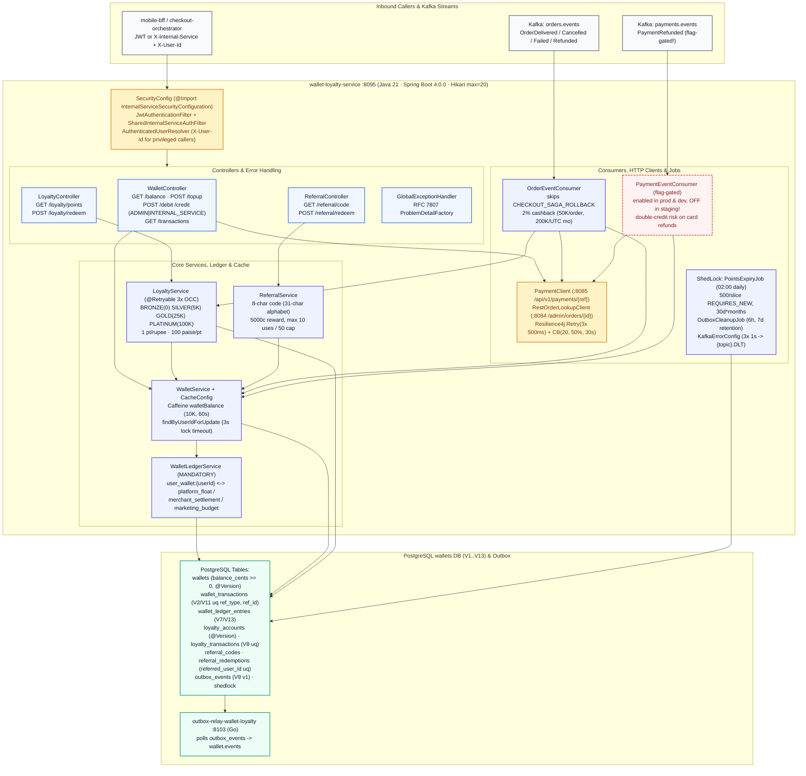
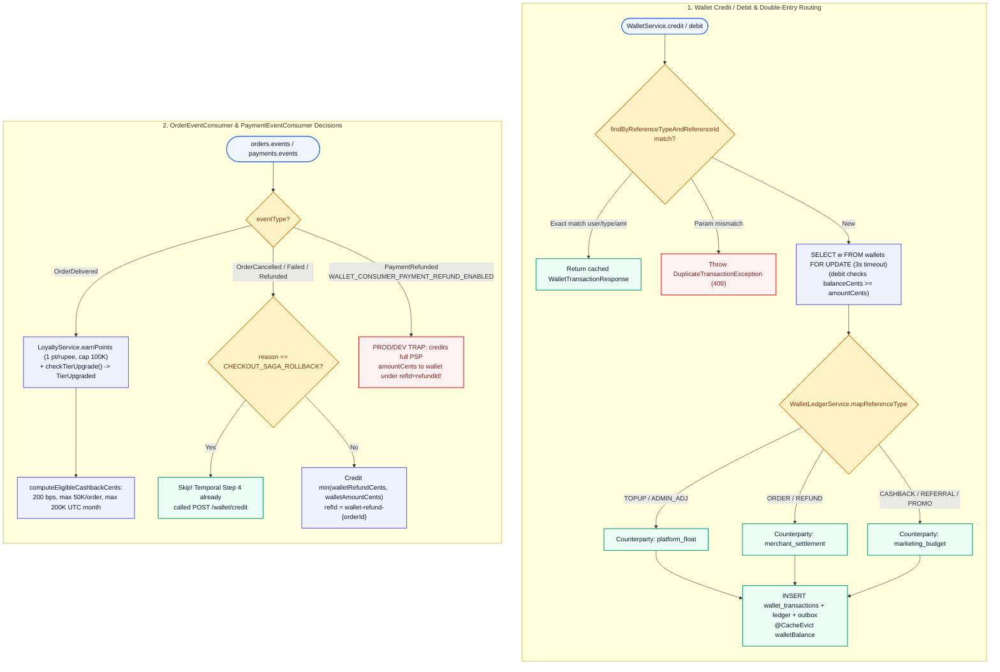
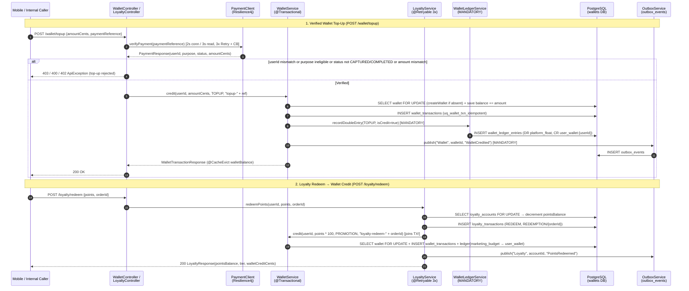

# `wallet-loyalty-service` — Code Walkthrough

> [!NOTE]
> **Part of the InstaCommerce Onboarding Suite:** [Onboarding Hub](../../README.md) · [Code Walkthrough Atlas](../README.md) · [Domain & Event Catalog (`05`)](../../05-domain-model-and-event-catalog.md) · [Incident Drills & Exam (`06`)](../../06-incident-drills-and-readiness-exam.md) · [Dependency Matrix & Cheatsheet (`07`)](../../07-service-dependency-and-command-cheatsheet.md)

> **Stored-Value Wallet Double-Entry Ledger, Loyalty Tiers, Referral Program & Async Cashback Consumers**
>
> | Dimension | Verified Repo Truth |
> |---|---|
> | **Module & Runtime** | Java 21 / Spring Boot 4.0.0 ([build.gradle.kts](../../../../services/wallet-loyalty-service/build.gradle.kts#L1-L45)) · Spring Retry, Caffeine (`walletBalance`), Resilience4j, ShedLock · Dependencies: `:libs:platform-common`, `:contracts` |
> | **HTTP Port** | `8095` (`${SERVER_PORT:8095}` in [application.yml](../../../../services/wallet-loyalty-service/src/main/resources/application.yml#L1-L4)) |
> | **Primary Storage** | PostgreSQL `wallets`, Flyway `V1`–`V13` (`ddl-auto: validate`, `open-in-view: false`, Hikari `max=20`) — **zero Redis, local Caffeine only (`10,000` entries, `60s` TTL)** |
> | **Kafka Topics** | **Produces** (via Go `outbox-relay-wallet-loyalty` `:8103`): `wallet.events` (`WalletCredited`, `WalletDebited`, `PointsEarned`, `PointsRedeemed`, `PointsExpired`, `TierUpgraded`)<br>**Consumes:** `orders.events` (`OrderDelivered`, `OrderCancelled`, `OrderFailed`, `OrderRefunded`, group `wallet-loyalty-orders`) · `payments.events` (`PaymentRefunded`, group `wallet-loyalty-payments`, **flag-gated**!) · **DLT:** `{topic}.DLT` |
> | **Helm Keys** | `wallet-loyalty-service` ([values.yaml](../../../../deploy/helm/values.yaml#L1346)) · Relay: `outbox-relay-wallet-loyalty` ([values.yaml](../../../../deploy/helm/values.yaml#L1103)) · **Prod trap:** `WALLET_CONSUMER_PAYMENT_REFUND_ENABLED: "true"` in `values-prod.yaml` & `values-dev.yaml`! |
> | **SLO Tier** | **Tier 2** (`99.0%` availability, `2000 ms` p99, `432 min/30d` budget) per [error-budget-policy.yaml](../../../../monitoring/error-budget-policy.yaml#L29-L44) |

---

## 1. Service Boundaries & Package Tree

`wallet-loyalty-service` owns customer stored-value balances (`wallets`), idempotent transaction history (`wallet_transactions`), double-entry accounting (`wallet_ledger_entries`), four-tier loyalty points (`loyalty_accounts`, `loyalty_transactions`), referral codes and redemptions (`referral_codes`, `referral_redemptions`), and transactional outbox events.

At runtime, `mobile-bff-service` (`:8080`) exposes customer wallet/loyalty/referral endpoints (`GET/POST /wallet/**`, `/loyalty/**`, `/referral/**`), `checkout-orchestrator-service` (`:8091`) calls `/wallet/debit` during checkout and `/wallet/credit` during Saga Step 4 rollback, and `wallet-loyalty-service` calls out synchronously over HTTP to `payment-service` (`:8085`) for top-up verification and `order-service` (`:8084`) to look up `userId` when order payloads omit it.

### Package Layout (`com.instacommerce.wallet`)

```text
services/wallet-loyalty-service/src/main/java/com/instacommerce/wallet/
├── WalletLoyaltyServiceApplication.java     # @SpringBootApplication, @EnableConfigurationProperties(WalletProperties)
├── client/
│   ├── PaymentClient.java                   # RestClient -> payment-service :8085/api/v1/payments/{id} (CB + Retry)
│   └── RestOrderLookupClient.java           # RestClient -> order-service :8084/admin/orders/{id} (CB + Retry)
├── config/
│   ├── CacheConfig.java                     # Caffeine walletBalance (10,000 entries, 60s expireAfterWrite)
│   ├── KafkaErrorConfig.java                # CommonErrorHandler: FixedBackOff(1s, 3x) -> {topic}.DLT
│   ├── SecurityConfig.java                  # @Import(InternalServiceSecurityConfiguration) + JwtAuthenticationFilter
│   ├── ShedLockConfig.java                  # JdbcTemplateLockProvider usingDbTime(), PT30M
│   └── WalletProperties.java                # @ConfigurationProperties(prefix = "wallet") loyalty, cashback, referral, topup
├── kafka/
│   ├── OrderEventConsumer.java              # orders.events -> loyalty earn, 2% cashback, order refund credit (rollback skip)
│   └── PaymentEventConsumer.java            # payments.events -> @ConditionalOnProperty(default false; TRUE in prod!)
├── controller/
│   ├── WalletController.java                # /wallet & /api/v1/wallet (balance, topup, debit, credit, transactions)
│   ├── LoyaltyController.java               # /loyalty & /api/v1/loyalty (points, redeem)
│   └── ReferralController.java              # /referral & /api/v1/referral (code, redeem)
├── domain/model/                            # Wallet (@Version), WalletTransaction, WalletLedgerEntry,
│                                            # LoyaltyAccount (@Version), LoyaltyTransaction, ReferralCode, ReferralRedemption
├── exception/
│   └── GlobalExceptionHandler.java          # Extends RFC 7807 ProblemDetailFactory!
├── security/
│   └── AuthenticatedUserResolver.java       # Resolves X-User-Id header ONLY for ADMIN / INTERNAL_SERVICE callers
└── service/
    ├── WalletService.java                   # Idempotent credit/debit + FOR UPDATE (3s timeout) + ledger + outbox
    ├── WalletLedgerService.java             # PROPAGATION_MANDATORY double-entry + verifyBalance() helper
    ├── LoyaltyService.java                  # @Retryable OCC (3x), tier evaluation, redeemPoints -> WalletService.credit
    ├── ReferralService.java                 # 31-char code generator, max 10 uses, max 50 referrers/campaign
    ├── PointsExpiryJob.java                 # Daily 02:00 ShedLock job (500/slice REQUIRES_NEW)
    ├── OutboxService.java                   # Propagation.MANDATORY outbox_events writer
    └── OutboxCleanupJob.java                # 6h ShedLock purge (7d retention)
```

---

## 2. Startup, Configuration & Security Filter Chain

1. **Auth & User Identity Resolution:** [SecurityConfig](../../../../services/wallet-loyalty-service/src/main/java/com/instacommerce/wallet/config/SecurityConfig.java#L1-L70) imports `InternalServiceSecurityConfiguration` (`SharedInternalServiceAuthFilter` from `:libs:platform-common`), puts `JwtAuthenticationFilter` in front of `UsernamePasswordAuthenticationFilter`, and enforces:
   - `POST /wallet/debit`, `POST /wallet/credit` (plus `/api/v1/wallet/**` variants): `hasAnyRole("ADMIN", "INTERNAL_SERVICE")`.
   - Everything else under `/wallet/**`, `/loyalty/**`, `/referral/**`: `authenticated()`.
   - **Privileged Header Delegation:** [AuthenticatedUserResolver](../../../../services/wallet-loyalty-service/src/main/java/com/instacommerce/wallet/security/AuthenticatedUserResolver.java#L1-L57) allows `X-User-Id` header impersonation **only** when the caller holds `ROLE_ADMIN` or `ROLE_INTERNAL_SERVICE` (e.g., `mobile-bff-service` or `checkout-orchestrator-service`); normal JWT users always resolve their own UUID from the JWT subject, blocking horizontal privilege escalation.
2. **Error Format:** Unlike `payment-service`, [GlobalExceptionHandler](../../../../services/wallet-loyalty-service/src/main/java/com/instacommerce/wallet/exception/GlobalExceptionHandler.java#L1-L74) builds standard RFC 7807 `ProblemDetail` payloads (`ProblemDetailFactory` pattern).
3. **Required Internal Secret:** [application.yml](../../../../services/wallet-loyalty-service/src/main/resources/application.yml#L117) binds `internal.service.token: ${INTERNAL_SERVICE_TOKEN}` with **no default value** (overridden only in [application-local.yml](../../../../services/wallet-loyalty-service/src/main/resources/application-local.yml#L1-L35)), so pods fail fast at startup if the secret is missing.

---

## 3. PostgreSQL Schema, Migrations (`V1`–`V13`) & Accounting Tables

All `13` Flyway migrations under [migration/](../../../../services/wallet-loyalty-service/src/main/resources/db/migration/) govern:

| Migration Range | Tables & Critical Database Invariants |
|---|---|
| `V1`–`V2`, `V11` | `wallets` (`user_id` unique, `balance_cents >= 0`, `version` optimistic lock) and `wallet_transactions` (`V2` + `V11` update CHECK constraint for reference types; unique index `uq_wallet_txn_idempotent(reference_type, reference_id)`). |
| `V3`, `V8`, `V10` | `loyalty_accounts` (`user_id` unique, `points_balance`, `lifetime_points`, `tier` ENUM; `V10` adds `version` column) and `loyalty_transactions` (`V8` adds `idx_loyalty_txn_idempotent(reference_type, reference_id)`). |
| `V4` | `referral_codes` (unique 8-char code, `uses_count <= max_uses`) and `referral_redemptions` (unique `referred_user_id` preventing repeat redemptions). |
| `V5`, `V6`, `V9`, `V12` | `outbox_events` (`V9` aligns `EventEnvelope` fields + `schema_version = 'v1'`, `V12` adds retention index) and `shedlock` (`V6`). |
| `V7`, `V13` | `wallet_ledger_entries` double-entry journal (`V13` expands allowed `transaction_type` CHECK constraint to match `WalletTransaction.ReferenceType`). |

### Counterparty Ledger Accounts ([WalletLedgerService](../../../../services/wallet-loyalty-service/src/main/java/com/instacommerce/wallet/service/WalletLedgerService.java#L1-L140))

Every `WalletService.credit` or `debit` invokes `WalletLedgerService.recordDoubleEntry` (`Propagation.MANDATORY`) with an exact mirror `DEBIT`/`CREDIT` pair balancing `user_wallet:{userId}` against one of three counterparty accounts:
- `TOPUP` / `ADMIN_ADJUSTMENT` <-> `platform_float`
- `ORDER_PAYMENT` / `REFUND` <-> `merchant_settlement`
- `CASHBACK` / `REFERRAL` / `PROMOTION` <-> `marketing_budget`

`WalletLedgerService.verifyBalance(walletId)` (sum of credits minus debits vs `wallets.balance_cents`) exists in source, though **no scheduled verification job** invokes it yet.

---

## 4. Architecture & Low-Level Component Topology

**wallet-loyalty-service Architecture LLD** — *[Rendered PNG](../diagrams/services/wallet-loyalty-service-arch-lld.png) · [Mermaid Source](../diagrams/services/wallet-loyalty-service-arch-lld.mmd)*



**Key Architectural Seams:**
- **Resilience4j HTTP Clients:** [PaymentClient](../../../../services/wallet-loyalty-service/src/main/java/com/instacommerce/wallet/client/PaymentClient.java#L1-L116) and [RestOrderLookupClient](../../../../services/wallet-loyalty-service/src/main/java/com/instacommerce/wallet/client/RestOrderLookupClient.java#L19-L87) wrap Spring `RestClient` (`connectTimeout: 2s/3s`, `readTimeout: 3s/5s`) with `@CircuitBreaker` + `@Retry` (`maxAttempts: 3`, `waitDuration: 500ms`, `20`-call CB, `50%` failure rate, `30s` open state).
- **Local Balance Cache:** `WalletService.getBalance` caches balances in Caffeine `walletBalance` (`60s`), evicted on every `credit`/`debit` via `@CacheEvict`. Because Caffeine is pod-local with no Redis Pub/Sub invalidation, multi-pod deployments can serve up to `60s`-stale balance reads after an out-of-band credit on another pod (while debits always lock PostgreSQL directly).

---

## 5. Decision Logic: Double-Entry Routing, Rollback Skip & Cashback Caps

**wallet-loyalty-service Flowchart** — *[Rendered PNG](../diagrams/services/wallet-loyalty-service-flowchart.png) · [Mermaid Source](../diagrams/services/wallet-loyalty-service-flowchart.mmd)*



### Wallet Credit / Debit Idempotency (`WalletService`)
In [WalletService](../../../../services/wallet-loyalty-service/src/main/java/com/instacommerce/wallet/service/WalletService.java#L1-L223):
1. Pre-check `walletTransactionRepository.findByReferenceTypeAndReferenceId(refType, refId)`:
   - **Exact match** (`wallet.userId`, `txnType`, `amountCents`): returns cached `WalletTransactionResponse` idempotently.
   - **Parameter mismatch**: throws `DuplicateTransactionException` (`HTTP 409 Conflict`).
2. Otherwise acquires `walletRepository.findByUserIdForUpdate(userId)` (`3s` lock timeout in `application.yml`). For `credit`, if no wallet row exists yet, `findOrCreateWallet` creates one (note: lacks a `DataIntegrityViolationException` catch on concurrent first-user insert!).
3. Updates balance (`debit` enforces `balanceCents >= amountCents`, else throws `InsufficientBalanceException`), persists `WalletTransaction`, calls `WalletLedgerService.recordDoubleEntry`, writes `WalletCredited` / `WalletDebited` to `outbox_events`, and evicts `walletBalance`.

### Loyalty Earn, Cashback Caps & Rollback Guard (`OrderEventConsumer`)
1. **Checkout Saga Rollback Guard ([OrderEventConsumer](../../../../services/wallet-loyalty-service/src/main/java/com/instacommerce/wallet/kafka/OrderEventConsumer.java#L117-L122)):** On `OrderCancelled`, `OrderFailed`, or `OrderRefunded`, if `reason` equals `"CHECKOUT_SAGA_ROLLBACK"`, `OrderEventConsumer` **skips crediting** because Temporal checkout Saga Step 4 already called `POST /wallet/credit` synchronously. For other terminal cancellations/refunds, it credits `min(walletRefundCents, walletAmountCents)` using `referenceType = REFUND` and deterministic `referenceId = "wallet-refund-" + orderId`.
2. **Delivered Order Rewards ([OrderEventConsumer](../../../../services/wallet-loyalty-service/src/main/java/com/instacommerce/wallet/kafka/OrderEventConsumer.java#L285-L290), [WalletProperties](../../../../services/wallet-loyalty-service/src/main/java/com/instacommerce/wallet/config/WalletProperties.java#L1-L67)):**
   - **Loyalty Points:** Earns `1` point per `100` cents (`INR 1`), capped at `100,000` points per order. Tiers evaluate lifetime points: `BRONZE (0)` -> `SILVER (5,000)` -> `GOLD (25,000)` -> `PLATINUM (100,000)`, emitting `PointsEarned` + `TierUpgraded`.
   - **Cashback:** Computes `200 bps` (`2%`) of order total, capped at `50,000` cents/order and `200,000` cents per **UTC calendar month** (`ZoneOffset.UTC`—not IST `Asia/Kolkata`!).

---

## 6. Call-Stack Sequence: Top-Up Verification & Loyalty-to-Wallet Redemption

**wallet-loyalty-service Sequence Diagram** — *[Rendered PNG](../diagrams/services/wallet-loyalty-service-sequence.png) · [Mermaid Source](../diagrams/services/wallet-loyalty-service-sequence.mmd)*



1. **Verified Wallet Top-Up ([WalletController.topUp](../../../../services/wallet-loyalty-service/src/main/java/com/instacommerce/wallet/controller/WalletController.java#L75-L102)):**
   - Calls `PaymentClient.verifyPayment(paymentReference)` (`GET payment-service:8085/api/v1/payments/{id}`).
   - Strictly rejects null `payment.userId()` or mismatch against authenticated user (`403 PAYMENT_OWNERSHIP_MISMATCH`), rejects non-top-up purpose or status other than `CAPTURED`/`COMPLETED`, and verifies exact `amountCents`.
   - Calls `WalletService.credit(userId, amountCents, TOPUP, "topup-" + paymentReference)`, which locks the wallet row, inserts `wallet_transactions`, writes `(DR platform_float, CR user_wallet:{userId})`, and writes `WalletCredited` to `outbox_events`.
2. **Loyalty Points Redemption ([LoyaltyController.redeemPoints](../../../../services/wallet-loyalty-service/src/main/java/com/instacommerce/wallet/controller/LoyaltyController.java#L35-L42) -> [LoyaltyService](../../../../services/wallet-loyalty-service/src/main/java/com/instacommerce/wallet/service/LoyaltyService.java#L1-L254)):**
   - Annotated with `@Retryable` (`maxAttempts: 3` on `ObjectOptimisticLockingFailureException` only) and `@Transactional`.
   - Acquires `loyalty_accounts` `FOR UPDATE`, deducts `pointsBalance`, inserts `loyalty_transactions(REDEEM, REDEMPTION/{orderId})`, calls `WalletService.credit(userId, points * 100, PROMOTION, "loyalty-redeem-" + orderId)` inside the **exact same ACID transaction** (posting `DR marketing_budget / CR user_wallet:{userId}`), and emits `PointsRedeemed`.

---

## 7. Consumers, Scheduled Jobs & Outbox

- **[PaymentEventConsumer](../../../../services/wallet-loyalty-service/src/main/java/com/instacommerce/wallet/kafka/PaymentEventConsumer.java#L1-L91):** `@ConditionalOnProperty(prefix = "wallet.consumer.payment-refund", name = "enabled", havingValue = "true")`. Defaults to `false` in YAML, `values.yaml`, and `values-staging.yaml`, **but overridden to `"true"` in `values-prod.yaml` ([line 133](../../../../deploy/helm/values-prod.yaml#L133)) and `values-dev.yaml` ([line 58](../../../../deploy/helm/values-dev.yaml#L58))**.
- **[PointsExpiryJob](../../../../services/wallet-loyalty-service/src/main/java/com/instacommerce/wallet/service/PointsExpiryJob.java#L1-L165):** Daily at `02:00` (`wallet.loyalty.expiry-cron`, ShedLock `PT5M`/`PT30M`). Uses `cutoff = Instant.now().minus(expiryMonths * 30L, ChronoUnit.DAYS)` (`12 * 30 = 360` days), claims batches of `500` expired `EARN` rows, processes each inside a `REQUIRES_NEW` `TransactionTemplate`, inserts `EXPIRE` transactions (`referenceType="EXPIRY"`, `referenceId=earnTxn.getId()` matching `V8` unique index), decrements `pointsBalance`, and emits `PointsExpired`.
- **[ReferralService](../../../../services/wallet-loyalty-service/src/main/java/com/instacommerce/wallet/service/ReferralService.java#L1-L164):** Generates 8-char codes from a `31`-character unambiguous alphabet, caps per-code uses (`10`) and campaign redemptions (`50`), rewards `5,000` cents to referrer/referee on redemption (`PROMOTION`/`REFERRAL` credit -> `marketing_budget`), and enforces `referral_redemptions.referred_user_id` uniqueness.
- **[OutboxCleanupJob](../../../../services/wallet-loyalty-service/src/main/java/com/instacommerce/wallet/service/OutboxCleanupJob.java#L1-L32):** Runs every 6h under ShedLock, deleting `sent = true` events older than `7` days.

---

## 8. Configuration, Helm Overrides & Narrow Test Verification

| Config / Flag | Base YAML / Staging | Prod / Dev Helm | Runtime Effect |
|---|---|---|---|
| `wallet.consumer.payment-refund.enabled` (`WALLET_CONSUMER_PAYMENT_REFUND_ENABLED`) | `false` (`application.yml`, `values.yaml:1346`, `values-staging.yaml:366`) | **`"true"`** (`values-prod.yaml:133`, `values-dev.yaml:58`) | Enables `PaymentEventConsumer` in prod/dev! |
| `wallet.loyalty.points-per-rupee` | `1` (`max-points-per-order: 100000`) | Unchanged | `1` pt / `100` cents, `100,000` pt cap/order |
| `wallet.cashback.rate-bps` | `200` (`2%`), max `50,000`/order, `200,000`/month | Unchanged | Monthly cap evaluated in `ZoneOffset.UTC` |
| `internal.service.token` | `${INTERNAL_SERVICE_TOKEN}` (required) | Secret Manager / K8s Secret | Pod startup fails if unset outside `local` |

`11` test classes live under `services/wallet-loyalty-service/src/test` (including `PaymentEventConsumerConditionTest`, `OrderEventConsumerTest`, `WalletLedgerSymmetryTest`, `LoyaltyServiceIntegrationTest`). Run narrow checks via:

```bash
./gradlew :services:wallet-loyalty-service:test --tests "com.instacommerce.wallet.service.WalletLedgerSymmetryTest"
```

---

## 9. Must-Fix Code Risks & Documentation Drift

| Severity | Finding | Exact Evidence & Impact |
|---|---|---|
| **MUST-FIX (PROD BUG)** | **`PaymentEventConsumer` enabled in prod/dev credits full PSP card refunds to user wallets** | `WALLET_CONSUMER_PAYMENT_REFUND_ENABLED` is `"true"` in [values-prod.yaml](../../../../deploy/helm/values-prod.yaml#L133) and [values-dev.yaml](../../../../deploy/helm/values-dev.yaml#L58) (vs `"false"` in staging & base YAML). [PaymentEventConsumer.handlePaymentRefunded](../../../../services/wallet-loyalty-service/src/main/java/com/instacommerce/wallet/kafka/PaymentEventConsumer.java#L50-L82) credits **every** `PaymentRefunded` event's full `amountCents` into the user's wallet (`refType=REFUND, refId=refundId`), even though `PaymentRefunded` represents external **card/PSP** refunds while `OrderEventConsumer` handles `walletRefundCents` separately under `wallet-refund-{orderId}`—causing spurious wallet credits and double refunds on split-tender orders! |
| **HIGH** | **Concurrent first-user `findOrCreateWallet` / `findOrCreateAccount` insert race** | Neither [WalletService.findOrCreateWallet](../../../../services/wallet-loyalty-service/src/main/java/com/instacommerce/wallet/service/WalletService.java#L183-L192) nor [LoyaltyService.findOrCreateAccount](../../../../services/wallet-loyalty-service/src/main/java/com/instacommerce/wallet/service/LoyaltyService.java#L236-L245) catches `DataIntegrityViolationException` on the unique `user_id` constraint; `LoyaltyService`'s `@Retryable` retries only `ObjectOptimisticLockingFailureException`, so simultaneous first-ever requests for a new user fail with a `500` DB constraint violation. |
| **MEDIUM** | **Top-up ownership requires `PaymentResponse.userId`, UTC cashback boundary, & 360d expiry** | `WalletController.topUp` rejects null `payment.userId()` (`403 PAYMENT_OWNERSHIP_MISMATCH`), coupling top-ups to callers populating `userId` in `payment-service`. `OrderEventConsumer` computes monthly cashback caps in `ZoneOffset.UTC` rather than store/local timezone (`IST`), and `PointsExpiryJob` approximates `N` months as `N * 30` days (`360d` for 12m). |
| **DRIFT** | **Legacy `wallet-loyalty-service/README.md` misstates 6 core facts** | [README.md](../../../../services/wallet-loyalty-service/README.md) still claims port `8093` (actual `8095`), migrations `V1`–`V12` (actual `V1`–`V13`), singular+plural topic names (`wallet.event`/`wallet.events`), no lock on `loyalty_accounts` (`findByUserIdForUpdate` exists), `ErrorResponse` (actual `ProblemDetail`), and omits `PointsExpired`. |

---

**Previous:** [payment-service](./payment-service.md) | **Atlas Hub:** [Code Walkthrough Atlas](../README.md) | **Next:** [fraud-detection-service](./fraud-detection-service.md)
