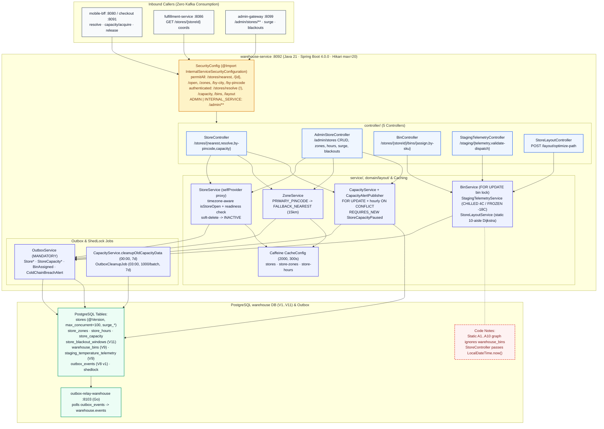
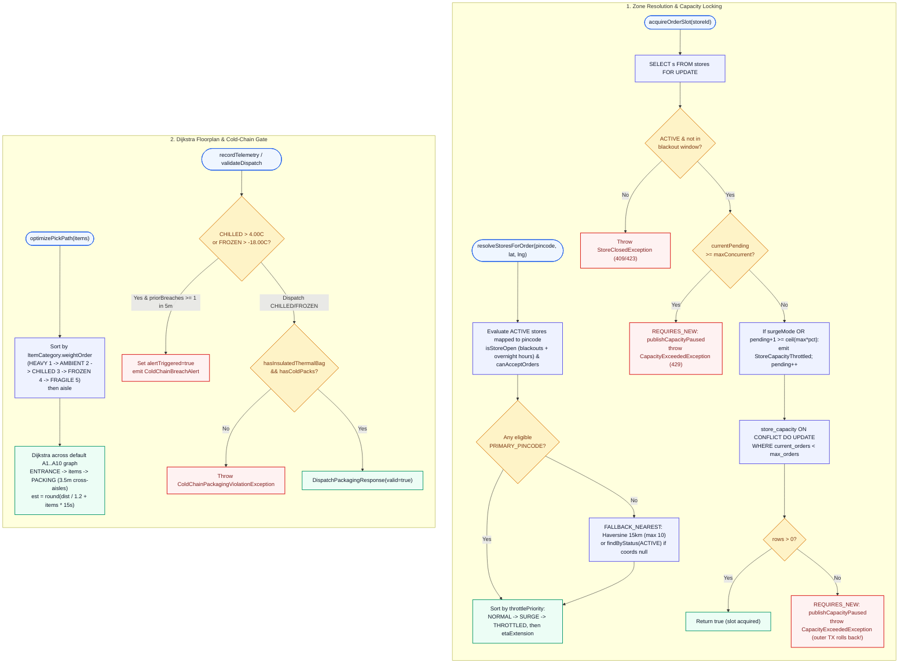
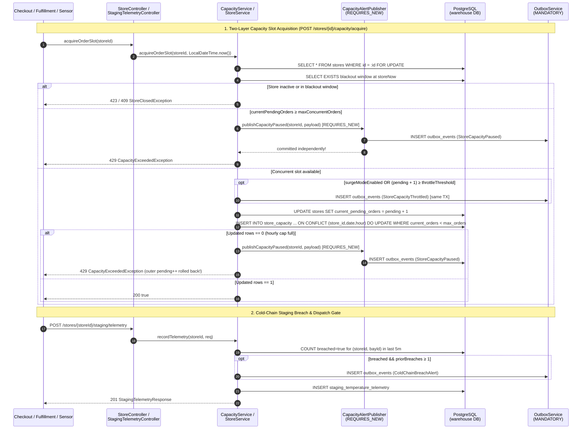

# `warehouse-service` — Code Walkthrough

> [!NOTE]
> **Part of the InstaCommerce Onboarding Suite:** [Onboarding Hub](../../README.md) · [Code Walkthrough Atlas](../README.md) · [Domain & Event Catalog (`05`)](../../05-domain-model-and-event-catalog.md) · [Incident Drills & Exam (`06`)](../../06-incident-drills-and-readiness-exam.md) · [Dependency Matrix & Cheatsheet (`07`)](../../07-service-dependency-and-command-cheatsheet.md)

> **Dark-Store Topology, Zone Resolution, Two-Layer Capacity Locking, Dijkstra Floorplan Routing & Cold-Chain Gate**
>
> | Dimension | Verified Repo Truth |
> |---|---|
> | **Module & Runtime** | Java 21 / Spring Boot 4.0.0 ([build.gradle.kts](../../../../services/warehouse-service/build.gradle.kts#L1-L42)) · Caffeine (`stores`, `store-zones`, `store-hours`), ShedLock · Dependencies: `:libs:platform-common`, `:contracts` |
> | **HTTP Port** | `8092` (`${SERVER_PORT:8092}` in [application.yml](../../../../services/warehouse-service/src/main/resources/application.yml#L1-L4)) |
> | **Primary Storage** | PostgreSQL `warehouse`, Flyway `V1`–`V11` (`ddl-auto: validate`, `open-in-view: false`, Hikari `max=20`) — **zero Redis, zero Kafka consumers** |
> | **Kafka Topics** | **Produces** (via Go `outbox-relay-warehouse` `:8103`): `warehouse.events` (`StoreCreated`, `StoreUpdated`, `StoreStatusChanged`, `StoreCapacityUpdated`, `StoreCapacityThrottled`, `StoreCapacityPaused`, `BinAssigned`, `ColdChainBreachAlert`)<br>**Consumes:** none (`0` `@KafkaListener` beans) |
> | **Helm Keys** | `warehouse-service` ([values.yaml](../../../../deploy/helm/values.yaml)) · Relay: `outbox-relay-warehouse` ([values.yaml](../../../../deploy/helm/values.yaml#L1059)) |
> | **SLO Tier** | **Tier 2** (`99.0%` availability, `2000 ms` p99, `432 min/30d` budget) per [error-budget-policy.yaml](../../../../monitoring/error-budget-policy.yaml#L29-L44) |

---

## 1. Service Boundaries & Package Tree

`warehouse-service` is the physical dark-store registry and real-time operational capacity gatekeeper for quick-commerce fulfillment:
- **Upstream Consumers:** `checkout-orchestrator-service` (`:8091`) acquires and releases store capacity slots (`POST /stores/{id}/capacity/acquire` and `/release`); `mobile-bff-service` (`:8080`) resolves serviceable stores (`GET /stores/resolve`, `GET /stores/nearest`); `fulfillment-service` (`:8086`) caches store coordinates (`GET /stores/{id}`); `admin-gateway-service` (`:8099`) manages stores, delivery zones, operating hours, blackout windows, surge overrides, warehouse bins, and cold-chain telemetry.
- **No Kafka Consumption:** `warehouse-service` consumes zero Kafka topics; all outbound side effects write atomically into `outbox_events` (`outbox-relay-warehouse` -> `warehouse.events`).

### Package Layout (`com.instacommerce.warehouse`)

```text
services/warehouse-service/src/main/java/com/instacommerce/warehouse/
├── WarehouseServiceApplication.java         # @SpringBootApplication, Clock.systemUTC() bean, @EnableConfigurationProperties
├── config/
│   ├── CacheConfig.java                     # Caffeine (maxSize 2000, 300s): stores, store-zones, store-hours
│   ├── SecurityConfig.java                  # @Import(InternalServiceSecurityConfiguration) + permitAll/auth rules
│   ├── ShedLockConfig.java                  # JdbcTemplateLockProvider usingDbTime()
│   └── WarehouseProperties.java             # @ConfigurationProperties(prefix = "warehouse")
├── controller/
│   ├── StoreController.java                 # /stores (nearest, resolve, {id}, {id}/open, {id}/zones, delivery-radius, capacity)
│   ├── AdminStoreController.java            # /admin/stores (CRUD, status, zones, hours, surge, blackouts)
│   ├── BinController.java                   # /stores/{storeId}/bins (list, assign, by-sku)
│   ├── StagingTelemetryController.java      # /stores/{storeId}/staging/{telemetry, validate-dispatch}
│   └── StoreLayoutController.java           # POST /stores/{storeId}/layout/optimize-path
├── domain/layout/
│   ├── ItemCategory.java                    # weightOrder: HEAVY(1)->AMBIENT(2)->CHILLED(3)->FROZEN(4)->FRAGILE(5)
│   └── StoreLayoutGraph.java                # Static 10-aisle (A1..A10, 3.5m cross-aisles) Dijkstra floorplan graph
├── exception/
│   └── GlobalExceptionHandler.java          # Returns 409 CONFLICT on Optimistic/PessimisticLockingFailureException!
├── repository/
│   ├── StoreRepository.java                 # findNearestStores native SQL (divides by cos(radians(:lat)))
│   └── StoreCapacityRepository.java         # Atomic INSERT ... ON CONFLICT DO UPDATE WHERE current_orders < max_orders
└── service/
    ├── StoreService.java                    # selfProvider proxy for @Cacheable("store-hours"); soft-delete -> INACTIVE
    ├── ZoneService.java                     # Pincode primary lookup -> 15km Haversine fallback -> throttlePriority sort
    ├── CapacityService.java                 # Two-layer lock (stores FOR UPDATE + store_capacity atomic upsert)
    ├── CapacityAlertPublisher.java          # PROPAGATION_REQUIRES_NEW StoreCapacityPaused outbox emitter!
    ├── BinService.java                      # @Transactional lock on bin upsert + BinAssigned outbox
    ├── StagingTelemetryService.java         # CHILLED > 4.00C / FROZEN > -18.00C gate (uses Instant.now() directly)
    ├── StoreLayoutService.java              # Sorts items by weightOrder -> aisle -> Dijkstra pick path
    ├── OutboxService.java                   # Propagation.MANDATORY outbox_events writer
    └── OutboxCleanupJob.java                # Daily 03:00 ShedLock purge (1000/batch, 7d retention)
```

---

## 2. Startup, Configuration & Security Filter Chain

1. **Clock Bean ([WarehouseServiceApplication](../../../../services/warehouse-service/src/main/java/com/instacommerce/warehouse/WarehouseServiceApplication.java#L10-L22)):** Exposes `Clock.systemUTC()`, though several paths bypass it via `LocalDateTime.now()` and `Instant.now()`.
2. **Asymmetric Auth Matcher ([SecurityConfig](../../../../services/warehouse-service/src/main/java/com/instacommerce/warehouse/config/SecurityConfig.java#L1-L69)):** Imports `InternalServiceSecurityConfiguration` (`SharedInternalServiceAuthFilter`) and registers `JwtAuthenticationFilter`. Notice the asymmetry in `permitAll()` vs `authenticated()` under `/stores/**`:
   - **Unauthenticated `permitAll()` (`GET`):** `/stores/nearest`, `/stores/{id}`, `/stores/{id}/open`, `/stores/{id}/zones`, `/stores/{id}/delivery-radius`, `/stores/by-city`, `/stores/by-pincode`.
   - **Requires Authentication (falls through to `anyRequest().authenticated()`):** `GET /stores/resolve`, `POST /stores/{id}/capacity/**`, `/stores/{id}/bins/**`, `/stores/{id}/staging/**`, `/stores/{id}/layout/**`.
   - **Admin (`ADMIN` or `INTERNAL_SERVICE`):** `/admin/**` ([AdminStoreController](../../../../services/warehouse-service/src/main/java/com/instacommerce/warehouse/controller/AdminStoreController.java#L1-L162)).
3. **Lock Conflict Mapping:** Unlike `fulfillment-service` and `payment-service`, [GlobalExceptionHandler](../../../../services/warehouse-service/src/main/java/com/instacommerce/warehouse/exception/GlobalExceptionHandler.java#L72-L76) explicitly catches both `OptimisticLockingFailureException` and `PessimisticLockingFailureException` and returns `HTTP 409 CONFLICT` (`CONFLICT`) instead of `500`.

---

## 3. PostgreSQL Schema (`V1`–`V11`) & Capacity Tables

All `11` Flyway scripts under [migration/](../../../../services/warehouse-service/src/main/resources/db/migration/) enforce dark-store configuration and telemetry invariants:

| Migration Range | Tables & Key Constraints |
|---|---|
| `V1`–`V3`, `V7` | `stores` (`code` unique, `status` ENUM `ACTIVE`/`INACTIVE`/`MAINTENANCE`, `max_concurrent_orders` default `100`, `current_pending_orders`, `V7` adds `version` + `timezone`), `store_zones` (delivery pincodes/radius), `operating_hours` (weekday `0–6` open/close, including overnight spans). |
| `V4`, `V9`, `V11` | `store_capacity` (unique `(store_id, date, hour)`, `current_orders`, `max_orders`, `throttle_threshold_pct`); `V9` adds `warehouse_bins` and `staging_temperature_telemetry`; `V11` adds `surge_mode_enabled`, `throttle_eta_extension_minutes`, and `store_blackout_windows`. |
| `V5`, `V6`, `V8`, `V10` | `outbox_events` (`V8` aligns `EventEnvelope` fields + `schema_version = 'v1'`, `V10` adds retention index) and `shedlock` (`V6`). |

---

## 4. Architecture & Low-Level Component Topology

**warehouse-service Architecture LLD** — *[Rendered PNG](../diagrams/services/warehouse-service-arch-lld.png) · [Mermaid Source](../diagrams/services/warehouse-service-arch-lld.mmd)*



**Key Component Interactions:**
- **Self-Proxy Caching Pattern ([StoreService](../../../../services/warehouse-service/src/main/java/com/instacommerce/warehouse/service/StoreService.java#L242)):** `StoreService` injects `ObjectProvider<StoreService> selfProvider` so internal calls like `checkStoreHours(...)` traverse the Spring AOP proxy and hit Caffeine cache `store-hours` (`2000` entries, `300s`).
- **Two-Layer Readiness Validation:** [StoreService.updateStoreStatus](../../../../services/warehouse-service/src/main/java/com/instacommerce/warehouse/service/StoreService.java#L291-L293) runs operating-hours/zone readiness checks *only* when transitioning **into** `ACTIVE`, and `deleteStore` performs a soft delete (`status = INACTIVE`) rather than deleting rows.

---

## 5. Zone Fallback, Two-Layer Capacity Locking, Dijkstra & Cold-Chain Gate

**warehouse-service Flowchart** — *[Rendered PNG](../diagrams/services/warehouse-service-flowchart.png) · [Mermaid Source](../diagrams/services/warehouse-service-flowchart.mmd)*



### 1. Pincode Primary & Haversine Fallback Resolution ([ZoneService](../../../../services/warehouse-service/src/main/java/com/instacommerce/warehouse/service/ZoneService.java#L1-L237))
- `resolveStoresForOrder(pincode, lat, lng)` first filters `ACTIVE` stores mapped to `pincode` in `store_zones` whose store is open (checking `store_blackout_windows` + overnight `operating_hours`) and passes capacity eligibility (`canAcceptOrders`).
- If **zero** `PRIMARY_PINCODE` matches qualify, it falls back (`FALLBACK_NEAREST`) to `StoreRepository.findNearestStores` within `15 km` (max `10` results), or `findByStatus(ACTIVE)` if caller coordinates are null.
- Matches are sorted by `throttlePriority` (`NORMAL` -> `SURGE` -> `THROTTLED`) and then `etaExtensionMinutes`.

### 2. Static `A1`–`A10` Dijkstra Floorplan & Weight Ordering ([StoreLayoutService](../../../../services/warehouse-service/src/main/java/com/instacommerce/warehouse/service/StoreLayoutService.java#L1-L105), [StoreLayoutGraph](../../../../services/warehouse-service/src/main/java/com/instacommerce/warehouse/domain/layout/StoreLayoutGraph.java#L101-L154))
- `POST /stores/{storeId}/layout/optimize-path` sorts request items by `ItemCategory.weightOrder` ([ItemCategory](../../../../services/warehouse-service/src/main/java/com/instacommerce/warehouse/domain/layout/ItemCategory.java#L1-L51): `HEAVY 1 -> AMBIENT 2 -> CHILLED 3 -> FROZEN 4 -> FRAGILE 5`), then by aisle, then runs Dijkstra shortest path from `ENTRANCE` across all item nodes to `PACKING`.
- **Important Code Truth:** `StoreLayoutGraph.createDefaultDarkStoreFloorplan` builds a **hardcoded** `10`-aisle (`A1`–`A10`, `3.5m` cross-aisle edges) graph shared identically across all stores, ignoring actual `warehouse_bins` coordinates (`estSeconds = round(distance / 1.2 + items * 15s)`).

---

## 6. Call-Stack Sequence: Two-Layer Capacity Acquire & `REQUIRES_NEW` Alerting

**warehouse-service Sequence Diagram** — *[Rendered PNG](../diagrams/services/warehouse-service-sequence.png) · [Mermaid Source](../diagrams/services/warehouse-service-sequence.mmd)*



### Why `CapacityAlertPublisher` Needs `Propagation.REQUIRES_NEW`
Walk through [CapacityService.acquireOrderSlot](../../../../services/warehouse-service/src/main/java/com/instacommerce/warehouse/service/CapacityService.java#L94-L139):
1. Outer `@Transactional` acquires `stores` row via `findByIdForUpdate` and checks `store_blackout_windows` at `storeNow`. Inactive or blacked-out stores throw `StoreClosedException` (`423` / `409`).
2. **Concurrent Order Cap Layer (`stores.current_pending_orders` vs `max_concurrent_orders`):** If `currentPendingOrders >= maxConcurrentOrders`, `CapacityService` calls [CapacityAlertPublisher.publishCapacityPaused](../../../../services/warehouse-service/src/main/java/com/instacommerce/warehouse/service/CapacityAlertPublisher.java#L1-L21) (`Propagation.REQUIRES_NEW`), commits a `StoreCapacityPaused` outbox event on an independent transaction, and then throws `CapacityExceededException` (`HTTP 429`). Without `REQUIRES_NEW`, throwing `CapacityExceededException` would roll back the very alert event notifying operations that the store hit capacity!
3. **Throttle Check + Hourly Cap Layer (`store_capacity`):** If `surgeModeEnabled` OR `(pending + 1) >= ceil(max * pct)`, it emits `StoreCapacityThrottled` inside the main transaction, increments `currentPendingOrders`, and executes [StoreCapacityRepository.incrementOrderCount](../../../../services/warehouse-service/src/main/java/com/instacommerce/warehouse/repository/StoreCapacityRepository.java#L1-L32) (`INSERT ... ON CONFLICT (store_id, date, hour) DO UPDATE SET current_orders = current_orders + 1 WHERE current_orders < max_orders`).
4. If the atomic hourly `UPSERT` returns `0` rows (hourly cap reached), `CapacityService` again calls `CapacityAlertPublisher.publishCapacityPaused` (`REQUIRES_NEW`) and throws `CapacityExceededException`, rolling back the outer `current_pending_orders++` while preserving `StoreCapacityPaused` in `outbox_events`!

### Cold-Chain Telemetry & Dispatch Gate ([StagingTelemetryService](../../../../services/warehouse-service/src/main/java/com/instacommerce/warehouse/service/StagingTelemetryService.java#L1-L155))
- `POST /stores/{storeId}/staging/telemetry` flags breaches (`CHILLED > 4.00C` or `FROZEN > -18.00C`). If breached and `>= 1` prior breach exists in the same `(storeId, bayId)` within the last `5m`, it sets `alertTriggered = true` and emits `ColdChainBreachAlert`.
- `POST /stores/{storeId}/staging/validate-dispatch` rejects orders containing `CHILLED` or `FROZEN` items unless `hasInsulatedThermalBag && hasColdPacks`, throwing `ColdChainPackagingViolationException`.

---

## 7. Scheduled Jobs & Outbox Cleanup

- **[CapacityService.cleanupOldCapacityData](../../../../services/warehouse-service/src/main/java/com/instacommerce/warehouse/service/CapacityService.java#L240-L270):** Runs daily at `00:00` under ShedLock, pruning `store_capacity` history older than `7` days.
- **[OutboxCleanupJob](../../../../services/warehouse-service/src/main/java/com/instacommerce/warehouse/service/OutboxCleanupJob.java#L1-L39):** Runs daily at `03:00` under ShedLock (`1000` rows/batch, `7`-day retention for `sent = true` events).
- **[BinService](../../../../services/warehouse-service/src/main/java/com/instacommerce/warehouse/service/BinService.java#L1-L146):** Acquires `FOR UPDATE` row lock on bin SKU assignment (`warehouse_bins`) and writes `BinAssigned` via `OutboxService`.

---

## 8. Configuration & Narrow Test Verification

- **Key Properties ([application.yml](../../../../services/warehouse-service/src/main/resources/application.yml#L1-L90)):** `SERVER_PORT:8092`, `hikari.maximum-pool-size: 20`, `hibernate.jakarta.persistence.lock.timeout` via repo hints, Caffeine TTL `300s`.
- **Tests:** `9` test classes live under `services/warehouse-service/src/test` (e.g., `CapacityServiceTest`, `StoreBlackoutSurgeAndFallbackTest`, `WarehouseRemediationTest`, `WarehouseIntegrationTest`). Run narrow checks via:

```bash
./gradlew :services:warehouse-service:test --tests "com.instacommerce.warehouse.service.CapacityServiceTest"
```

---

## 9. Must-Fix Code Risks & Severe README Drift

| Severity | Finding | Exact Evidence & Impact |
|---|---|---|
| **HIGH** | **Pole division-by-zero edge math in `StoreRepository.findNearestStores`** | [StoreRepository](../../../../services/warehouse-service/src/main/java/com/instacommerce/warehouse/repository/StoreRepository.java#L36-L37) divides longitude bounding-box delta by `cos(radians(:lat))`, even though [StoreController.findNearestStores](../../../../services/warehouse-service/src/main/java/com/instacommerce/warehouse/controller/StoreController.java#L50-L70) permits `lat` in `[-90.0, 90.0]` (`cos(+-90 deg) = 0`). |
| **MEDIUM** | **JVM-default timezone coupling in controllers & uninjected `Clock` in telemetry** | [StoreController](../../../../services/warehouse-service/src/main/java/com/instacommerce/warehouse/controller/StoreController.java#L59-L66) and [AdminStoreController](../../../../services/warehouse-service/src/main/java/com/instacommerce/warehouse/controller/AdminStoreController.java#L84-L90) pass `LocalDateTime.now()` (JVM default zone) which `toStoreTime` re-interprets via `ZoneId.systemDefault()`, while [StagingTelemetryService](../../../../services/warehouse-service/src/main/java/com/instacommerce/warehouse/service/StagingTelemetryService.java#L53-L124) calls `Instant.now()` directly instead of the `Clock` bean. |
| **MEDIUM** | **`/stores/resolve` auth asymmetry + static floorplan ignoring `warehouse_bins`** | [SecurityConfig](../../../../services/warehouse-service/src/main/java/com/instacommerce/warehouse/config/SecurityConfig.java#L45-L48) leaves `/stores/nearest` unauthenticated while `/stores/resolve` requires auth. Meanwhile `StoreLayoutService` computes paths on the static `A1`–`A10` floorplan ignoring per-store `warehouse_bins`. |
| **DRIFT** | **`warehouse-service/README.md` contradicts source across 7 core areas** | [warehouse-service/README.md](../../../../services/warehouse-service/README.md) falsely claims port `8090` (actual `8092`), `V1`–`V10` (actual `V1`–`V11`), hard store deletion (`deleteStore` sets `INACTIVE`), missing zone/hours CRUD (`AdminStoreController` has full CRUD + surge + blackouts), HTTP `500` on OCC (`GlobalExceptionHandler` returns `409`), `30`-day outbox retention (actual `7` days), and `"No test source directory exists"` (`9` test classes exist). |

---

**Previous:** [fraud-detection-service](./fraud-detection-service.md) | **Atlas Hub:** [Code Walkthrough Atlas](../README.md) | **Next:** [fulfillment-service](./fulfillment-service.md)
