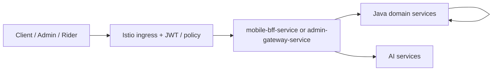
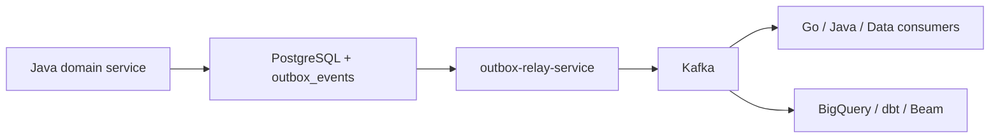

# Repository Truth

## Canonical Sources

When the repository disagrees with narrative docs, these files should be treated as the strongest source of truth:

- [`../settings.gradle.kts`](../../settings.gradle.kts): authoritative Java module list
- [`../.github/workflows/ci.yml`](../../.github/workflows/ci.yml): authoritative CI service matrix, Go/Python service names, and deploy-name mappings
- [`../deploy/helm/values.yaml`](../../deploy/helm/values.yaml): actual Kubernetes routing, service identities, and service-to-service allowlists
- [`../contracts/src/main/`](../../contracts/src/main): actual gRPC and event contract files

## Repository Topology

| Area | Purpose | Notes |
|---|---|---|
| [`../services`](../../services) | All runtime services | Java, Go, and Python services live side by side |
| [`../contracts`](../../contracts) | Proto + JSON schema contracts | Envelope plus domain event schemas |
| [`../data-platform`](../../data-platform) | dbt, Airflow, Beam, quality checks | Real warehouse assets, not placeholder docs |
| [`../ml`](../../ml) | Training, eval, feature store, serving helpers | Contains both working code and roadmap-style README material |
| [`../deploy/helm`](../../deploy/helm) | Helm chart and shared values | Main deploy surface |
| [`../argocd`](../../argocd) | GitOps app definitions | App-of-apps plus canary applications |
| [`../infra/terraform`](../../infra/terraform) | GCP infrastructure | VPC, GKE, Cloud SQL, BigQuery, Dataflow, Feature Store |
| [`../monitoring`](../../monitoring) | Alerts, SLO rules, dashboards | Current rules are more advanced than the top-level monitoring README suggests |

## Fleet Shape

### Java services

The Gradle settings file defines these Java services:

- identity-service
- catalog-service
- inventory-service
- order-service
- payment-service
- fulfillment-service
- notification-service
- search-service
- pricing-service
- cart-service
- checkout-orchestrator-service
- warehouse-service
- rider-fleet-service
- routing-eta-service
- wallet-loyalty-service
- audit-trail-service
- fraud-detection-service
- config-feature-flag-service
- mobile-bff-service
- admin-gateway-service

### Go services in CI

The CI workflow explicitly covers:

- cdc-consumer-service
- dispatch-optimizer-service
- location-ingestion-service
- outbox-relay-service
- payment-webhook-service
- reconciliation-engine
- stream-processor-service
- reverse-etl-orchestrator
- `go-shared` as the shared dependency trigger

Note: the repo-wide docs often speak about a "30-service" system. In checked-in CI terms that is effectively:

- `20` Java services
- `8` Go executables
- `2` Python services

`go-shared` is infrastructure code, not an independently deployed business service.

## Actual Runtime Architecture

### 1. Synchronous request plane

Observations:

- The deploy config in [`../deploy/helm/values.yaml`](../../deploy/helm/values.yaml) assumes Istio is the front door and encodes path routing plus service-to-service authorization.
- The edge pattern exists architecturally, but only one side is deeply implemented: downstream domain services. The two edge services themselves are mostly scaffold.

### 2. Checkout authority is orchestration-first

The strongest implemented business path is the checkout sequence:

- [`../services/checkout-orchestrator-service/src/main/java/com/instacommerce/checkout/workflow/CheckoutWorkflowImpl.java`](../../services/checkout-orchestrator-service/src/main/java/com/instacommerce/checkout/workflow/CheckoutWorkflowImpl.java)
- [`../services/order-service/src/main/java/com/instacommerce/order/service/OrderService.java`](../../services/order-service/src/main/java/com/instacommerce/order/service/OrderService.java)
- [`../services/inventory-service/src/main/java/com/instacommerce/inventory/service/ReservationService.java`](../../services/inventory-service/src/main/java/com/instacommerce/inventory/service/ReservationService.java)
- [`../services/payment-service/src/main/java/com/instacommerce/payment/service/PaymentService.java`](../../services/payment-service/src/main/java/com/instacommerce/payment/service/PaymentService.java)

Code-backed flow:

1. Checkout validates cart
2. Pricing calculates totals and quote validation inputs
3. Inventory reserves stock under pessimistic locking
4. Payment authorizes with explicit idempotency handling
5. Order persists order state and emits outbox events
6. Inventory confirm and payment capture complete the flow
7. Temporal Saga compensation unwinds failures in reverse order

This is a meaningful architectural choice: the repository clearly treats checkout as a durable orchestration problem, not a simple synchronous REST fan-out.

### 3. The async plane is real

Evidence:

- Java services consistently carry outbox migrations and outbox service code
- [`../services/outbox-relay-service/main.go`](../../services/outbox-relay-service/main.go) polls PostgreSQL, publishes to Kafka, and marks rows sent
- [`../services/cdc-consumer-service/main.go`](../../services/cdc-consumer-service/main.go) batches Kafka records into BigQuery
- [`../services/stream-processor-service/main.go`](../../services/stream-processor-service/main.go) computes Redis and Prometheus-facing operational metrics

This is not just design theater. The repo structurally depends on events for order lifecycle propagation, audit ingestion, search projection updates, wallet side effects, and analytics.

## Cross-Cutting Patterns Repeated in Code

### Outbox pattern

This is one of the most repeated implementation patterns in the Java services:

- state change in service DB
- outbox row written inside the same transaction
- external publishing delegated to the Go relay / CDC layer

This reduces direct coupling, but it also creates a large operational surface area: connector health, lag, DLQs, replay tooling, and schema governance all matter.

### Idempotency

The repo takes idempotency seriously in money and checkout paths:

- checkout workflow-derived payment keys
- payment authorization/capture/void logic normalizing idempotency keys
- inventory reservation lookup by idempotency key
- order creation lookup by idempotency key

That is a strong signal that the author understands retried distributed calls are normal, not exceptional.

### Internal service authentication

The Helm values encode service allowlists and JWT request-authentication resources, while many Java services also include `InternalServiceAuthFilter` or `InternalServiceAuthInterceptor` classes.

That means trust boundaries exist at two layers:

- mesh/policy layer
- application filter layer

This is good in principle, but it increases configuration drift risk if one layer evolves without the other.

## Implemented Reality vs Target-State Story

The repo has both code truth and aspirational design truth. A few important examples:

| Area | Code-backed reality | Target-state or overstated doc story |
|---|---|---|
| Edge gateways | `mobile-bff-service` and `admin-gateway-service` are scaffold-heavy | Multiple docs describe them as full aggregation and RBAC hubs |
| Search | Search uses PostgreSQL full-text search and Caffeine | Older HLD language still references Elasticsearch |
| Rider ingestion | Go location ingestion exposes HTTP/WebSocket ingress | Some HLD text frames rider ingestion as gRPC streaming |
| AI orchestrator | Legacy v1 flow in `app/main.py` coexists with a `/v2` LangGraph path | Some docs speak as if a single settled orchestration stack exists |

These mismatches do not mean the architecture is poor. They mean change programs and documentation have advanced faster than some implementation surfaces.
