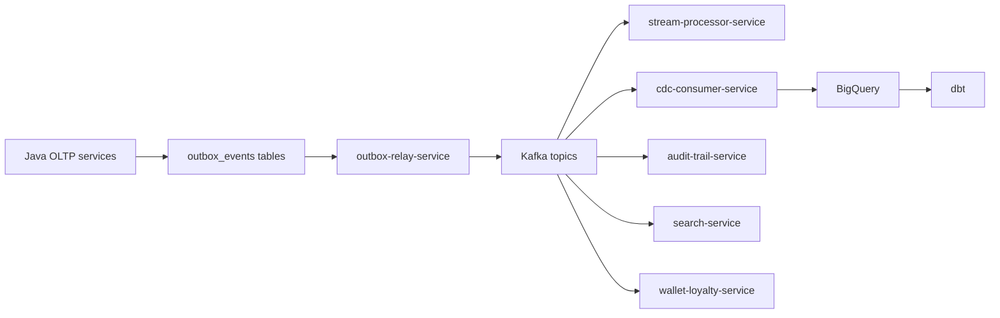

# Data, ML, and Platform

## Contracts and Event Governance

The contract system is split deliberately:

- `proto/` for synchronous/gRPC style service interfaces
- `resources/schemas/` for event payload definitions

The event layer standardizes an envelope with fields such as:

- `event_id`
- `event_type`
- `aggregate_id`
- `schema_version`
- `source_service`
- `correlation_id`
- `timestamp`
- `payload`

This is a strong design choice because it gives the repo a consistent async shape across Java, Go, and data-platform consumers.

## Event/Data Plane

## Go Services in the Data Plane

### outbox-relay-service

[`../services/outbox-relay-service/main.go`](../../services/outbox-relay-service/main.go) does the operationally critical work of:

- connecting to PostgreSQL
- polling unsent outbox rows
- producing Kafka messages
- exposing health/readiness
- emitting OpenTelemetry metrics/traces

Tradeoff:

- Good: centralized relay logic reduces duplication in Java services
- Cost: relay downtime or poison events can stall downstream propagation for many domains at once

### cdc-consumer-service

[`../services/cdc-consumer-service/main.go`](../../services/cdc-consumer-service/main.go) is a warehouse bridge:

- multiple Kafka readers
- batch buffering
- BigQuery insertion
- DLQ publishing
- readiness state

This is one of the highest-value infrastructure services because analytics freshness depends on it.

### stream-processor-service

[`../services/stream-processor-service/main.go`](../../services/stream-processor-service/main.go) computes:

- near-real-time operational metrics
- Redis-backed counters and state
- Prometheus-exported signals
- delivery SLA monitoring

This is not a canonical ledger. It is an operational decision-support layer.

## Data Platform

The data platform is materially implemented, not just described:

- dbt staging models: orders, payments, users, products, deliveries, inventory, searches, cart events
- dbt intermediate models: order deliveries, user order history, product performance
- dbt marts: revenue, store performance, rider performance, search funnel, product analytics, user cohort retention, sponsored opportunities
- Airflow DAGs for staging, marts, quality, feature refresh, training, alerts
- Beam/Dataflow pipelines for order, payment, cart, inventory, and rider location streams
- Great Expectations suites for orders, payments, inventory, users

Actual dbt model tree:

- [`../data-platform/dbt/models/staging`](../../data-platform/dbt/models/staging)
- [`../data-platform/dbt/models/intermediate`](../../data-platform/dbt/models/intermediate)
- [`../data-platform/dbt/models/marts`](../../data-platform/dbt/models/marts)

This part of the repo is structurally coherent: the README inventory aligns closely with actual files.

## ML Platform

The ML tree is deeper than a toy example:

- training entrypoints per model family under [`../ml/train`](../../ml/train)
- unified evaluation under [`../ml/eval/evaluate.py`](../../ml/eval/evaluate.py)
- feature-store metadata and SQL under [`../ml/feature_store`](../../ml/feature_store)
- serving helpers under [`../ml/serving`](../../ml/serving)

Important reality check:

- the ML README honestly notes that some productionization claims are ahead of current artifact wiring
- the codebase includes real serving and training assets, but some "fully production" language should still be read as roadmap-plus-implementation, not pure present tense

## AI Runtime Layer

### ai-orchestrator-service

There are effectively two sub-systems living together:

1. A legacy request-handling and orchestration flow in [`../services/ai-orchestrator-service/app/main.py`](../../services/ai-orchestrator-service/app/main.py)
2. A newer LangGraph-centered `/v2` path in:
   - [`../services/ai-orchestrator-service/app/api/handlers.py`](../../services/ai-orchestrator-service/app/api/handlers.py)
   - [`../services/ai-orchestrator-service/app/graph/graph.py`](../../services/ai-orchestrator-service/app/graph/graph.py)

Operational implication:

- migration complexity exists inside the service itself
- observability and behavior parity between v1 and v2 need to be watched
- the codebase currently reflects transition, not consolidation

### ai-inference-service

[`../services/ai-inference-service/app/main.py`](../../services/ai-inference-service/app/main.py) shows a practical inference gateway:

- model registry abstraction
- cache
- optional feature-store backends
- shadow model support
- Prometheus metrics

This is one of the cleaner Python services in the repo because the boundary is simple: serve predictions, do not mutate domain state.

## Deployment and GitOps Plane

### Helm

[`../deploy/helm/values.yaml`](../../deploy/helm/values.yaml) is more important than the Helm README because it contains:

- actual Istio routes
- actual request-authentication resources
- actual authorization policies
- actual service env configuration shape

Key observation: deploy policy is often ahead of service completeness. The mesh is prepared to route to `mobile-bff-service` and `admin-gateway-service`, even though their business logic is mostly scaffold.

### ArgoCD

[`../argocd/README.md`](../../argocd/README.md) and [`../argocd/app-of-apps.yaml`](../../argocd/app-of-apps.yaml) establish a GitOps control plane, plus there are checked-in canary application manifests under [`../argocd/applications`](../../argocd/applications).

That means release operations are intended to be:

- image built by CI
- values/manifests updated in Git
- Argo syncs desired state

### Terraform

The Terraform root at [`../infra/terraform`](../../infra/terraform) is substantial:

- VPC
- GKE
- Cloud SQL
- Memorystore
- BigQuery
- Feature Store
- Data Lake
- Dataflow
- IAM
- Secret Manager

The environment root in [`../infra/terraform/environments/dev/main.tf`](../../infra/terraform/environments/dev/main.tf) clearly composes those modules rather than merely documenting them.

## Observability and Reliability

The top-level monitoring README is useful, but the actual Prometheus rules file is richer:

- SLI recording rules
- multi-window burn-rate alerts
- tiered SLO treatment
- Kafka lag alerts
- latency burn alerts

See:

- [`../monitoring/prometheus-rules.yaml`](../../monitoring/prometheus-rules.yaml)

This is an important repo truth: the checked-in alert logic is more operationally mature than some of the shorter summary docs imply.

## Platform-Level Tradeoffs

### Strengths

- Clear separation between transactional truth and async propagation
- Good use of outbox and idempotency in critical flows
- Serious infra and observability intent is visible in code, not only docs
- Data and ML are integrated into the same monorepo, which improves traceability

### Costs

- Very large blast radius for shared contract or event-envelope changes
- Multiple languages increase operational and onboarding burden
- Edge completeness lags behind back-end depth
- AI subsystem is in a migration state
- Config truth is distributed across Java, Go, Helm, Terraform, and docs
