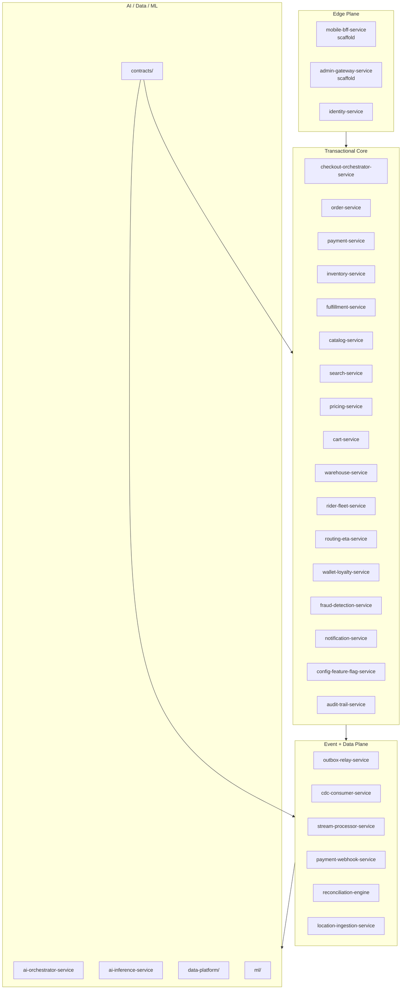

# InstaCommerce Deep Summary Documentation

This folder is a code-backed summary of the repository as it exists in the checked-in tree.
It is intentionally different from the broader architecture and review set under `docs/`:
the goal here is to compress the repo into a smaller set of documents that distinguish
between implemented runtime truth, target-state design, and operational gaps.

## Scope

This summary was assembled by reading across:

- Canonical module and CI definitions in [`../settings.gradle.kts`](../../settings.gradle.kts) and [`../.github/workflows/ci.yml`](../../.github/workflows/ci.yml)
- Existing platform docs and diagrams under [`../docs/`](../), [`../contracts/README.md`](../../contracts/README.md), [`../data-platform/README.md`](../../data-platform/README.md), and [`../ml/README.md`](../../ml/README.md)
- Representative source code in the critical checkout, order, inventory, payment, search, AI, data-plane, and deploy layers
- Runtime and deployment config in [`../deploy/helm/`](../../deploy/helm/), [`../argocd/`](../../argocd/), [`../infra/terraform/`](../../infra/terraform/), and [`../monitoring/`](../../monitoring/)

## What This Repo Actually Is

In repository terms, InstaCommerce is a polyglot monorepo with:

- `20` Java/Spring Boot services defined in [`../settings.gradle.kts`](../../settings.gradle.kts)
- `8` Go executables selected in CI, plus the shared Go library under [`../services/go-shared`](../../services/go-shared)
- `2` Python/FastAPI services for AI orchestration and inference
- Contract definitions in [`../contracts`](../../contracts)
- A dbt/Airflow/Beam data platform in [`../data-platform`](../../data-platform)
- An ML training and serving tree in [`../ml`](../../ml)
- GitOps and infra code in [`../deploy/helm`](../../deploy/helm), [`../argocd`](../../argocd), and [`../infra/terraform`](../../infra/terraform)

## Main Conclusions

1. The checkout core is real: `checkout-orchestrator-service`, `order-service`, `inventory-service`, and `payment-service` contain substantial code and form the strongest implemented path in the repo.
2. The repo is event-driven in a serious way, not just on paper. Outbox tables, relay code, Kafka consumers, CDC ingestion, and downstream consumers are all checked in.
3. The edge layer is uneven. `mobile-bff-service` and `admin-gateway-service` are mostly scaffold and should be treated as target-state shells, not production-complete gateways.
4. The AI layer is partially transitional. `ai-orchestrator-service` has both a legacy `app/main.py` flow and a newer `/v2` LangGraph path.
5. Several high-level docs are aspirational. Some HLD/README claims overstate what the code currently enforces or ships.

## Reading Order

1. [`01-repo-truth.md`](01-repo-truth.md)
2. [`02-service-fleet.md`](02-service-fleet.md)
3. [`03-data-ml-platform.md`](03-data-ml-platform.md)
4. [`04-risks-gaps-and-readiness.md`](04-risks-gaps-and-readiness.md)

## Quick Map

