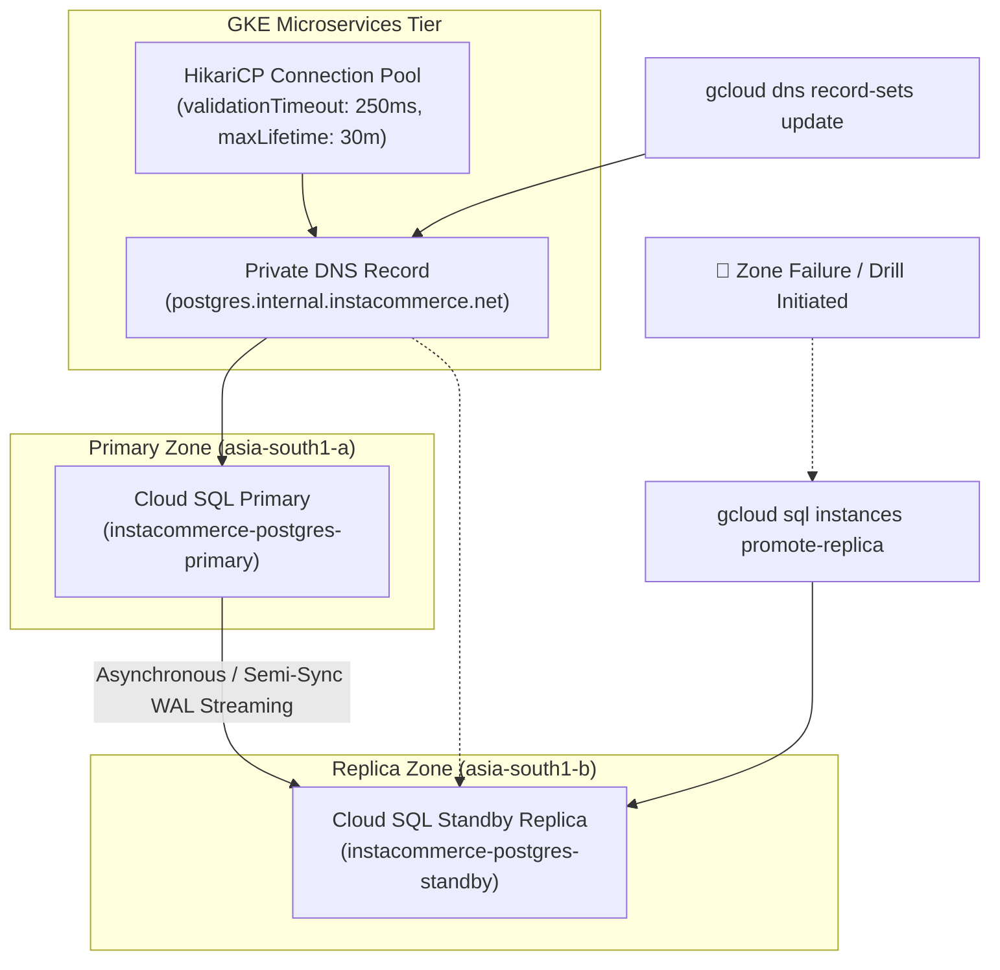

# Runbook: Cloud SQL PostgreSQL Disaster Recovery & Failover Drill

## 1. Objectives & SLAs
- **Recovery Point Objective (RPO)**: < 1.0 second (synchronous / low-lag replication).
- **Recovery Time Objective (RTO)**: < 60 seconds (target time for microservice HikariCP pools to reconnect to promoted replica without pod restarts).
- **Scope**: Tier 0 & Tier 1 PostgreSQL transactional databases (`order-service`, `payment-service`, `inventory-service`, `cart-service`, `identity-service`).

---

## 2. Architecture & Failover Flow



---

## 3. Automated Failover Drill Procedure

### Step 1: Pre-Drill Validation
1. Verify replication lag is within RPO threshold (< 1s):
   ```bash
   gcloud sql instances describe instacommerce-postgres-standby \
     --format="value(replicaConfiguration.failoverTarget)"
   ```
2. Verify application health on all services.

### Step 2: Triggering Failover
Run the automated failover drill script:
```bash
./scripts/dr-database-failover-drill.sh \
  --primary instacommerce-postgres-primary \
  --standby instacommerce-postgres-standby \
  --project instacommerce-prod
```

The script executes:
1. `gcloud sql instances promote-replica instacommerce-postgres-standby`
2. Updates Cloud DNS private zone A-record `postgres.internal.instacommerce.net` to the promoted replica's private IP.
3. Probes microservice `/actuator/health/readiness` until `readinessState.db` returns UP.
4. Records elapsed time against the 60-second RTO.

### Step 3: Post-Failover Verification
1. Ensure HikariCP connections in `order-service` and `inventory-service` drop stale broken connections and establish new TCP connections to promoted host without pod restart.
2. Confirm zero transactional write errors:
   `sum(rate(http_server_requests_seconds_count{status=~"5.."}[5m])) == 0`
