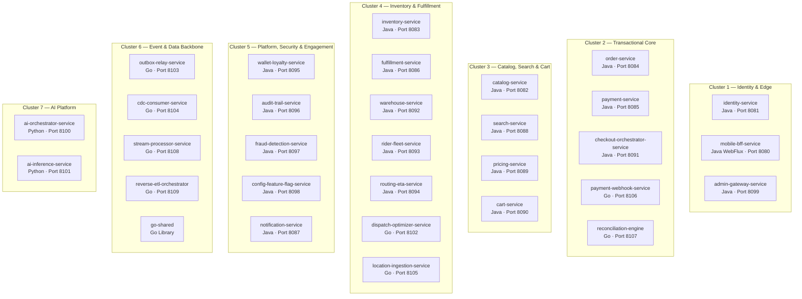

# InstaCommerce Microservice Directory & Documentation Index

Comprehensive navigation index for all 30 production microservices and shared libraries across the InstaCommerce monorepo.

> **Source of Truth:** Port assignments conform to [`GLOSSARY.md`](../../GLOSSARY.md). Module definitions conform to `settings.gradle.kts` (Java), `services/*/go.mod` (Go), and `.github/workflows/ci.yml`.

---

## 1. Fleet Architecture Overview

---

## 2. Complete Service Registry (30 Microservices + 1 Library)

| # | Service Name | Language | Canonical Port | Primary Datastore | Kafka Integration | Documentation Link |
|---|---|---|---|---|---|---|
| 1 | `mobile-bff-service` | Java (WebFlux) | `8080` | Redis Cache | Upstream REST Aggregator | [README](mobile-bff-service/README.md) · [Runbook](mobile-bff-service/runbook.md) |
| 2 | `identity-service` | Java 21 | `8081` | PostgreSQL (`users`) | Publishes `identity.events` | [README](identity-service/README.md) · [Runbook](identity-service/runbook.md) |
| 3 | `catalog-service` | Java 21 | `8082` | PostgreSQL (`catalog`) | Publishes `catalog.events` | [README](catalog-service/README.md) · [Runbook](catalog-service/runbook.md) |
| 4 | `inventory-service` | Java 21 | `8083` | PostgreSQL (`inventory`) | Publishes `inventory.events` | [README](inventory-service/README.md) · [Runbook](inventory-service/runbook.md) |
| 5 | `order-service` | Java 21 | `8084` | PostgreSQL (`orders`) | Publishes `orders.events` | [README](order-service/README.md) · [Runbook](order-service/runbook.md) |
| 6 | `payment-service` | Java 21 | `8085` | PostgreSQL (`payments`) | Publishes `payments.events` | [README](payment-service/README.md) · [Runbook](payment-service/runbook.md) |
| 7 | `fulfillment-service` | Java 21 | `8086` | PostgreSQL (`fulfillment`) | Publishes `fulfillment.events` | [README](fulfillment-service/README.md) · [Runbook](fulfillment-service/runbook.md) |
| 8 | `notification-service` | Java 21 | `8087` | PostgreSQL (`notifications`) | Consumes `orders`, `payments`, `identity` | [README](notification-service/README.md) · [Runbook](notification-service/runbook.md) |
| 9 | `search-service` | Java 21 | `8088` | PostgreSQL (`search_docs`) | Publishes `search.events` | [README](search-service/README.md) · [Runbook](search-service/runbook.md) |
| 10 | `pricing-service` | Java 21 | `8089` | PostgreSQL (`pricing`) | Publishes `pricing.events` | [README](pricing-service/README.md) · [Runbook](pricing-service/runbook.md) |
| 11 | `cart-service` | Java 21 | `8090` | PostgreSQL (`cart`) + Redis | Publishes `cart.events` | [README](cart-service/README.md) · [Runbook](cart-service/runbook.md) |
| 12 | `checkout-orchestrator` | Java 21 | `8091` | PostgreSQL + Temporal | Orchestrates Saga across Core Services | [README](checkout-orchestrator-service/README.md) · [Runbook](checkout-orchestrator-service/runbook.md) |
| 13 | `warehouse-service` | Java 21 | `8092` | PostgreSQL (`warehouse`) | Publishes `warehouse.events` | [README](warehouse-service/README.md) · [Runbook](warehouse-service/runbook.md) |
| 14 | `rider-fleet-service` | Java 21 | `8093` | PostgreSQL (`riders`) | Publishes `rider.events` | [README](rider-fleet-service/README.md) · [Runbook](rider-fleet-service/runbook.md) |
| 15 | `routing-eta-service` | Java 21 | `8094` | PostgreSQL (`routing`) | Publishes `delivery.events`, `routing.events` | [README](routing-eta-service/README.md) · [Runbook](routing-eta-service/runbook.md) |
| 16 | `wallet-loyalty-service` | Java 21 | `8095` | PostgreSQL (`wallets`) | Publishes `wallet.events` | [README](wallet-loyalty-service/README.md) · [Runbook](wallet-loyalty-service/runbook.md) |
| 17 | `audit-trail-service` | Java 21 | `8096` | PostgreSQL (`audit`) + GCS | Consumes all 20 canonical topics | [README](audit-trail-service/README.md) · [Runbook](audit-trail-service/runbook.md) |
| 18 | `fraud-detection-service` | Java 21 | `8097` | PostgreSQL (`fraud`) + Redis | Publishes `fraud.events` | [README](fraud-detection-service/README.md) · [Runbook](fraud-detection-service/runbook.md) |
| 19 | `config-feature-flag` | Java 21 | `8098` | PostgreSQL + Redis | Caches flags, provides evaluation APIs | [README](config-feature-flag-service/README.md) · [Runbook](config-feature-flag-service/runbook.md) |
| 20 | `admin-gateway-service` | Java 21 | `8099` | Stateless Gateway | Internal admin routing & RBAC | [README](admin-gateway-service/README.md) · [Runbook](admin-gateway-service/runbook.md) |
| 21 | `ai-orchestrator-service` | Python 3.12 | `8100` | Redis Checkpoints | Publishes `ai-orchestrator.events` | [README](ai-orchestrator-service/README.md) · [Runbook](ai-orchestrator-service/runbook.md) |
| 22 | `ai-inference-service` | Python 3.12 | `8101` | In-Memory LRU + Redis | Low-latency ML inference | [README](ai-inference-service/README.md) · [Runbook](ai-inference-service/runbook.md) |
| 23 | `dispatch-optimizer` | Go 1.25 | `8102` | Stateless Solver | Advisory solver for `rider-fleet-service` | [README](dispatch-optimizer-service/README.md) · [Runbook](dispatch-optimizer-service/runbook.md) |
| 24 | `outbox-relay-service` | Go 1.25 | `8103` | PostgreSQL Polling | Relays transactional outbox to Kafka | [README](outbox-relay-service/README.md) · [Runbook](outbox-relay-service/runbook.md) |
| 25 | `cdc-consumer-service` | Go 1.25 | `8104` | Google BigQuery | Consumes Debezium CDC → BigQuery | [README](cdc-consumer-service/README.md) · [Runbook](cdc-consumer-service/runbook.md) |
| 26 | `location-ingestion` | Go 1.25 | `8105` | Redis GEO HSET | Publishes to `rider.location.updates` | [README](location-ingestion-service/README.md) · [Runbook](location-ingestion-service/runbook.md) |
| 27 | `payment-webhook` | Go 1.25 | `8106` | Redis Deduplication | Publishes to `payment.webhooks` | [README](payment-webhook-service/README.md) · [Runbook](payment-webhook-service/runbook.md) |
| 28 | `reconciliation-engine` | Go 1.25 | `8107` | PostgreSQL (`reconciliation`) | Publishes `reconciliation.events` | [README](reconciliation-engine/README.md) · [Runbook](reconciliation-engine/runbook.md) |
| 29 | `stream-processor` | Go 1.25 | `8108` | Redis Real-Time Aggs | Consumes Kafka streams for operational aggs | [README](stream-processor-service/README.md) · [Runbook](stream-processor-service/runbook.md) |
| 30 | `reverse-etl-orchestrator` | Go 1.25 | `8109` | BigQuery → Redis/Postgres | Syncs analytical data products to operational DBs | [README](reverse-etl-orchestrator/README.md) · [Runbook](reverse-etl-orchestrator/runbook.md) |
| 31 | `go-shared` | Go 1.25 | Library | Shared Middleware / Protos | Common library imported by all 8 Go services | [README](go-shared/README.md) |
