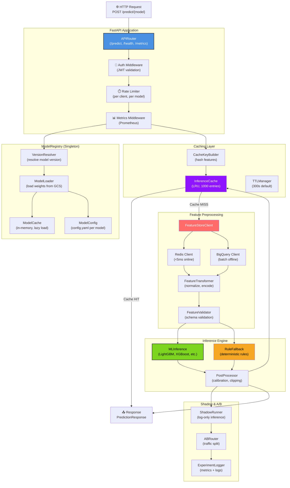
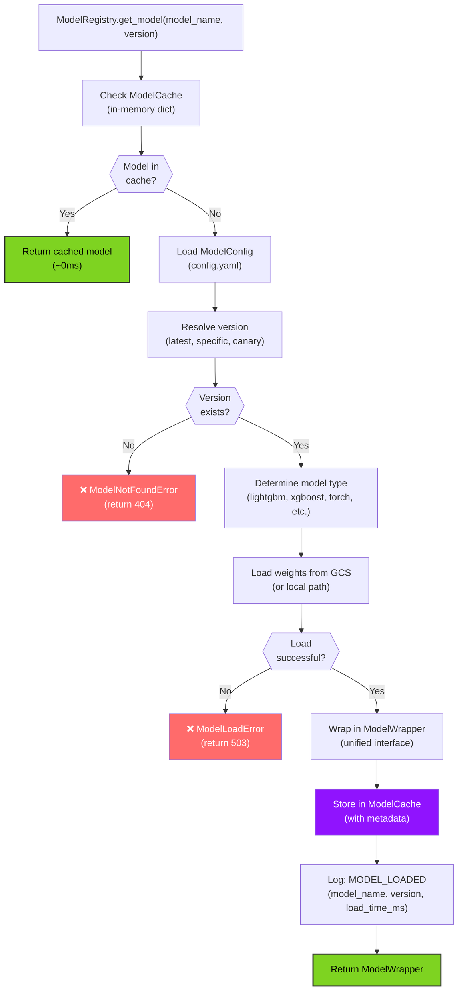
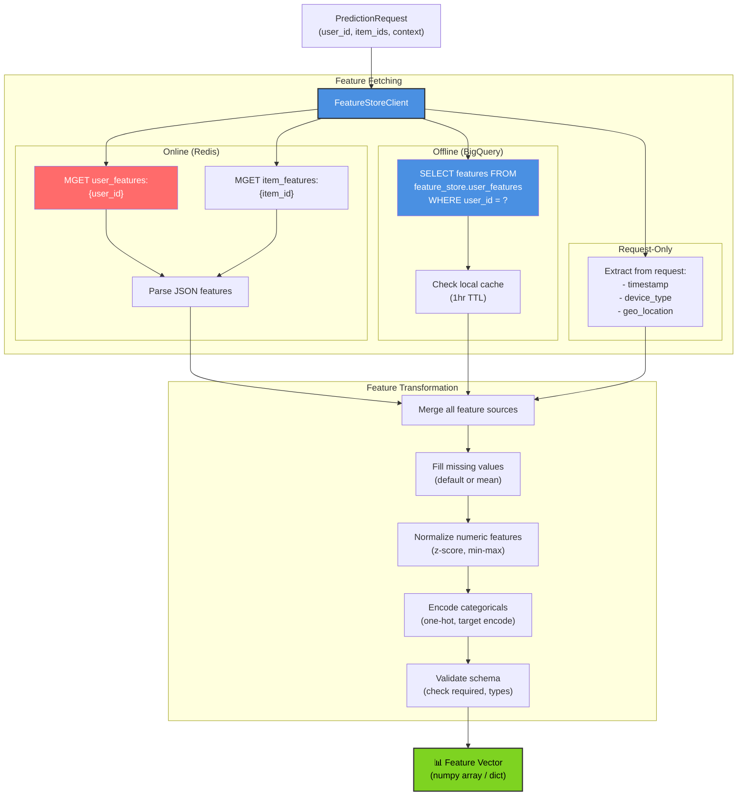
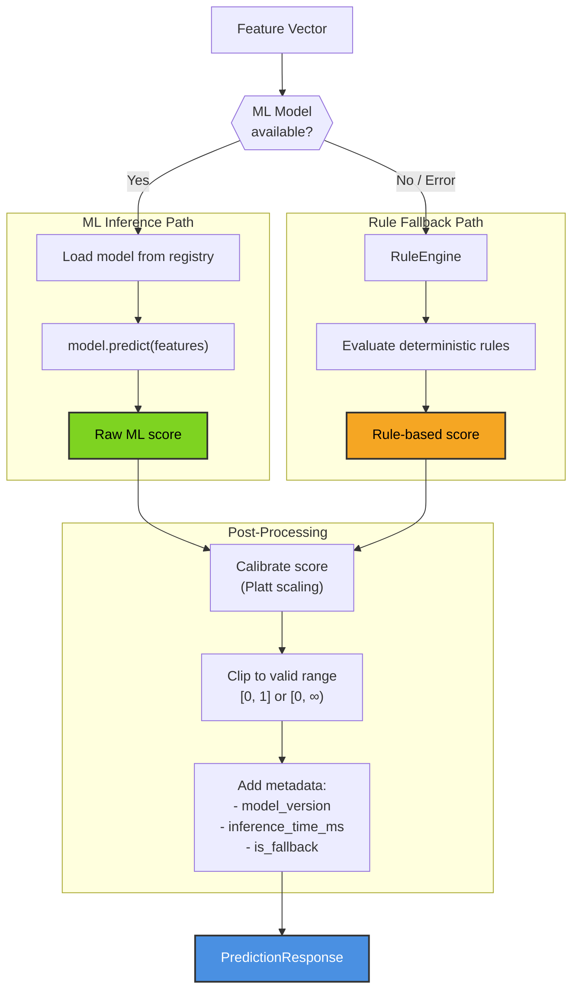
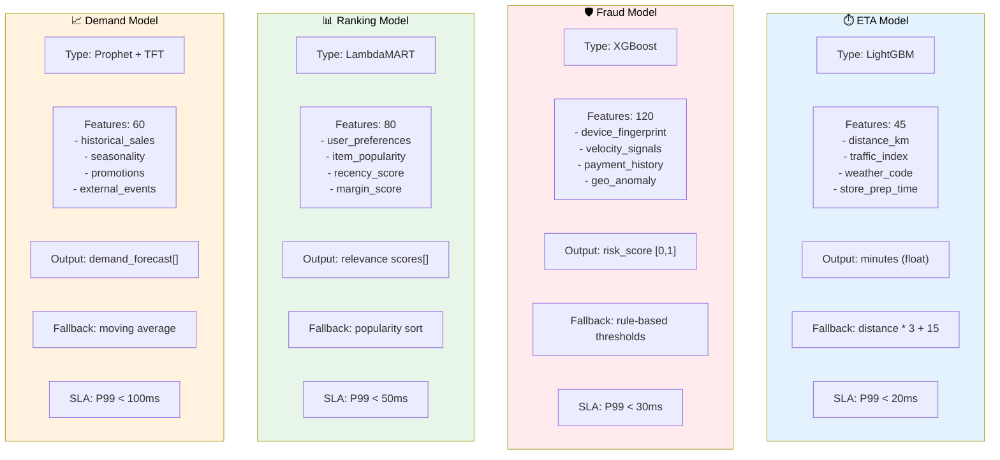
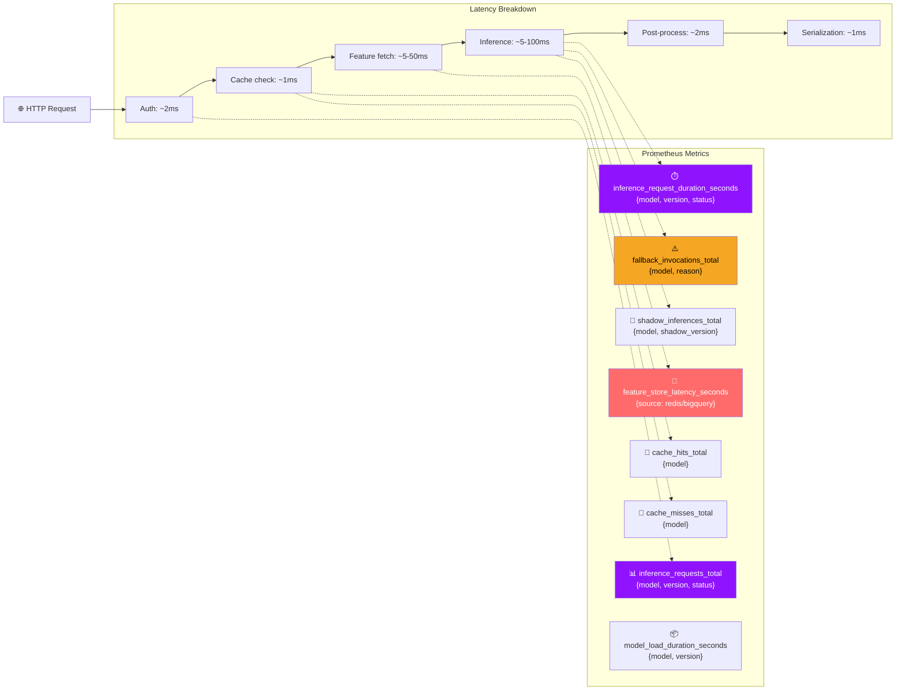
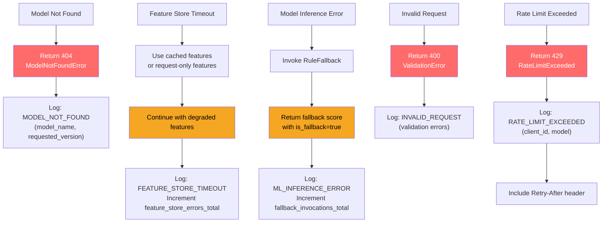

# AI Inference Service - Low-Level Design

## Component Architecture



## ModelRegistry Implementation



## FeatureStoreClient Pipeline



## InferenceEngine Decision Flow



## Per-Model Configurations



## Metrics Collection Pipeline



## SLO: P99 Latency Targets

```
┌─────────────────────────────────────────────────────────────┐
│  AI Inference Service Request Timeline (per model)          │
├─────────────────────────────────────────────────────────────┤
│ Request Parsing & Validation:          ~2ms                 │
│ Auth (JWT validation):                 ~3ms                 │
│ Cache Key Generation:                  ~1ms                 │
│ Cache Lookup (LRU in-memory):          ~0.5ms               │
│ Subtotal (overhead):                   ~6.5ms               │
│                                                             │
│ Feature Store (Redis online):          ~5ms (p99)           │
│ Feature Store (BigQuery, if needed):   ~50ms (p99, cached)  │
│ Feature Transformation:                ~3ms                 │
│                                                             │
│ Model Inference (varies by model):                          │
│   - ETA (LightGBM):                    ~10ms p99            │
│   - Fraud (XGBoost):                   ~15ms p99            │
│   - Ranking (LambdaMART):              ~25ms p99            │
│   - Demand (Prophet+TFT):              ~80ms p99            │
│   - Personalization (Two-Tower):       ~20ms p99            │
│   - CLV (BG/NBD):                      ~30ms p99            │
│   - Dynamic Pricing (Bandit):          ~15ms p99            │
│                                                             │
│ Post-Processing (calibration):         ~2ms                 │
│ Response Serialization:                ~1ms                 │
│                                                             │
│ TOTAL P99 (ETA, fastest):              ~30ms                │
│ TOTAL P99 (Demand, slowest):           ~140ms               │
│ TARGET:                                <200ms all models    │
│ STATUS:                                ✅ WITHIN SLO        │
└─────────────────────────────────────────────────────────────┘
```

## Error Handling & Resilience


