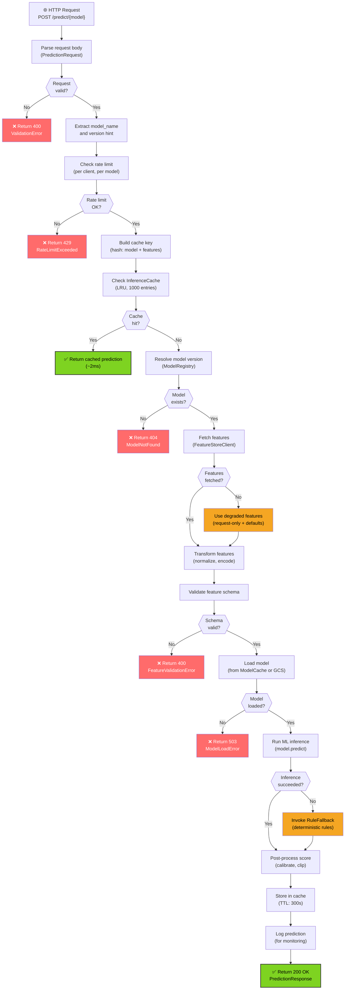
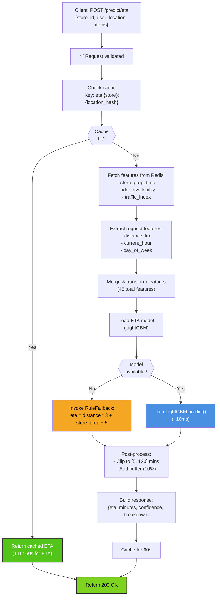
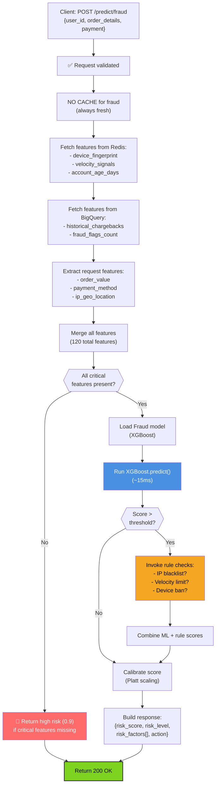
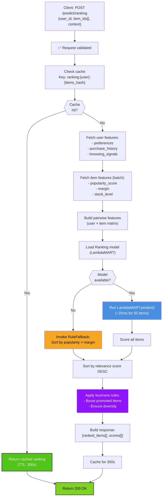
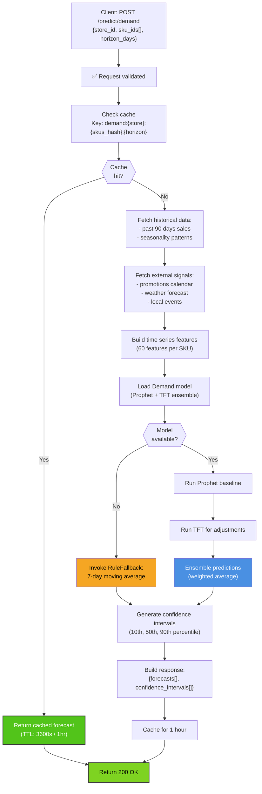
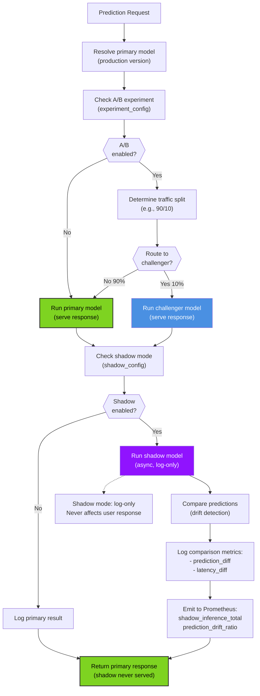
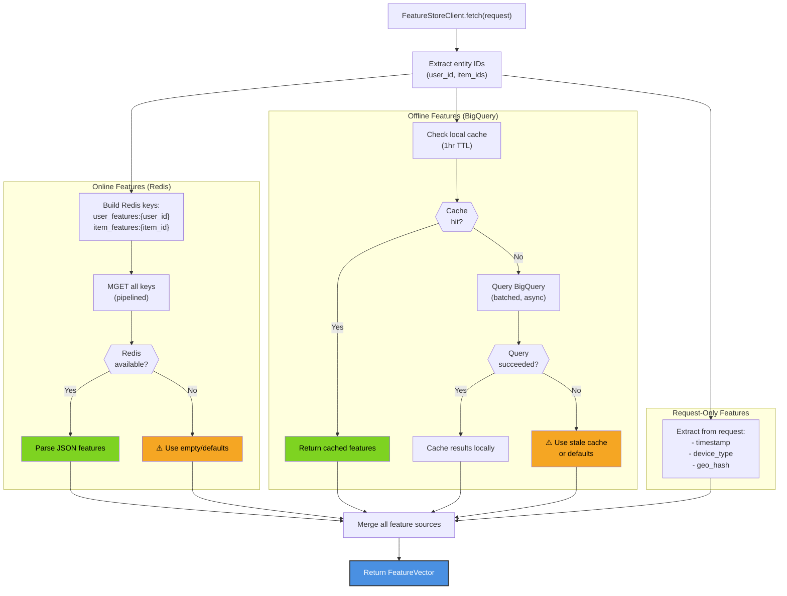

# AI Inference Service - Request Flowcharts

## Complete Inference Request Flow

## ETA Prediction Flow

## Fraud Scoring Flow

## Product Ranking Flow

## Demand Forecasting Flow

## Shadow & A/B Inference Flow

## Feature Store Fetch Flow

