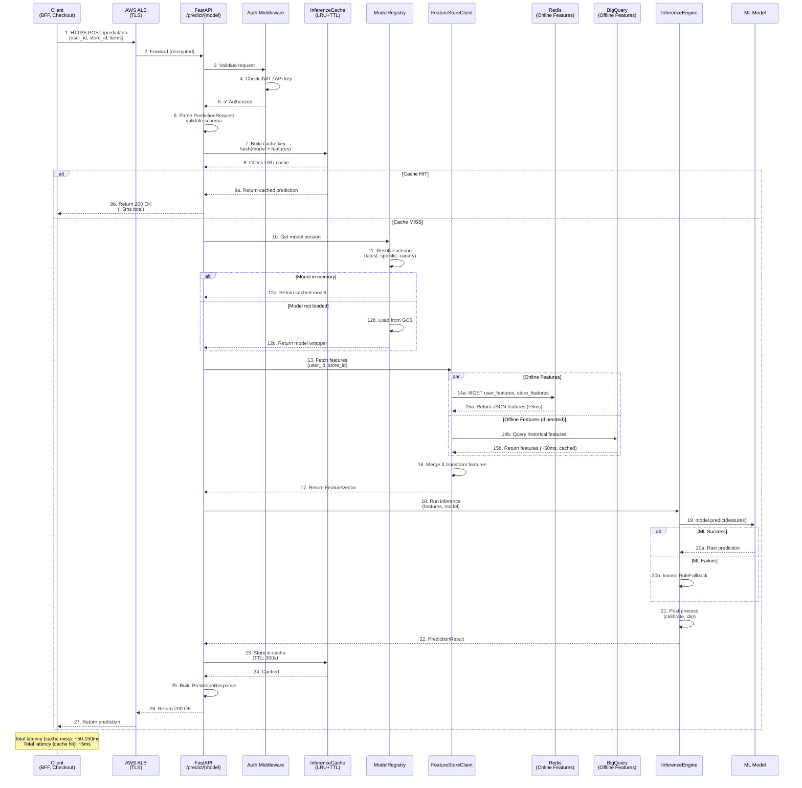
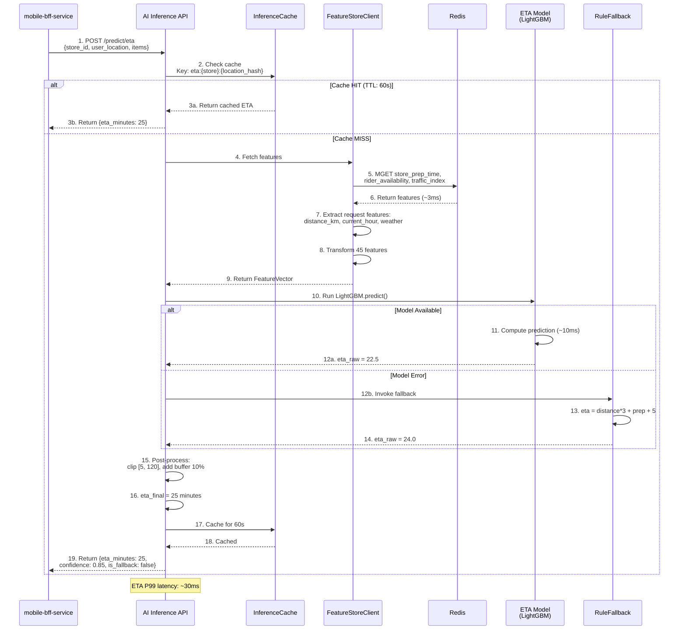
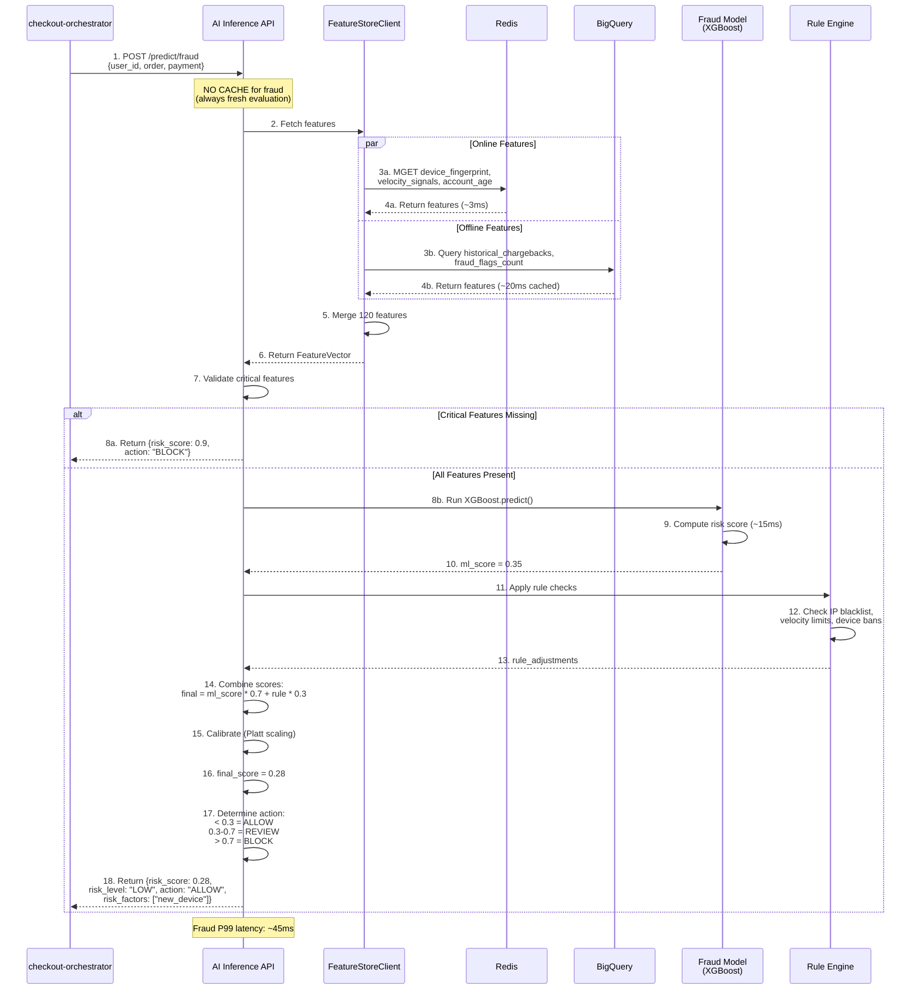
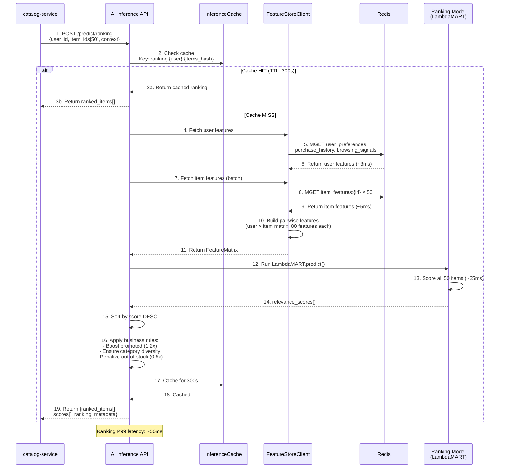
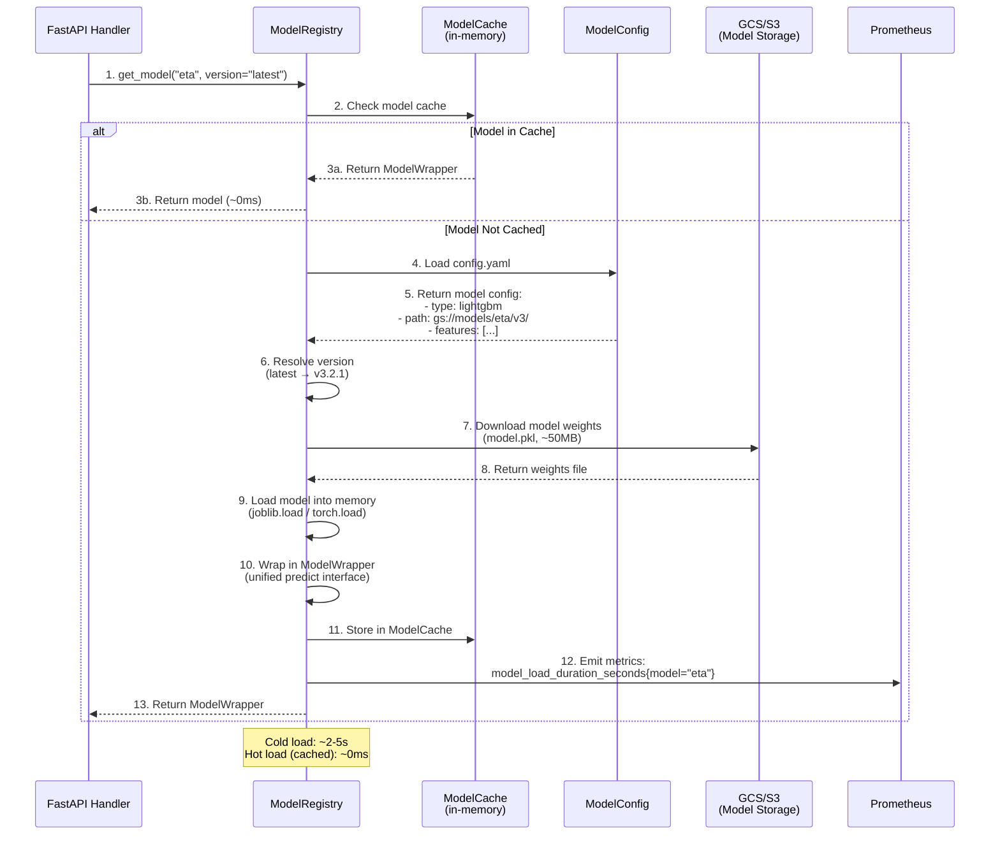
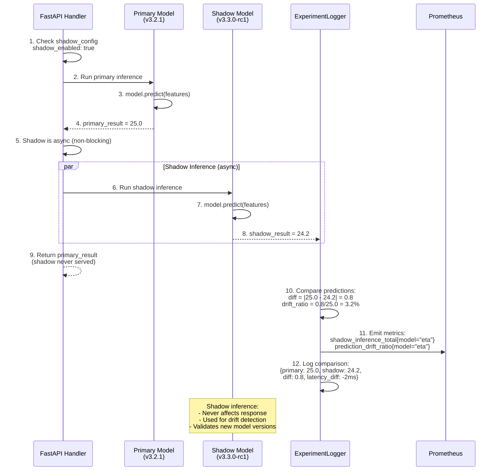
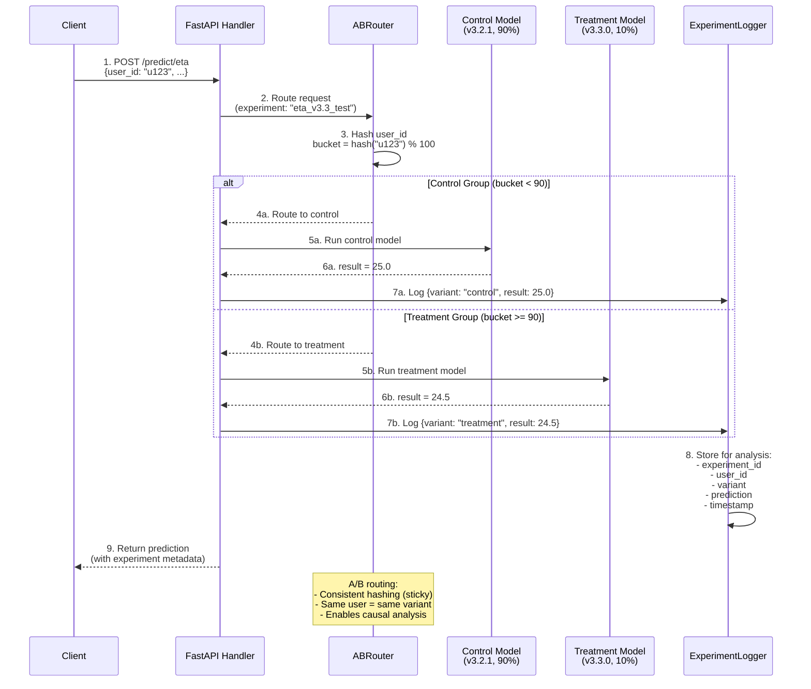
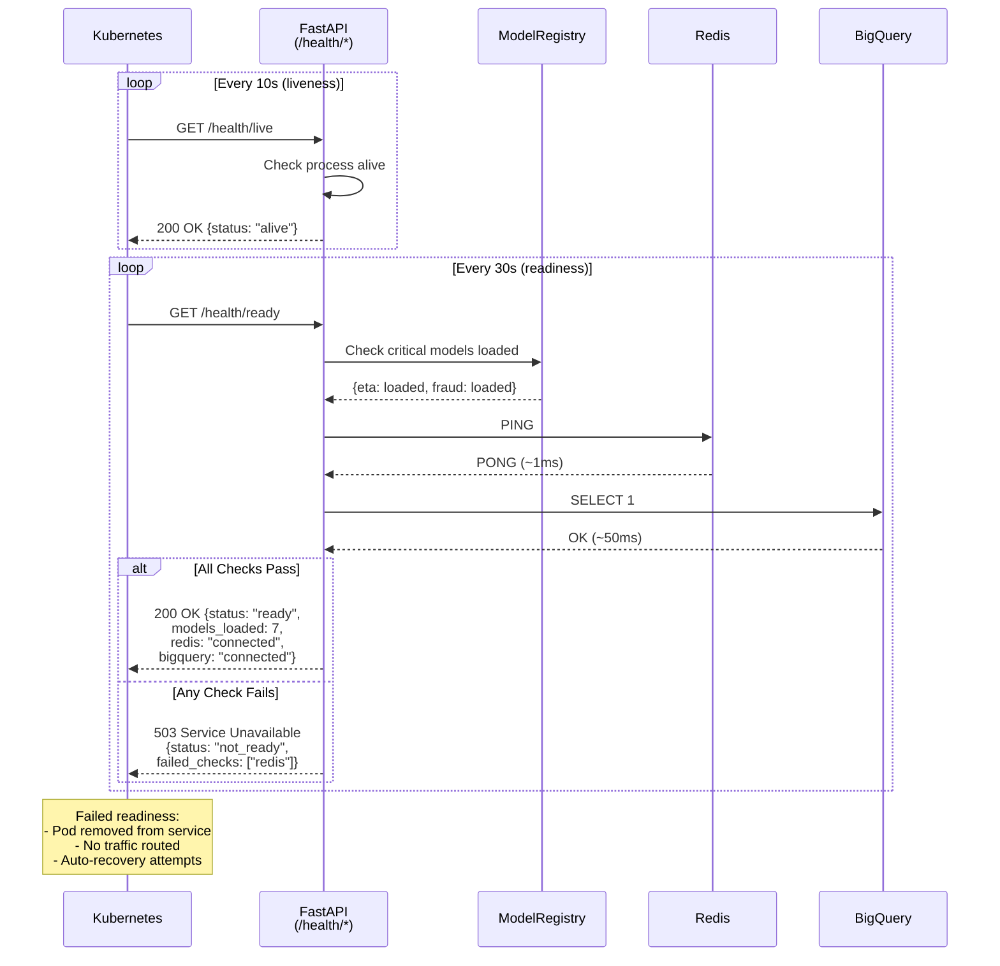

# AI Inference Service - Sequence Diagrams

## Complete Inference Request Sequence

## ETA Prediction Sequence

## Fraud Scoring Sequence

## Product Ranking Sequence

## Model Loading & Caching Sequence

## Shadow Inference Sequence

## A/B Experiment Routing Sequence

## Health Check & Readiness Sequence

