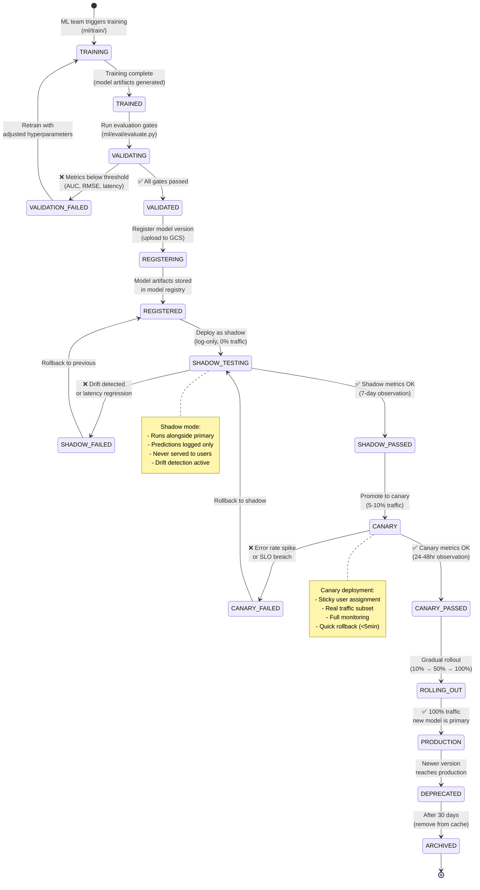
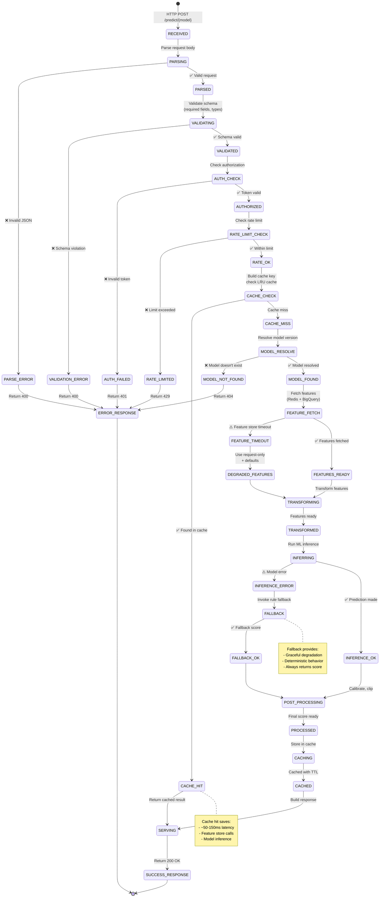
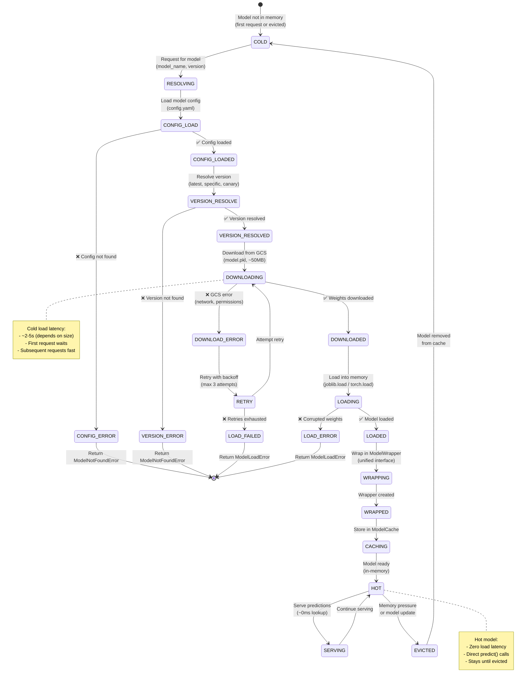
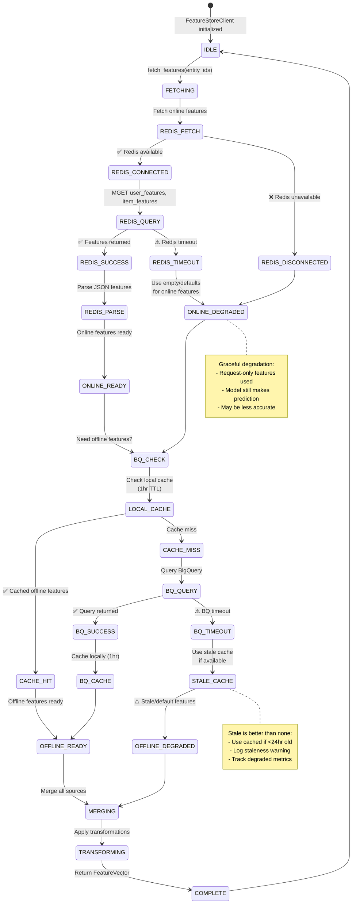
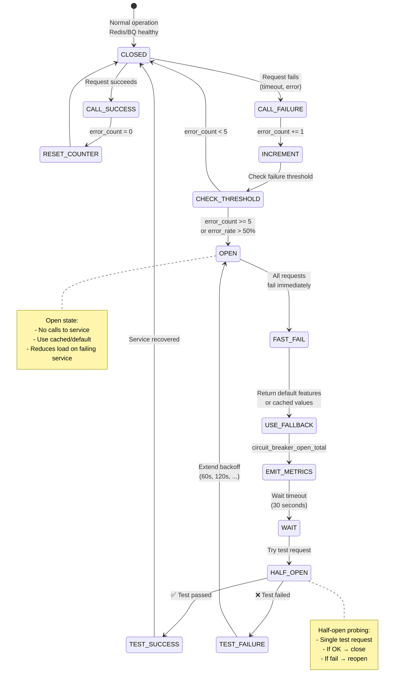
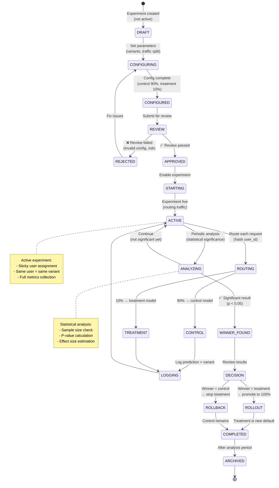
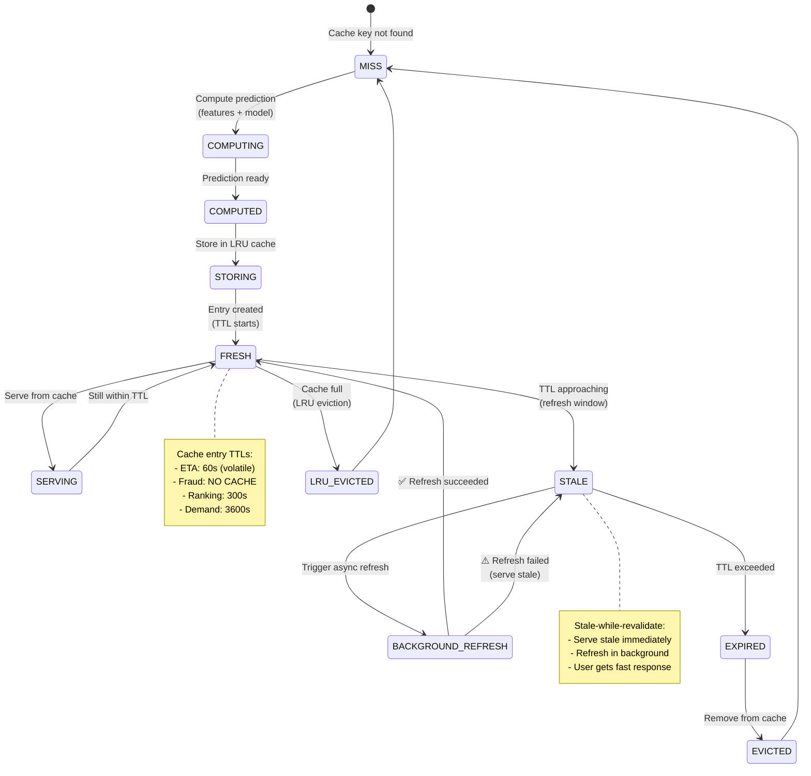
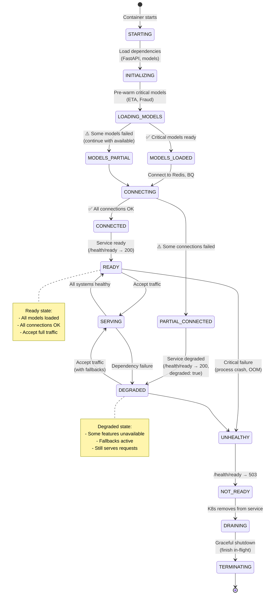

# AI Inference Service - State Machine Diagrams

## Model Deployment State Machine

## Inference Request State Machine

## Model Loading State Machine

## Feature Store Client State Machine

## Circuit Breaker State Machine (Feature Store)

## A/B Experiment State Machine

## Inference Cache Entry State Machine

## Service Health State Machine

