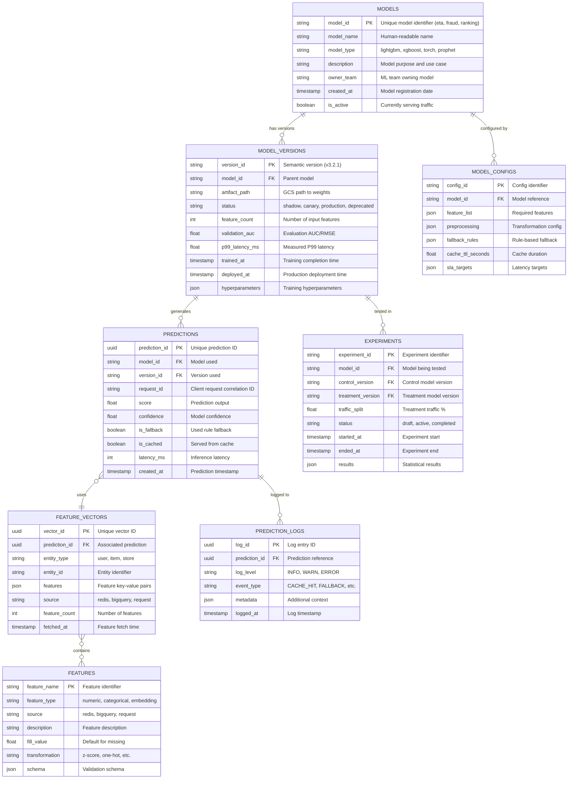
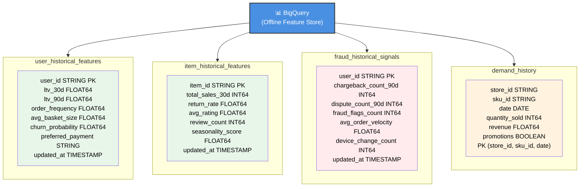
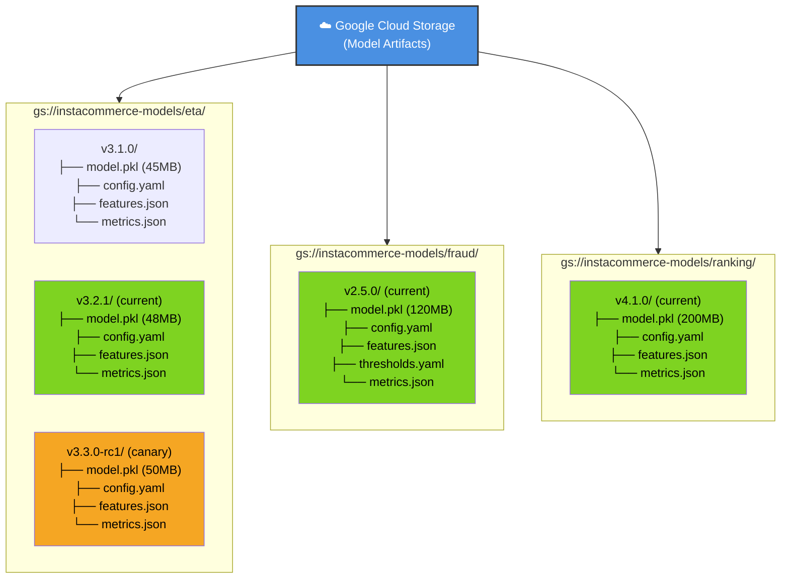
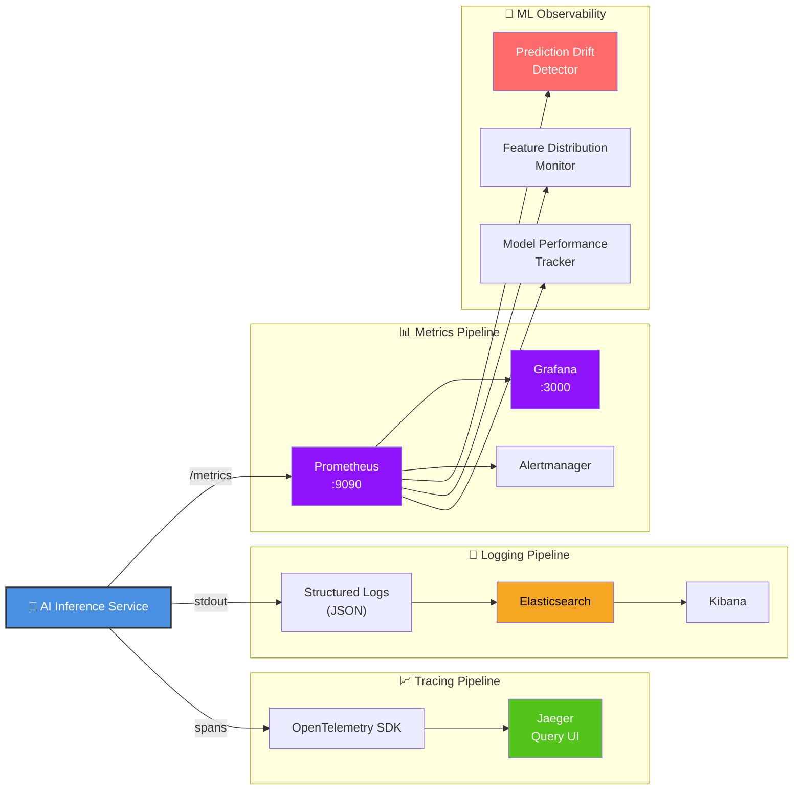
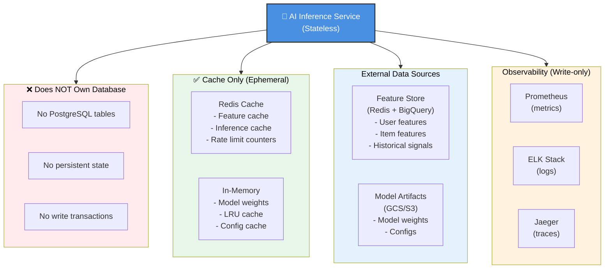
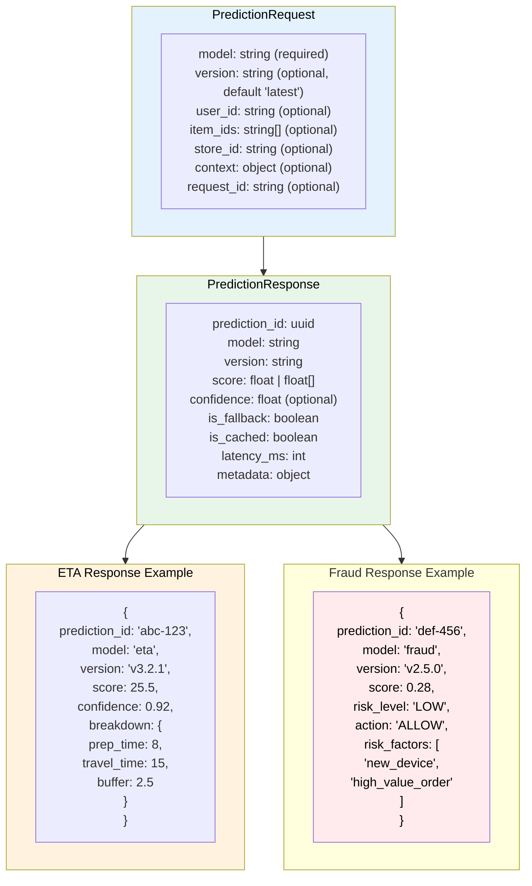

# AI Inference Service - ER Diagram & Data Model

## Core Data Model (Logical)



## Redis Cache Schema (Online Features)

```mermaid
graph TB
    Redis["🔴 Redis Cluster<br/>(Online Feature Store)"]

    subgraph UserFeatures["User Features"]
        UF_Key["user_features:{user_id}<br/>Type: JSON Hash<br/>TTL: 1 hour"]
        UF_Value["{<br/>  recent_orders: 5,<br/>  avg_basket_value: 45.50,<br/>  favorite_categories: ['grocery'],<br/>  session_count_7d: 12,<br/>  last_order_hours_ago: 48<br/>}"]
    end

    subgraph ItemFeatures["Item Features"]
        IF_Key["item_features:{item_id}<br/>Type: JSON Hash<br/>TTL: 15 minutes"]
        IF_Value["{<br/>  view_count_24h: 1500,<br/>  purchase_rate: 0.12,<br/>  stock_level: 85,<br/>  price: 12.99,<br/>  category: 'beverages'<br/>}"]
    end

    subgraph StoreFeatures["Store Features"]
        SF_Key["store_features:{store_id}<br/>Type: JSON Hash<br/>TTL: 5 minutes"]
        SF_Value["{<br/>  prep_time_minutes: 8,<br/>  active_riders: 12,<br/>  current_orders: 45,<br/>  avg_wait_time: 3.5<br/>}"]
    end

    subgraph InferenceCache["Inference Cache"]
        IC_Key["inference:{model}:{hash}<br/>Type: JSON<br/>TTL: varies by model"]
        IC_Value["{<br/>  score: 25.5,<br/>  confidence: 0.92,<br/>  model_version: 'v3.2.1',<br/>  cached_at: 1711000000<br/>}"]
    end

    subgraph RateLimits["Rate Limits"]
        RL_Key["rate_limit:{client}:{model}<br/>Type: Counter<br/>TTL: 60 seconds"]
        RL_Value["Current count: 45<br/>Limit: 100/minute"]
    end

    Redis --> UserFeatures
    Redis --> ItemFeatures
    Redis --> StoreFeatures
    Redis --> InferenceCache
    Redis --> RateLimits

    UF_Key --> UF_Value
    IF_Key --> IF_Value
    SF_Key --> SF_Value
    IC_Key --> IC_Value
    RL_Key --> RL_Value

    style Redis fill:#FF6B6B,color:#fff,stroke:#333,stroke-width:2px
    style UF_Value fill:#E8F5E9,color:#000
    style IF_Value fill:#E8F5E9,color:#000
    style SF_Value fill:#E8F5E9,color:#000
    style IC_Value fill:#E3F2FD,color:#000
    style RL_Value fill:#FFF3E0,color:#000
```



## BigQuery Offline Feature Tables



## Prometheus Metrics Schema

```
AI Inference Service Metrics
├─ inference_request_duration_seconds{model, version, status}
│  └ Histogram: Request latency distribution
│     Buckets: 0.01, 0.025, 0.05, 0.1, 0.25, 0.5, 1.0, 2.5
│
├─ inference_requests_total{model, version, status}
│  └ Counter: Total prediction requests
│     status: success, error, fallback, rate_limited
│
├─ model_inference_duration_seconds{model, version}
│  └ Histogram: Pure model.predict() latency
│     Excludes feature fetch, cache lookup
│
├─ feature_store_latency_seconds{source, operation}
│  └ Histogram: Feature fetch latency
│     source: redis, bigquery
│     operation: get, mget, query
│
├─ feature_store_errors_total{source, error_type}
│  └ Counter: Feature store failures
│     error_type: timeout, connection, parse
│
├─ cache_operations_total{model, operation}
│  └ Counter: Cache hits/misses
│     operation: hit, miss, store, evict
│
├─ cache_hit_ratio{model}
│  └ Gauge: Cache hit percentage (0-1)
│     Updated every 60s
│
├─ fallback_invocations_total{model, reason}
│  └ Counter: Rule fallback activations
│     reason: model_error, timeout, missing_features
│
├─ model_load_duration_seconds{model, version}
│  └ Histogram: Cold model load time
│     Includes GCS download + deserialization
│
├─ models_loaded_total{model}
│  └ Gauge: Currently loaded model count
│     Per model family
│
├─ shadow_inference_total{model, shadow_version}
│  └ Counter: Shadow inference executions
│
├─ prediction_drift_ratio{model}
│  └ Gauge: Shadow vs primary prediction drift
│     |shadow - primary| / primary
│
├─ experiment_assignments_total{experiment_id, variant}
│  └ Counter: A/B experiment assignments
│
└─ rate_limit_rejections_total{model, client}
   └ Counter: Rate limit exceeded events
```

## Model Artifact Storage (GCS)



## Observability Pipeline



## No Persistent Database (Stateless Service)



## Request/Response Data Structures


