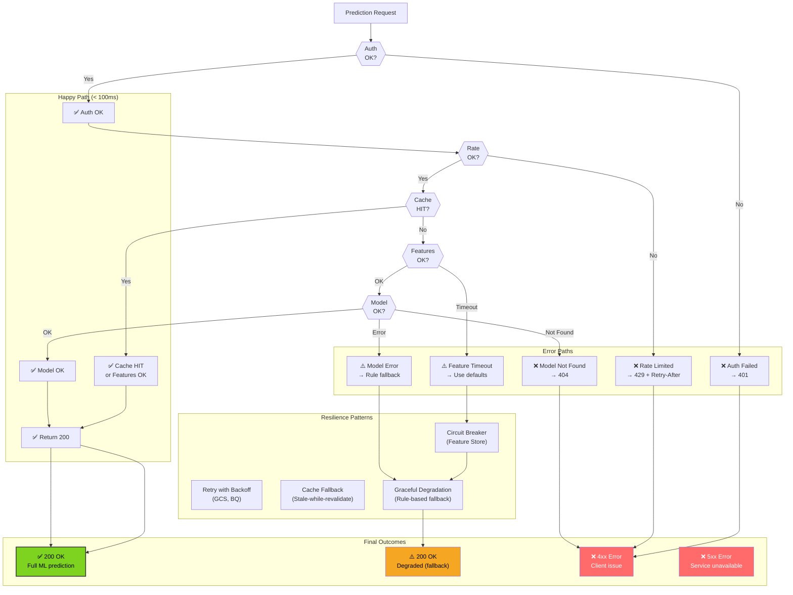
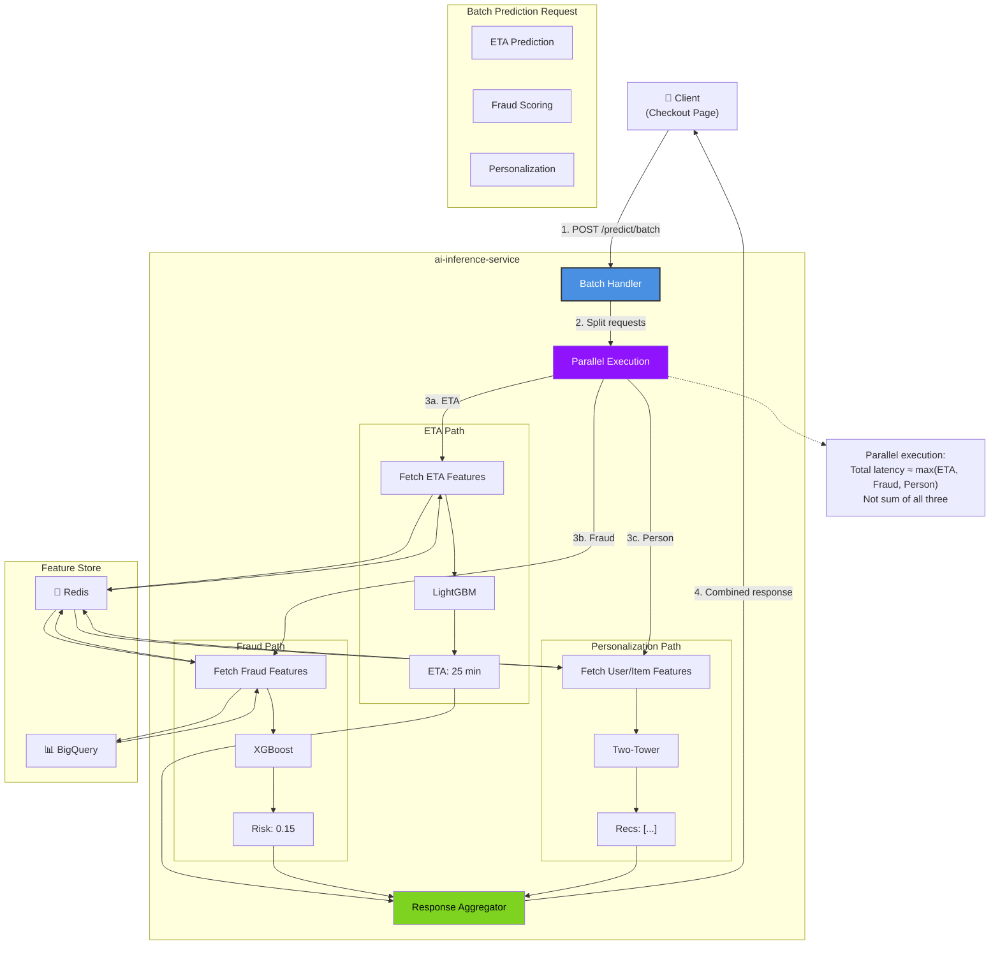
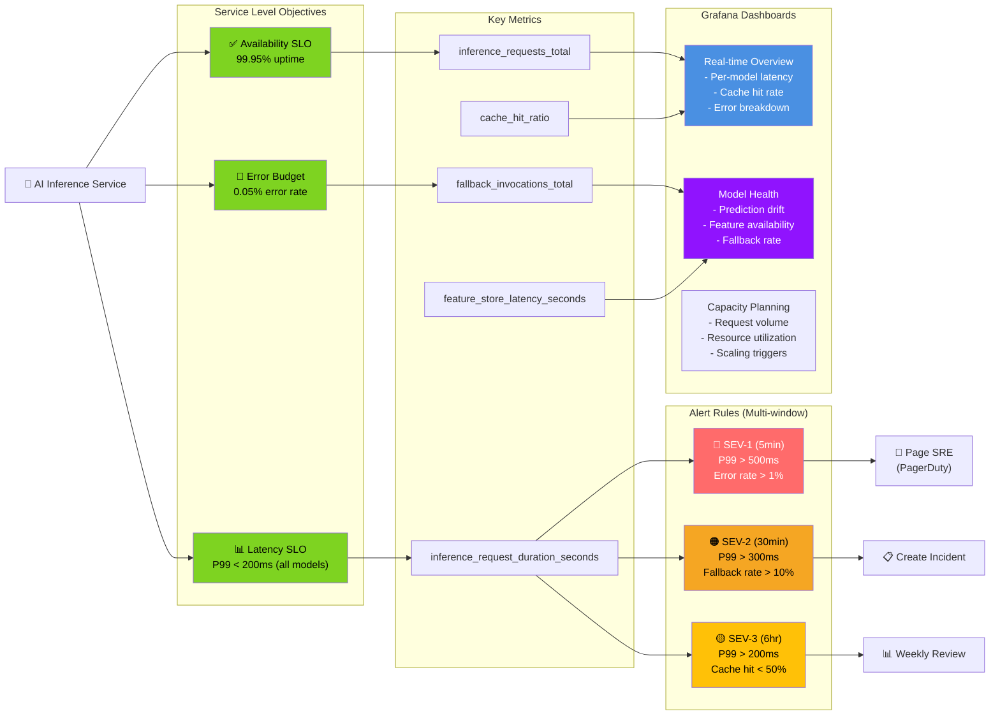

# AI Inference Service - End-to-End Flows

## Complete ETA Prediction Journey (E2E)

```mermaid
graph TB
    User["👤 Customer<br/>(Mobile App)"]
    App["📱 Mobile App<br/>(iOS/Android)"]
    CDN["🌍 CloudFront CDN"]
    ALB["⚖️ AWS ALB<br/>(TLS :443)"]

    subgraph BFFLayer["mobile-bff-service"]
        BFF["BFF Handler<br/>GET /cart/eta"]
        CartAggregator["Cart Aggregator"]
    end

    subgraph AIInfLayer["ai-inference-service :8101"]
        API["FastAPI Router<br/>POST /predict/eta"]
        Auth["Auth Middleware"]
        RateLimit["Rate Limiter"]
        CacheCheck["Cache Check<br/>(LRU)"]
        FeatureFetch["FeatureStoreClient"]
        ModelLoad["ModelRegistry"]
        Inference["InferenceEngine<br/>(LightGBM)"]
        PostProcess["PostProcessor"]
    end

    subgraph FeatureStores["Feature Stores"]
        Redis["🔴 Redis<br/>(store_features, traffic)"]
        BQ["📊 BigQuery<br/>(historical patterns)"]
    end

    subgraph ModelStorage["Model Storage"]
        GCS["☁️ GCS<br/>/models/eta/v3.2.1/"]
    end

    subgraph Observability["Observability"]
        Prom["📊 Prometheus"]
        Logs["📝 ELK Logs"]
        Traces["📈 Jaeger"]
    end

    User -->|1. View cart| App
    App -->|2. Request ETA| CDN
    CDN -->|3. Forward| ALB
    ALB -->|4. Route| BFF

    BFF -->|5. Get cart items| CartAggregator
    CartAggregator -->|6. Build request| BFF
    BFF -->|7. POST /predict/eta<br/>{store_id, user_location, items}| API

    API -->|8. Validate| Auth
    Auth -->|9. Check limit| RateLimit
    RateLimit -->|10. Check cache| CacheCheck

    CacheCheck -->|11a. Cache HIT| PostProcess
    CacheCheck -->|11b. Cache MISS| FeatureFetch

    FeatureFetch -->|12. MGET features| Redis
    Redis -->|13. Store prep time,<br/>traffic index (~3ms)| FeatureFetch

    FeatureFetch -->|14. Query patterns| BQ
    BQ -->|15. Historical data<br/>(cached ~20ms)| FeatureFetch

    FeatureFetch -->|16. Feature vector| ModelLoad
    ModelLoad -->|17. Get model| GCS
    GCS -->|18. Weights (if cold)| ModelLoad

    ModelLoad -->|19. Model ready| Inference
    Inference -->|20. LightGBM.predict()<br/>(~10ms)| PostProcess

    PostProcess -->|21. Calibrate, clip| CacheCheck
    CacheCheck -->|22. Store (TTL 60s)| PostProcess

    PostProcess -->|23. Return| API
    API -->|24. {eta: 25min}| BFF
    BFF -->|25. Enrich response| App
    App -->|26. Display| User

    API -->|27. Emit metrics| Prom
    API -->|28. Log request| Logs
    API -->|29. Span complete| Traces

    style User fill:#F5A623,color:#000
    style API fill:#4A90E2,color:#fff,stroke:#333,stroke-width:2px
    style Inference fill:#7ED321,color:#000,stroke:#333,stroke-width:2px
    style Redis fill:#FF6B6B,color:#fff
    style CacheCheck fill:#9013FE,color:#fff
```

## Fraud Scoring in Checkout Flow (E2E)

```mermaid
graph TB
    Customer["👤 Customer"]
    Checkout["🛒 checkout-orchestrator-service"]

    subgraph CheckoutFlow["Checkout Saga"]
        ValidateCart["Validate Cart"]
        ReserveInventory["Reserve Inventory"]
        FraudCheck["🛡️ Fraud Check"]
        ProcessPayment["Process Payment"]
        ConfirmOrder["Confirm Order"]
    end

    subgraph AIInfService["ai-inference-service"]
        FraudAPI["POST /predict/fraud"]
        FraudFeatures["Fetch Fraud Features"]
        FraudModel["XGBoost Fraud Model"]
        RuleEngine["Rule Engine"]
        FraudDecision["Risk Decision"]
    end

    subgraph FeatureSources["Feature Sources"]
        Redis["🔴 Redis<br/>(velocity, device)"]
        BQ["📊 BigQuery<br/>(chargebacks, history)"]
    end

    subgraph Outcomes["Fraud Outcomes"]
        Allow["✅ ALLOW<br/>(score < 0.3)"]
        Review["⚠️ REVIEW<br/>(0.3 ≤ score < 0.7)"]
        Block["❌ BLOCK<br/>(score ≥ 0.7)"]
    end

    Customer -->|1. Submit order| Checkout
    Checkout --> ValidateCart
    ValidateCart -->|2. Cart OK| ReserveInventory
    ReserveInventory -->|3. Inventory reserved| FraudCheck

    FraudCheck -->|4. POST /predict/fraud<br/>{user_id, order, payment}| FraudAPI

    FraudAPI -->|5. Fetch features| FraudFeatures
    FraudFeatures -->|6. MGET| Redis
    Redis -->|7. device_fingerprint,<br/>velocity_signals| FraudFeatures
    FraudFeatures -->|8. Query| BQ
    BQ -->|9. chargeback_count,<br/>fraud_flags| FraudFeatures

    FraudFeatures -->|10. 120 features| FraudModel
    FraudModel -->|11. XGBoost.predict()<br/>(~15ms)| RuleEngine
    RuleEngine -->|12. Apply rules<br/>(IP blacklist, etc.)| FraudDecision

    FraudDecision -->|13. risk_score: 0.25| FraudAPI
    FraudAPI -->|14. Return decision| FraudCheck

    FraudCheck -->|15a. ALLOW| ProcessPayment
    FraudCheck -->|15b. REVIEW| ManualReview["Manual Review Queue"]
    FraudCheck -->|15c. BLOCK| BlockOrder["Block & Notify"]

    ProcessPayment -->|16. Payment OK| ConfirmOrder
    ConfirmOrder -->|17. Order confirmed| Customer

    style FraudCheck fill:#FF6B6B,color:#fff,stroke:#333,stroke-width:2px
    style FraudModel fill:#4A90E2,color:#fff
    style Allow fill:#7ED321,color:#000
    style Review fill:#F5A623,color:#000
    style Block fill:#FF6B6B,color:#fff
```

## Product Ranking in Catalog (E2E)

```mermaid
graph TB
    User["👤 Customer"]
    App["📱 Mobile App"]

    subgraph CatalogService["catalog-service"]
        CatalogAPI["GET /category/{id}/products"]
        ProductFetch["Fetch Products"]
        RankingCall["Call Ranking Service"]
        ApplyRanking["Apply Ranked Order"]
        ResponseBuild["Build Response"]
    end

    subgraph AIInfService["ai-inference-service"]
        RankingAPI["POST /predict/ranking"]
        RankingCache["Check Cache"]
        UserFeatures["Fetch User Prefs"]
        ItemFeatures["Fetch Item Features"]
        RankingModel["LambdaMART Model"]
        BusinessRules["Business Rules"]
    end

    subgraph FeatureStore["Feature Store"]
        Redis["🔴 Redis"]
    end

    subgraph Results["Ranking Results"]
        RankedItems["Ranked Items<br/>[item_5, item_2, item_8, ...]"]
    end

    User -->|1. Browse category| App
    App -->|2. GET /category/beverages| CatalogAPI

    CatalogAPI -->|3. Get products| ProductFetch
    ProductFetch -->|4. 50 products| RankingCall

    RankingCall -->|5. POST /predict/ranking<br/>{user_id, item_ids[50]}| RankingAPI

    RankingAPI -->|6. Check cache| RankingCache
    RankingCache -->|7a. Cache HIT| ResponseBuild
    RankingCache -->|7b. Cache MISS| UserFeatures

    UserFeatures -->|8. MGET user prefs| Redis
    Redis -->|9. preferences,<br/>purchase_history| UserFeatures

    UserFeatures -->|10. Get item features| ItemFeatures
    ItemFeatures -->|11. MGET × 50| Redis
    Redis -->|12. popularity,<br/>margin, stock| ItemFeatures

    ItemFeatures -->|13. Feature matrix| RankingModel
    RankingModel -->|14. LambdaMART.predict()<br/>(~25ms)| BusinessRules

    BusinessRules -->|15. Apply rules:<br/>- Boost promoted<br/>- Ensure diversity| RankingCache
    RankingCache -->|16. Cache (TTL 300s)| RankingAPI

    RankingAPI -->|17. ranked_items[]| RankingCall
    RankingCall -->|18. Apply order| ApplyRanking
    ApplyRanking -->|19. Build response| ResponseBuild
    ResponseBuild -->|20. Return products| App
    App -->|21. Display| User

    style RankingModel fill:#7ED321,color:#000,stroke:#333,stroke-width:2px
    style BusinessRules fill:#9013FE,color:#fff
    style RankedItems fill:#4A90E2,color:#fff
```

## Model Deployment Pipeline (E2E)

```mermaid
graph TB
    subgraph Training["ML Training (ml/train/)"]
        Train["Train Model"]
        Evaluate["Evaluate<br/>(ml/eval/)"]
        ValidateGates["Validation Gates<br/>(AUC > 0.85, latency < 50ms)"]
    end

    subgraph Registration["Model Registration"]
        UploadGCS["Upload to GCS"]
        RegisterVersion["Register Version"]
        UpdateConfig["Update config.yaml"]
    end

    subgraph ShadowPhase["Shadow Testing (7 days)"]
        DeployShadow["Deploy as Shadow"]
        ShadowInference["Run Shadow Inference<br/>(log-only)"]
        DriftDetection["Drift Detection"]
        ShadowMetrics["Shadow Metrics"]
    end

    subgraph CanaryPhase["Canary Deployment (24-48h)"]
        DeployCanary["Deploy 5-10% Traffic"]
        CanaryMetrics["Monitor Metrics"]
        CanaryAlerts["Alert Rules"]
    end

    subgraph Production["Production Rollout"]
        GradualRollout["Gradual Rollout<br/>(10% → 50% → 100%)"]
        FullProduction["100% Production"]
        Monitoring["Continuous Monitoring"]
    end

    subgraph Rollback["Rollback Capability"]
        RollbackTrigger["Detect Issue<br/>(error rate, latency)"]
        QuickRollback["Instant Rollback<br/>(< 5 minutes)"]
        PreviousVersion["Revert to Previous"]
    end

    Train -->|1. Complete| Evaluate
    Evaluate -->|2. Pass gates| ValidateGates
    ValidateGates -->|3. ✅ Approved| UploadGCS

    UploadGCS -->|4. Artifacts stored| RegisterVersion
    RegisterVersion -->|5. v3.3.0| UpdateConfig

    UpdateConfig -->|6. Enable shadow| DeployShadow
    DeployShadow -->|7. 0% traffic| ShadowInference
    ShadowInference -->|8. Log predictions| DriftDetection
    DriftDetection -->|9. < 5% drift| ShadowMetrics
    ShadowMetrics -->|10. 7 days OK| DeployCanary

    DeployCanary -->|11. 5% traffic| CanaryMetrics
    CanaryMetrics -->|12. SLO OK| CanaryAlerts
    CanaryAlerts -->|13. No alerts| GradualRollout

    GradualRollout -->|14. Progressive| FullProduction
    FullProduction -->|15. 100%| Monitoring

    Monitoring -->|16. Issue detected| RollbackTrigger
    RollbackTrigger -->|17. Auto/manual| QuickRollback
    QuickRollback -->|18. Instant| PreviousVersion

    style ValidateGates fill:#7ED321,color:#000
    style ShadowInference fill:#9013FE,color:#fff
    style DeployCanary fill:#F5A623,color:#000
    style FullProduction fill:#4A90E2,color:#fff,stroke:#333,stroke-width:2px
    style QuickRollback fill:#FF6B6B,color:#fff
```



## Error Handling & Resilience (E2E)



## Multi-Model Batch Prediction (E2E)



## SLO Monitoring & Alerting (E2E)



## Request Timeline Breakdown

```
┌─────────────────────────────────────────────────────────────────────┐
│  AI Inference Service - Complete Request Timeline                    │
├─────────────────────────────────────────────────────────────────────┤
│                                                                      │
│  PHASE 1: Request Processing (~5ms)                                 │
│  ├── TLS termination (ALB):           ~2ms                          │
│  ├── Request parsing:                 ~1ms                          │
│  ├── Auth validation:                 ~1ms                          │
│  └── Rate limit check:                ~1ms                          │
│                                                                      │
│  PHASE 2: Cache Check (~1ms)                                        │
│  ├── Build cache key (hash):          ~0.5ms                        │
│  └── LRU lookup:                      ~0.5ms                        │
│                                                                      │
│  === IF CACHE HIT: Return immediately (~7ms total) ===              │
│                                                                      │
│  PHASE 3: Feature Fetch (~10-50ms)                                  │
│  ├── Redis online features:           ~3-5ms (p99)                  │
│  ├── BigQuery offline (if needed):    ~20-50ms (cached)             │
│  └── Feature transformation:          ~2-3ms                        │
│                                                                      │
│  PHASE 4: Model Inference (varies by model)                         │
│  ├── ETA (LightGBM):                  ~8-12ms (p99)                 │
│  ├── Fraud (XGBoost):                 ~12-18ms (p99)                │
│  ├── Ranking (LambdaMART):            ~20-30ms (p99)                │
│  ├── Demand (Prophet+TFT):            ~70-100ms (p99)               │
│  ├── Personalization (Two-Tower):     ~15-25ms (p99)                │
│  ├── CLV (BG/NBD):                    ~25-35ms (p99)                │
│  └── Dynamic Pricing (Bandit):        ~10-18ms (p99)                │
│                                                                      │
│  PHASE 5: Post-Processing (~3ms)                                    │
│  ├── Score calibration:               ~1ms                          │
│  ├── Range clipping:                  ~0.5ms                        │
│  ├── Cache storage:                   ~1ms                          │
│  └── Response serialization:          ~0.5ms                        │
│                                                                      │
│  ═══════════════════════════════════════════════════════════════    │
│                                                                      │
│  TOTAL LATENCY (P99 examples):                                      │
│  ├── Cache HIT:                       ~7ms                          │
│  ├── ETA (cache miss):                ~35ms                         │
│  ├── Fraud (cache miss):              ~45ms                         │
│  ├── Ranking (cache miss):            ~60ms                         │
│  └── Demand (cache miss):             ~140ms                        │
│                                                                      │
│  SLO TARGET:                          <200ms all models             │
│  STATUS:                              ✅ WITHIN SLO                 │
│                                                                      │
└─────────────────────────────────────────────────────────────────────┘
```
