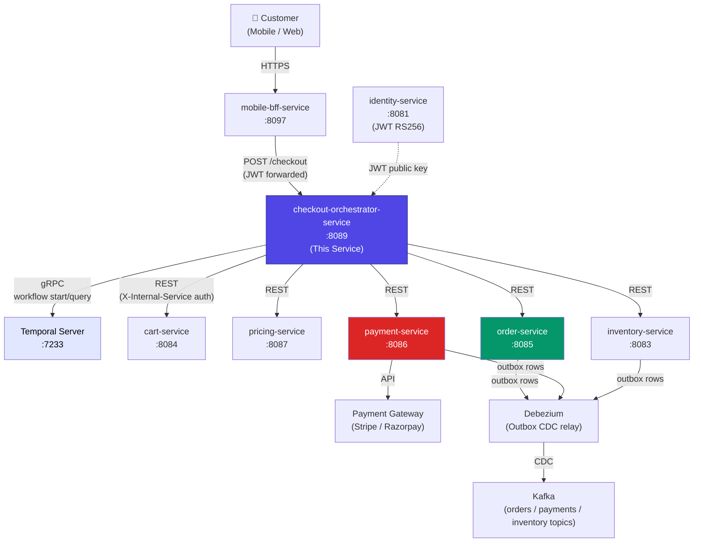
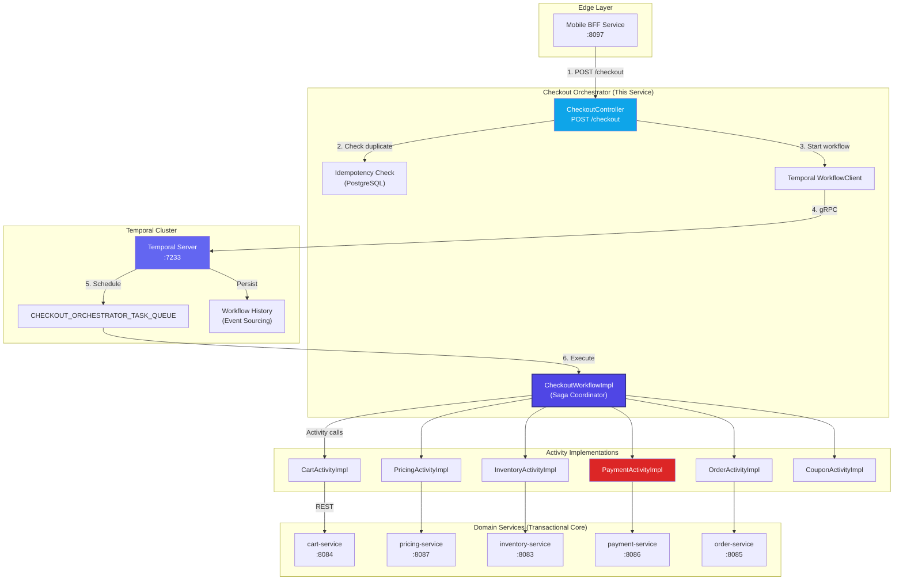
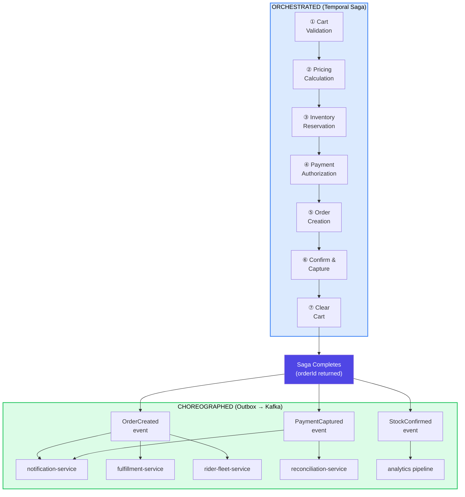
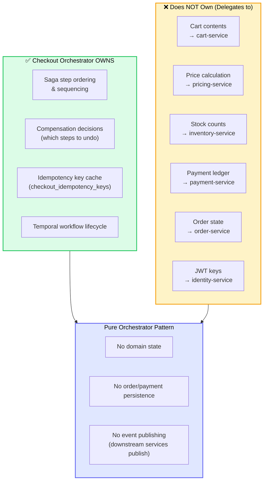
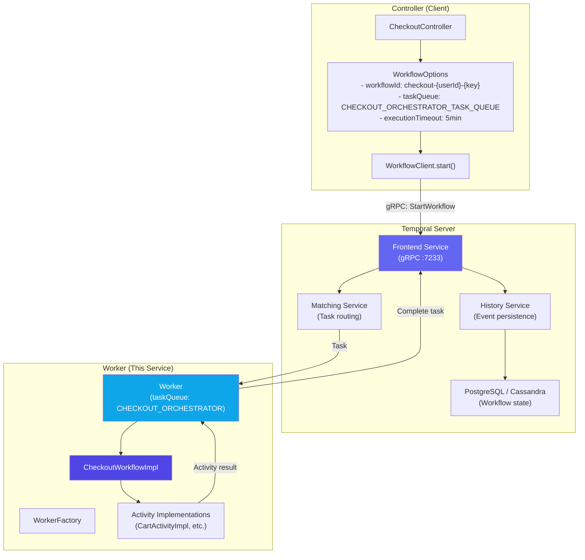
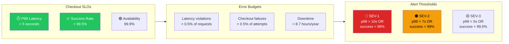

# Checkout Orchestrator - High-Level Design

## System Context

## Saga Orchestration Architecture

## Hybrid Orchestration / Choreography Model

## Service Boundary & Ownership

## Temporal Integration Architecture

## Critical Path SLOs

