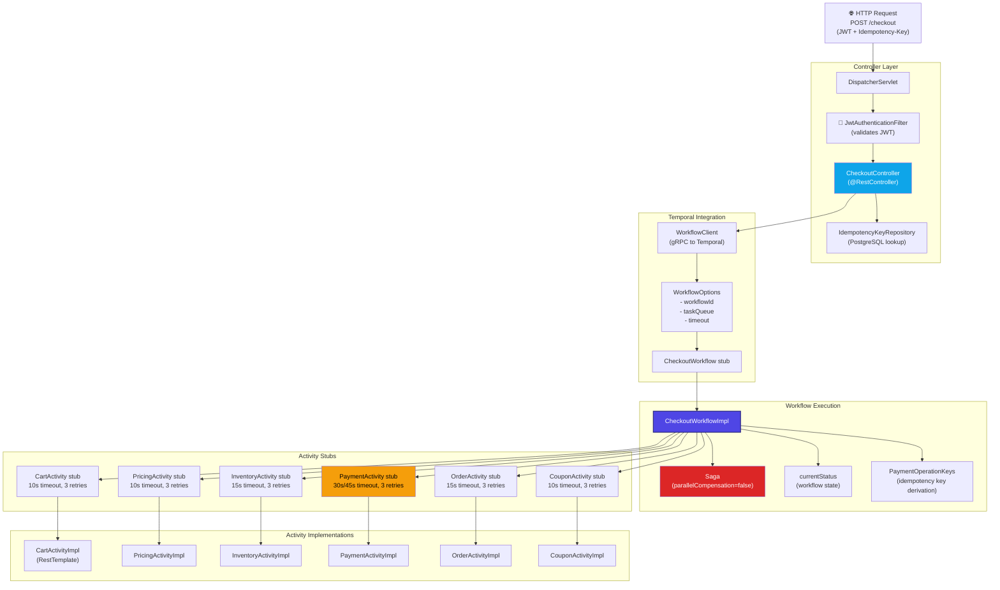
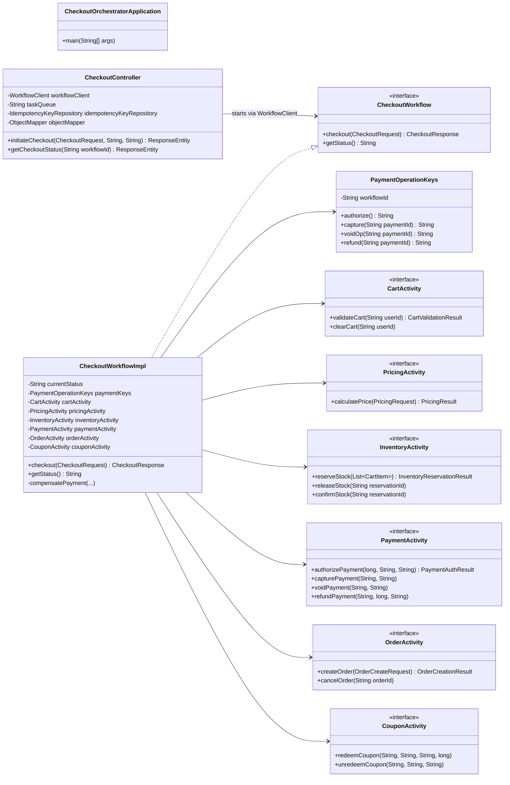
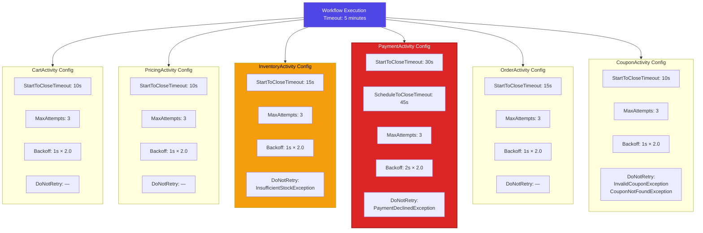
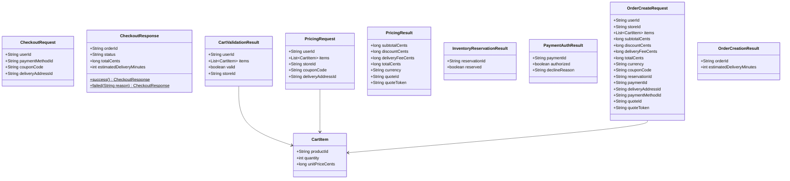
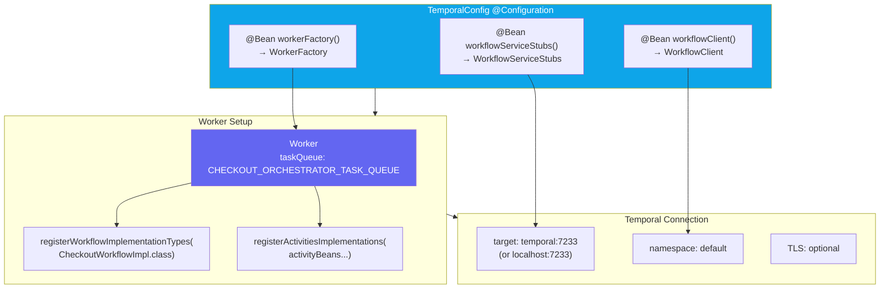
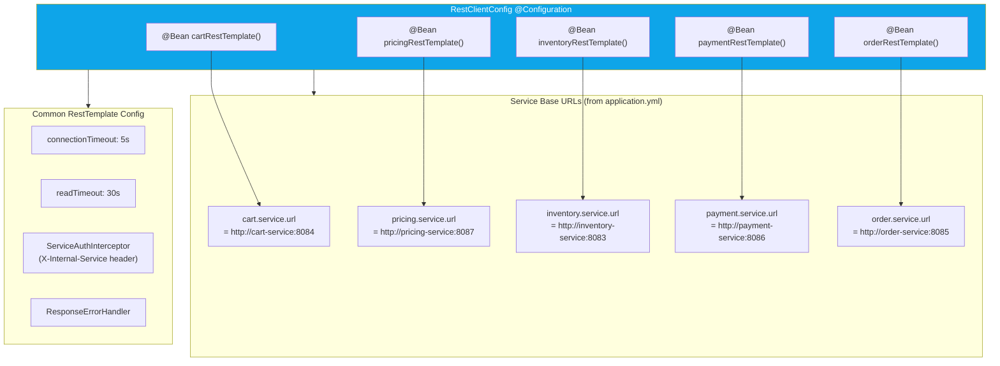
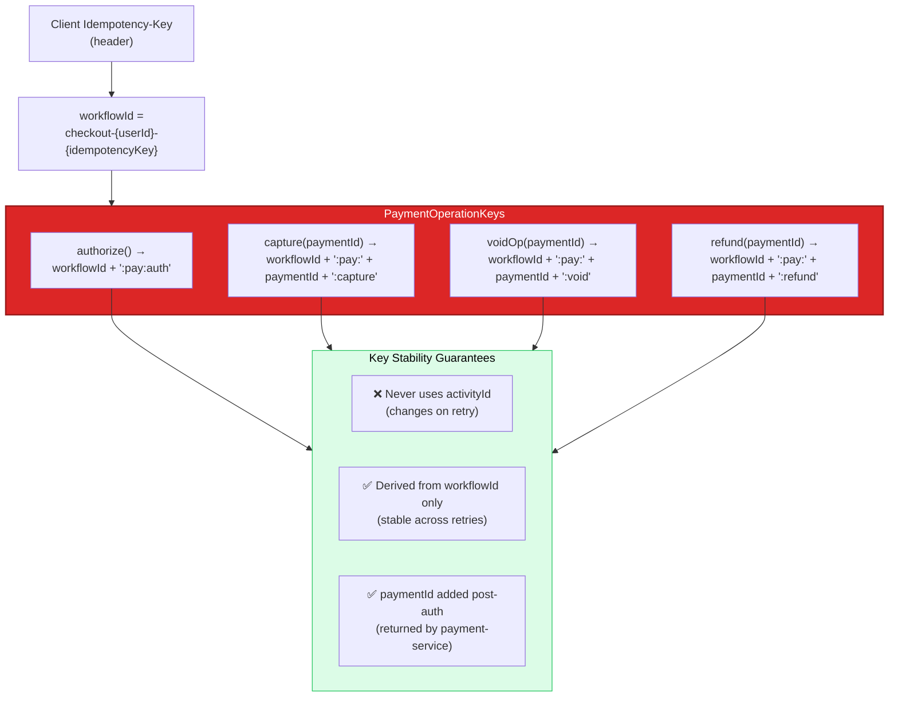
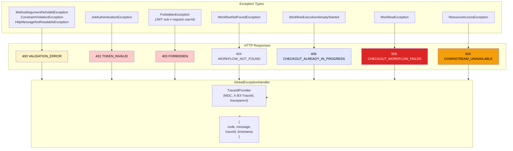

# Checkout Orchestrator - Low-Level Design

## Component Architecture



## Class Diagram



## Activity Timeout Configuration



## Data Types (DTOs)



## Temporal Worker Configuration



## REST Client Configuration



## Idempotency Key Derivation



## Error Handling & Exception Mapping



## Latency Budget Analysis

```
┌─────────────────────────────────────────────────────────────────┐
│  Checkout Workflow Latency Budget (P99 target: <5s)             │
├─────────────────────────────────────────────────────────────────┤
│ Controller overhead (JWT, idempotency check):     ~50ms         │
│ Temporal workflow start:                          ~100ms        │
│                                                                 │
│ ① Cart validation (cart-service):                 ~200ms p99    │
│ ② Pricing calculation (pricing-service):          ~300ms p99    │
│ ③ Inventory reservation (inventory-service):      ~200ms p99    │
│ ④ Payment authorization (payment-service + PSP):  ~1500ms p99   │
│ ⑤ Order creation (order-service):                 ~300ms p99    │
│ ⑥ Stock confirm + Payment capture:                ~800ms p99    │
│ ⑦ Cart clear (best effort):                       ~100ms        │
│                                                                 │
│ Temporal history persistence:                     ~100ms        │
│                                                                 │
│ TOTAL P99 (single attempt):                       ~3650ms       │
│ BUFFER (5s target):                               ~1350ms       │
│ STATUS:                                           ✅ WITHIN SLO │
│                                                                 │
│ NOTE: With retries at max backoff, worst case approaches 5min   │
│       workflow execution timeout                                │
└─────────────────────────────────────────────────────────────────┘
```
