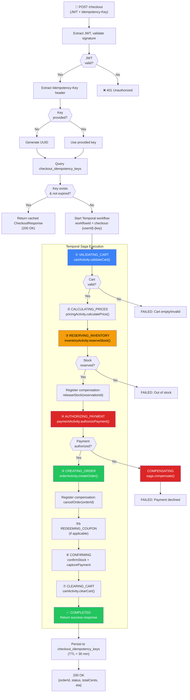
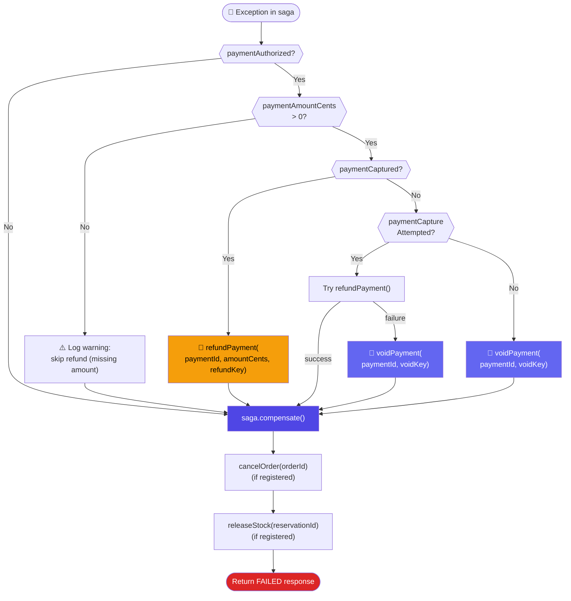
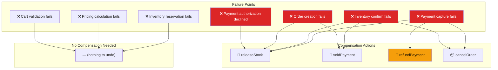
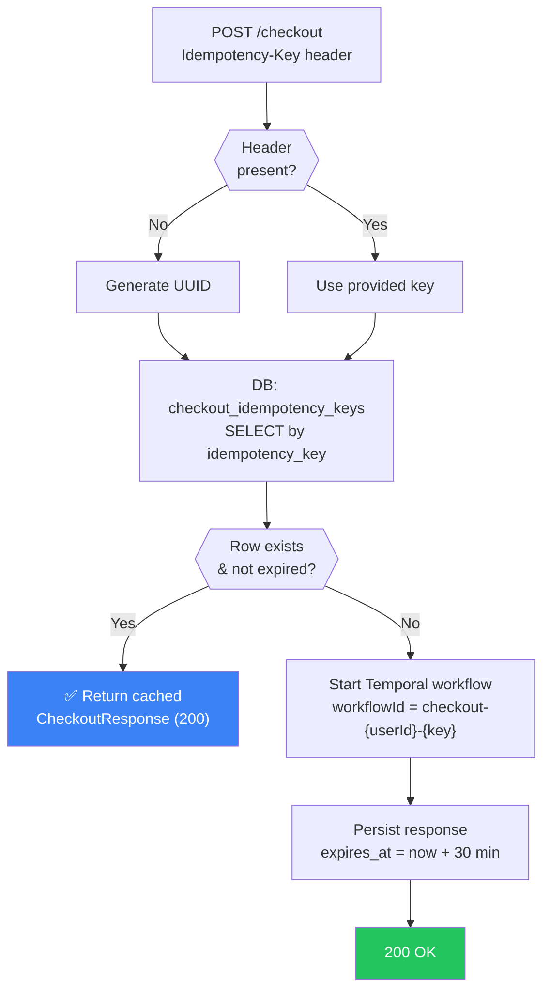
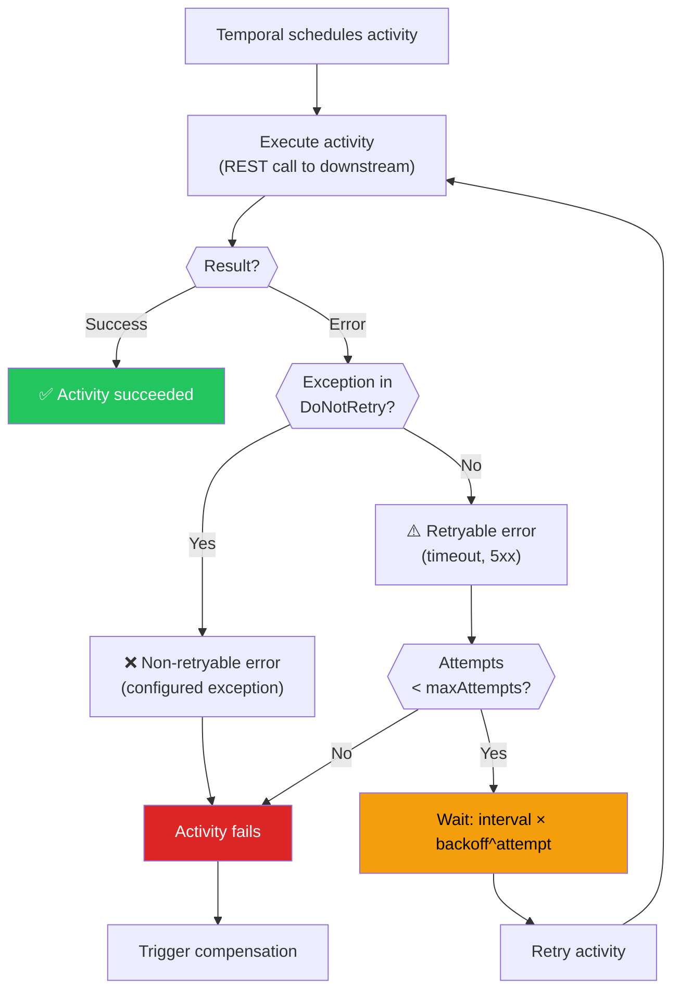
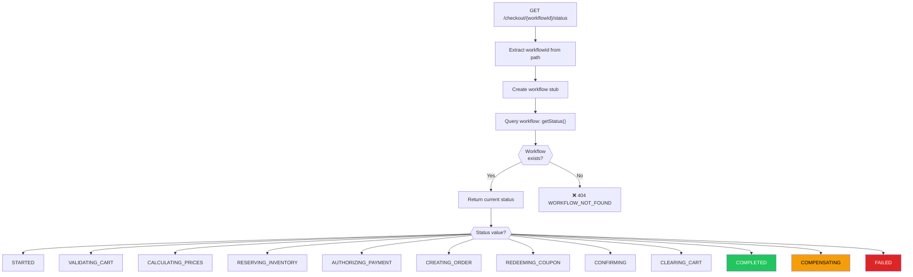
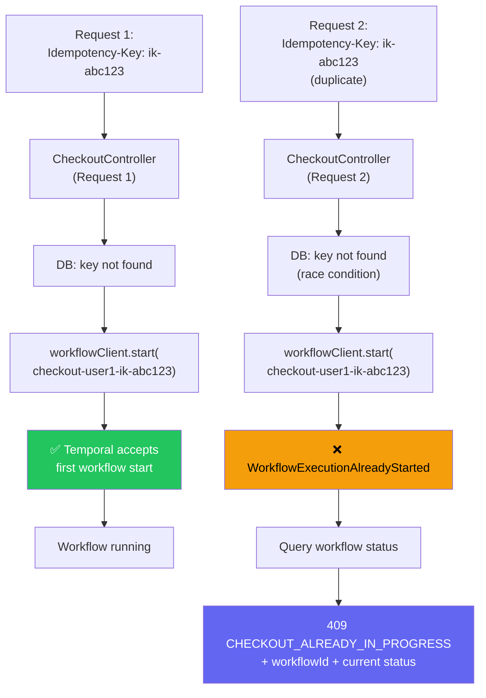
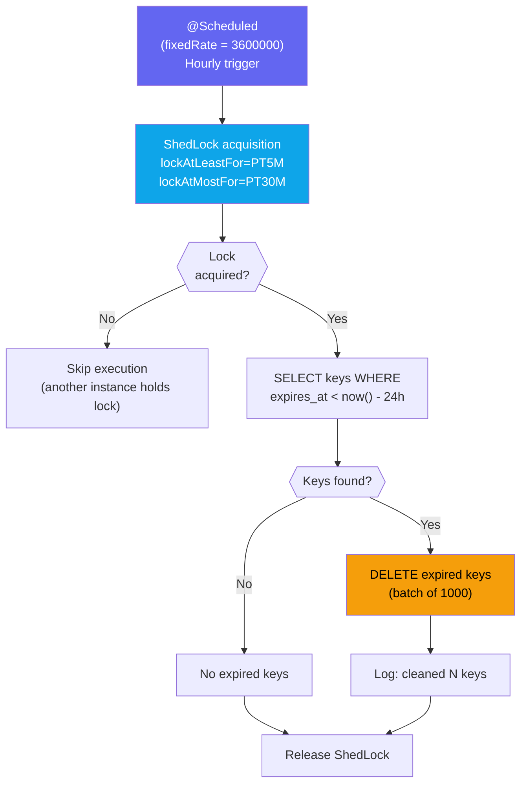
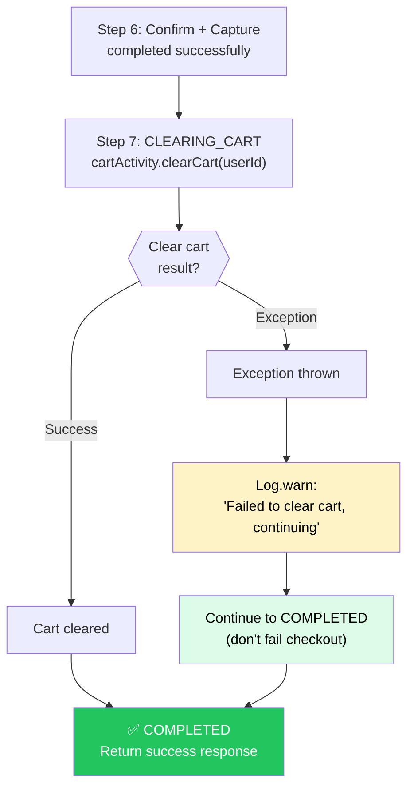

# Checkout Orchestrator - Flowcharts

## Complete Checkout Saga Flow

## Payment Compensation Strategy (Three-Tier)

## Failure Point Compensation Matrix

## Idempotency Check Flow

## Activity Retry Flow

## Workflow Status Query Flow

## Concurrent Checkout Prevention

## Idempotency Key Cleanup Flow

## Cart Clear Best-Effort Flow

