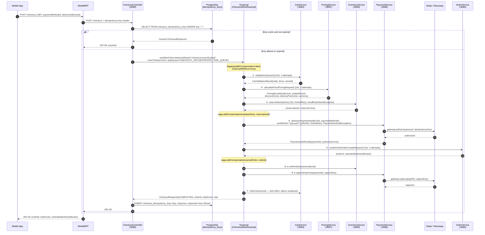
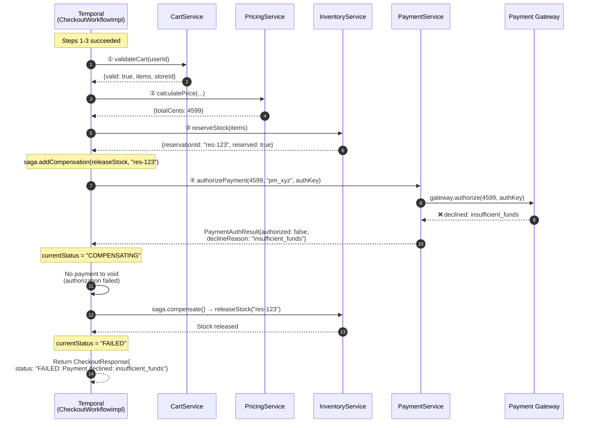
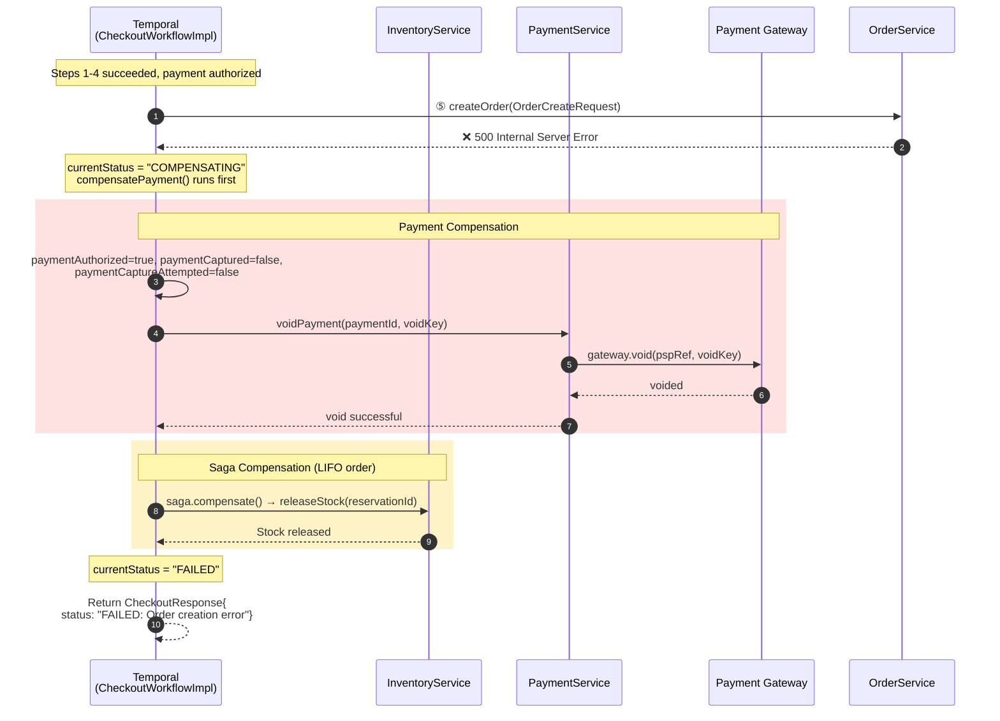
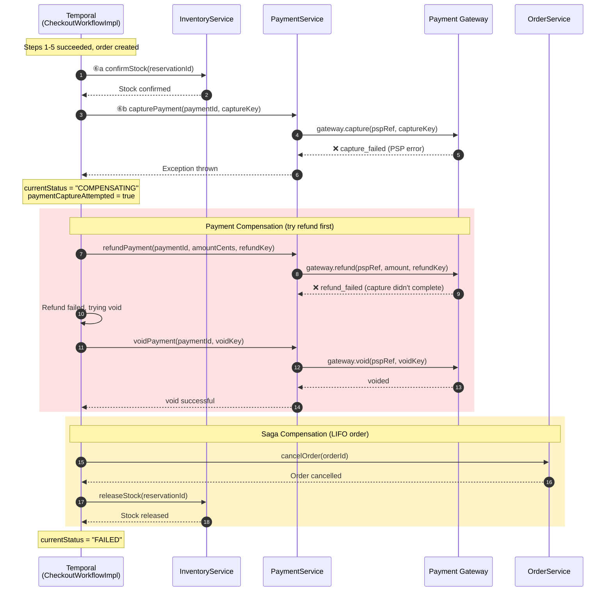
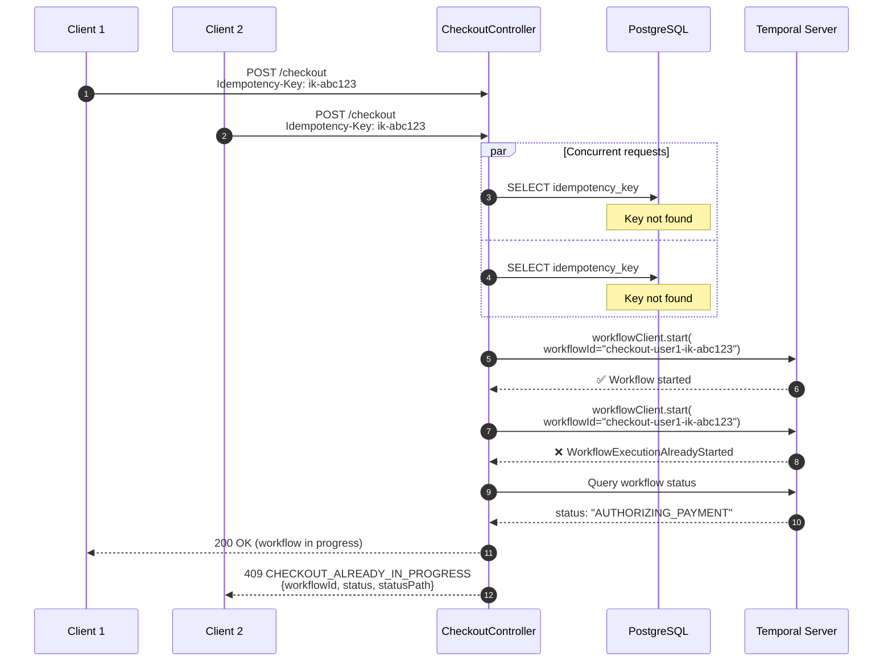
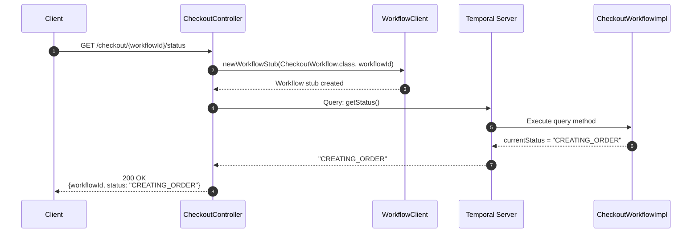
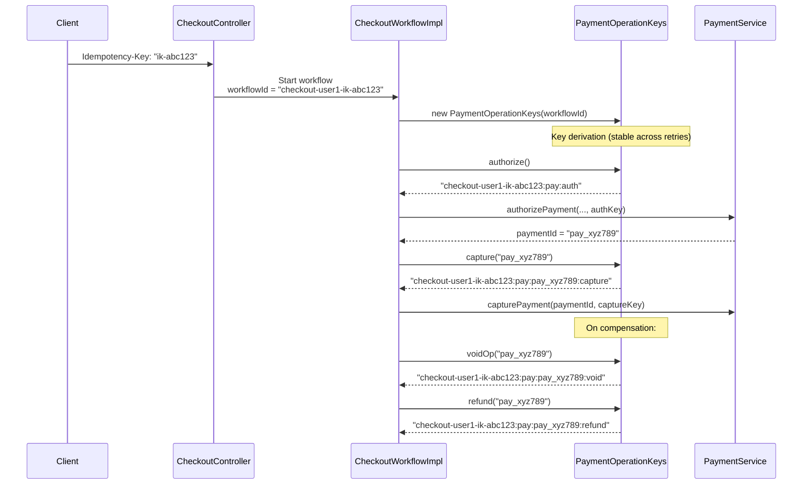
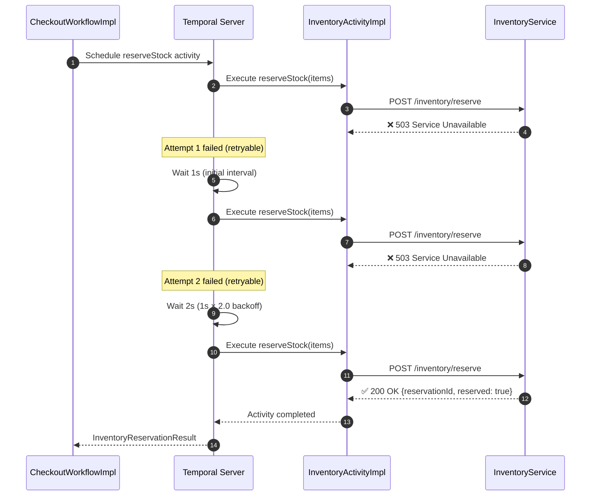
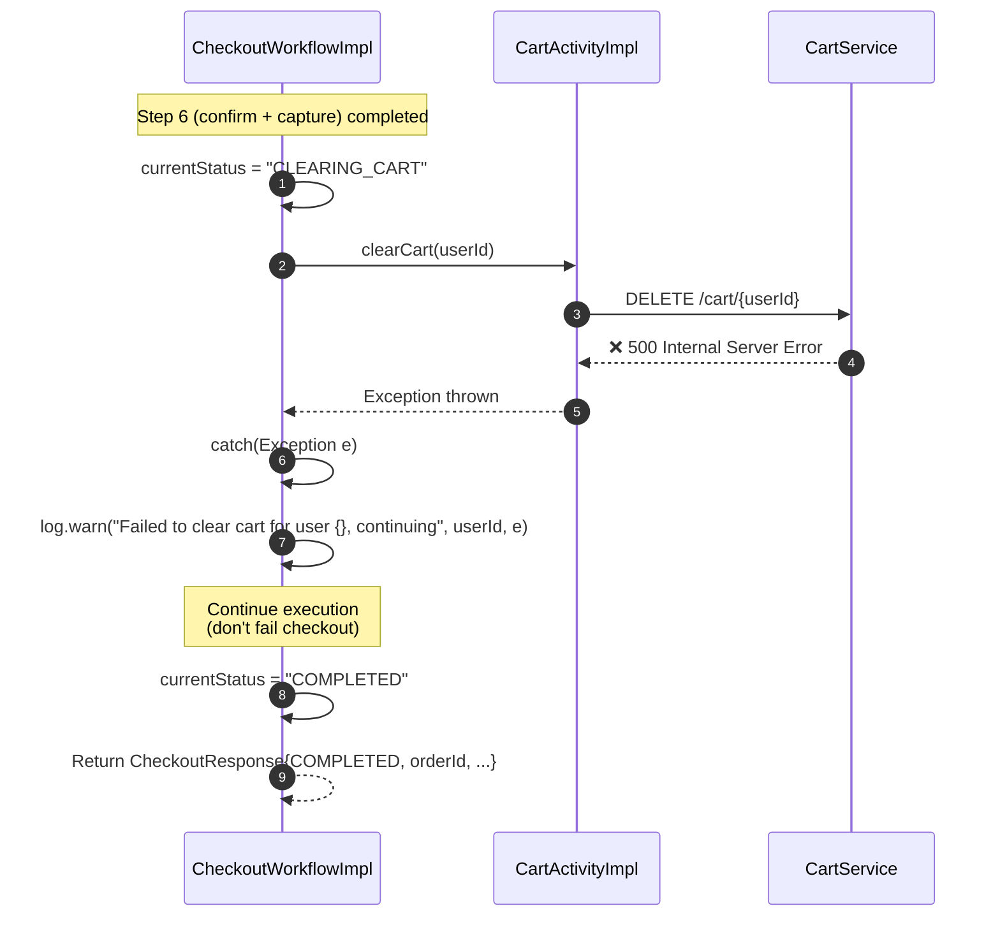

# Checkout Orchestrator - Sequence Diagrams

## Complete Checkout Money-Path Sequence (Happy Path)

## Payment Authorization Declined - Compensation Sequence

## Order Creation Failure - Full Compensation Sequence

## Payment Capture Failure - Refund Fallback Sequence

## Concurrent Checkout Detection Sequence

## Workflow Query Sequence

## Idempotency Key Lineage Through Money-Path

## Temporal Activity Retry Sequence

## Cart Clear Best-Effort Sequence

