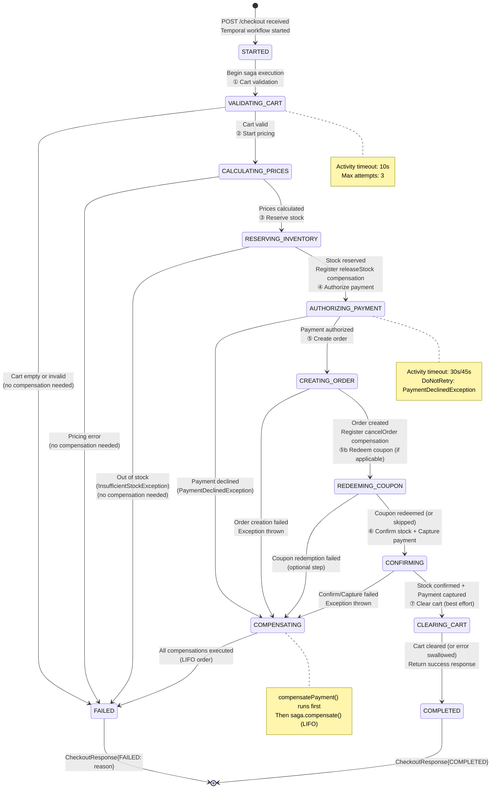
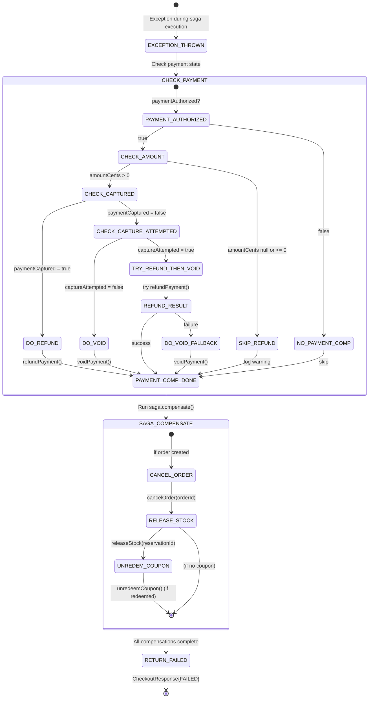
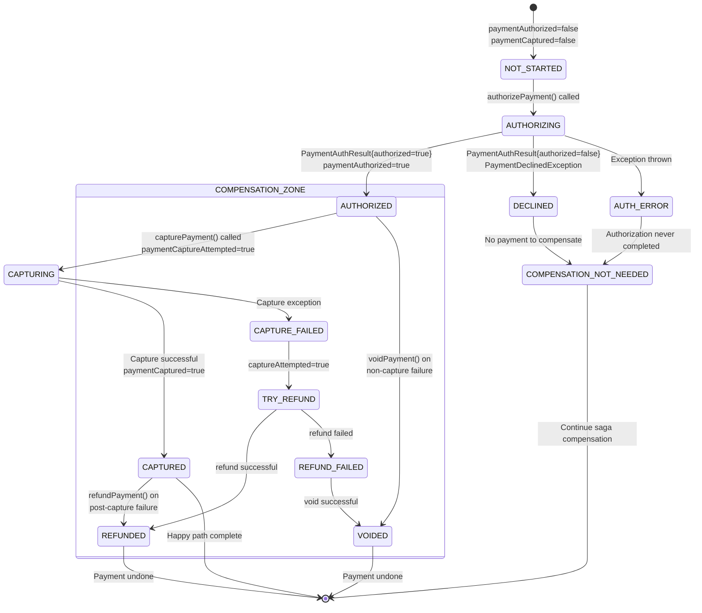
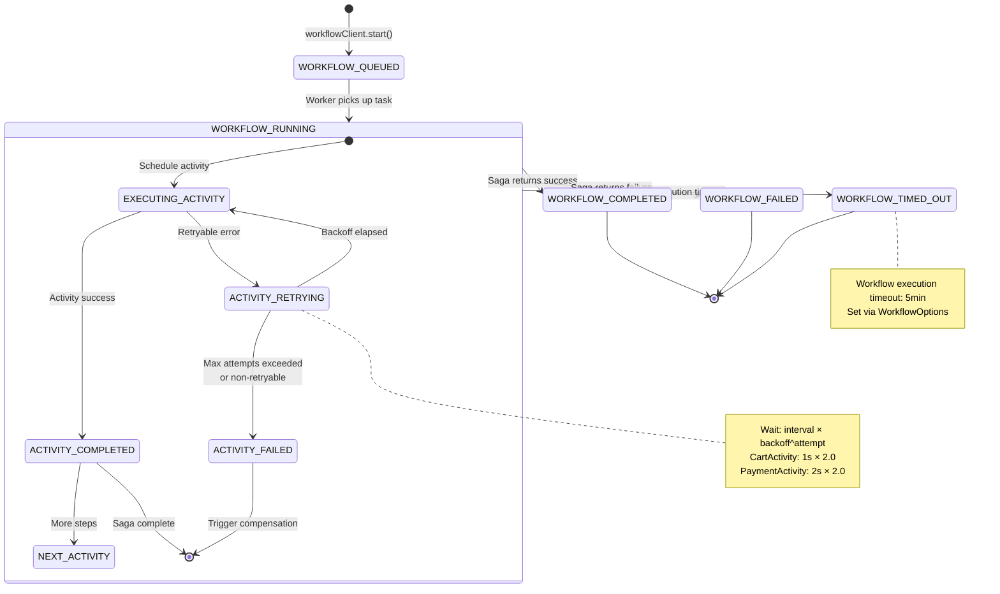
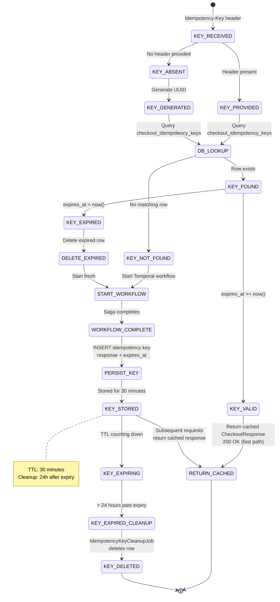
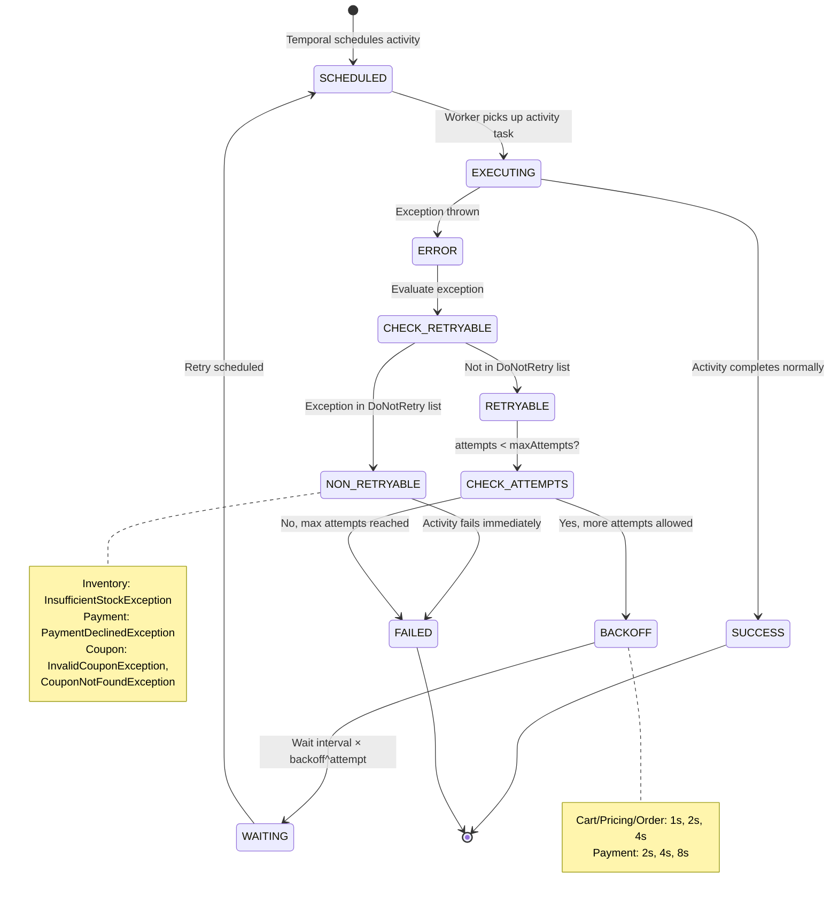
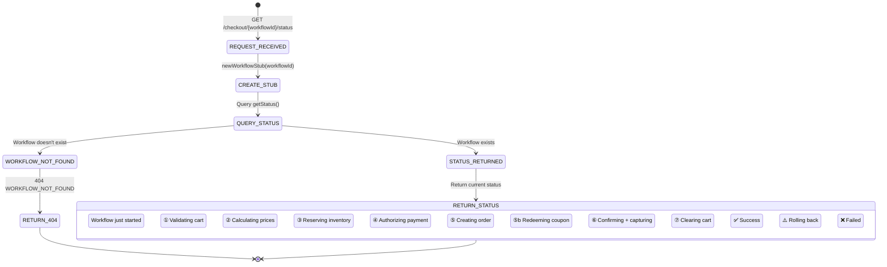
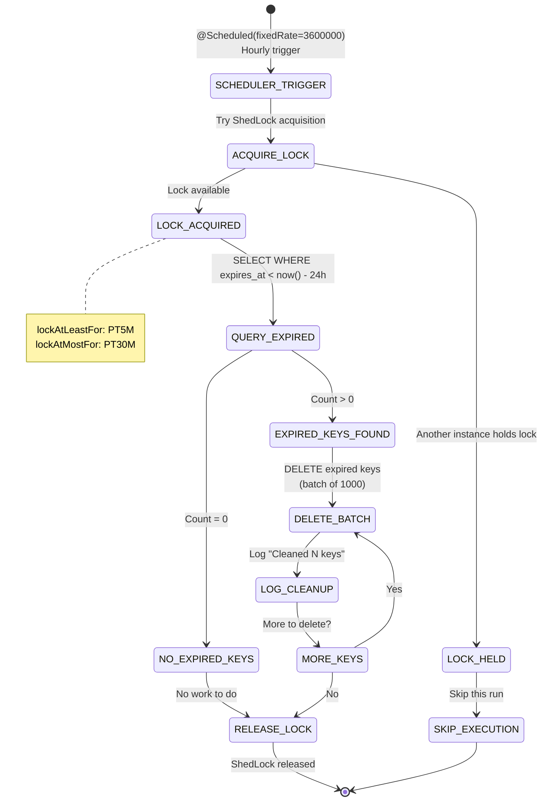

# Checkout Orchestrator - State Machine Diagrams

## Checkout Workflow State Machine (Complete Lifecycle)

## Saga Compensation State Machine

## Payment State Machine (Within Checkout Context)

## Temporal Workflow Execution State Machine

## Idempotency Key State Machine

## Activity Retry State Machine

## Checkout Status Query State Machine

## ShedLock Job State Machine

