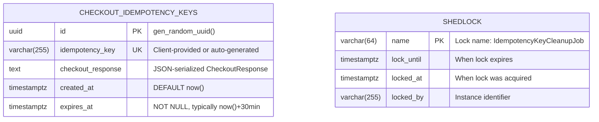
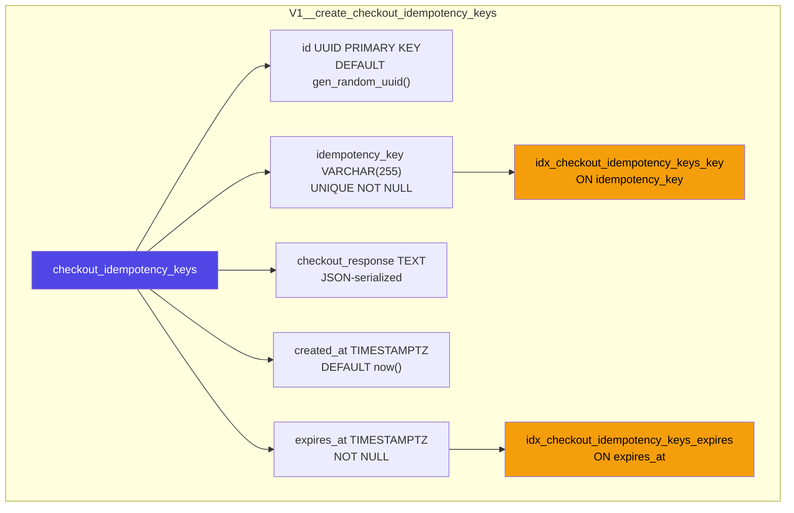
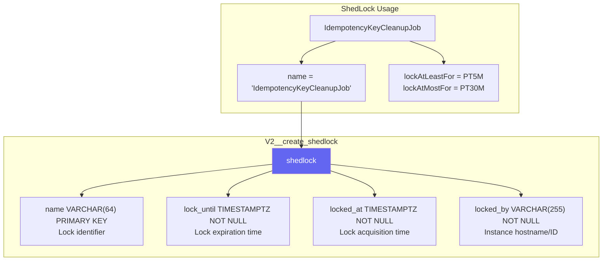
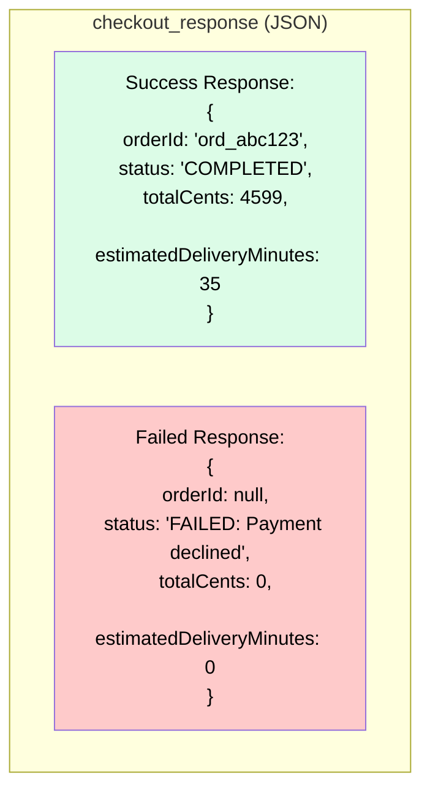
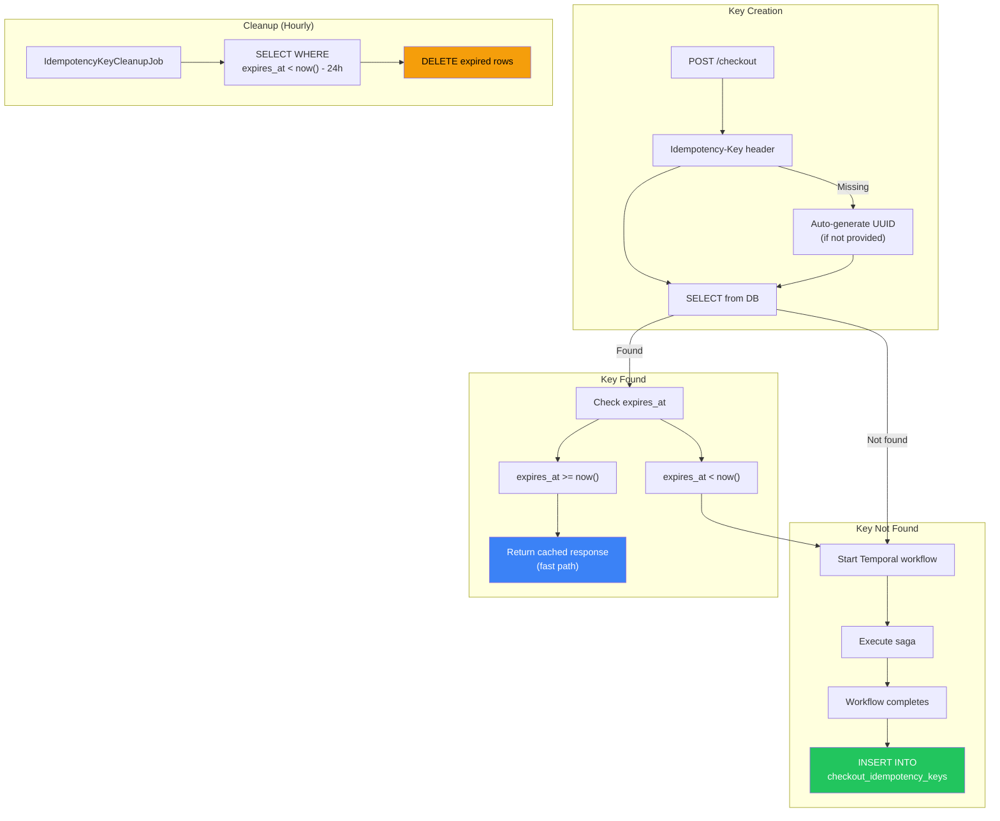
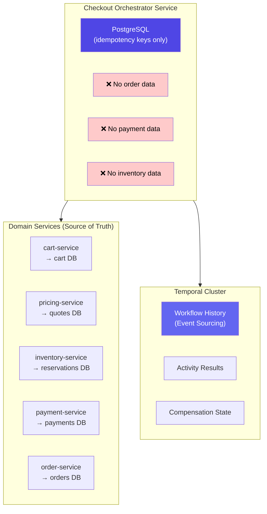
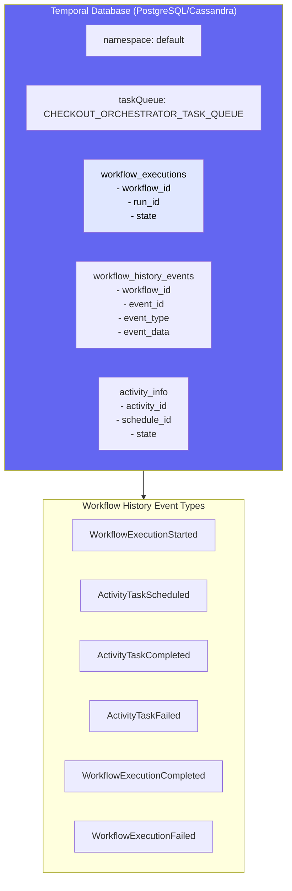
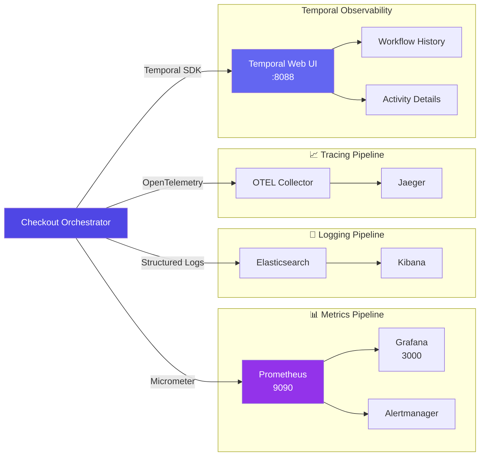
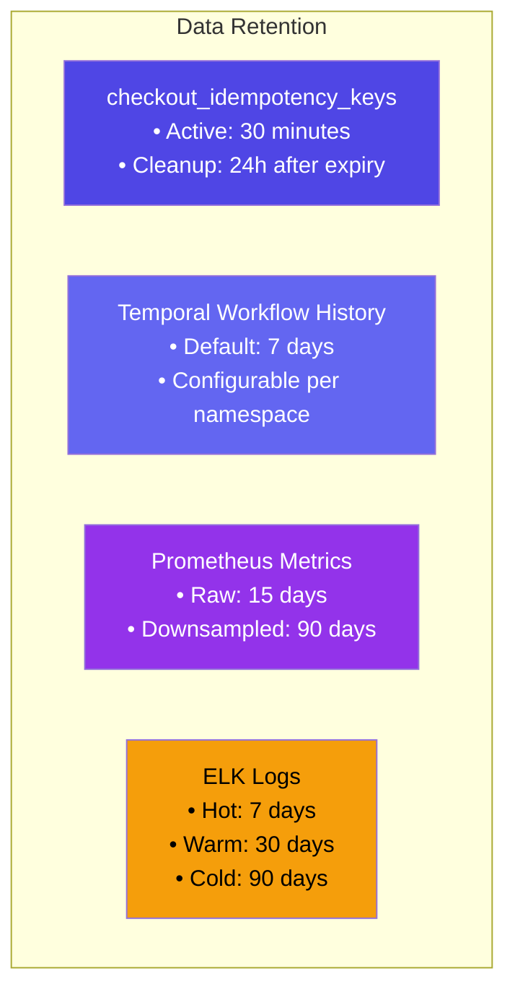

# Checkout Orchestrator - ER Diagram & Storage Schema

## Database Schema (Flyway-Managed)



## Idempotency Keys Table Details



## ShedLock Table Details



## Checkout Response JSON Schema



## Data Flow: Idempotency Key Lifecycle



## No Domain State Persistence



## Temporal Workflow State (External)



## Prometheus Metrics Schema

```
Checkout Orchestrator Metrics
├─ checkout_workflow_started_total
│  └ Counter: Total workflows started
│
├─ checkout_workflow_completed_total{status}
│  └ Counter: Completed workflows
│     - status: success, failed
│
├─ checkout_workflow_duration_ms
│  └ Histogram: Workflow execution time
│     - p50, p95, p99, p99.9
│
├─ checkout_activity_duration_ms{activity}
│  └ Histogram: Activity execution time
│     - activity: cart, pricing, inventory, payment, order
│
├─ checkout_activity_retries_total{activity}
│  └ Counter: Activity retry count
│
├─ checkout_compensation_triggered_total{step}
│  └ Counter: Compensation executions
│     - step: releaseStock, voidPayment, refundPayment, cancelOrder
│
├─ checkout_idempotency_cache_hits_total
│  └ Counter: Idempotent request hits
│
├─ checkout_idempotency_cache_misses_total
│  └ Counter: Cache misses (new workflows)
│
├─ checkout_idempotency_keys_cleaned_total
│  └ Counter: Keys cleaned by job
│
└─ temporal_workflow_task_queue_poll_latency_ms
   └ Histogram: Temporal task poll latency
```

## Observability Pipeline



## Data Retention Policies


