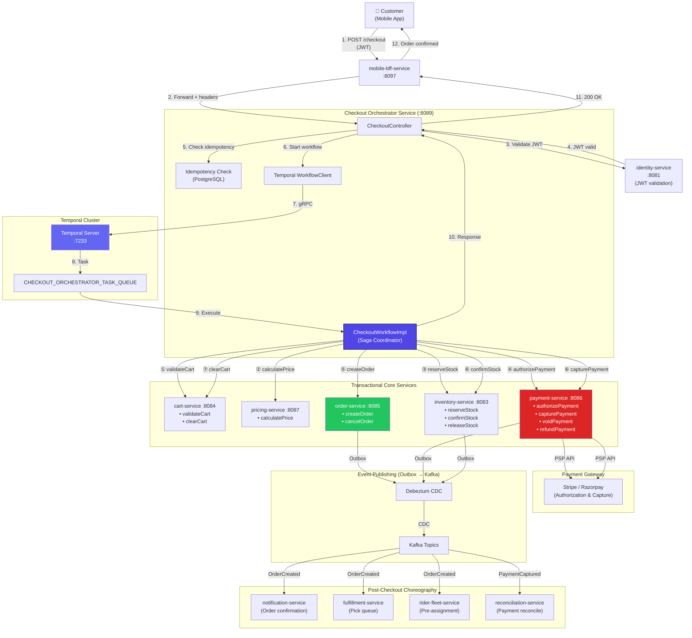
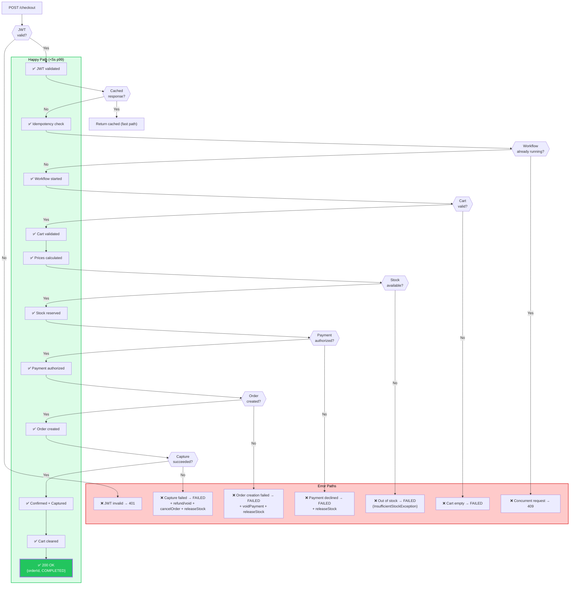
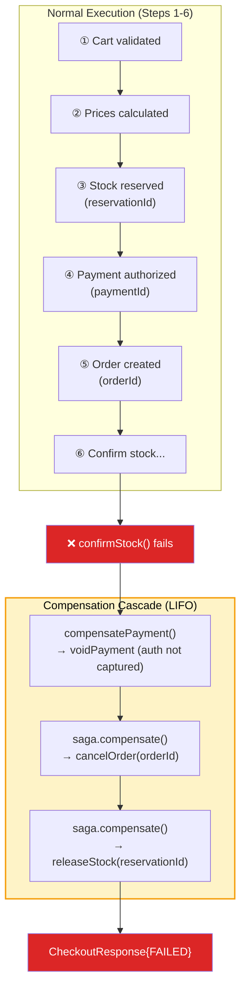
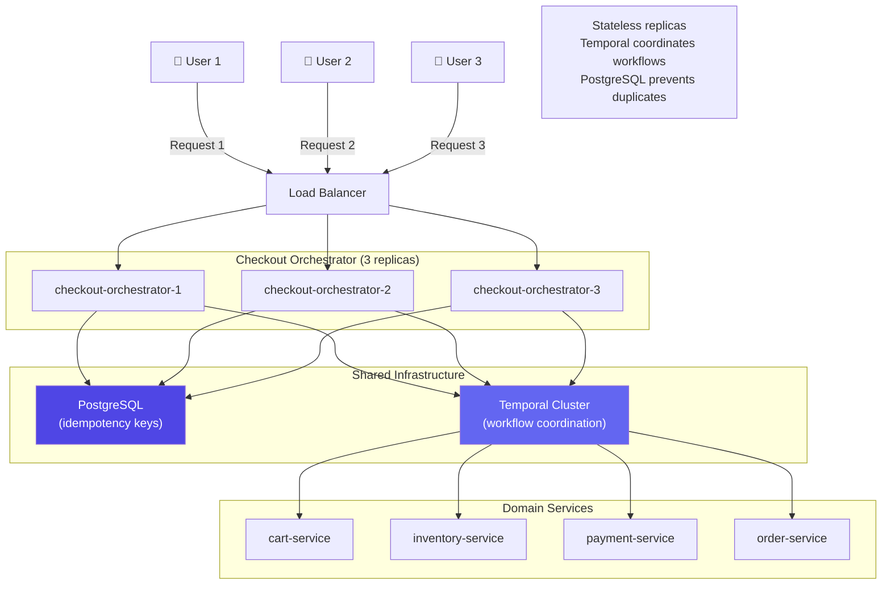
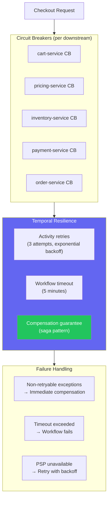
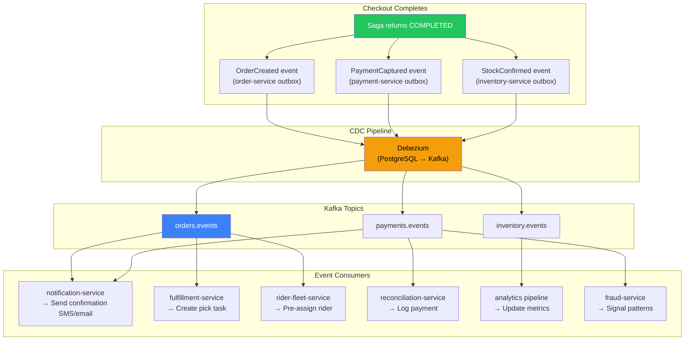
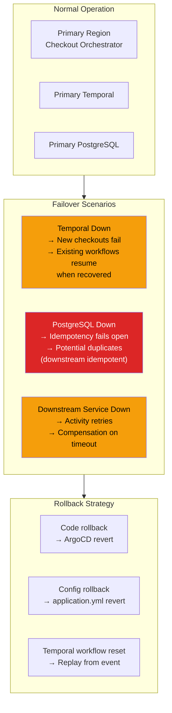

# Checkout Orchestrator - End-to-End Flows

## Complete Cart-to-Order-Confirmed Flow (E2E)



## Request Flow with Error Handling



## Compensation Cascade (Worst-Case Failure)



## Multi-User Concurrent Checkout



## SLO Monitoring Dashboard

```mermaid
graph LR
    CO["Checkout Orchestrator"]

    subgraph SLOs["Service Level Objectives"]
        Latency["⏱️ P99 Latency\n< 5 seconds"]
        Success["✅ Success Rate\n> 99.5%"]
        Availability["🟢 Availability\n99.9%"]
    end

    subgraph Metrics["Key Metrics"]
        M1["checkout_workflow_duration_ms\n(Histogram)"]
        M2["checkout_workflow_completed_total{status}\n(Counter)"]
        M3["checkout_activity_duration_ms{activity}\n(Histogram per step)"]
        M4["checkout_compensation_triggered_total{step}\n(Counter)"]
    end

    subgraph Alerts["Alert Rules"]
        SEV1["🔴 SEV-1\np99 > 10s OR success < 98%\n→ Page SRE"]
        SEV2["🟠 SEV-2\np99 > 7s OR success < 99%\n→ Create incident"]
        SEV3["🟡 SEV-3\np99 > 5s OR success < 99.5%\n→ Review in standup"]
    end

    CO --> SLOs
    SLOs --> Metrics
    Metrics --> Alerts

    style Latency fill:#22c55e,color:#fff
    style Success fill:#22c55e,color:#fff
    style SEV1 fill:#dc2626,color:#fff
    style SEV2 fill:#f59e0b,color:#000
```



## Resilience & Degradation Patterns



## Post-Checkout Event Flow



## Checkout Timeline (Latency Breakdown)

```
┌─────────────────────────────────────────────────────────────────┐
│  Checkout E2E Timeline (P99 target: <5s)                        │
├─────────────────────────────────────────────────────────────────┤
│ Controller overhead:                                            │
│   JWT validation:                         ~30ms                 │
│   Idempotency DB lookup:                  ~10ms                 │
│   Temporal workflow start:                ~100ms                │
│                                                                 │
│ Saga execution:                                                 │
│   ① Cart validation:                      ~200ms p99            │
│   ② Pricing calculation:                  ~300ms p99            │
│   ③ Inventory reservation:                ~200ms p99            │
│   ④ Payment authorization (PSP):          ~1500ms p99           │
│   ⑤ Order creation:                       ~300ms p99            │
│   ⑥ Stock confirm + Payment capture:      ~800ms p99            │
│   ⑦ Cart clear (best effort):             ~100ms                │
│                                                                 │
│ Response handling:                                              │
│   Temporal result propagation:            ~50ms                 │
│   Idempotency key persistence:            ~20ms                 │
│   HTTP response serialization:            ~10ms                 │
│                                                                 │
│ TOTAL P99:                                ~3620ms               │
│ BUDGET REMAINING:                         ~1380ms               │
│ STATUS:                                   ✅ WITHIN 5s SLO      │
│                                                                 │
│ CRITICAL PATH: Payment authorization (44% of total)             │
│ OPTIMIZATION: PSP selection, caching, regional routing          │
└─────────────────────────────────────────────────────────────────┘
```

## Disaster Recovery & Rollback


