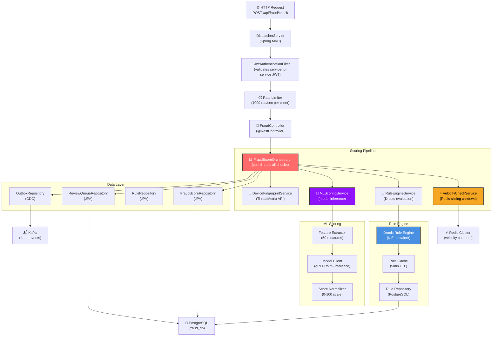
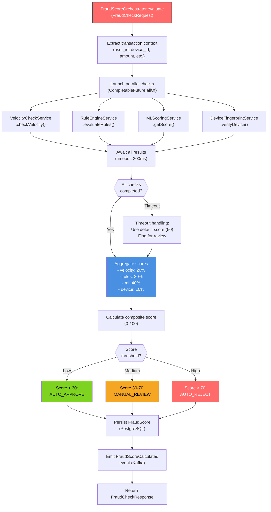
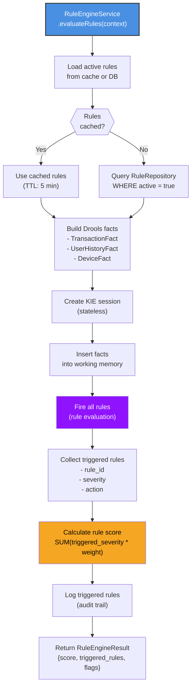
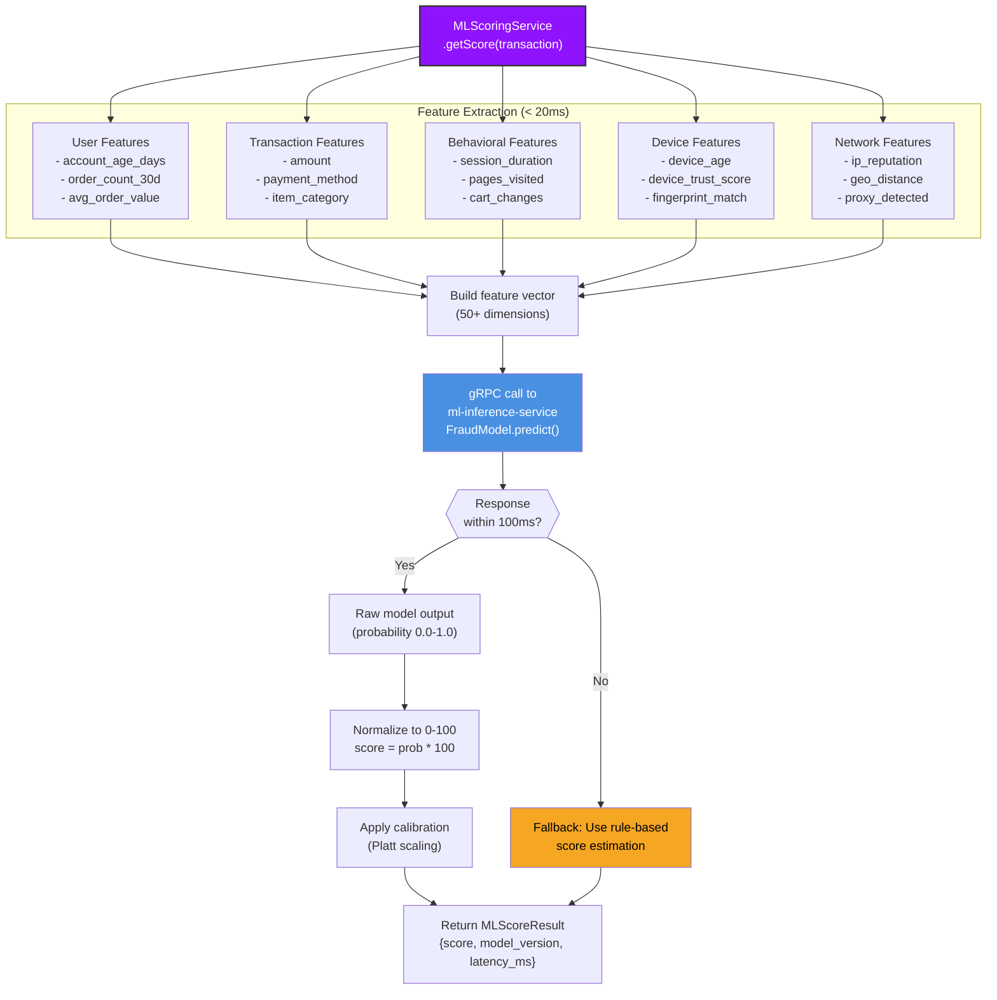
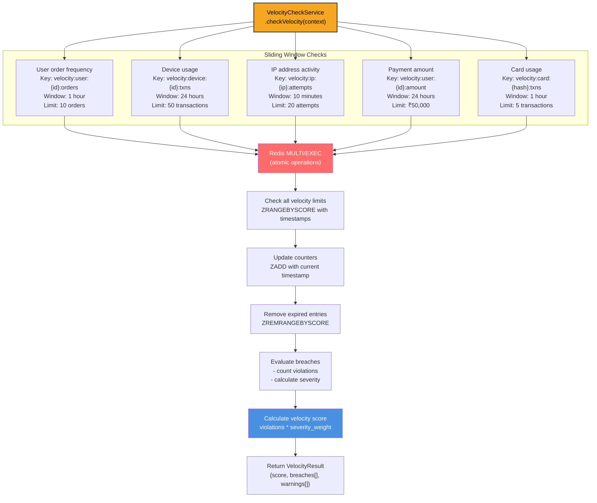
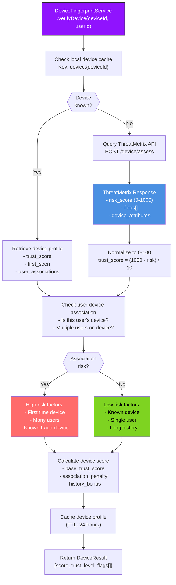
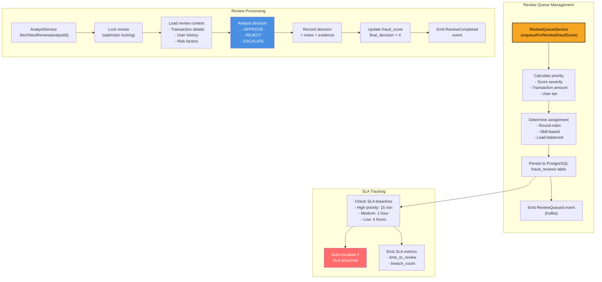
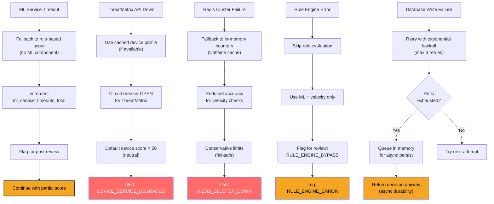

# Fraud Detection Service - Low-Level Design

## Component Architecture



## FraudScoreOrchestrator Implementation



## Rule Engine Service (Drools)



## ML Scoring Service



## Velocity Check Service (Redis)



## Device Fingerprint Service



## Review Queue Service



## Error Handling & Resilience



## SLO: P99 Latency Target < 200ms

```
┌─────────────────────────────────────────────────────────────┐
│  Fraud Check Request Timeline (P99 target: <200ms)          │
├─────────────────────────────────────────────────────────────┤
│ Request parsing & validation:          ~5ms                 │
│ JWT authentication:                    ~3ms                 │
│ Rate limit check:                      ~2ms                 │
│ Subtotal (overhead):                   ~10ms                │
│                                                             │
│ Parallel scoring pipeline:                                  │
│   - Velocity check (Redis):            ~15ms p99            │
│   - Rule engine (Drools):              ~25ms p99            │
│   - ML scoring (gRPC):                 ~80ms p99            │
│   - Device fingerprint (API):          ~60ms p99            │
│   Max parallel time:                   ~80ms p99            │
│                                                             │
│ Score aggregation:                     ~5ms                 │
│ Decision logic:                        ~2ms                 │
│ Database persist (async):              ~0ms (non-blocking)  │
│ Response serialization:                ~3ms                 │
│                                                             │
│ TOTAL P99:                             ~100ms               │
│ BUFFER (200ms target):                 ~100ms               │
│ STATUS:                                ✅ WITHIN SLO        │
└─────────────────────────────────────────────────────────────┘
```
