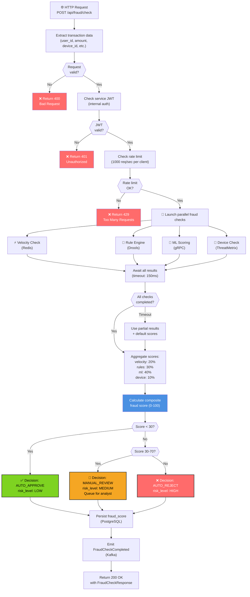
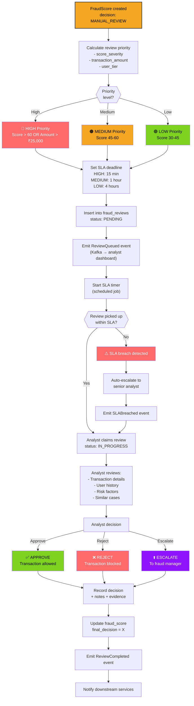
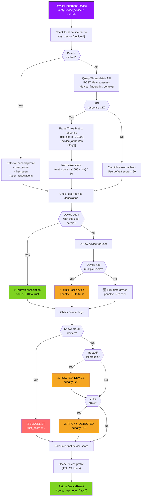
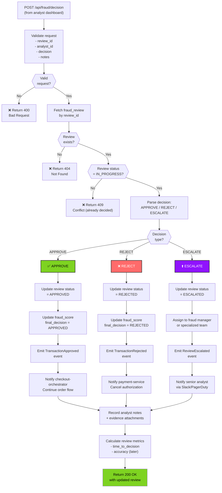

# Fraud Detection Service - Request Flowcharts

## Complete Fraud Check Flow

## Velocity Check Flowchart

```mermaid
flowchart TD
    A["VelocityCheckService<br/>.checkVelocity(context)"]
    B["Extract identifiers<br/>(user_id, device_id, ip, card_hash)"]
    
    C["🔄 Check user order frequency<br/>Key: velocity:user:{id}:orders<br/>Window: 1 hour"]
    D{{"Orders > 10<br/>in 1 hour?"}}
    E1["⚠️ Flag: HIGH_ORDER_FREQUENCY"]
    
    F["🔄 Check device transaction count<br/>Key: velocity:device:{id}:txns<br/>Window: 24 hours"]
    G{{"Txns > 50<br/>in 24 hours?"}}
    H1["⚠️ Flag: EXCESSIVE_DEVICE_USAGE"]
    
    I["🔄 Check IP attempts<br/>Key: velocity:ip:{ip}:attempts<br/>Window: 10 minutes"]
    J{{"Attempts > 20<br/>in 10 min?"}}
    K1["⚠️ Flag: IP_RATE_LIMIT_EXCEEDED"]
    
    L["🔄 Check payment amount<br/>Key: velocity:user:{id}:amount<br/>Window: 24 hours"]
    M{{"Total > ₹50,000<br/>in 24 hours?"}}
    N1["⚠️ Flag: HIGH_DAILY_SPEND"]
    
    O["🔄 Check card usage<br/>Key: velocity:card:{hash}:txns<br/>Window: 1 hour"]
    P{{"Card txns > 5<br/>in 1 hour?"}}
    Q1["⚠️ Flag: CARD_VELOCITY_EXCEEDED"]
    
    R["Update all counters<br/>ZADD with current timestamp"]
    
    S["Expire old entries<br/>ZREMRANGEBYSCORE"]
    
    T["Calculate velocity score<br/>violations * severity_weight"]
    
    U["Return VelocityResult<br/>{score, flags[], counters}"]
    
    A --> B
    B --> C --> D
    D -->|Yes| E1 --> F
    D -->|No| F
    
    F --> G
    G -->|Yes| H1 --> I
    G -->|No| I
    
    I --> J
    J -->|Yes| K1 --> L
    J -->|No| L
    
    L --> M
    M -->|Yes| N1 --> O
    M -->|No| O
    
    O --> P
    P -->|Yes| Q1 --> R
    P -->|No| R
    
    R --> S --> T --> U
    
    style A fill:#F5A623,color:#000,stroke:#333,stroke-width:2px
    style E1 fill:#FF6B6B,color:#fff
    style H1 fill:#FF6B6B,color:#fff
    style K1 fill:#FF6B6B,color:#fff
    style N1 fill:#FF6B6B,color:#fff
    style Q1 fill:#FF6B6B,color:#fff
    style U fill:#7ED321,color:#000
```

## Rule Engine Evaluation Flowchart

```mermaid
flowchart TD
    A["RuleEngineService<br/>.evaluateRules(context)"]
    B["Load active rules<br/>from cache or DB"]
    C{{"Cache<br/>hit?"}}
    D["Return cached rules<br/>(TTL: 5 min)"]
    E["Query PostgreSQL<br/>SELECT * FROM rules<br/>WHERE active = true"]
    F["Cache rules<br/>(TTL: 5 min)"]
    
    G["Build Drools facts:<br/>- TransactionFact<br/>- UserHistoryFact<br/>- DeviceFact<br/>- GeoFact"]
    
    H["Create KIE session<br/>(stateless)"]
    I["Insert facts into<br/>working memory"]
    J["Fire all rules"]
    
    K["Collect triggered rules"]
    
    L["📜 Amount threshold rules"]
    L1{{"Amount > ₹10,000?"}}
    L2["Flag: HIGH_VALUE_TRANSACTION"]
    
    M["📜 New user rules"]
    M1{{"Account < 7 days?"}}
    M2["Flag: NEW_ACCOUNT_RISK"]
    
    N["📜 Pattern detection rules"]
    N1{{"Promo abuse<br/>pattern?"}}
    N2["Flag: PROMO_ABUSE_DETECTED"]
    
    O["📜 Category risk rules"]
    O1{{"High-risk<br/>category?"}}
    O2["Flag: HIGH_RISK_CATEGORY"]
    
    P["📜 Geo-velocity rules"]
    P1{{"Impossible<br/>travel?"}}
    P2["Flag: IMPOSSIBLE_TRAVEL"]
    
    Q["Calculate rule score<br/>SUM(severity * weight)"]
    R["Return RuleEngineResult<br/>{score, triggered_rules[], flags[]}"]
    
    A --> B --> C
    C -->|Yes| D --> G
    C -->|No| E --> F --> G
    
    G --> H --> I --> J --> K
    
    K --> L --> L1
    L1 -->|Yes| L2 --> M
    L1 -->|No| M
    
    M --> M1
    M1 -->|Yes| M2 --> N
    M1 -->|No| N
    
    N --> N1
    N1 -->|Yes| N2 --> O
    N1 -->|No| O
    
    O --> O1
    O1 -->|Yes| O2 --> P
    O1 -->|No| P
    
    P --> P1
    P1 -->|Yes| P2 --> Q
    P1 -->|No| Q
    
    Q --> R
    
    style A fill:#4A90E2,color:#fff,stroke:#333,stroke-width:2px
    style L2 fill:#FF6B6B,color:#fff
    style M2 fill:#FF6B6B,color:#fff
    style N2 fill:#FF6B6B,color:#fff
    style O2 fill:#FF6B6B,color:#fff
    style P2 fill:#FF6B6B,color:#fff
    style R fill:#7ED321,color:#000
```

## Manual Review Escalation Flowchart

## Device Fingerprint Verification Flowchart

## Fraud Decision Callback Flowchart

