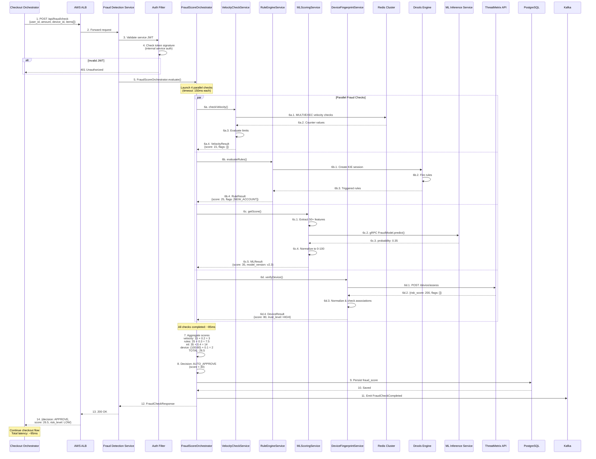
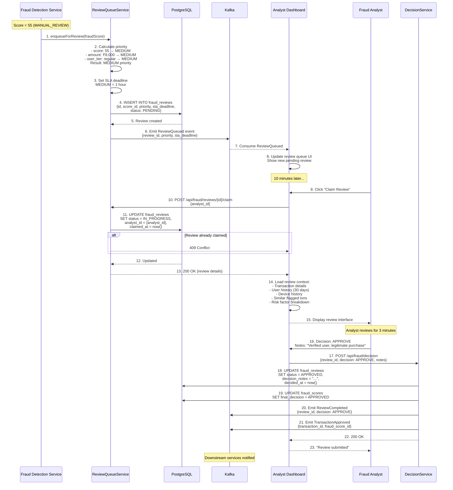
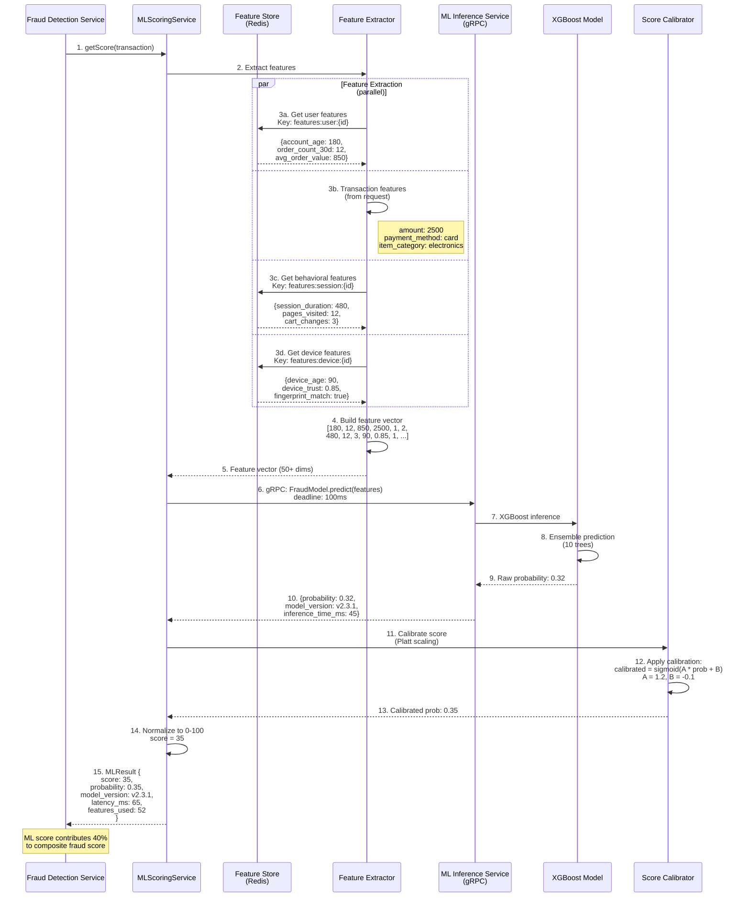
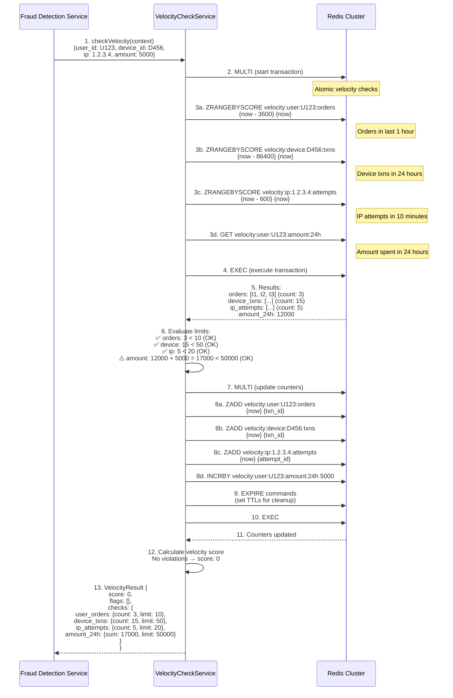
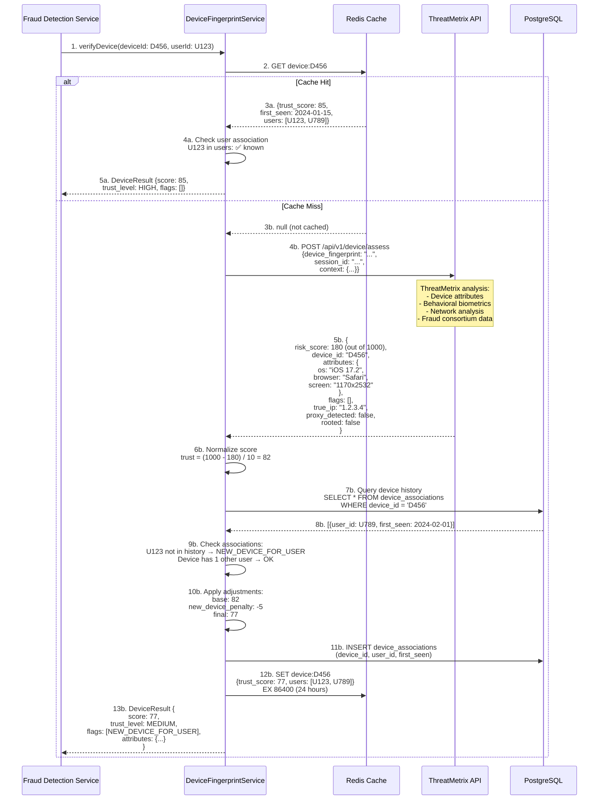
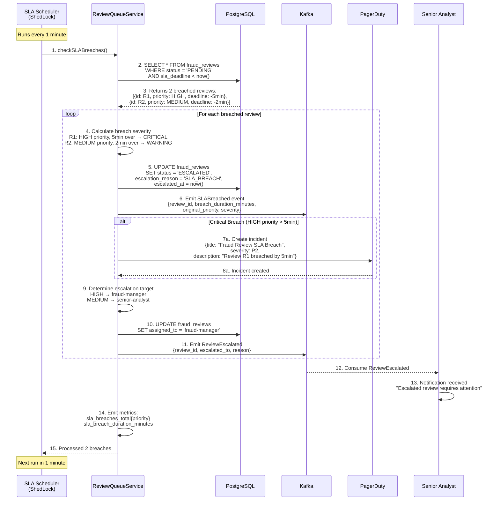
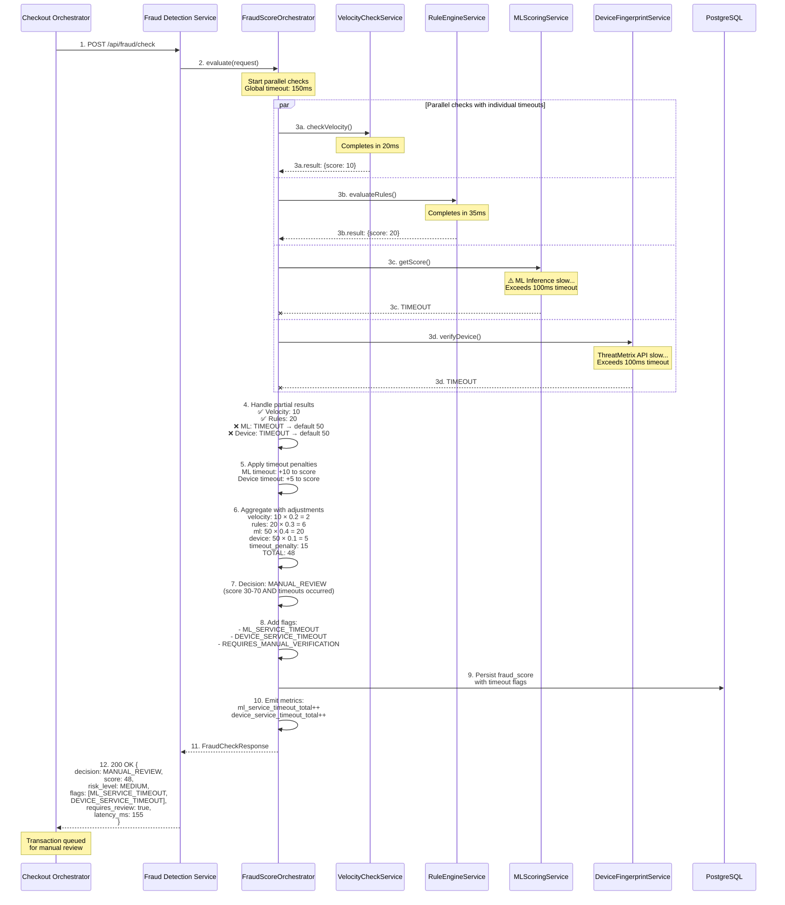

# Fraud Detection Service - Sequence Diagrams

## Complete Checkout Fraud Check Sequence

## Manual Review Queue Sequence

## Real-time Scoring with ML Model Sequence

## Velocity Check with Redis Sequence

## Device Fingerprint Verification Sequence

## SLA Breach and Auto-Escalation Sequence

## Fraud Check with Timeout Handling Sequence

