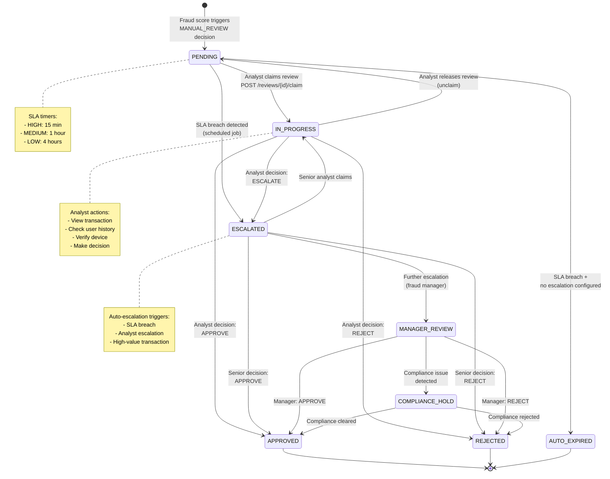
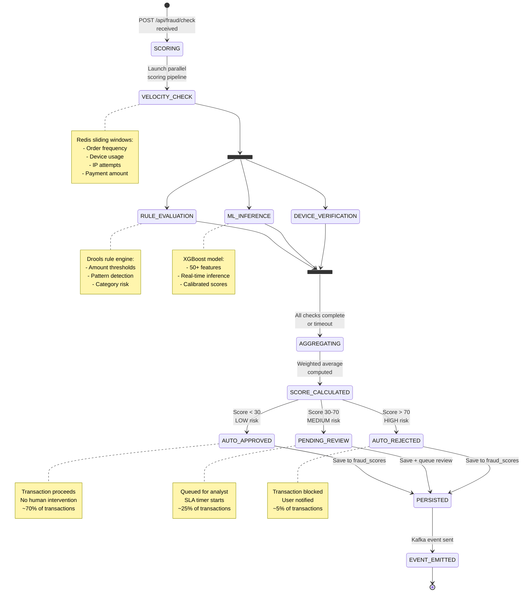
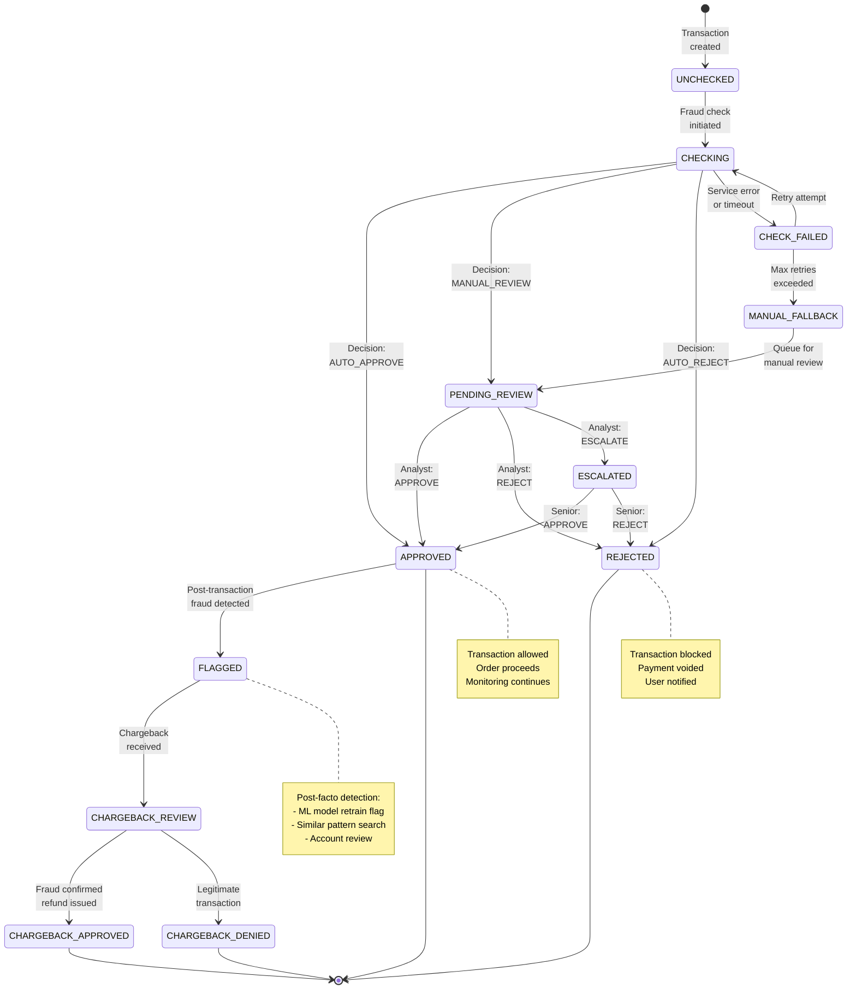
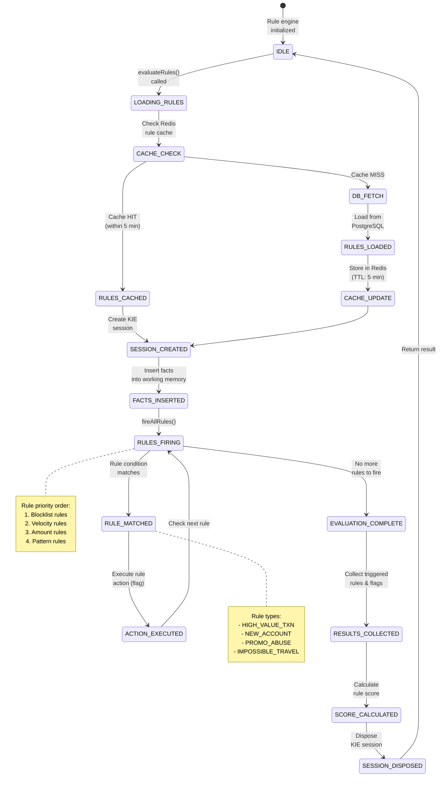
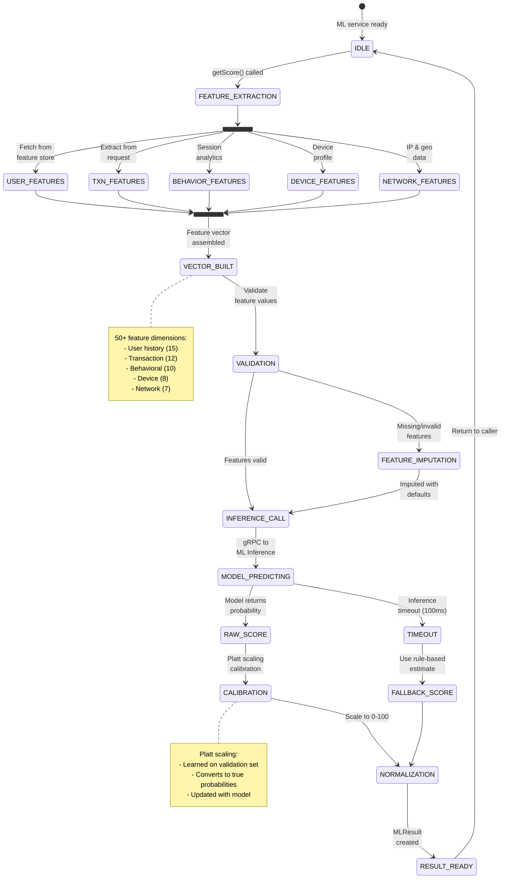
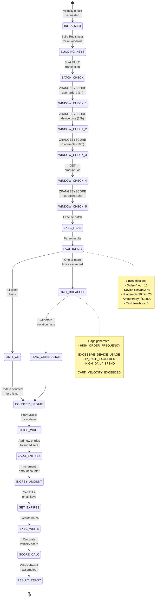
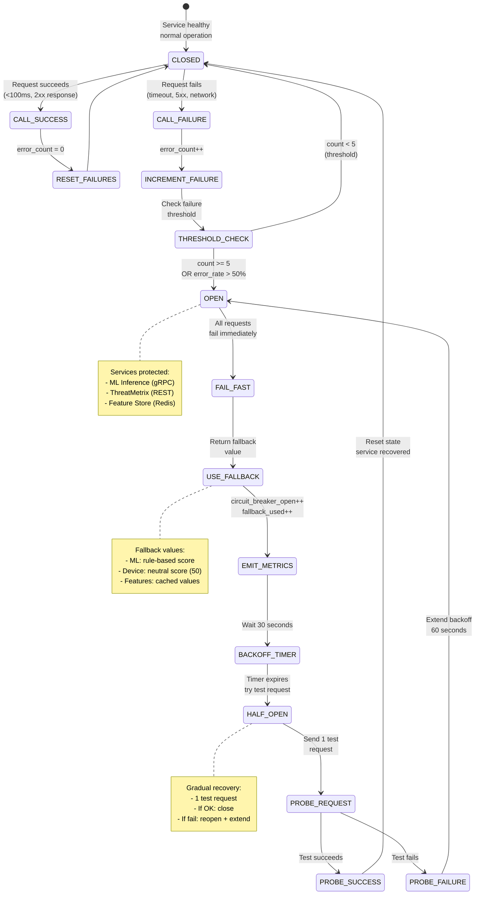
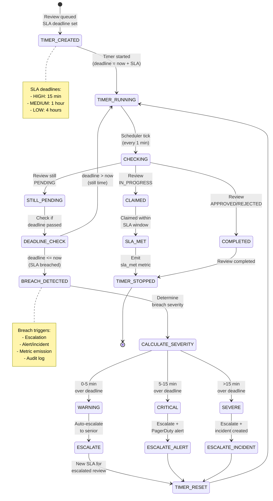

# Fraud Detection Service - State Machine Diagrams

## Review State Machine (Complete Lifecycle)

## Fraud Score Decision State Machine

## Transaction Fraud Status State Machine

## Rule Engine State Machine

## ML Scoring Pipeline State Machine

## Velocity Counter State Machine

## Circuit Breaker State Machine (External Services)

## SLA Timer State Machine

