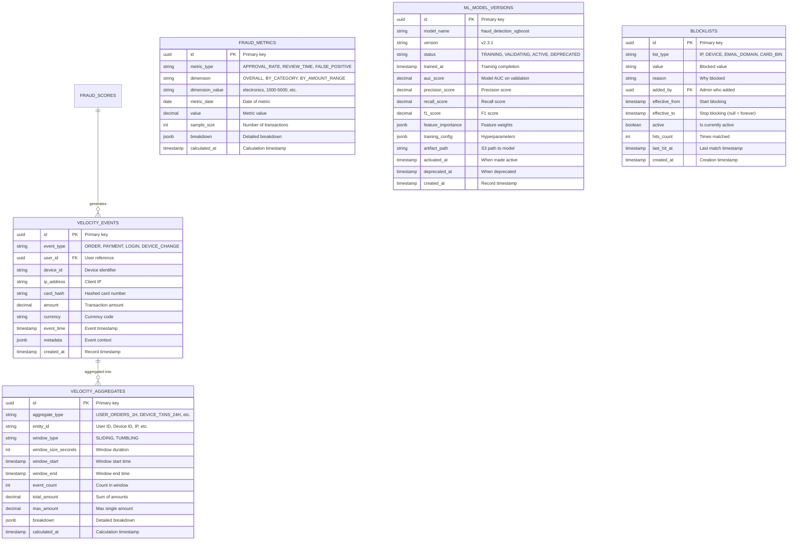
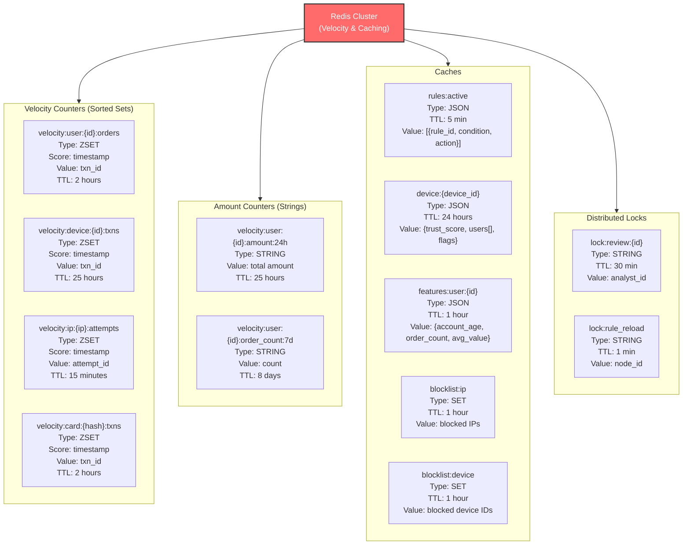
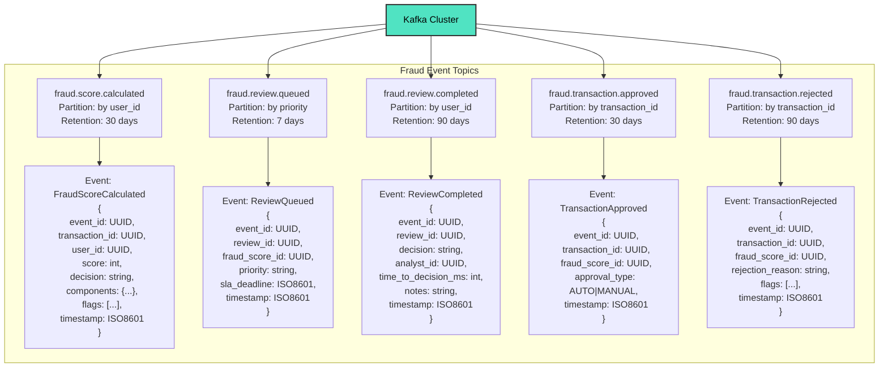
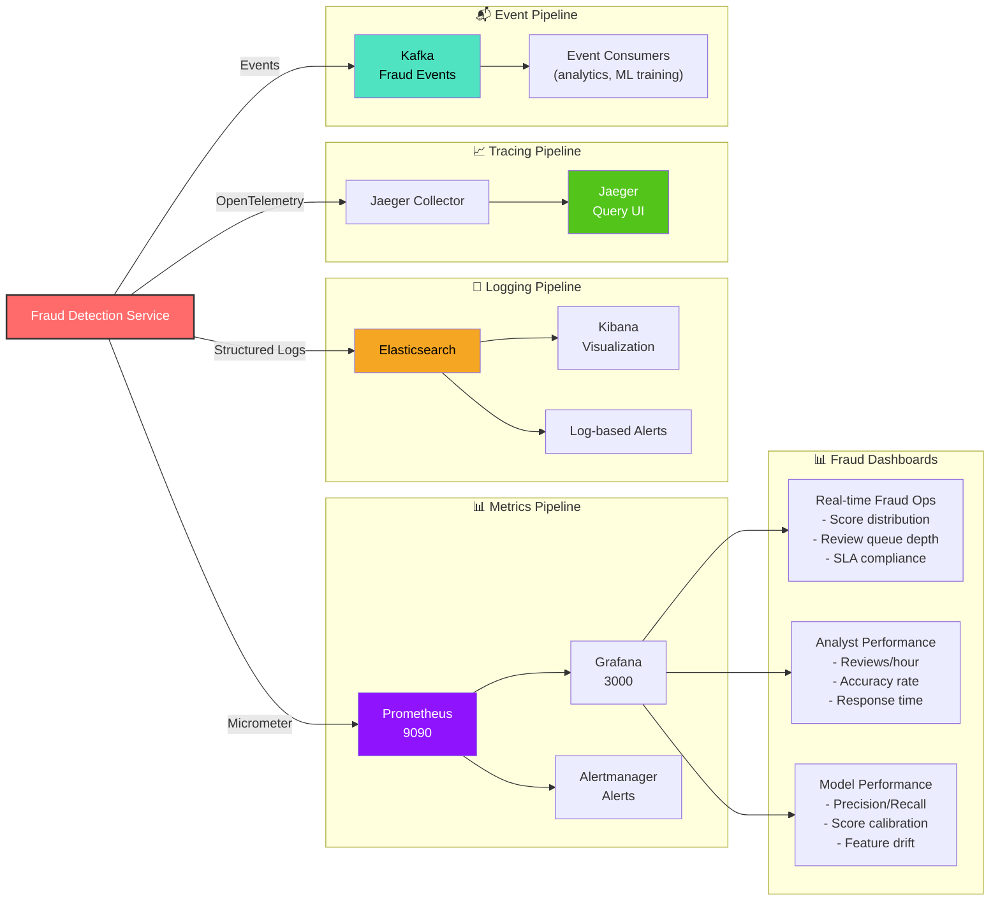

# Fraud Detection Service - ER Diagram & Storage Schema

## Core Fraud Detection Tables

```mermaid
erDiagram
    FRAUD_SCORES ||--o{ FRAUD_REVIEWS : "may trigger"
    FRAUD_SCORES ||--o{ SCORE_COMPONENTS : "has"
    FRAUD_SCORES ||--o{ FRAUD_FLAGS : "has"
    FRAUD_REVIEWS ||--o{ REVIEW_ACTIONS : "has"
    RULES ||--o{ RULE_TRIGGERS : "triggers"
    FRAUD_SCORES ||--o{ RULE_TRIGGERS : "has"
    DEVICES ||--o{ DEVICE_ASSOCIATIONS : "has"
    USERS }o--|| DEVICE_ASSOCIATIONS : "uses"
    
    FRAUD_SCORES {
        uuid id PK "Primary key"
        uuid transaction_id FK "Reference to order/payment"
        uuid user_id FK "User being scored"
        string device_id "Device fingerprint ID"
        decimal amount "Transaction amount"
        string currency "INR, USD, etc."
        int composite_score "Final score (0-100)"
        string decision "AUTO_APPROVE, MANUAL_REVIEW, AUTO_REJECT"
        string final_decision "APPROVED, REJECTED (after review)"
        string risk_level "LOW, MEDIUM, HIGH, CRITICAL"
        jsonb metadata "Additional context"
        timestamp created_at "Score timestamp"
        timestamp updated_at "Last update"
        int latency_ms "Total scoring latency"
    }
    
    SCORE_COMPONENTS {
        uuid id PK "Primary key"
        uuid fraud_score_id FK "Parent score"
        string component_type "VELOCITY, RULES, ML, DEVICE"
        int raw_score "Component score (0-100)"
        decimal weight "Contribution weight (0.0-1.0)"
        int weighted_score "raw_score * weight"
        int latency_ms "Component latency"
        boolean timeout "True if component timed out"
        jsonb details "Component-specific details"
        timestamp created_at "Timestamp"
    }
    
    FRAUD_FLAGS {
        uuid id PK "Primary key"
        uuid fraud_score_id FK "Parent score"
        string flag_code "e.g., HIGH_ORDER_FREQUENCY"
        string flag_type "VELOCITY, RULE, ML, DEVICE"
        string severity "LOW, MEDIUM, HIGH, CRITICAL"
        string description "Human-readable description"
        jsonb context "Flag-specific context"
        timestamp created_at "Timestamp"
    }
    
    FRAUD_REVIEWS {
        uuid id PK "Primary key"
        uuid fraud_score_id FK "Score under review"
        string status "PENDING, IN_PROGRESS, APPROVED, REJECTED, ESCALATED"
        string priority "LOW, MEDIUM, HIGH"
        uuid analyst_id FK "Assigned analyst"
        timestamp sla_deadline "Review deadline"
        timestamp claimed_at "When analyst claimed"
        timestamp decided_at "When decision made"
        string decision_notes "Analyst notes"
        string escalation_reason "Reason for escalation"
        uuid escalated_to FK "Senior analyst/manager"
        timestamp created_at "Queue timestamp"
        timestamp updated_at "Last update"
    }
    
    REVIEW_ACTIONS {
        uuid id PK "Primary key"
        uuid review_id FK "Parent review"
        uuid analyst_id FK "Who took action"
        string action_type "CLAIM, RELEASE, DECIDE, ESCALATE, NOTE"
        string action_value "Decision or note content"
        jsonb metadata "Action context"
        timestamp created_at "Action timestamp"
    }
    
    RULES {
        uuid id PK "Primary key"
        string rule_code UK "Unique rule identifier"
        string name "Human-readable name"
        string description "Rule description"
        string rule_type "VELOCITY, AMOUNT, PATTERN, CATEGORY, GEO"
        text condition_drl "Drools rule definition"
        string action "FLAG, BLOCK, REVIEW"
        int severity_score "Score contribution (0-100)"
        decimal weight "Rule weight"
        boolean active "Is rule active"
        int priority "Execution priority"
        jsonb parameters "Configurable thresholds"
        timestamp effective_from "Rule start date"
        timestamp effective_to "Rule end date (null = forever)"
        timestamp created_at "Creation timestamp"
        timestamp updated_at "Last update"
        uuid created_by FK "Admin who created"
    }
    
    RULE_TRIGGERS {
        uuid id PK "Primary key"
        uuid fraud_score_id FK "Score where triggered"
        uuid rule_id FK "Rule that triggered"
        string rule_code "Rule code (denormalized)"
        jsonb matched_conditions "What conditions matched"
        int score_contribution "Points added to score"
        timestamp created_at "Trigger timestamp"
    }
    
    DEVICES {
        string device_id PK "ThreatMetrix device ID"
        int trust_score "Device trust (0-100)"
        string device_type "MOBILE, DESKTOP, TABLET"
        string os "iOS, Android, Windows, etc."
        string browser "Safari, Chrome, etc."
        boolean rooted "Jailbroken/rooted device"
        boolean proxy_detected "VPN/proxy detected"
        string risk_level "LOW, MEDIUM, HIGH"
        timestamp first_seen "First appearance"
        timestamp last_seen "Last appearance"
        int transaction_count "Total transactions"
        int fraud_count "Fraudulent transactions"
        jsonb attributes "Device attributes"
        timestamp created_at "Creation timestamp"
        timestamp updated_at "Last update"
    }
    
    DEVICE_ASSOCIATIONS {
        uuid id PK "Primary key"
        string device_id FK "Device reference"
        uuid user_id FK "User reference"
        timestamp first_seen "First association"
        timestamp last_seen "Last association"
        int transaction_count "Transactions on this combo"
        boolean primary_device "Is user's primary device"
        timestamp created_at "Creation timestamp"
    }
```



## Velocity & Analytics Tables



## Redis Cache Schema & Keys



## Prometheus Metrics Schema

```
Fraud Detection Service Metrics
├─ fraud_check_duration_ms{endpoint}
│  └ Histogram: Total fraud check latency
│     - p50: 80ms, p99: <200ms
│
├─ fraud_score_distribution{decision}
│  └ Histogram: Score distribution by decision
│     - AUTO_APPROVE: 0-30
│     - MANUAL_REVIEW: 30-70
│     - AUTO_REJECT: 70-100
│
├─ scoring_component_duration_ms{component}
│  └ Histogram: Per-component latency
│     - component: velocity, rules, ml, device
│
├─ scoring_component_timeout_total{component}
│  └ Counter: Component timeout count
│     - Indicates service degradation
│
├─ velocity_breaches_total{limit_type}
│  └ Counter: Velocity limit breaches
│     - limit_type: order_frequency, device_usage, etc.
│
├─ rules_triggered_total{rule_code, severity}
│  └ Counter: Rules triggered by type
│     - Tracks rule effectiveness
│
├─ ml_inference_duration_ms
│  └ Histogram: ML model inference time
│     - Target p99: <100ms
│
├─ device_verification_duration_ms
│  └ Histogram: ThreatMetrix API latency
│     - Target p99: <100ms
│
├─ reviews_queued_total{priority}
│  └ Counter: Reviews added to queue
│     - priority: low, medium, high
│
├─ reviews_completed_total{decision}
│  └ Counter: Reviews completed
│     - decision: approved, rejected, escalated
│
├─ review_sla_breaches_total{priority}
│  └ Counter: SLA breach count
│     - Alert if increasing
│
├─ review_time_to_decision_ms{priority}
│  └ Histogram: Time from queue to decision
│     - SLA targets: HIGH 15min, MEDIUM 1hr
│
├─ circuit_breaker_state{service}
│  └ Gauge: Circuit breaker status
│     - service: ml_inference, threatmetrix
│     - 0: CLOSED, 1: OPEN, 2: HALF_OPEN
│
└─ decision_accuracy{decision_type}
   └ Gauge: Fraud detection accuracy
      - Calculated from chargebacks
      - Updated weekly
```

## Kafka Event Schema



## Database Indexes & Constraints

```sql
-- fraud_scores indexes
CREATE INDEX idx_fraud_scores_transaction ON fraud_scores(transaction_id);
CREATE INDEX idx_fraud_scores_user ON fraud_scores(user_id);
CREATE INDEX idx_fraud_scores_device ON fraud_scores(device_id);
CREATE INDEX idx_fraud_scores_decision ON fraud_scores(decision);
CREATE INDEX idx_fraud_scores_created ON fraud_scores(created_at DESC);
CREATE INDEX idx_fraud_scores_user_created ON fraud_scores(user_id, created_at DESC);

-- fraud_reviews indexes
CREATE INDEX idx_fraud_reviews_status ON fraud_reviews(status);
CREATE INDEX idx_fraud_reviews_priority ON fraud_reviews(priority);
CREATE INDEX idx_fraud_reviews_analyst ON fraud_reviews(analyst_id);
CREATE INDEX idx_fraud_reviews_sla ON fraud_reviews(sla_deadline) 
    WHERE status = 'PENDING';
CREATE INDEX idx_fraud_reviews_pending ON fraud_reviews(created_at) 
    WHERE status = 'PENDING';

-- rules indexes
CREATE UNIQUE INDEX idx_rules_code ON rules(rule_code);
CREATE INDEX idx_rules_active ON rules(active, priority) 
    WHERE active = true;
CREATE INDEX idx_rules_type ON rules(rule_type);

-- devices indexes
CREATE INDEX idx_devices_trust ON devices(trust_score);
CREATE INDEX idx_devices_risk ON devices(risk_level);
CREATE INDEX idx_devices_last_seen ON devices(last_seen DESC);

-- device_associations indexes
CREATE INDEX idx_device_assoc_user ON device_associations(user_id);
CREATE INDEX idx_device_assoc_device ON device_associations(device_id);
CREATE UNIQUE INDEX idx_device_assoc_unique ON device_associations(device_id, user_id);

-- velocity_events indexes (partitioned by month)
CREATE INDEX idx_velocity_events_user ON velocity_events(user_id, event_time DESC);
CREATE INDEX idx_velocity_events_device ON velocity_events(device_id, event_time DESC);
CREATE INDEX idx_velocity_events_ip ON velocity_events(ip_address, event_time DESC);

-- Constraints
ALTER TABLE fraud_scores ADD CONSTRAINT chk_score_range 
    CHECK (composite_score >= 0 AND composite_score <= 100);
ALTER TABLE fraud_scores ADD CONSTRAINT chk_decision 
    CHECK (decision IN ('AUTO_APPROVE', 'MANUAL_REVIEW', 'AUTO_REJECT'));
ALTER TABLE fraud_reviews ADD CONSTRAINT chk_status 
    CHECK (status IN ('PENDING', 'IN_PROGRESS', 'APPROVED', 'REJECTED', 'ESCALATED'));
ALTER TABLE rules ADD CONSTRAINT chk_severity 
    CHECK (severity_score >= 0 AND severity_score <= 100);
```

## Observability Pipeline


