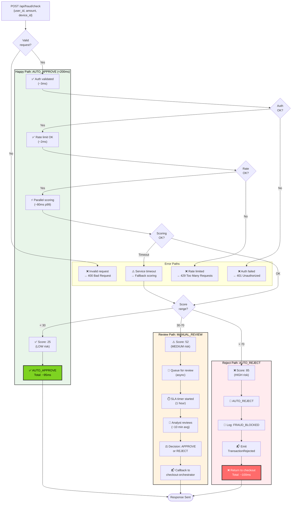
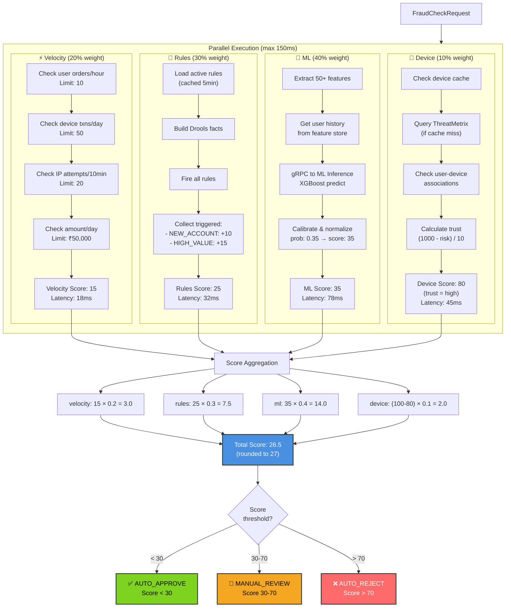
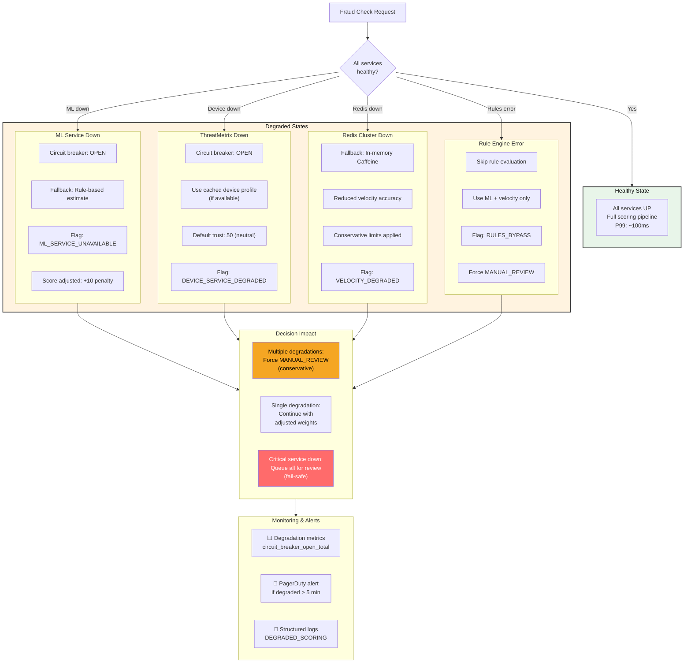
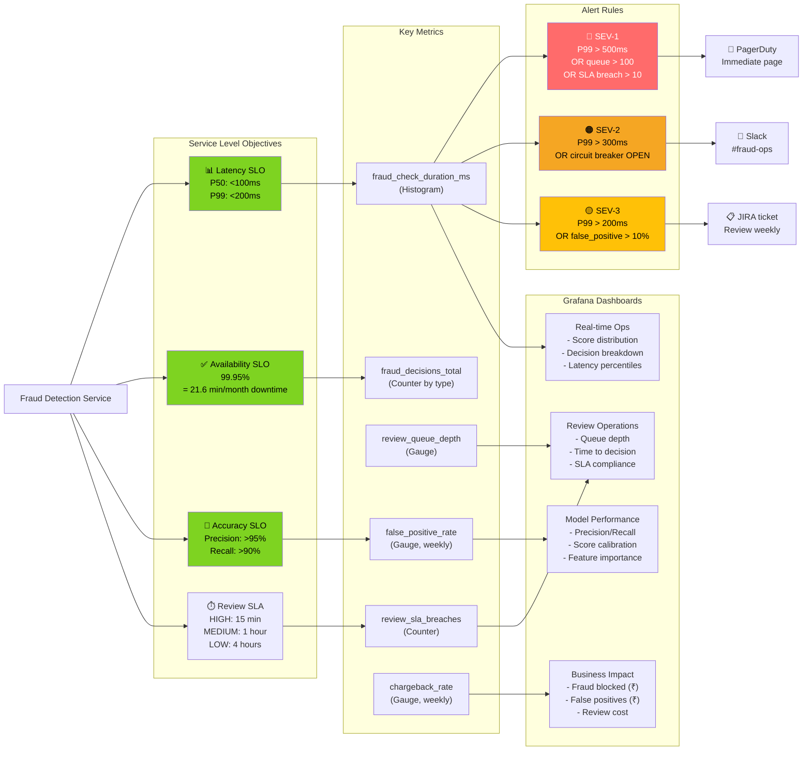

# Fraud Detection Service - End-to-End Flows

## Complete Order to Fraud Decision Flow (E2E)

```mermaid
graph TB
    Customer["👤 Customer<br/>(Mobile App)"]
    MobileBFF["📱 Mobile BFF"]
    CartService["🛒 Cart Service"]
    CheckoutOrch["🔄 Checkout Orchestrator<br/>(Temporal)"]
    
    ALB["⚖️ AWS ALB<br/>(SSL/TLS)"]
    
    subgraph FraudService["Fraud Detection Service"]
        FraudController["🎯 FraudController"]
        ScoreOrchestrator["📊 FraudScoreOrchestrator"]
        
        subgraph scoring["Parallel Scoring Pipeline"]
            VelocityCheck["⚡ VelocityCheckService"]
            RuleEngine["📜 RuleEngineService<br/>(Drools)"]
            MLScoring["🤖 MLScoringService"]
            DeviceCheck["📱 DeviceFingerprintService"]
        end
        
        DecisionEngine["⚖️ DecisionEngine"]
        ReviewQueue["👥 ReviewQueueService"]
    end
    
    subgraph DataStores["Data Stores"]
        Redis["⚡ Redis Cluster<br/>(velocity, cache)"]
        PostgreSQL["🐘 PostgreSQL<br/>(fraud_db)"]
        Kafka["📬 Kafka<br/>(events)"]
    end
    
    subgraph External["External Services"]
        MLInference["🤖 ML Inference<br/>(gRPC)"]
        ThreatMetrix["📱 ThreatMetrix<br/>(Device API)"]
        FeatureStore["📊 Feature Store"]
    end
    
    subgraph ReviewPath["Manual Review Path"]
        AnalystDash["👨‍💼 Analyst Dashboard"]
        Analyst["👤 Fraud Analyst"]
        DecisionAPI["⚖️ Decision API"]
    end
    
    PaymentService["💳 Payment Service"]
    OrderService["📋 Order Service"]
    
    Customer -->|1. Place Order| MobileBFF
    MobileBFF -->|2. Create checkout| CartService
    CartService -->|3. Start checkout saga| CheckoutOrch
    
    CheckoutOrch -->|4. POST /api/fraud/check<br/>{user, amount, device, items}| ALB
    ALB -->|5. Route| FraudController
    
    FraudController -->|6. Orchestrate scoring| ScoreOrchestrator
    
    ScoreOrchestrator -->|7a. Check velocity| VelocityCheck
    VelocityCheck -->|Redis MULTI/EXEC| Redis
    
    ScoreOrchestrator -->|7b. Evaluate rules| RuleEngine
    RuleEngine -->|Rule cache| Redis
    
    ScoreOrchestrator -->|7c. Get ML score| MLScoring
    MLScoring -->|Get features| FeatureStore
    MLScoring -->|gRPC predict| MLInference
    
    ScoreOrchestrator -->|7d. Verify device| DeviceCheck
    DeviceCheck -->|Device cache| Redis
    DeviceCheck -->|API call| ThreatMetrix
    
    ScoreOrchestrator -->|8. Aggregate scores| DecisionEngine
    
    DecisionEngine -->|9. Persist score| PostgreSQL
    DecisionEngine -->|10. Emit event| Kafka
    
    DecisionEngine -->|11a. Score < 30| AutoApprove["✅ AUTO_APPROVE"]
    DecisionEngine -->|11b. Score 30-70| ReviewQueue
    DecisionEngine -->|11c. Score > 70| AutoReject["❌ AUTO_REJECT"]
    
    ReviewQueue -->|12. Queue review| Kafka
    Kafka -->|13. Notify| AnalystDash
    AnalystDash -->|14. Display| Analyst
    Analyst -->|15. Decision| DecisionAPI
    DecisionAPI -->|16. Update| PostgreSQL
    DecisionAPI -->|17. Emit| Kafka
    
    AutoApprove -->|18a. Response| FraudController
    AutoReject -->|18b. Response| FraudController
    DecisionAPI -->|18c. Callback| CheckoutOrch
    
    FraudController -->|19. FraudCheckResponse| CheckoutOrch
    
    CheckoutOrch -->|20a. Approved| PaymentService
    CheckoutOrch -->|20b. Rejected| OrderCancelled["❌ Order Cancelled"]
    
    PaymentService -->|21. Process payment| PaymentService
    PaymentService -->|22. Payment confirmed| OrderService
    
    OrderService -->|23. Create order| OrderService
    OrderService -->|24. Order confirmed| CheckoutOrch
    
    CheckoutOrch -->|25. Success| MobileBFF
    MobileBFF -->|26. Order placed!| Customer
    
    style FraudService fill:#FFEBEE,color:#000,stroke:#333,stroke-width:2px
    style AutoApprove fill:#7ED321,color:#000,stroke:#333,stroke-width:2px
    style AutoReject fill:#FF6B6B,color:#fff,stroke:#333,stroke-width:2px
    style DecisionEngine fill:#4A90E2,color:#fff,stroke:#333,stroke-width:2px
```

## Request Flow with All Decision Paths



## Scoring Pipeline Deep Dive



## Manual Review Complete Journey

```mermaid
graph TB
    subgraph trigger["Review Triggered"]
        T1["Fraud score: 55<br/>Decision: MANUAL_REVIEW"]
        T2["Calculate priority<br/>→ MEDIUM"]
        T3["Set SLA: 1 hour"]
        T4["Insert into fraud_reviews<br/>status: PENDING"]
        T5["Emit ReviewQueued<br/>to Kafka"]
    end
    
    subgraph notify["Notification"]
        N1["Kafka consumer<br/>receives event"]
        N2["WebSocket push<br/>to analyst dashboard"]
        N3["Dashboard updates<br/>queue count: +1"]
        N4["🔔 Audio/visual alert"]
    end
    
    subgraph claim["Analyst Claims"]
        C1["👤 Analyst clicks 'Claim'"]
        C2["POST /reviews/{id}/claim"]
        C3["Check not already claimed<br/>(optimistic lock)"]
        C4["Update status: IN_PROGRESS<br/>analyst_id: {analyst}"]
        C5["Stop SLA timer<br/>(claimed within SLA ✓)"]
    end
    
    subgraph review["Review Process"]
        RE1["Load review context"]
        
        subgraph context["Review Context"]
            CTX1["📋 Transaction Details<br/>- Amount: ₹8,500<br/>- Items: Electronics<br/>- Payment: Card"]
            CTX2["👤 User History<br/>- Account age: 45 days<br/>- Orders: 12<br/>- Avg value: ₹2,100"]
            CTX3["🚨 Risk Factors<br/>- NEW_ACCOUNT: +10<br/>- HIGH_VALUE: +15<br/>- Score: 55"]
            CTX4["📱 Device Info<br/>- Trust: MEDIUM (77)<br/>- NEW_DEVICE_FOR_USER<br/>- OS: iOS 17.2"]
            CTX5["🔍 Similar Cases<br/>- 3 similar approved<br/>- 1 similar rejected<br/>- Pattern: legitimate"]
        end
        
        RE2["Analyst analyzes<br/>(avg 3-5 minutes)"]
    end
    
    subgraph decide["Decision"]
        D1["Analyst decision"]
        
        Approve["✅ APPROVE<br/>'Verified purchase, new device<br/>added recently but legitimate'"]
        Reject["❌ REJECT<br/>'Suspicious pattern,<br/>multiple declined cards'"]
        Escalate["⬆️ ESCALATE<br/>'Unusual pattern,<br/>need senior review'"]
    end
    
    subgraph complete["Completion"]
        COMP1["POST /api/fraud/decision<br/>{review_id, decision, notes}"]
        COMP2["Update fraud_reviews<br/>status: APPROVED"]
        COMP3["Update fraud_scores<br/>final_decision: APPROVED"]
        COMP4["Emit ReviewCompleted<br/>to Kafka"]
        COMP5["Callback to<br/>checkout-orchestrator"]
        COMP6["📊 Update metrics<br/>time_to_decision: 4min"]
    end
    
    subgraph outcome["Outcome"]
        OUT1["✅ Order proceeds<br/>Payment captured"]
        OUT2["❌ Order cancelled<br/>Payment voided"]
    end
    
    T1 --> T2 --> T3 --> T4 --> T5
    T5 --> N1 --> N2 --> N3 --> N4
    N4 --> C1 --> C2 --> C3 --> C4 --> C5
    C5 --> RE1 --> context
    context --> RE2 --> D1
    
    D1 -->|Approve| Approve --> COMP1
    D1 -->|Reject| Reject --> COMP1
    D1 -->|Escalate| Escalate --> COMP1
    
    COMP1 --> COMP2 --> COMP3 --> COMP4 --> COMP5 --> COMP6
    
    COMP6 -->|If APPROVED| OUT1
    COMP6 -->|If REJECTED| OUT2
    
    style Approve fill:#7ED321,color:#000,stroke:#333,stroke-width:2px
    style Reject fill:#FF6B6B,color:#fff,stroke:#333,stroke-width:2px
    style Escalate fill:#9013FE,color:#fff,stroke:#333,stroke-width:2px
```



## Resilience & Degradation Patterns



## SLO & Monitoring Dashboard



## Cross-Service Integration Flow

```mermaid
graph TB
    subgraph upstream["Upstream Services (Callers)"]
        Checkout["🔄 Checkout Orchestrator<br/>Primary caller"]
        Payment["💳 Payment Service<br/>Pre-auth checks"]
        Order["📋 Order Service<br/>Post-order validation"]
        Identity["🆔 Identity Service<br/>Account verification"]
    end
    
    FraudService["🚨 Fraud Detection Service"]
    
    subgraph downstream["Downstream Dependencies"]
        MLInference["🤖 ML Inference Service<br/>Model predictions"]
        FeatureStore["📊 Feature Store<br/>User/transaction features"]
        ThreatMetrix["📱 ThreatMetrix<br/>Device intelligence"]
        IdentityLookup["🆔 Identity Service<br/>User history"]
    end
    
    subgraph data["Data Stores"]
        PostgreSQL["🐘 PostgreSQL<br/>fraud_db"]
        Redis["⚡ Redis Cluster<br/>Velocity counters"]
        Kafka["📬 Kafka<br/>Event streaming"]
    end
    
    subgraph consumers["Event Consumers"]
        Analytics["📈 Analytics Service<br/>fraud.score.calculated"]
        MLTraining["🎓 ML Training Pipeline<br/>fraud.review.completed"]
        Compliance["📋 Compliance Service<br/>fraud.transaction.rejected"]
        Notifications["📧 Notification Service<br/>fraud.review.queued"]
    end
    
    Checkout -->|POST /fraud/check| FraudService
    Payment -->|POST /fraud/check| FraudService
    Order -->|POST /fraud/validate| FraudService
    Identity -->|POST /fraud/account-check| FraudService
    
    FraudService -->|gRPC| MLInference
    FraudService -->|REST| FeatureStore
    FraudService -->|REST| ThreatMetrix
    FraudService -->|REST| IdentityLookup
    
    FraudService -->|Read/Write| PostgreSQL
    FraudService -->|Read/Write| Redis
    FraudService -->|Produce| Kafka
    
    Kafka -->|fraud.score.calculated| Analytics
    Kafka -->|fraud.review.completed| MLTraining
    Kafka -->|fraud.transaction.rejected| Compliance
    Kafka -->|fraud.review.queued| Notifications
    
    FraudService -->|Callback| Checkout
    FraudService -->|Event| Payment
    
    style FraudService fill:#FF6B6B,color:#fff,stroke:#333,stroke-width:3px
    style Checkout fill:#4A90E2,color:#fff
    style Kafka fill:#50E3C2,color:#000
```


