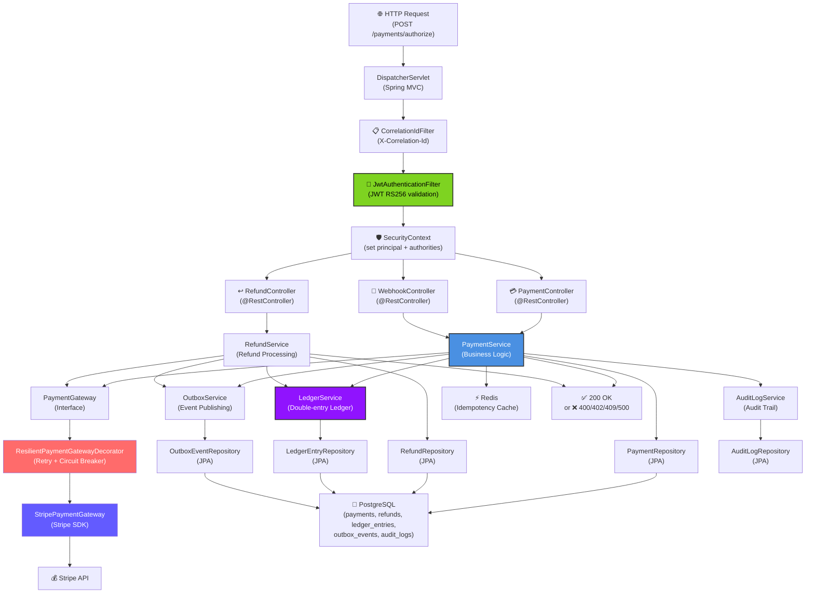
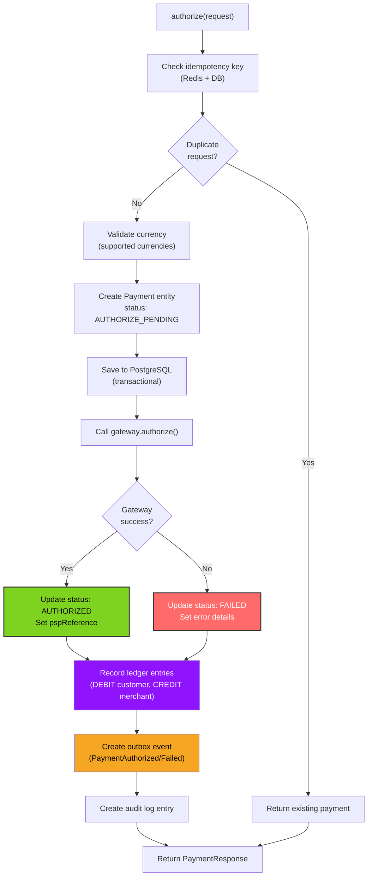
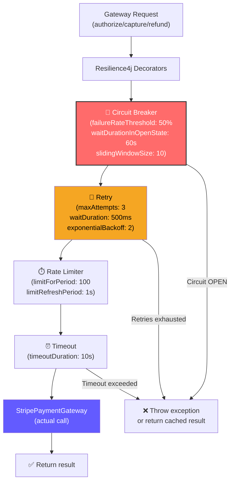
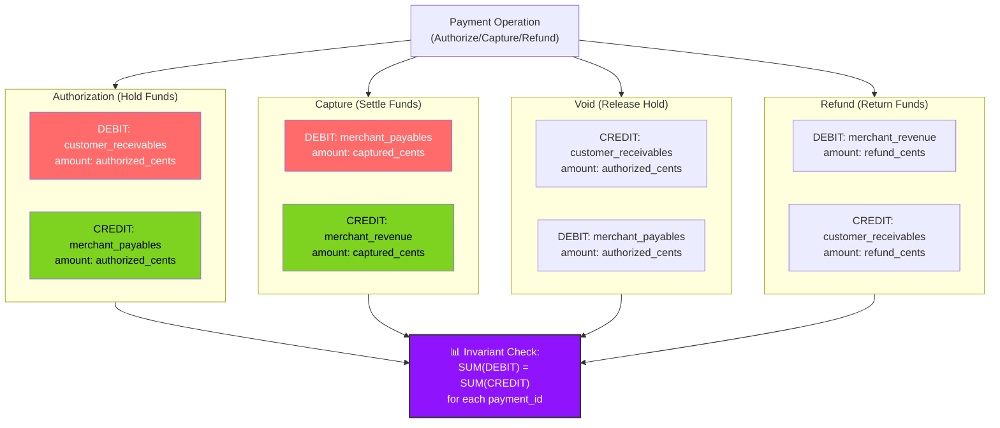
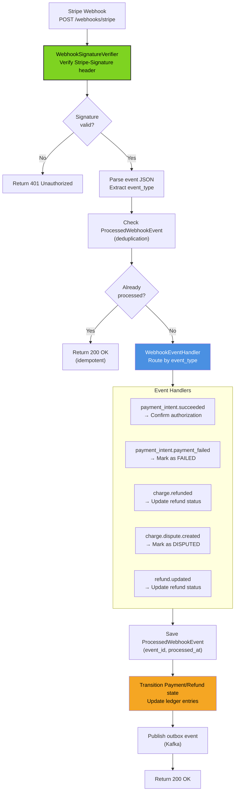
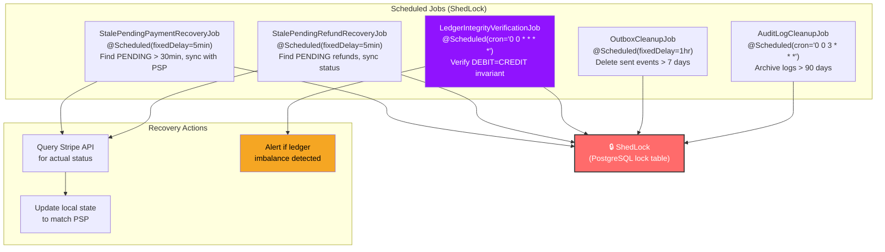

# Payment Service - Low-Level Design

## Component Architecture



## PaymentService Implementation



## ResilientPaymentGatewayDecorator



## LedgerService Double-Entry Bookkeeping



## WebhookEventProcessor



## Scheduled Jobs



## Repository Layer

```mermaid
graph TB
    subgraph Repositories["JPA Repositories"]
        PaymentRepo["PaymentRepository<br/>extends JpaRepository"]
        RefundRepo["RefundRepository<br/>extends JpaRepository"]
        LedgerRepo["LedgerEntryRepository<br/>extends JpaRepository"]
        OutboxRepo["OutboxEventRepository<br/>extends JpaRepository"]
        AuditRepo["AuditLogRepository<br/>extends JpaRepository"]
        WebhookRepo["ProcessedWebhookEventRepository<br/>extends JpaRepository"]
    end

    subgraph CustomQueries["Custom Query Methods"]
        FindByOrderId["findByOrderId(UUID orderId)"]
        FindByIdempotencyKey["findByIdempotencyKey(String key)"]
        FindByPaymentId["findByPaymentId(UUID paymentId)"]
        FindUnsent["findBySentFalseOrderByCreatedAtAsc()"]
        FindStale["findByStatusAndCreatedAtBefore(status, threshold)"]
        SumByPaymentId["sumAmountCentsByPaymentIdAndEntryType()"]
    end

    PaymentRepo --> FindByOrderId
    PaymentRepo --> FindByIdempotencyKey
    RefundRepo --> FindByPaymentId
    LedgerRepo --> SumByPaymentId
    OutboxRepo --> FindUnsent
    PaymentRepo --> FindStale

    style PaymentRepo fill:#4A90E2,color:#fff
    style LedgerRepo fill:#9013FE,color:#fff
```



## SLO: P99 Latency Target <500ms

```
┌─────────────────────────────────────────────────────────────┐
│  Payment Authorization Timeline (P99 target: <500ms)        │
├─────────────────────────────────────────────────────────────┤
│ JWT Validation:                        ~15ms                │
│ Idempotency Check (Redis):             ~5ms                 │
│ Payment Entity Creation:               ~2ms                 │
│ Subtotal (Pre-PSP):                    ~22ms                │
│                                                             │
│ Stripe API Call (authorize):           ~300-400ms (p99)     │
│   - Network latency to Stripe:         ~50ms                │
│   - Stripe processing:                 ~250-350ms           │
│                                                             │
│ Database Write (payment + ledger):     ~30ms                │
│ Outbox Event Write:                    ~10ms                │
│ Response Serialization:                ~5ms                 │
│                                                             │
│ TOTAL P99:                             ~467ms               │
│ BUFFER (500ms target):                 ~33ms                │
│ STATUS:                                ✅ WITHIN SLO        │
└─────────────────────────────────────────────────────────────┘

┌─────────────────────────────────────────────────────────────┐
│  Capture/Void Timeline (P99 target: <300ms)                 │
├─────────────────────────────────────────────────────────────┤
│ JWT Validation:                        ~15ms                │
│ Payment Lookup:                        ~10ms                │
│ Stripe API Call:                       ~200-250ms (p99)     │
│ Database Update + Ledger:              ~30ms                │
│ TOTAL P99:                             ~305ms               │
│ STATUS:                                ⚠️ NEAR SLO          │
└─────────────────────────────────────────────────────────────┘
```

## Error Handling & Resilience

```mermaid
graph TD
    A["Stripe API Error"]
    B["Network Timeout"]
    C["Database Error"]
    D["Idempotency Conflict"]
    E["Invalid State Transition"]

    A --> A1["PaymentGatewayException<br/>(card_declined, insufficient_funds)"]
    A1 --> A2["Map to PaymentDeclinedException"]
    A2 --> A3["Return 402 Payment Required"]
    A3 --> A4["Include decline_code in response"]

    B --> B1["PaymentGatewayTransientException"]
    B1 --> B2["Retry with exponential backoff<br/>(max 3 attempts)"]
    B2 --> B3{"Retry<br/>success?"}
    B3 -->|Yes| B4["Continue normal flow"]
    B3 -->|No| B5["Set status: FAILED<br/>Return 503 Service Unavailable"]

    C --> C1["DataAccessException"]
    C1 --> C2["Transaction rollback"]
    C2 --> C3["Log error with correlation_id"]
    C3 --> C4["Return 500 Internal Server Error"]

    D --> D1["DuplicatePaymentException"]
    D1 --> D2["Return existing payment<br/>(idempotent)"]
    D2 --> D3["Return 200 OK"]

    E --> E1["PaymentInvalidStateException"]
    E1 --> E2["Log state violation"]
    E2 --> E3["Return 409 Conflict<br/>Include current_state, attempted_action"]

    style A3 fill:#FF6B6B,color:#fff,stroke:#333,stroke-width:2px
    style B5 fill:#FF6B6B,color:#fff
    style C4 fill:#FF6B6B,color:#fff
    style D3 fill:#7ED321,color:#000,stroke:#333,stroke-width:2px
    style E3 fill:#F5A623,color:#000
```


