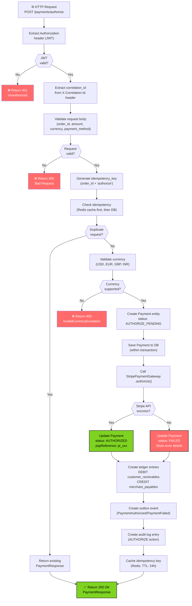
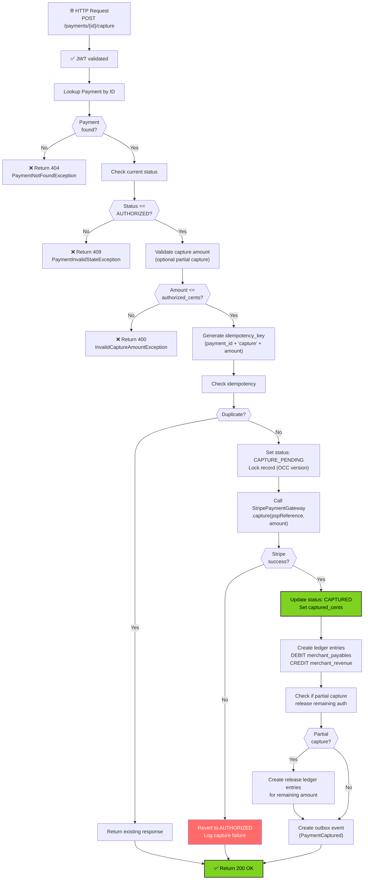
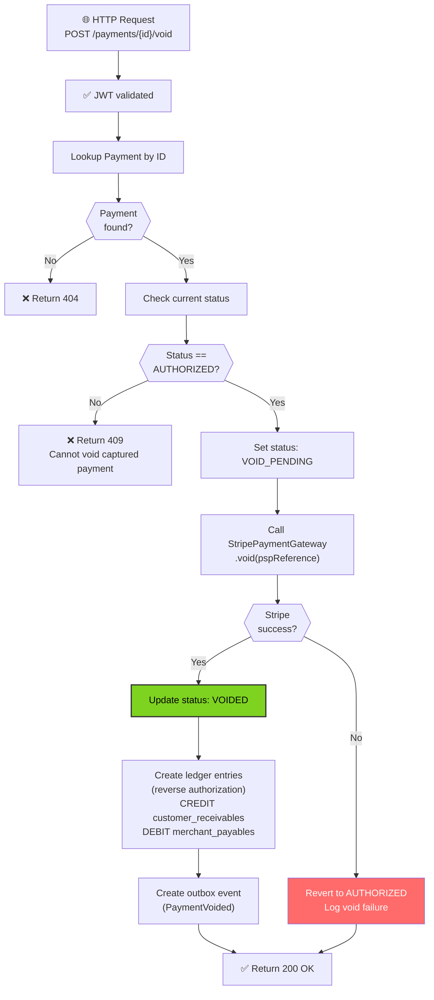
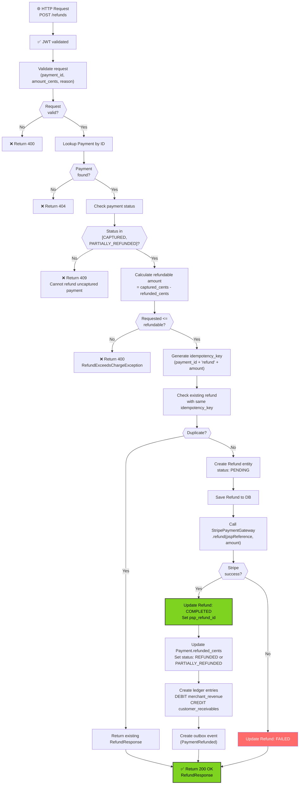
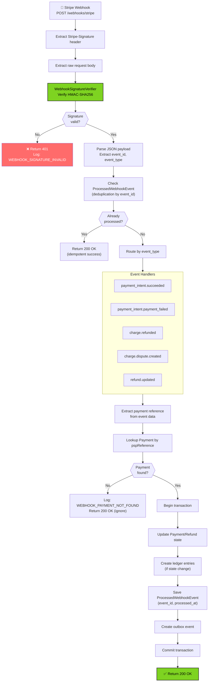
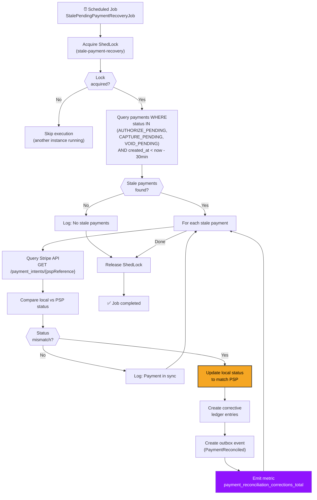
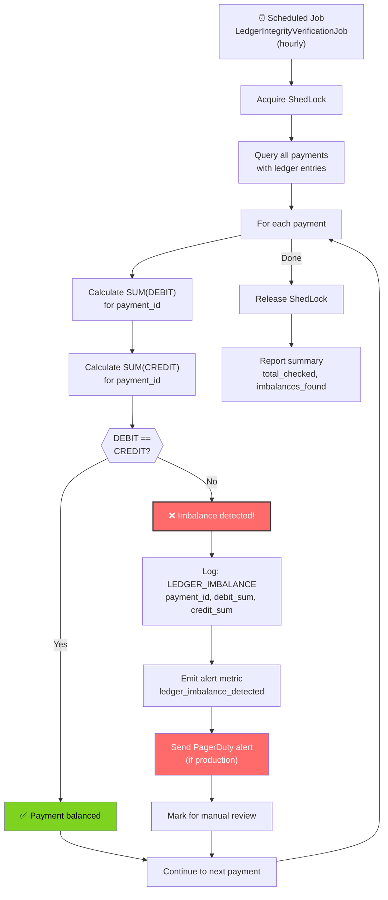

# Payment Service - Request Flowcharts

## Complete Authorization Flow

## Capture Flow

## Void Flow

## Refund Flow

## Webhook Processing Flow

## Reconciliation Job Flow

## Ledger Integrity Verification Flow

