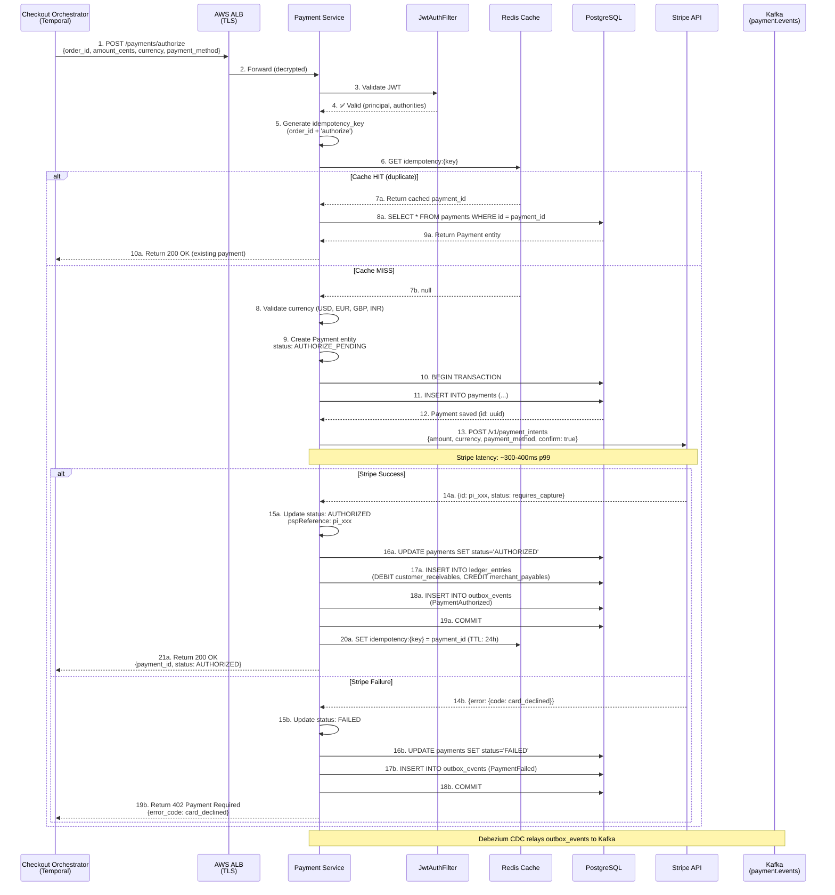
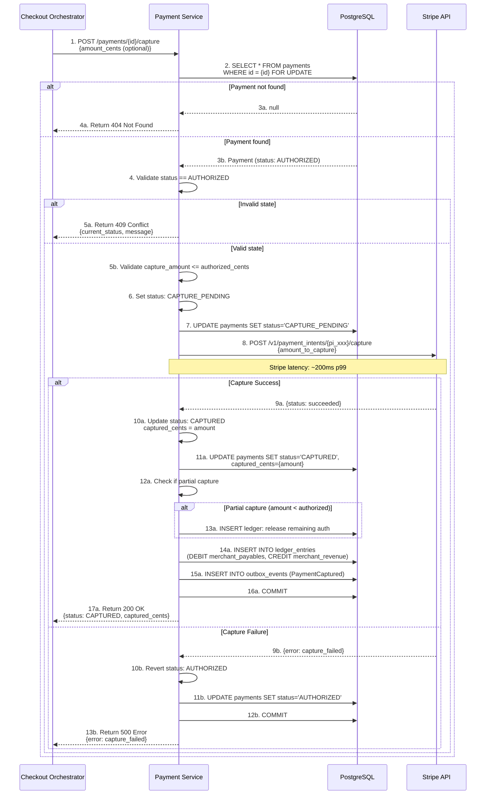
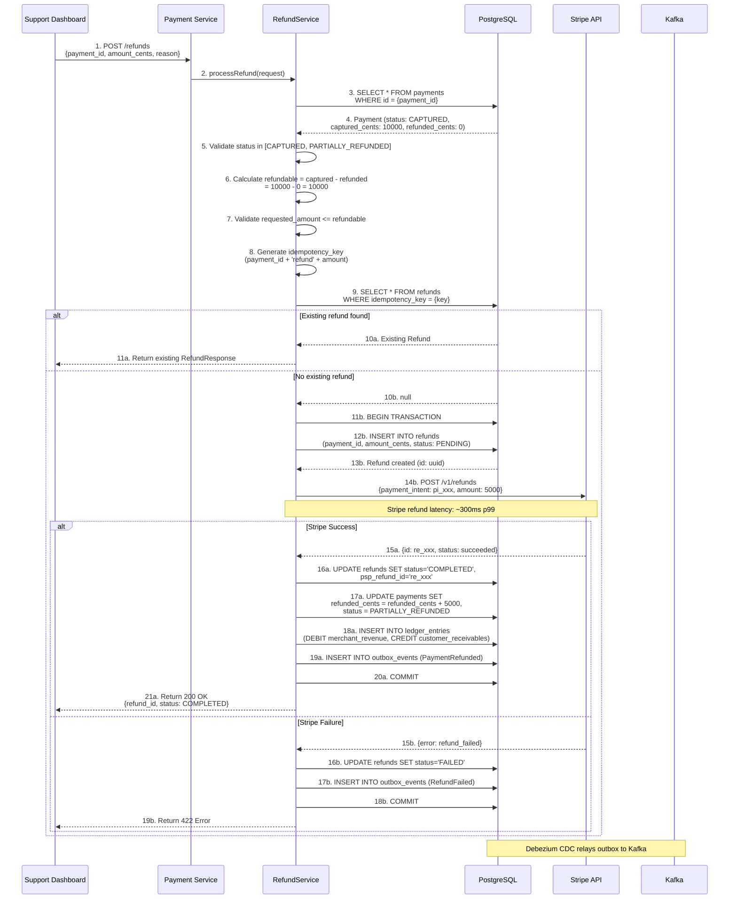
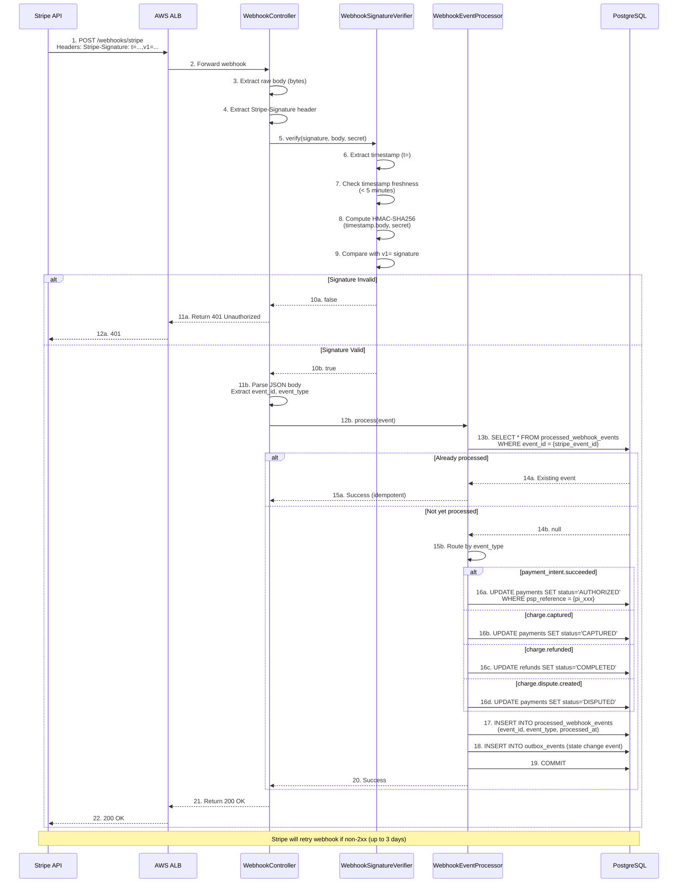
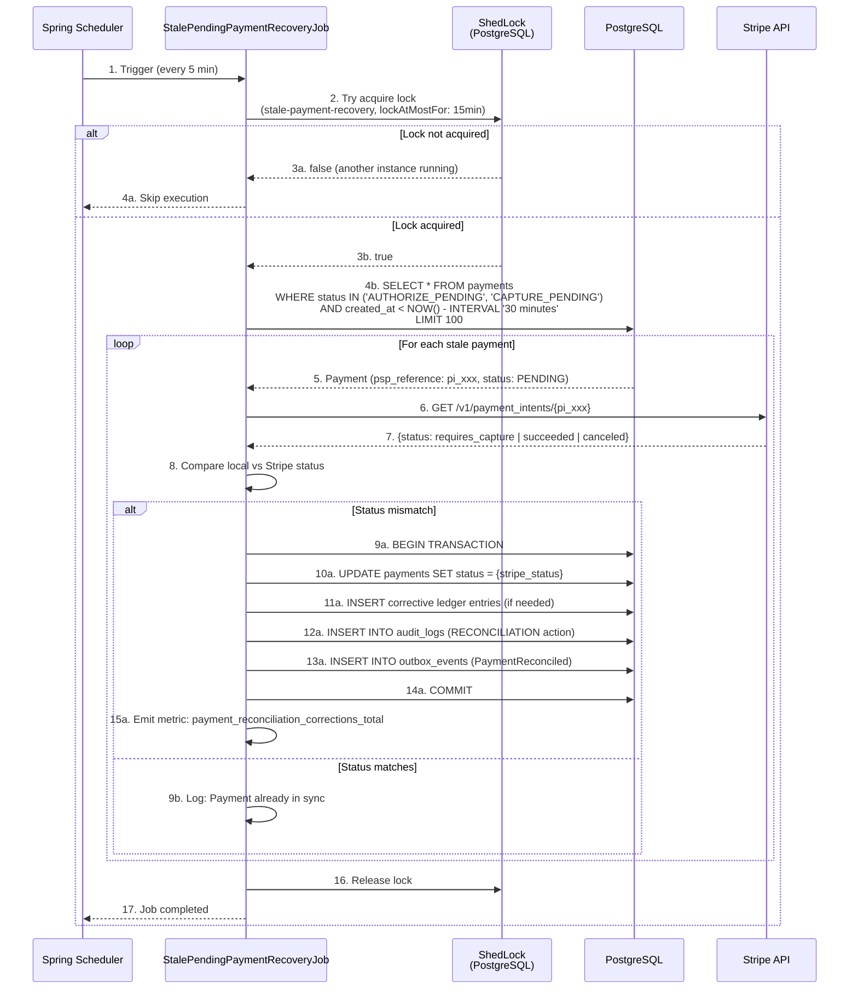
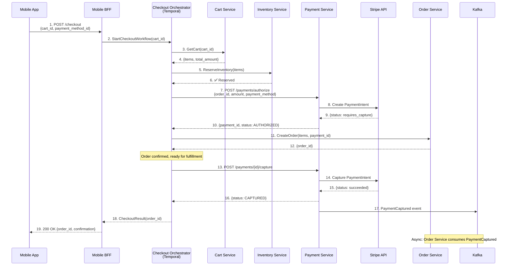

# Payment Service - Sequence Diagrams

## Complete Authorization Sequence

## Capture Sequence

## Refund Sequence

## Stripe Webhook Processing Sequence

## Stale Payment Recovery Sequence

## Checkout Integration Sequence (E2E)

