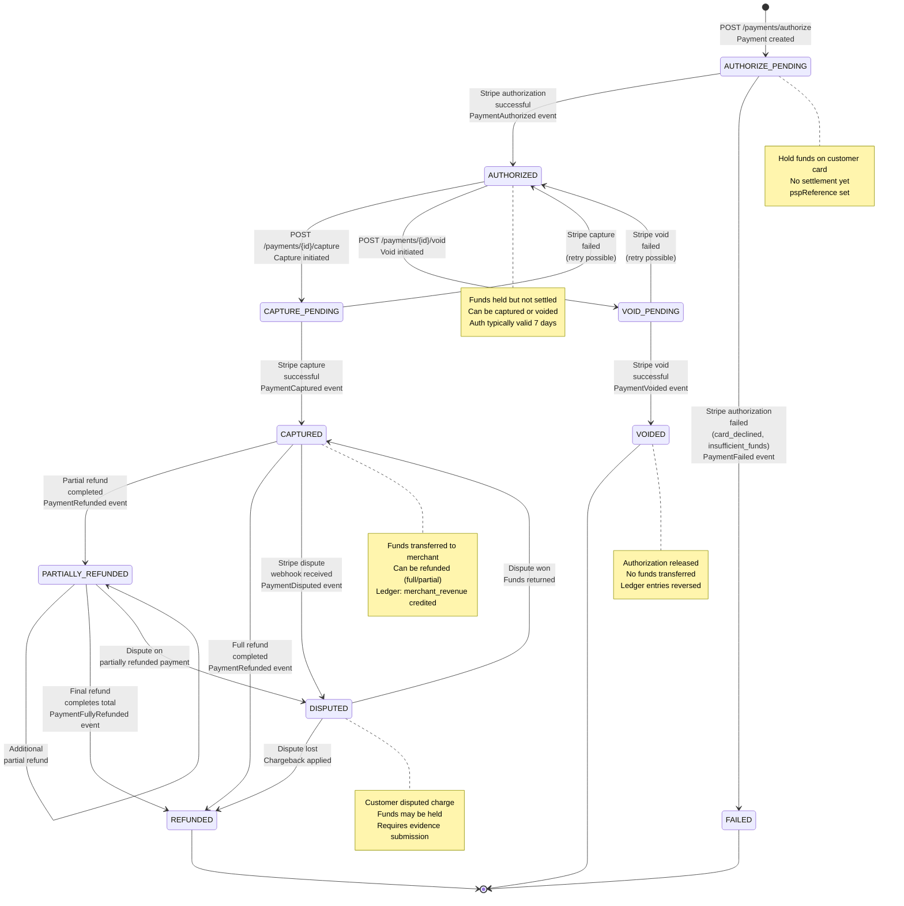
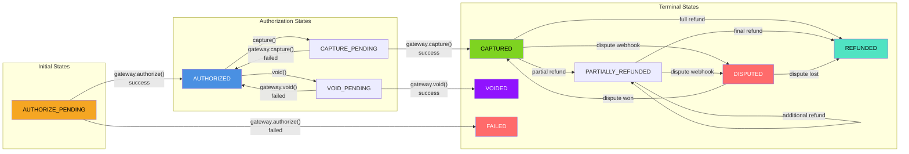
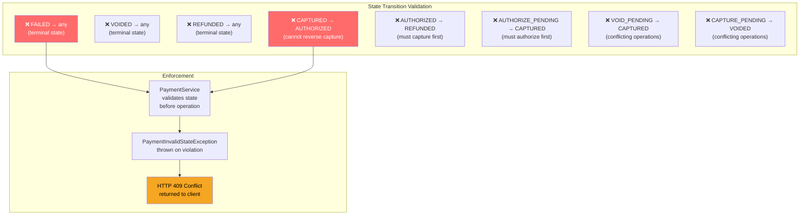
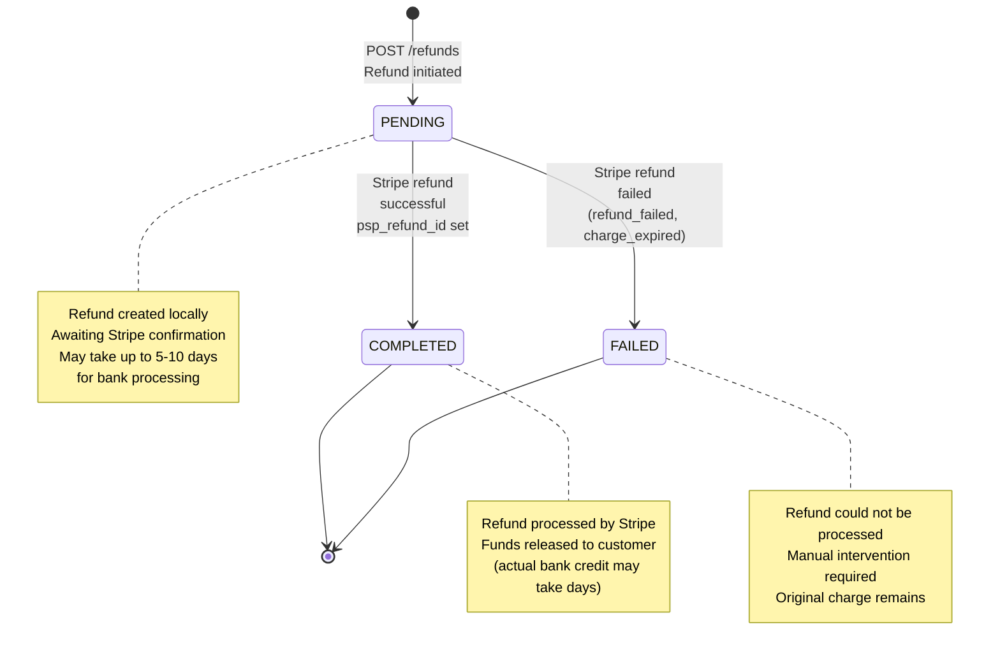
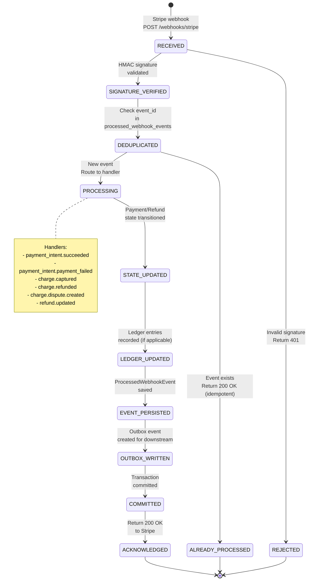
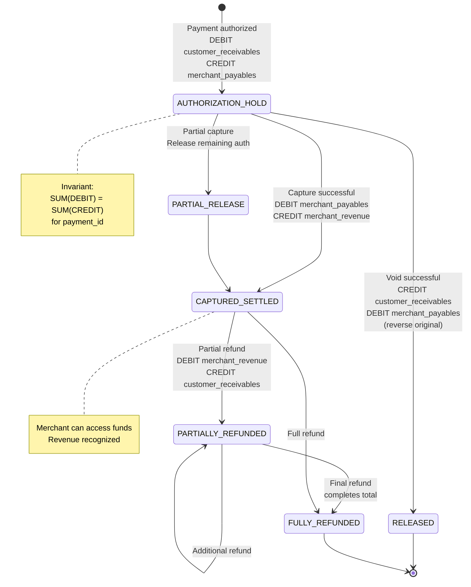
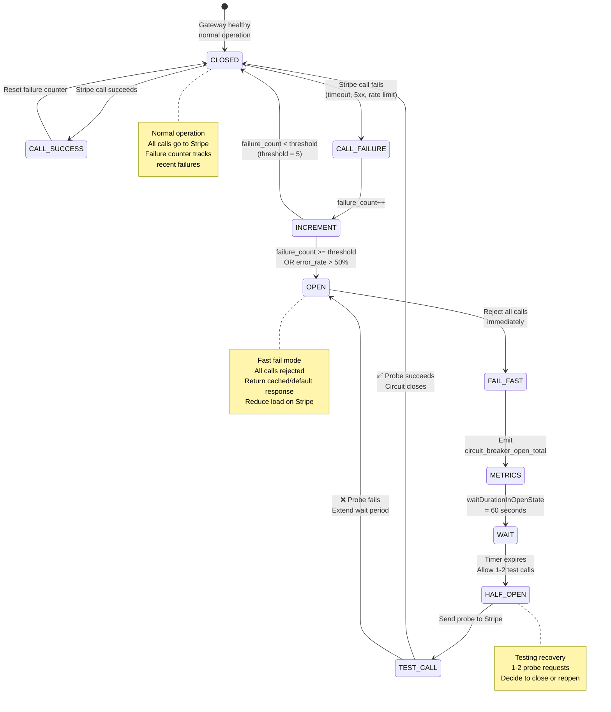
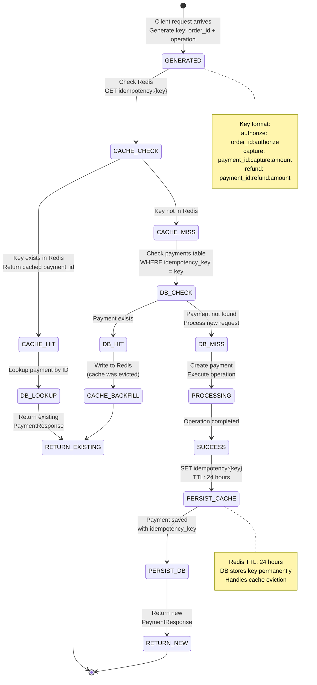
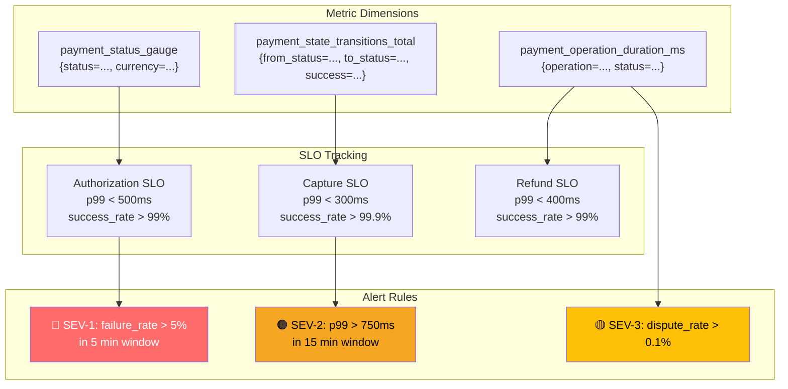

# Payment Service - State Machine Diagrams

## Payment Lifecycle State Machine (Complete)

## Valid State Transitions

## Invalid State Transition Rules

## Refund Status State Machine

## Webhook Event State Transitions

## Ledger Entry State Flow

## Circuit Breaker State Machine (Stripe Gateway)

## Idempotency Key Lifecycle

## Payment Status Metric States

