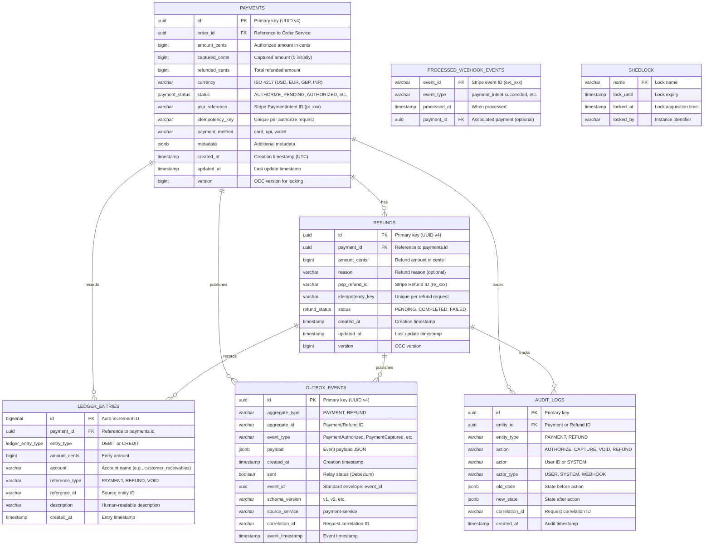
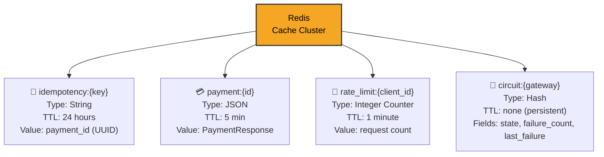
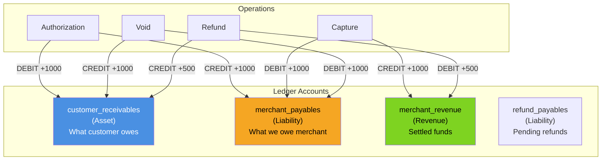
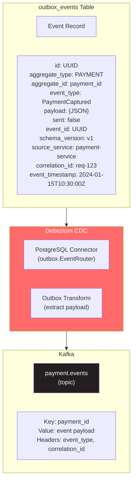
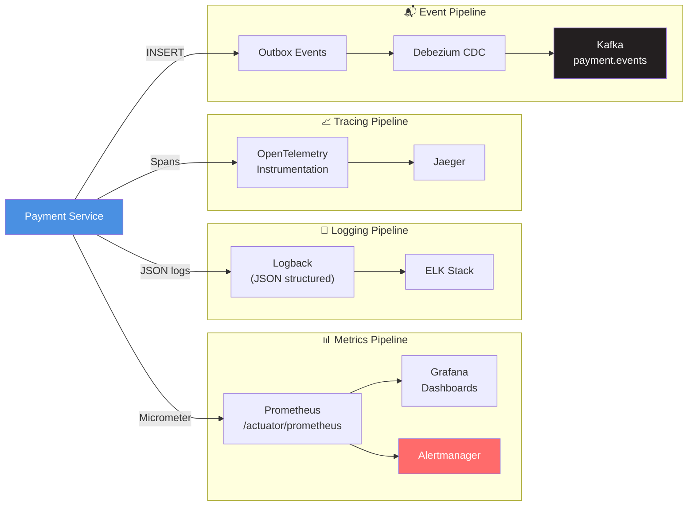

# Payment Service - ER Diagram & Storage Schema

## Core Entity Relationships



## Payments Table Schema

```sql
CREATE TYPE payment_status AS ENUM (
    'AUTHORIZE_PENDING',
    'AUTHORIZED',
    'CAPTURE_PENDING',
    'CAPTURED',
    'VOID_PENDING',
    'VOIDED',
    'PARTIALLY_REFUNDED',
    'REFUNDED',
    'FAILED',
    'DISPUTED'
);

CREATE TABLE payments (
    id UUID PRIMARY KEY DEFAULT gen_random_uuid(),
    order_id UUID NOT NULL,
    amount_cents BIGINT NOT NULL CHECK (amount_cents > 0),
    captured_cents BIGINT NOT NULL DEFAULT 0 CHECK (captured_cents >= 0),
    refunded_cents BIGINT NOT NULL DEFAULT 0 CHECK (refunded_cents >= 0),
    currency VARCHAR(3) NOT NULL,
    status payment_status NOT NULL DEFAULT 'AUTHORIZE_PENDING',
    psp_reference VARCHAR(255),
    idempotency_key VARCHAR(255) NOT NULL,
    payment_method VARCHAR(50),
    metadata JSONB,
    created_at TIMESTAMP WITH TIME ZONE NOT NULL DEFAULT NOW(),
    updated_at TIMESTAMP WITH TIME ZONE NOT NULL DEFAULT NOW(),
    version BIGINT NOT NULL DEFAULT 0,
    
    CONSTRAINT payments_idempotency_key_unique UNIQUE (idempotency_key),
    CONSTRAINT payments_refunded_lte_captured CHECK (refunded_cents <= captured_cents),
    CONSTRAINT payments_captured_lte_amount CHECK (captured_cents <= amount_cents)
);

-- Indexes for common queries
CREATE INDEX idx_payments_order_id ON payments(order_id);
CREATE INDEX idx_payments_status ON payments(status);
CREATE INDEX idx_payments_psp_reference ON payments(psp_reference);
CREATE INDEX idx_payments_created_at ON payments(created_at);
CREATE INDEX idx_payments_status_created_at ON payments(status, created_at) 
    WHERE status IN ('AUTHORIZE_PENDING', 'CAPTURE_PENDING', 'VOID_PENDING');
```

## Ledger Entries Table Schema

```sql
CREATE TYPE ledger_entry_type AS ENUM ('DEBIT', 'CREDIT');

CREATE TABLE ledger_entries (
    id BIGSERIAL PRIMARY KEY,
    payment_id UUID NOT NULL REFERENCES payments(id),
    entry_type ledger_entry_type NOT NULL,
    amount_cents BIGINT NOT NULL CHECK (amount_cents > 0),
    account VARCHAR(100) NOT NULL,
    reference_type VARCHAR(50) NOT NULL,
    reference_id VARCHAR(255),
    description TEXT,
    created_at TIMESTAMP WITH TIME ZONE NOT NULL DEFAULT NOW(),
    
    CONSTRAINT ledger_entries_dedup UNIQUE (payment_id, entry_type, account, reference_type, reference_id)
);

-- Indexes for ledger queries
CREATE INDEX idx_ledger_entries_payment_id ON ledger_entries(payment_id);
CREATE INDEX idx_ledger_entries_account ON ledger_entries(account);
CREATE INDEX idx_ledger_entries_created_at ON ledger_entries(created_at);

-- View for ledger balance by payment
CREATE VIEW payment_ledger_balances AS
SELECT 
    payment_id,
    SUM(CASE WHEN entry_type = 'DEBIT' THEN amount_cents ELSE 0 END) AS total_debits,
    SUM(CASE WHEN entry_type = 'CREDIT' THEN amount_cents ELSE 0 END) AS total_credits,
    SUM(CASE WHEN entry_type = 'DEBIT' THEN amount_cents ELSE 0 END) -
    SUM(CASE WHEN entry_type = 'CREDIT' THEN amount_cents ELSE 0 END) AS balance
FROM ledger_entries
GROUP BY payment_id;
```

## Redis Cache Schema & Keys



## Account Structure (Double-Entry Bookkeeping)



## Ledger Entry Examples

```
┌─────────────────────────────────────────────────────────────────────────┐
│  Authorization: $100.00 (10000 cents)                                   │
├─────────────────────────────────────────────────────────────────────────┤
│  Entry 1: DEBIT   customer_receivables    +10000 (Asset ↑)             │
│  Entry 2: CREDIT  merchant_payables       +10000 (Liability ↑)          │
│                                                                         │
│  Balance Check: DEBIT(10000) = CREDIT(10000) ✅                        │
└─────────────────────────────────────────────────────────────────────────┘

┌─────────────────────────────────────────────────────────────────────────┐
│  Capture: $100.00 (10000 cents)                                         │
├─────────────────────────────────────────────────────────────────────────┤
│  Entry 3: DEBIT   merchant_payables       +10000 (Liability ↓)         │
│  Entry 4: CREDIT  merchant_revenue        +10000 (Revenue ↑)           │
│                                                                         │
│  Balance Check: DEBIT(20000) = CREDIT(20000) ✅                        │
└─────────────────────────────────────────────────────────────────────────┘

┌─────────────────────────────────────────────────────────────────────────┐
│  Partial Refund: $30.00 (3000 cents)                                    │
├─────────────────────────────────────────────────────────────────────────┤
│  Entry 5: DEBIT   merchant_revenue        +3000  (Revenue ↓)           │
│  Entry 6: CREDIT  customer_receivables    +3000  (Asset ↓)             │
│                                                                         │
│  Balance Check: DEBIT(23000) = CREDIT(23000) ✅                        │
│  Net Revenue: 10000 - 3000 = 7000 cents ($70.00)                       │
└─────────────────────────────────────────────────────────────────────────┘
```

## Outbox Event Schema (Debezium CDC)



## Prometheus Metrics Schema

```
Payment Service Metrics
├─ payment_authorizations_total{status, currency, payment_method}
│  └ Counter: Total authorization attempts
│
├─ payment_captures_total{status, partial}
│  └ Counter: Total capture attempts
│     - partial: true/false
│
├─ payment_refunds_total{status, reason}
│  └ Counter: Total refund attempts
│
├─ payment_operation_duration_ms{operation, status}
│  └ Histogram: Operation latency
│     - operation: authorize, capture, void, refund
│     - buckets: 10, 50, 100, 200, 500, 1000, 2000
│
├─ stripe_api_calls_total{endpoint, status_code}
│  └ Counter: Stripe API call count
│
├─ stripe_api_latency_ms{endpoint}
│  └ Histogram: Stripe API latency
│
├─ ledger_entries_total{entry_type, account}
│  └ Counter: Ledger entries created
│
├─ ledger_balance_imbalance_total
│  └ Counter: Integrity violations detected
│
├─ circuit_breaker_state{gateway}
│  └ Gauge: 0=CLOSED, 1=OPEN, 2=HALF_OPEN
│
├─ webhook_events_processed_total{event_type, outcome}
│  └ Counter: Webhooks processed
│     - outcome: success, duplicate, invalid_signature
│
└─ outbox_events_pending_gauge
   └ Gauge: Unsent outbox events count
```

## Observability Pipeline


