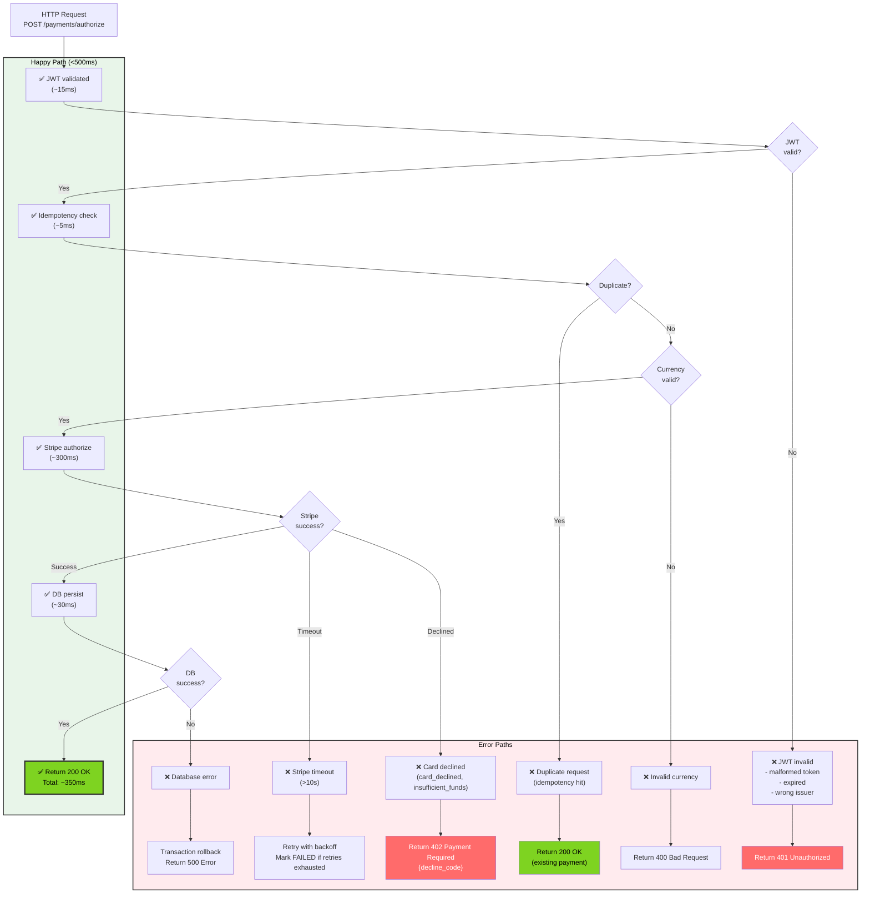
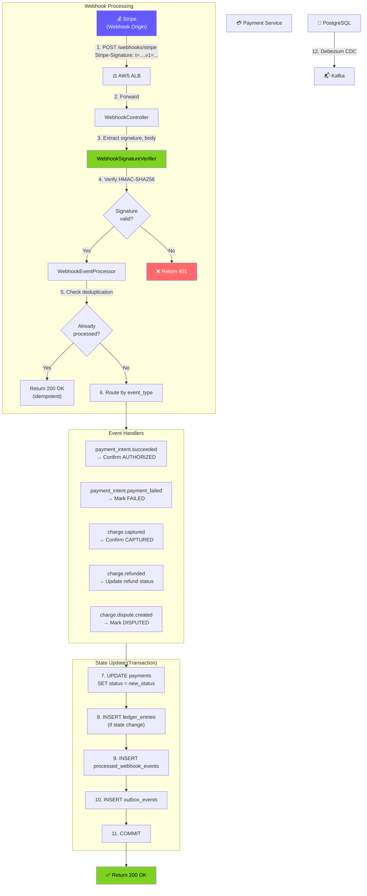
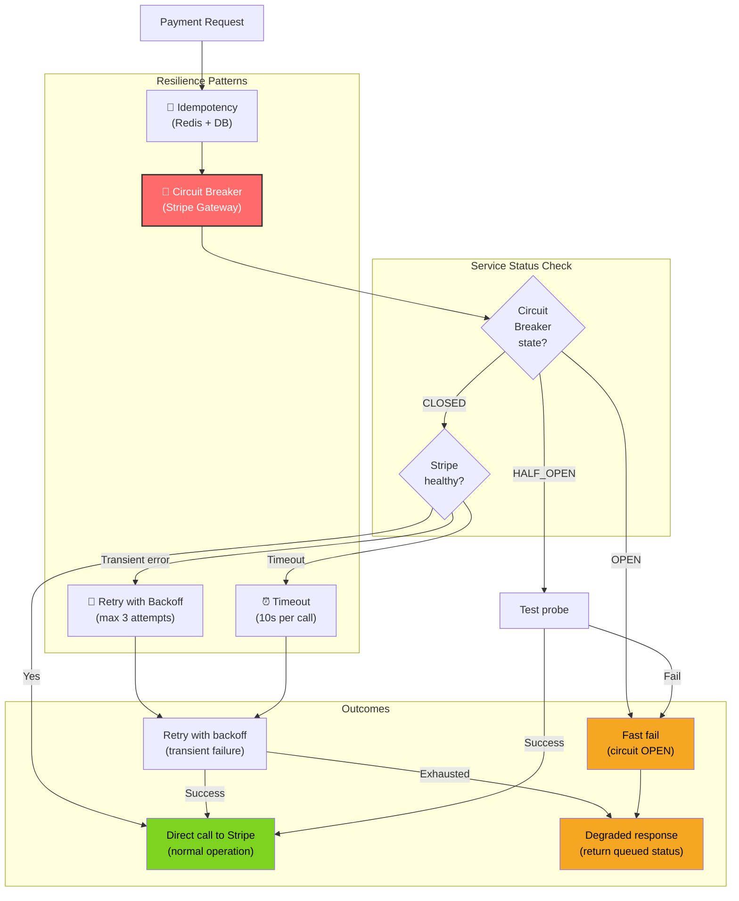
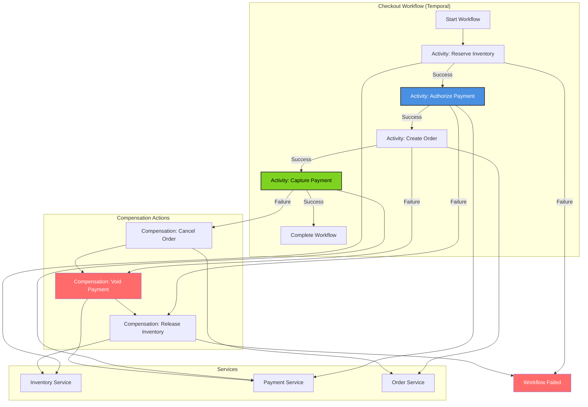
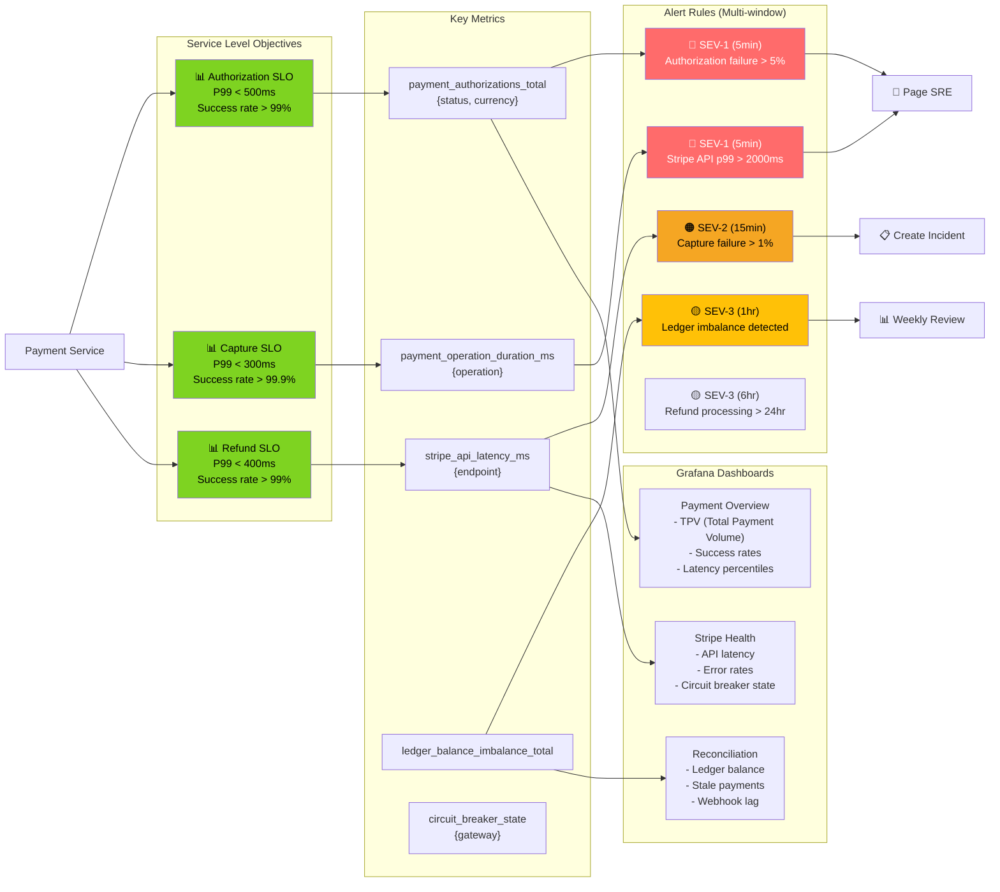
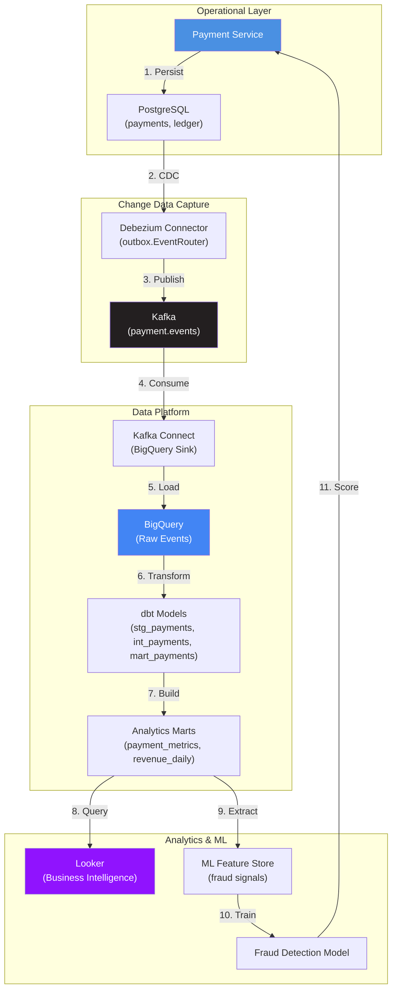

# Payment Service - End-to-End Flows

## Complete Checkout to Refund Flow (E2E)

```mermaid
graph TB
    User["👤 Customer<br/>(Mobile App)"]
    MobileBFF["📱 Mobile BFF"]
    CheckoutOrch["🔄 Checkout Orchestrator<br/>(Temporal Workflow)"]
    CartService["🛒 Cart Service"]
    InventoryService["📦 Inventory Service"]
    PaymentService["💳 Payment Service"]
    StripeAPI["💰 Stripe API"]
    PostgreSQL["🐘 PostgreSQL"]
    Redis["⚡ Redis"]
    Kafka["📬 Kafka<br/>(payment.events)"]
    OrderService["📋 Order Service"]
    FulfillmentService["🚚 Fulfillment Service"]
    NotificationService["🔔 Notification Service"]
    SupportDashboard["👨‍💼 Support Dashboard"]

    subgraph Phase1["Phase 1: Checkout Initiation"]
        User -->|1. Tap 'Place Order'| MobileBFF
        MobileBFF -->|2. Start checkout workflow| CheckoutOrch
        CheckoutOrch -->|3. Get cart details| CartService
        CartService -->|4. Return cart items, total| CheckoutOrch
        CheckoutOrch -->|5. Reserve inventory| InventoryService
        InventoryService -->|6. Inventory reserved| CheckoutOrch
    end

    subgraph Phase2["Phase 2: Payment Authorization"]
        CheckoutOrch -->|7. POST /payments/authorize<br/>{order_id, amount, payment_method}| PaymentService
        PaymentService -->|8. Check idempotency| Redis
        Redis -->|9. Cache miss| PaymentService
        PaymentService -->|10. Create PaymentIntent| StripeAPI
        StripeAPI -->|11. {id: pi_xxx, status: requires_capture}| PaymentService
        PaymentService -->|12. Save payment, ledger entries, outbox event| PostgreSQL
        PaymentService -->|13. {payment_id, status: AUTHORIZED}| CheckoutOrch
    end

    subgraph Phase3["Phase 3: Order Creation"]
        CheckoutOrch -->|14. Create order| OrderService
        OrderService -->|15. {order_id}| CheckoutOrch
    end

    subgraph Phase4["Phase 4: Payment Capture"]
        CheckoutOrch -->|16. POST /payments/{id}/capture| PaymentService
        PaymentService -->|17. Capture PaymentIntent| StripeAPI
        StripeAPI -->|18. {status: succeeded}| PaymentService
        PaymentService -->|19. Update status, ledger, outbox| PostgreSQL
        PaymentService -->|20. {status: CAPTURED}| CheckoutOrch
    end

    subgraph Phase5["Phase 5: Event Propagation"]
        PostgreSQL -->|21. Debezium CDC| Kafka
        Kafka -->|22. PaymentCaptured event| OrderService
        Kafka -->|23. PaymentCaptured event| FulfillmentService
        Kafka -->|24. PaymentCaptured event| NotificationService
        FulfillmentService -->|25. Start fulfillment| FulfillmentService
        NotificationService -->|26. Send confirmation email| User
    end

    subgraph Phase6["Phase 6: Refund (Later)"]
        User -->|27. Request refund via support| SupportDashboard
        SupportDashboard -->|28. POST /refunds<br/>{payment_id, amount, reason}| PaymentService
        PaymentService -->|29. Create Stripe refund| StripeAPI
        StripeAPI -->|30. {id: re_xxx, status: succeeded}| PaymentService
        PaymentService -->|31. Update payment, create ledger entries| PostgreSQL
        PaymentService -->|32. {refund_id, status: COMPLETED}| SupportDashboard
        PostgreSQL -->|33. CDC| Kafka
        Kafka -->|34. PaymentRefunded event| OrderService
        Kafka -->|35. PaymentRefunded event| NotificationService
        NotificationService -->|36. Send refund confirmation| User
    end

    style User fill:#4A90E2,color:#fff
    style PaymentService fill:#4A90E2,color:#fff,stroke:#333,stroke-width:2px
    style StripeAPI fill:#635BFF,color:#fff
    style Kafka fill:#231F20,color:#fff
```

## Request Flow with Error Handling



## Stripe Webhook Integration Flow



## Resilience & Degradation Patterns



## Multi-Service Orchestration (Saga Pattern)



## Reconciliation & Monitoring Dashboard



## Data Flow: Payment to Analytics


