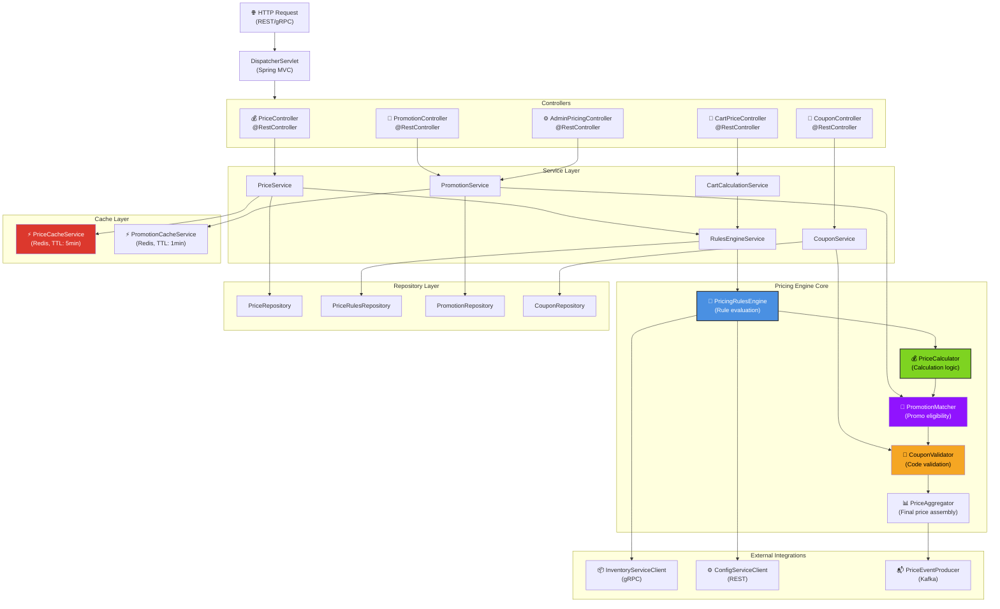
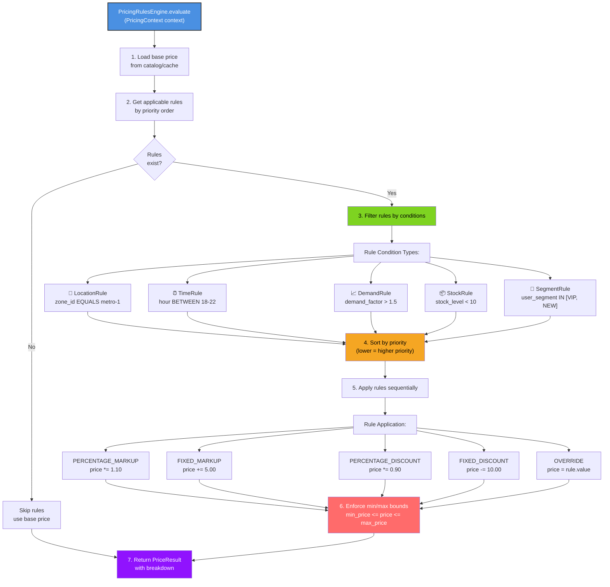
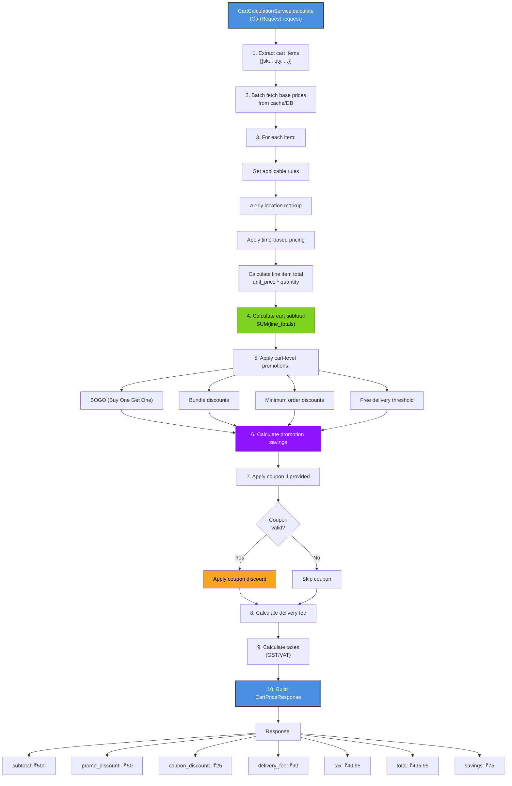
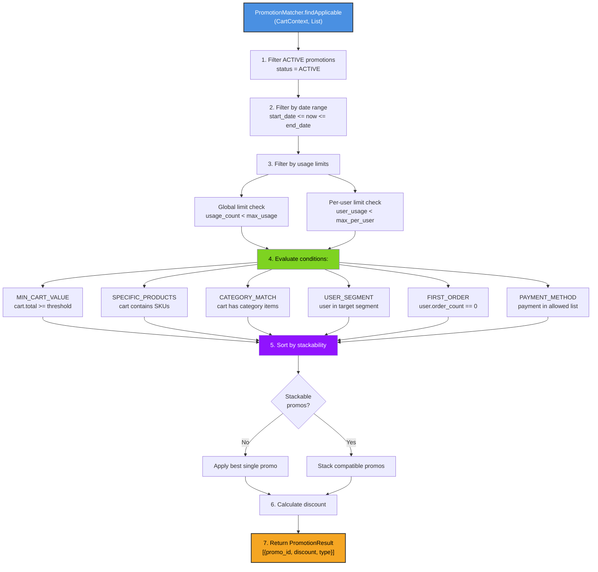
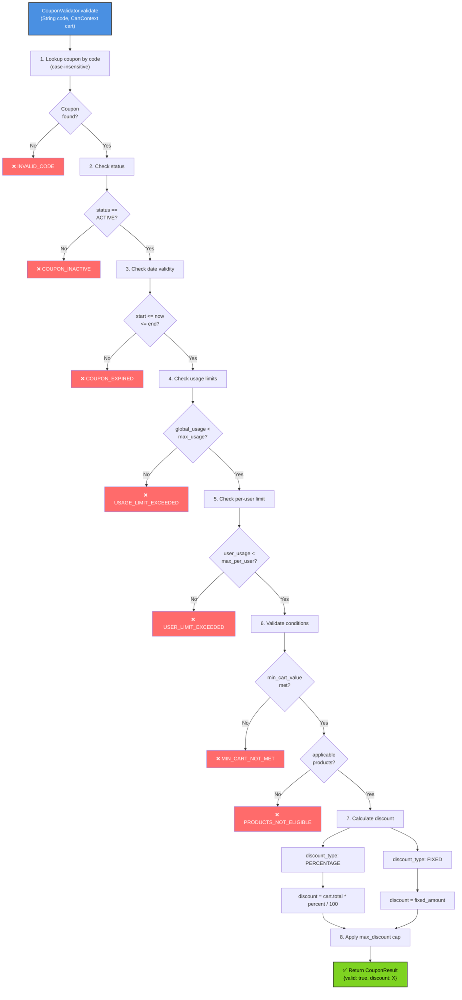
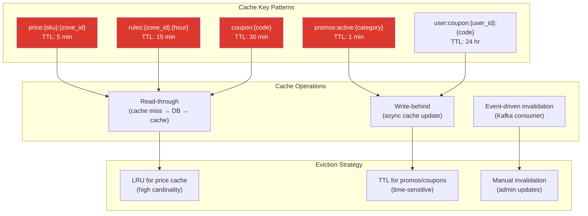
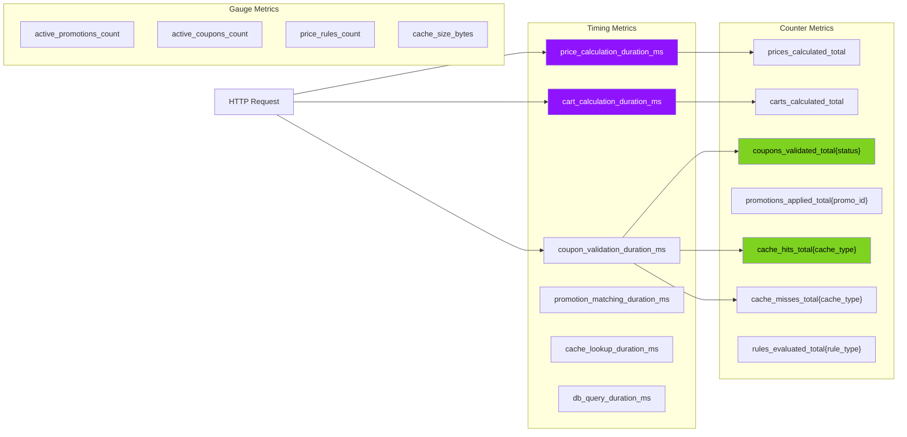
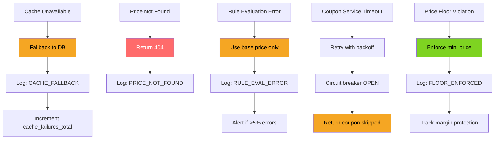

# Pricing Service - Low-Level Design

## Component Architecture



## PricingRulesEngine Implementation



## CartCalculationService Implementation



## PromotionMatcher Implementation



## CouponValidator Implementation



## Cache Strategy



## Metrics Collection



## SLO Latency Budget

```
┌─────────────────────────────────────────────────────────────┐
│  Pricing Service Request Timeline (P99 target: <200ms)      │
├─────────────────────────────────────────────────────────────┤
│ Request parsing & validation:          ~5ms                 │
│ Cache lookup (Redis):                  ~3ms (hit)           │
│                                        ~2ms (miss overhead) │
│                                                             │
│ If cache miss:                                              │
│   - DB query (base price):             ~15ms                │
│   - DB query (rules):                  ~10ms                │
│   - Rules evaluation:                  ~20ms                │
│                                                             │
│ Promotion matching:                    ~25ms                │
│ Coupon validation:                     ~15ms                │
│ Price aggregation:                     ~5ms                 │
│ Response serialization:                ~5ms                 │
│                                                             │
│ TOTAL P99 (cache hit):                 ~50ms                │
│ TOTAL P99 (cache miss):                ~100ms               │
│ TOTAL P99 (cart calculation):          ~150ms               │
│ BUFFER (200ms target):                 ~50ms                │
│ STATUS:                                ✅ WITHIN SLO        │
└─────────────────────────────────────────────────────────────┘
```

## Error Handling & Resilience


