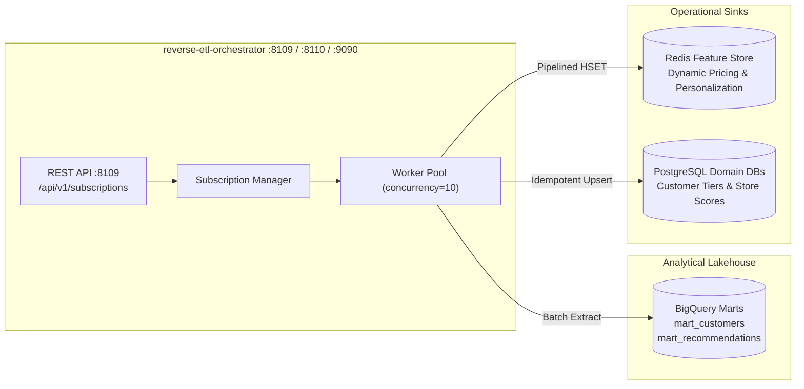

# Reverse ETL Orchestrator Service (`reverse-etl-orchestrator`)

> **Role:** Orchestrates analytical data activation by synchronizing BigQuery data products into operational datastores (Redis feature caches, PostgreSQL domain databases).

| Attribute | Value |
|---|---|
| **Language / Runtime** | Go 1.25.0 (`toolchain go1.25.1`), static binary |
| **Ports** | `8109` (REST API) · `8110` (Health Probes) · `9090` (Prometheus Metrics) |
| **K8s Container Port** | `8080` (mapped in `deploy/helm/values.yaml`) |
| **Upstream Data Source** | Google BigQuery analytical marts (`data-platform/dbt`) |
| **Operational Sinks** | Redis Cluster (feature hydration), PostgreSQL operational DBs |
| **Health Checks** | `http://localhost:8110/health`, `/health/live`, `/health/ready` |
| **Metrics** | `http://localhost:9090/metrics` |

---

## 1. High-Level Design

---

## 2. API Reference (Port 8109)

| Method | Endpoint | Description |
|---|---|---|
| `GET` | `/api/v1/subscriptions` | List all active data product sync subscriptions |
| `POST` | `/api/v1/subscriptions` | Register a new BigQuery-to-operational sync job |
| `GET` | `/api/v1/subscriptions/{id}` | Get subscription metadata and last sync run status |
| `POST` | `/api/v1/subscriptions/{id}/activate` | Trigger an immediate ad-hoc sync cycle |
| `DELETE` | `/api/v1/subscriptions/{id}` | Deactivate or archive a subscription |

---

## 3. Operational Runbook

See [`runbook.md`](runbook.md) for incident triage, BigQuery quota exhaustion handling, and sync lag remediation.
